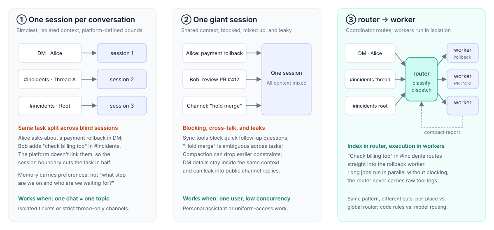
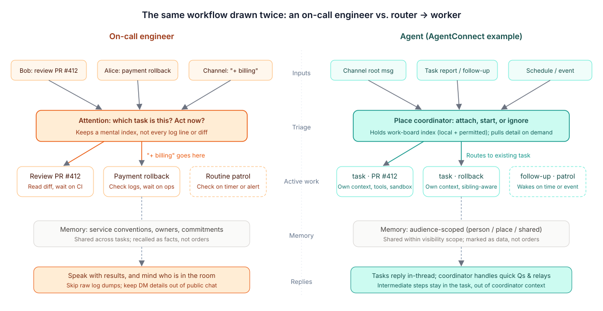
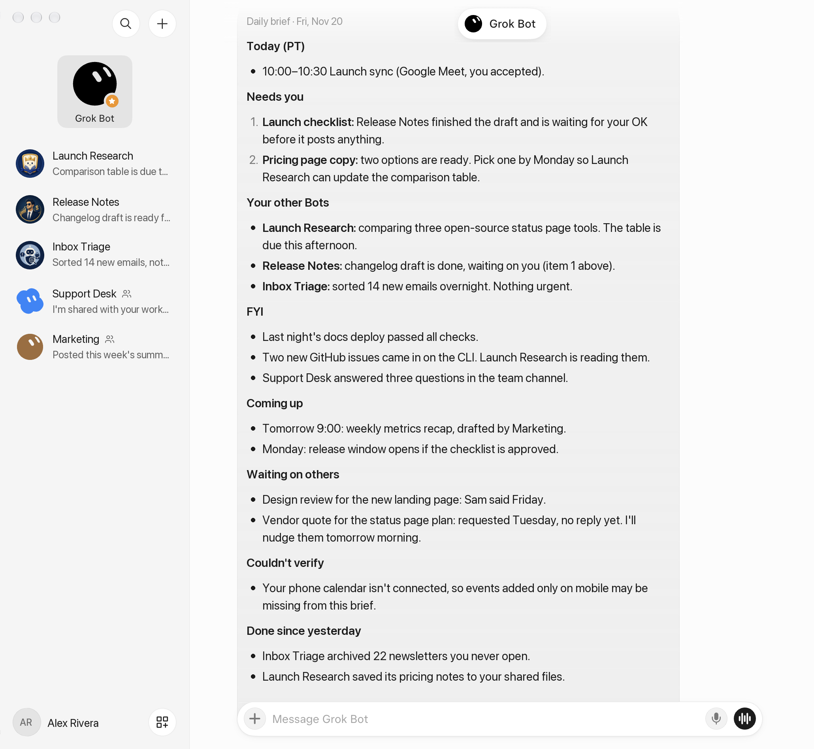
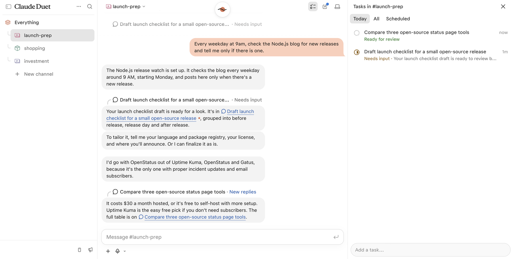
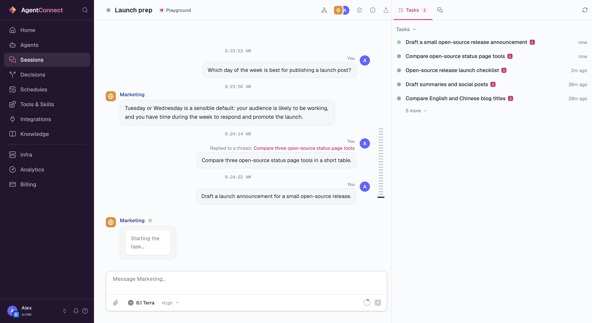



**收录说明**：直接下载，图片收入 images/；相对链接改为绝对地址。经 Hacker News 检索发现。作者是开源编排平台 AgentConnect 的团队，文中把自家产品列为比较对象之一。站点另有官方中文版，记入 altUrls，存档用英文版。删去站点导航、栏目与阅读时长、作者头像、文末的话题标签、页内目录、推荐阅读和产品推广。原文全文存于本目录的 original.md，网站上不显示，已翻译。

**内容摘要**：文章依据公开文档与代码、第三方上手评测和自己的使用，比较 DeepSeek 的 `dsh-superagent`、xAI 的 Grok Bot、Anthropic 的 Claude Duet 与 AgentConnect 如何把常驻智能体拆成协调与执行两层；Claude Tag 作为「一个对话一个会话」的基线，Muse 与 Dots 作为参照。四者的差别在于协调者看到的范围多大、不带执行日志时怎样恢复任务状态，以及多人共用频道时怎样防止跨权限泄露。关于 Duet，文中写它的界面顶部是主对话 Everything，下面是用户建的主题频道，共享同一份记忆，任务按状态分组；作者在预览账号中看到 Everything 的 Scheduled 标签页默认有两项周期任务：每天五次的 Check-in 和每天一次的 Morning brief。作者说明没有做统一的跨产品基准测试，Duet 的内部架构未公开，相关部分是根据界面和行为推断。

**保留理由**：已收资料中少见的跨产品架构比较，含 Claude Duet 预览账号里的默认定时任务等观察；出自同类产品的厂商，比较时需留意立场。

---

常驻智能体如何拆分路由、执行与权限

对 dsh-superagent、Grok Bot、Claude Duet 及其他实现的比较研究。

The AgentConnect team

比较 · 2026-11-23

一旦你把 agent 放进团队的聊天工具，一件工作很少只停留在一个线程里。上下文会散布在私信、频道和回复中，同时还有几件互不相关的任务在并行运行。常见的应对是把消息协调与任务执行拆开：路由层（router）决定一个进来发生的事件属于哪件工作，执行层（worker）在各自的上下文中执行每项任务。本文中，*会话*（session）指一段持续处理消息的模型上下文，*常驻智能体*（always-on agent）指随时间持续接收事件并跟进工作的 agent。

我们研究了来自公开来源的三份外部实现：DeepSeek 的 `dsh-superagent`、xAI 的 Grok Bot 和 Anthropic 的 Claude Duet，并把它们与我们自己的开源平台 AgentConnect 做了比较。这四者并不处在同一层。`dsh-superagent` 是基于 DeepSeek Harness 构建的、采用 MIT 许可的研究原型；Grok Bot（涵盖个人 Bot 与 Team Bot）和 Claude Duet（目前仅支持单用户）是 xAI 和 Anthropic 的托管 agent，为每位用户配置一台云虚拟机；AgentConnect 是一个开源的多平台编排层。四者在把协调与执行拆开这一点上方向一致。它们的差异在于四个实际决策：协调者覆盖多大范围，在不拖入执行日志的前提下怎样回忆起任务状态，怎样处理拆分带来的故障模式，以及多人共用一个工作区时怎样防止跨权限的上下文泄露。

文中还出现几件作为参照的产品。Anthropic 的托管 Slack 功能 Claude Tag 是我们「一个对话一个会话」的基线示例（即便它正在向频道级路由演进），因此不列入四方比较。OpenAI 的 Dots 和 Meta 的 Muse 也属于托管个人 agent 这一类，界面更简单，围绕一个主聊天加一张状态表构建，文中在相关设计选择处会提到它们。Anthropic 2026 年 11 月 13 日的工程文章[*构建常驻智能体*](https://claude.com/resources/articles/building-always-on-agents)讲的是通用做法，从未点名 Duet，但它关于计划、自动模式审核、凭据代理、敏感操作批准关口以及少说话的建议，都出现在 Duet 的安全文档里，因此我们在相关处引用它。所有来源都来自公开仓库、文档、讲座和第三方上手评测（仓库与文档于 2026 年 11 月 20 日核对，Claude Duet、Dots 和 Muse 于 2026 年 11 月 21 日核对），链接收集在文末。

## 最简单的基线：一个对话一个会话

把 agent 接进 Slack 最显而易见的做法是一个对话一个会话：每个私信一个，每个线程一个。实现直截了当，边界清晰，会话键就是 `platform + channel + thread`。AgentConnect 最初按线程的默认方式就是这样运作的，后来我们才加入经由协调者路由的 Auto 会话模式和 Assistant 模式。Claude Tag 也是同样的形状。其[文档](https://claude.com/docs/claude-tag/concepts/how-it-works)说明，在频道顶层 @ 提及 `@Claude` 会把消息交给该频道自己的会话；需要调查、工具或多轮交互的工作会开启一个绑定到该消息下线程的 worker 会话。同一频道里的两个线程是两个会话，各有独立的沙箱，彼此不直接共享状态。

问题在于，彼此隔离的会话对对方一无所知。假设工程师 Alice 在私信里让 agent 调查一次支付服务的回滚，她的同事 Bob 在 `#incidents` 里留言：「也查一下账单服务。」现在一次调查分散在两个各自独立的会话里。长期记忆可以存下约定和偏好供以后的会话读取，但除非有东西主动跟踪任务进度，记忆无法可靠地回答「回滚进行到哪一步了，我们在等谁？」

在这种布局下要跨对话接手工作，需要线程之外的任务记录或状态同步。Claude Tag 通过频道记忆和回溯（look-back）在会话之间架桥：被要求回溯时，它能列出该频道的既往会话并阅读其记录，但不能跨会话做全文检索，所以你得提供时间范围或话题。Claude Tag 也正走向频道级路由：[2026 年 8 月的更新](https://claude.com/blog/claude-tag-now-reads-even-more-of-the-room)之后，它读取整个频道，并对每条消息判断是直接回答、开一个线程、转到正在进行的工作，还是保持安静。

即便有状态同步，平台的对话边界也很少与团队实际的说话方式吻合。你在一个线程里回复，同事却在频道根下补充一句。反过来，一个线程也可能在一个下午里漂移到三个互不相关的话题上。要让一项任务保持完整，就需要一次路由决策：这条来自别处的新消息，属于正在进行的工作吗？

## 把所有东西倒进一个巨大的会话

另一个极端是把每条消息都灌进一个长期运行的会话。默认一切共享同一个上下文，于是 Alice 关于回滚的私信和 Bob 在 `#incidents` 的补充立刻连上了。

但一切也会互相碰撞。如果工具调用在循环内同步执行，Bob 关于某个 PR 的简短提问就要等回滚脚本跑完（异步工具执行能缓解阻塞，但缓解不了其余问题）。交错的消息还会造成串扰：如果有人在某个频道里发「指标稳定之前先别合并」，模型很容易把回滚分支和另一个进行中的 PR 搞混。随着上下文增长，压缩或把历史卸载到磁盘成为必需，而粗糙的摘要会丢掉早先的约束条件。更糟的是，敏感的私信讨论留在同一个上下文窗口里，可能渗入公开频道的回复。对于一个并发低、权限统一的单用户来说，一个巨大的会话足够简单。在繁忙的多用户工作区里，你最终还是得外挂调度、任务跟踪和隔离。

Anthropic 的工程文章建议从一个队列开始：事件不直接调用 agent，而是落入收件箱，由一个后台 worker 一次处理一个。它建议先做到每个用户一个收件箱，只在需要更多并行时才进一步拆分。（这里的「worker」指队列消费服务，不是下文讨论的按任务划分的 worker。）文章没有规定在那之后怎么拆；router → worker 是其中一种具体做法。

router → worker 的拆分把接收消息与做工作分开。router 对进来的事件分类并按需分派；worker 在隔离的上下文中并行推进任务。协调者通过任务索引和简短报告跟踪进度，只按需拉取完整细节，而不是把原始工具输出带在自己的上下文里。router 是确定性代码还是 LLM、覆盖一个对话还是所有来源，正是四份实现分道扬镳之处。

## 这种拆分为什么像一个值班工程师

设想一位值班工程师同时应付三件事：调查一次支付回滚、评审 PR #412、留意例行巡护。当同事在聊天里发「也把账单服务包括进来」，第一步是注意与分流：认出这条留言属于回滚，而不属于 PR #412。

每一项都有一个精简的状态：回滚在等运维确认，PR 在等 CI，巡护只需按计划看一眼。记住这些状态并不意味着要在工作记忆里保留每一行日志和每个 diff 片段。运维一发出「指标看起来干净了」，工程师就接起回滚并把它收尾。

把这映射到 agent 上，分流这一步就是 router，而脑中那份活跃事项清单就是任务索引。每件工作在一个 worker 中运行，各有自己的上下文，所以中间步骤留在本地。记忆保存持久的事实（服务约定、偏好、归属），与跟踪什么被阻塞、在等谁的任务状态协同工作。

右侧以 AgentConnect 作为一个具体例子：任务在自己的线程里直接回复，协调者回答简单问题并转达在别处产生的结论。`dsh-superagent` 做了相反的选择，把回答、结果和追问都经由 Router 传递，Worker 只发一个简短确认。这个类比解释了并发协调，但出口规则和边界在各实现之间差异很大。

## `dsh-superagent` 内部：拆解 Router 与 Worker

在四种设计中，DeepSeek 的 `dsh-superagent`（2026 年 10 月 31 日开源）是唯一有公开原型源码、配套设计文章和消融实验数字的。因此适合先在这里审视 router → worker 系统的各个部件，再比较另外三者如何替换这些部件。

[`dsh-superagent-prototype`](https://github.com/deepseek-ai/dsh-superagent-prototype) 是 DeepSeek Harness 的一个套件，它监视一个 GitHub 仓库，并能连接飞书。进来的工作会创建一个工作项，在自己的会话和目录中运行，并向原对话汇报。其 README 说明这是研究代码，部分地方与 DeepSeek 内部版本及配套文章（[*探索超级智能体设计：走向更自主的智能体系统*](https://x.com/DeepSeekHarness/status/2116857257245987236)，2026 年 11 月 1 日发布；[中文原文](https://mp.weixin.qq.com/s/zoS7GlReWPhfCjENGxXCdg)，2026 年 10 月 31 日）不同。下面每一处实现细节都直接对照开源代码核对过。

在代码中，Router 是 `orchestrator`，Worker 是 `worker`。三个核心对象组织状态：**Ticket**（一件工作）、**Trigger**（一个进来发生的事件）和 **Thread**（同一 PR、IM 话题或邮件链上的一串事件）。

Router 是一个长期存活的 LLM 会话，可以运行与 Worker 不同的模型。在开源代码中，Router 保留 shell 和只读文件工具，同时去掉文件写入、子 agent、网络搜索和调度等重型工具。为避免慢命令阻塞进来的事件，Router 和 Worker 上的前台命令与任务等待在 5 秒后自动转入后台，并在完成时用一条新消息唤醒会话；代码还明确阻止 Router 执行 `sleep` 或长时间等待。

所有状态都存在 SQLite（`trigger`、`thread`、`ticket`、`decision`、`outbox` 及相关表）中，而不是存在 Router 的提示历史里。协调者通过按资源路径寻址的分页读取工具按需拉取上下文，过大的 Worker 报告会被截断并附上读取指针。这实现了配套文章中的 *Chain of Recall* 和 *Inline & Spill* 模式，把上下文窗口当作缓存。

排在同一 Thread 上的 Trigger 会合并成一个评估批次，一次 Router 工具调用可以对多个候选项分别赋予 `accept`、`attach`、`ignore` 或 `stop`，这样一个拒绝不会让整批失败。Anthropic 的文章给出同样的批处理建议：用户连续发几条消息时，agent 应只回复一次。

Router 处理冷启动和跨任务协调，而不是稳态的闲聊。一旦某个 Ticket 订阅了某个 Thread，后续消息就跳过 Router 评估，直接分发给 Worker（在未被手动停止的已结束 Ticket 上，人类消息会自动恢复它）。人类的追问只向 Router 发一条无需决策的通知，除非此人要求 `stop`；如果 Worker 判断某条消息超出其 Ticket 的范围，它会把该事件交回引擎重新评估。Thread 与 Ticket 是多对多关系：订阅同一 PR 的多个 Ticket 都会收到新评论，Router 也可以把一个 Ticket 的发现作为备注传给另一个 Ticket。

代码强制执行出口规则。投递回答、结果和追问的回复工具只挂在 Router 上，并位于引擎状态门控之后：例行的进度更新留在内部 Ticket 日志里，不唤醒 Router；只有已完成或就绪的工作、对明确提问的回答，或 Worker 发出的结构化确认请求，才会到达 Router 对外投递。Worker 自己在开始工作前只发一个简短确认（按触发器去重，重启后依然有效），其余都在内部汇报。在飞书这类 IM 出口上，outbox 代码还强制执行 100 词硬上限（按分词后的词数计，包括链接），超长的一律拒绝。

准入门槛遵循同样的代码优先模式。监视范围、按平台的允许列表（不做跨平台身份映射），以及「在允许列表 × @ 提及」的矩阵，都在确定性代码中运行，对应关闭、仅观察和自动接受三种模式。只有通过这些确定性门控、仍需语义判断的候选才到达模型。

开源原型没有实现投机执行，尽管 DeepSeek 的文章讨论了这一想法：当一个群还在争论某个 bug 时，agent 在后台复现并尝试修复，只有在确认问题并找到干净的修复时才投递，否则保持沉默。

## 路由如何看到全局

一旦工作被分派出去，新消息仍不断到来。router 需要知道什么在运行、归谁负责，好让追问落到正确的地方。`dsh-superagent` 把这个索引存在 SQLite 里；另外三者用不同的方式解决。

**Grok Bot** 的公开文档描述了 Bot 层：记忆按 Bot 隔离，而云计算机、私有技能和已连接应用在同一个用户的各个 Bot 之间共享。每个用户有一个主 Bot，负责主动检查并协调他的其他 Bot。

一个对话内部的拆分来自 Lee Robinson 的斯坦福 CS146S 讲座。入口路由对事件去重，把每个事件分配到一个对话，并决定是否打断用户。事件进入队列，一次执行一轮，把连续发送的消息合并成一轮。本人的消息优先，并抢占正在运行的循环；群聊、Slack 线程和后台例程在队列后面等待。在对话内部，主 agent 充当编排者，保持自己的线程精简，把重型工作交给只返回结果的 helper（子 agent）。主 agent 维护一份待办清单，用来检查进度、给 helper 发消息或停止它们。

讲座还概述了主 agent 的几层上下文裁剪：长输出写入文件而不是放进上下文；截图之类昂贵的工作交给 helper；趁提示缓存还热时压缩旧消息；记忆分为始终加载的核心事实、按日期归档的对话日志和草稿笔记，其余一切按需从磁盘读取。

**Claude Duet** 把这种拆分直接放进产品界面。最上方是 **Everything**（一切），即主对话，相当于 Grok Bot 的主 Bot。下面是用户创建的主题频道，每个都像一个独立的 Bot，有自己的对话和任务列表。Everything 的任务列表汇总所有频道的任务，并标出来源频道，你还可以直接从 Everything 驱动其他频道中的任务。与 Grok Bot 不同，各频道共享一份记忆。任务按状态分组，并带一行状态说明，如 `Ready for review`（待审阅）、`Needs input`（需要输入）或 `Resolved`（已解决）。主对话只在任务完成或需要决定时发言，且只有用户才能把任务标记为已解决。

Duet 的内部架构没有公开，但把 Duet 与 Claude Code Projects 并用可以看出它们共享同一套交互模型：选一个对话（Projects 里是项目，Duet 里是频道），与一个协调者对话，并在旁边看一份按状态分组的工作清单（Projects 把线程分为 Ready for review、Waiting on you、Working、Landing、Idle 和 Resolved）。Projects 的[文档](https://code.claude.com/docs/en/claude-projects)说明，协调者为每项工作开一个线程（默认是云会话），并且只读线程的报告，而不读每一步。从界面和行为判断，Duet 的频道对话扮演同样的协调者角色，每个任务则是一个独立推进的 worker 线程。

Duet 与 Projects 的差别在于主动性，它位于同一任务面板的 `Scheduled`（已排期）标签页下。在我们的预览账号中，Everything 的 `Scheduled` 标签页自带两项默认周期任务：每天运行五次的 Check-in（检查）和每天一次的 Morning brief（晨报），两者都支持手动运行、暂停和运行历史。单个后台任务在执行期间在主线程中保持安静，而定时的 Check-in 会在一天中提示更新、跟进沉寂的事项，并发布带 `Start`（开始）按钮的建议。技能和已连接应用也会从用户的 Claude 账号沿用过来。

**Muse 与 Dots** 把界面做得更简单：一个主聊天加一个状态视图。Muse 在 Goals 页列出活跃事项，每个目标带一行状态；Dots 在分为进行中、已排期和已完成的活动列表里给每个任务一个独立线程。两者都不直接暴露执行单元。

**AgentConnect** 把一块实时工作板注入每个场所（频道、私信或网页聊天）的协调者上下文，按最近活动排序，分为当前场所的任务和其他场所可见的任务。工作板只携带精简索引（类型、状态、标题和发起人），并只在变化时重发；摘要和细节按需拉取。协调者忙碌期间到达的任务报告不会另起一轮，而是等下一批，与人类消息一起处理。

四种设计都把执行细节挡在协调上下文之外。差别在于如何恢复状态：`dsh-superagent` 和 AgentConnect 维护系统管理的结构化索引，由 router 按 ID 查询；Grok Bot 的主 agent 依靠一份待办清单加摘要，以及按需读文件；Duet 把状态表做成了产品界面本身，Muse 和 Dots 也是如此。

## 范围、执行单元与回复出口

|  | dsh-superagent（开源原型） | Grok Bot（托管 SaaS） | Claude Duet（单用户主动 agent） | AgentConnect（开源编排层） |
| --- | --- | --- | --- | --- |
| 谁回复 | Router 投递所有回答、结果和追问（引擎状态门控，IM 上 100 词硬上限）；Worker 只发简短确认，其余都进内部报告 | 主 agent 通过单一的 `send user` 工具回复；helper 只把结果返回给主 agent | 任务完成或需要决定时由主对话发言；中间进度和提示留在任务列表里 | 协调者回答简短消息，并为需要动手的工作开启任务；任务在自己的线程里回复，协调者转达在别处产生的结果 |
| 协调范围 | 每个 agent 一个 LLM Router，覆盖所有来源；先由确定性代码过滤，订阅线程的事件直接分发给 Worker | 入口路由对事件去重并分配到对话；上下文按对话隔离（应用聊天、Slack 线程、群聊），同时共享该 Bot 的记忆和计算机 | Everything 是主对话，可查看并驱动所有频道中的任务；每个频道有自己的聊天和任务列表，共享记忆 | 每个场所（频道、私信、网页聊天）一个协调者，通过工作板看到当前请求者有权限查看的其他场所的任务 |
| 执行单元与运行时 | 一个 Ticket = 一个会话和一个目录；Worker 持有 Thread 订阅 | helper 在用户的云计算机上运行，每个 Bot 各有一块屏幕 | Duet 的云 VM 上每个任务一项；内部分层未公开，界面与行为同 Projects 的线程一致 | 一个任务 = 一个运行在消息线程中的会话；需要独立空间时可开专用的 Slack 频道 |
| 主动跟进 | 线程订阅与关联 PR 跟踪；人类的追问直接进入 Worker，Router 只收到允许 `stop` 的通知；Worker 把超出范围的消息交回重新评估 | 例程（定时或事件驱动）和主 Bot 的检查会唤醒 agent；本人的消息优先，并抢占后台工作 | 默认的定时 Check-in（当前预览版每天 5 次）和每日 Morning brief；Check-in 在一天中提示更新并跟进沉寂事项 | 跟进按计划或事件唤醒，做只读检查，需要行动时发出批准提案卡片；专用频道中的任务每轮都汇报，协调者定期检查沉寂任务 |
| 在哪里运行 | 宿主 harness 进程内的插件 | 每位用户一台常驻云 microVM，由该用户的 Bot 共享 | Anthropic 管理的云 VM；用户设备不必保持在线 | 自托管守护进程或托管池，带按 agent 的沙箱策略 |

把回复集中到一处有明显的取舍。让所有对外回复都经协调者，可以严密控制语气和节奏，代价是所有输出都挤过一个瓶颈。`dsh-superagent` 和 Grok Bot 都走这条路（即便 `dsh-superagent` 允许 Worker 发简短确认、并在代码中把 IM 回复限制在 100 词，高并发时仍可能在 Router 后面排队）。Duet 把中间更新下放到任务列表，使主对话只承载结论和决定。AgentConnect 走中间路线：任务在自己的线程里直接回答，避免协调者成为瓶颈，同时由协调者转达在别处产生的结论（例如后台运行或移到专用频道的任务），代价是牺牲了声音的统一。

决定*是否*开口，和决定*谁*开口同样重要。Anthropic 的文章把「决定不发消息」列为一轮对话三种结束方式之一（另外两种是发消息，以及因等待用户输入而挂在工具调用上），并建议团队从安静开始，用评估来调整频率。Grok Bot 的路由同样判断进来发生的事件是否值得打断用户。沉默也有自己的故障模式：一位评测者指出，由于 Duet 在任务摆着没动时保持安静，他干脆忘了还有未完成的工作。DeepSeek 的投机执行想法处在同一设计空间：除非确认了 bug 并且有简单修复，否则完全保持安静。

协调范围在全局可见性与上下文隔离之间构成一个谱系。`dsh-superagent` 使用确定性过滤 → 一个全局 LLM Router → Worker，开箱即有整个工作区的感知。Grok Bot 和 Duet 用两层，按对话或频道切分上下文，顶上用一个主 Bot 或 Everything 跨它们协调。AgentConnect 在代码中按线程路由，给每个场所自己的协调者，并借助工作板重建跨场所的感知。

把协调与执行拆开，也会带来在单个会话里从不会出现的故障模式。构建 AgentConnect 时浮现了三个：

- **同一频道中的兄弟任务撞车。** 针对共用一台主机的两个服务，两条警报相隔几分钟到达。分派时它们看起来毫不相关，于是协调者开了两个任务。两者都在调查同一次故障，改了同一份配置，并请求批准，直到其中一个回话说「已经有人把修复上线了」。我们在每个任务的上下文里加入了同一频道中活跃的和最近碰过的兄弟任务，并要求 worker 在修改共享资源前先检查。然而即便提供了细节读取工具，测试中的 worker 仍然相信分派时的过时背景而跳过读取，所以我们不得不把每个兄弟任务的最新一行状态直接内联进列表。即便如此，两个任务几乎同时启动、在任一个写下发现之前（或者同一频道里还有另一个 agent 在工作），仍可能撞车。
- **直接回复掉出跟踪链。** 让协调者直接回答简短消息，可以避免为每一句问候都开一个任务。但在测试中，每当协调者随口问了一个需要人来确认的问题却没开任务，对沉寂任务的定期检查就无从跟踪。我们不得不加一条提示规则：如果需要有人的回复，就开一个任务。
- **报告批处理以延迟换取更少的轮次。** 协调者忙碌时把任务报告排进下一批，可以避免另起孤立的轮次，代价是查看该线程的人看到的状态更新略有延迟。

## 增加路由层的协调开销

增加一层路由会增加模型调用；隔离 worker 的上下文可以砍掉堆积如山的无关历史。总 token 数、实际的美元成本、实际的完成耗时是三个不同的指标，光盯着架构图看不出哪种方案胜出。

四种实现中只有 DeepSeek 公布了受控的数字，在其[配套文章](https://mp.weixin.qq.com/s/zoS7GlReWPhfCjENGxXCdg)的第 7 节（[英文版](https://x.com/DeepSeekHarness/status/2116857257245987236)）。那些运行使用一个**合成工作负载**（约 300 条消息、约 20 个工作请求），其中任务执行由定时的桩（stub）模拟，每种变体重复 5 次，数据集未公开。它们展示的是特定机制的方向性影响，并不对四个产品在真实世界中的成本排序。

在吞吐与批处理实验中（第 7.2 节），把需要决策的 Trigger 到达率从约 1 次/分钟提高到约 40 次/分钟，平均批大小从 1.0 增至 2.8，每次决策摊薄的推理时间从 6.4 秒降到 1.6 秒。在该设置下，批处理摊薄了路由时延，但这并不意味着端到端的消息时延或美元成本按同样比例下降。

直接路由的消融实验更能说明问题。去掉「把订阅线程的事件直接分发给 Worker」之后，任务完成时间不变，Router 决策增加约 30%，缓存读取从 23.23M token 升到 31.77M token，跃升约 37%。在该测试中，跳过冗余的路由调用明显削减了协调时的缓存读取；至于索引布局或报告批处理各能省多少，无法从这些数字中分离出来。

完成时间也出现分化。论文报告超级智能体设计的 p50 为 12.4 分钟、p95 为 15.7 分钟，而在中性提示下带子 agent 工具的单个会话 p95 为 29.5 分钟（p50 和 p95 即第 50 和第 95 百分位）。在这些定时桩运行中，多会话执行完成得更快，尽管缓存读取仍可能超过单个会话。

如果你想审计自己系统中的协调开销，就端到端追踪一条消息：它是否触发了额外的一轮路由，协调者是否在反复重读完整的执行日志，每一次进度提示是否都唤醒了一次长上下文调用？理想情况下，router 看起来应该像「可缓存的长前缀 + 极小的路由输出」。削减冗余路由、整份日志重放和孤立提示，通常是压低协调税的办法。到了算钱的时候，要在任务成功率相当的前提下，结合实际模型定价，测量输入 token、缓存读取、输出 token 和端到端时间。

## 一旦多人共用频道，权限决定路由拓扑

在共享的团队工作区里，准确分派工作只是任务的一半。router 还得回答一个更难的问题：我能把发现告诉*这个人*吗？

私信里讨论的生产环境漏洞，不能在别人于公开频道提问时浮现出来。在私有频道中运行的任务，不应在有人在 `#general` 里问「大家都在忙什么？」时出现。一位外部访客询问正在进行的工作时，应只看到属于其共享频道的内容。

Anthropic 的文章把权限称为常驻智能体中风险最高的部分，重点放在执行层：每次唤醒都以用户权限无人值守地运行，所以凭据应由 agent 环境之外的代理注入，敏感工具调用应挂起等待批准。这回答了「这次工具调用可以运行吗？」多用户工作区还带来第二个问题：是谁在问，他可以看什么，以及怎样阻止进入长期运行上下文的信息泄露给下一个人？

如果每个用户的读权限都相同，一个全局 LLM router 会很方便。但单租户并不意味着权限统一：同一家公司里仍有私信、私有频道、外部访客和不同角色。一旦这些边界存在，权限就不能只当事后过滤器；它直接决定你如何切分 router。

下面是我们如何在 AgentConnect 中拆分这些层，之后再看其他设计如何划界。

**先按场所切分拓扑。** AgentConnect 不在整个工作区上运行一个全局 LLM router，而是给每个场所（频道、私信、网页聊天）自己的协调者。私信和私有频道的记录根本不会进入公开频道的上下文。取舍很清楚：你放弃了全局 router 自带的全知，改以工作板索引和按需读取重建跨场所的感知。

**在工作板和批处理中执行权限。** 工作板上出现哪些任务，取决于当前请求者对每个任务来源的读权限；来自私信、群组私信和私有频道的工作绝不会泄露到别处。在既有组织成员又有外部访客的共享频道里，不同权限级别的消息不能合并进同一轮。系统也不会在混合批次中借用更高权限成员的身份读取额外上下文，因为取回的文字会留在该轮的上下文里，可能影响同一批中对访客的回复。

**按需拉取细节，而不是推送。** 工作板只列精简索引。协调者需要细节时，按当前请求者的权限按需读取；worker 的记录绝不会以原始形式推入协调者的上下文。

即便有这三层，长期存活的会话仍留下一个只靠读取时授权无法弥合的缺口：已经拉进上下文的信息，不会因为下一轮来自另一个请求者、有人退出私有频道，或频道转为私有而消失。撤销权限只阻止*下一次*读取，而不阻止已经留在历史里的片段。要在复用的上下文中让摘要、报告和回复保持在其原本的可见范围内，需要场所隔离、按权限拆分批次，以及对摘要和回复边界持续施加约束。

**记忆也按受众切分。** AgentConnect 把记忆分为三层：`person`、`place` 和 `shared`。写入按对话的受众落位：经核实只含组织成员的公开频道写 `shared`，一对一私信和网页聊天写 `person`，其余（私有频道、外部群聊）写 `place`。读取最多取 `shared` 加当前对话自己的那一层（`person` 或 `place`，绝不同时取两者），注入的记忆会标记为参考数据而非指令。

其他实现划的线不同：

- **Grok Bot** 主要按人隔离。每位成员与 Team Bot 的聊天保持私密，连 Bot 的所有者和 Manager 也读不到。在共享的 Slack 频道和线程中，Bot 默认使用所有者已连接的应用，使用请求者自己的账号前会征求同意，并且只让请求者本人处理批准。记忆按 Bot 隔离；由 Collaborator 传授的团队知识会先存为建议，直到所有者或 Manager 批准，而个人细节留在各自的聊天中。执行也拆开：个人聊天在各成员自己的云计算机上运行，共享对话则在该 Bot 的另一台机器上运行。
- **Claude Tag** 不在四方比较之内，但面对同样的多用户 Slack 环境。管理员把访问范围限定到整个 Slack 组织、某个工作区或特定频道。其发布文章给出一个明确的例子：为销售团队设置的 Claude 身份不会把记忆传给工程团队，不会向工程师暴露销售数据或工具，也不会转达私有频道的内容。
- **Claude Duet** 目前只服务单个用户，且不支持 Team 或 Enterprise 套餐，因此不涉及多用户可见性。它文档中写明的控制位于执行层，与 Anthropic 的工程文章一致：发送消息、付款、签署文件或删除数据需要用户批准；证券交易和账户间转账即使批准也不允许；操作经过自动模式分类器（auto-mode classifier）；凭据处理遵循 Claude Managed Agents，使 agent 从不直接接触密码或登录令牌。值得注意的是，其安全文档说明，断开外部应用会立即撤销未来的访问，但已经提取进记忆的事实不会被自动删除，必须手动移除——这与撤销权限不清除已有上下文或记忆是同一类边界问题。
- **Muse** 同样是单用户，重点在执行层：agent 在隔离沙箱中运行，看不到真实凭据，所有对外请求和连接器调用都经过一个名为 Sentinel 的外部代理组件，在出口处注入凭据。批准是按范围授予的许可（一次、本次会话、本任务、限时或永久），直接渲染在客户端界面里，而不是聊天里。
- **Dots** 可以连接 Slack，但只回应其所有者：其他人的私信或 `@` 提及不会触发工作，目前也没有共享的多用户 dot。
- **`dsh-superagent`** 的开源代码维护按来源的允许列表和监视范围，明确不做跨平台身份映射，也不含按请求者的可见性过滤（其 README 说明开源原型与内部版本不同）。

在多用户的团队中，给 router 一个全局视野只是开局的第一步。真正决定架构如何切分的，是在不污染长期运行上下文的前提下守住可见性边界。

## 结论

当一项任务横跨多个对话时，agent 需要存在于任何单个线程之外的任务记录。当多项任务并行运行时，协调者不应背负每个 worker 的执行日志。router → worker 是拆分工作的可靠做法。真正区分各实现的是四个取舍：协调者拥有多大范围，状态如何按需召回，如何吸收兄弟任务撞车、批处理延迟这类新的故障模式，以及如何在长期存活的多用户上下文中守住权限边界。

本研究依据公开文档与代码、第三方上手评测和我们自己的使用。我们没有做统一的跨产品基准测试，协调开销的数字只适用于 DeepSeek 的合成桩工作负载。如果你正在为团队构建或采用常驻智能体，请把权限端到端走一遍（跨越任务索引、按需读取、复用的会话上下文和最终回复），同时考量路由准确性和 token 成本。

AgentConnect 以 Apache 2.0 开源，可自托管或使用托管服务。关于协调者会话、跟进、批准和权限边界在实践中如何运作，参见 [Assistant 模式指南](https://www.agentconnect.md/docs/build-your-team/agents/assistant-mode)；源码在 [AgentConnect 仓库](https://github.com/agentconnect-md/agentconnect)。

## 参考文献

- 通用做法：Anthropic，[构建常驻智能体](https://claude.com/resources/articles/building-always-on-agents)（William Hu，2026-11-13）
- dsh-superagent：[deepseek-ai/dsh-superagent-prototype](https://github.com/deepseek-ai/dsh-superagent-prototype)（2026-10-31 开源，MIT）、[DeepSeek Harness](https://www.deepseek.com/en/harness/)，以及 DeepSeek Harness 团队的文章[探索超级智能体设计：走向更自主的智能体系统](https://x.com/DeepSeekHarness/status/2116857257245987236)（发表于 X，2026-11-01；[中文原文](https://mp.weixin.qq.com/s/zoS7GlReWPhfCjENGxXCdg)，2026-10-31）
- Grok Bot：[概览](https://docs.x.ai/grok-bot/overview)、[聊天与协作](https://docs.x.ai/grok-bot/chat-and-collaboration)、[团队与企业](https://docs.x.ai/grok-bot/teams-and-enterprises)、[发布文章](https://x.ai/news/introducing-grok-bot)、[Team Bots](https://docs.x.ai/grok-bot/team-bots)，以及 Lee Robinson 的斯坦福 CS146S [讲座](https://www.youtube.com/watch?v=L1OBRtfPS34)
- Claude Tag：[公告](https://www.anthropic.com/news/introducing-claude-tag)、[产品文档](https://claude.com/docs/claude-tag/overview)、[工作原理](https://claude.com/docs/claude-tag/concepts/how-it-works)、[2026 年 8 月更新](https://claude.com/blog/claude-tag-now-reads-even-more-of-the-room)
- Claude Duet：[产品页](https://claude.com/product/claude-duet)、[发布文章](https://claude.com/resources/articles/claude-duet)（2026-10-21）、[安全、隐私与保障](https://claude.com/resources/articles/claude-duet-safety-privacy-and-security)（2026-10-23）、[帮助中心](https://support.claude.com/en/articles/17631495)、Claude Code Projects [文档](https://code.claude.com/docs/en/claude-projects)，以及 [Every](https://every.to/vibe-check/vibe-check-duet-anthropic-s-always-on-agent) 和 [ChatPRD](https://www.chatprd.ai/how-i-ai/claude-duet-review) 的上手评测
- Muse：[公告](https://about.fb.com/news/2026/09/introducing-muse-personal-ai-agent/)（2026-09-08）、[工程文章](https://muse.ai/blog/security-and-safety-for-ai-agents-our-approach-with-muse)，以及 [ChatPRD](https://www.chatprd.ai/how-i-ai/meta-muse-review-personal-ai-agent)、[DataCamp](https://www.datacamp.com/tutorial/meta-muse-tutorial) 和 [CNN](https://www.cnn.com/2026/09/23/tech/meta-muse-ai-agent) 的上手评测
- Dots：[公告](https://openai.com/index/introducing-dots/)（2026-09-29）、[帮助中心](https://help.openai.com/en/articles/20001530-getting-started-with-your-dot)，以及[工作区管理](https://help.openai.com/articles/20001554)
- AgentConnect：[GitHub 仓库](https://github.com/agentconnect-md/agentconnect)、[Assistant 模式指南](https://www.agentconnect.md/docs/build-your-team/agents/assistant-mode)、[多 agent 工作模式](https://www.agentconnect.md/docs/build-your-team/agents/multi-agent-work-modes)、[权限概览](https://www.agentconnect.md/docs/operate-govern/permissions-overview)、[Assistant Mode 设计文档](https://github.com/agentconnect-md/agentconnect/blob/main/docs/designs/assistant-mode.md)、[Auto Session Mode 设计文档](https://github.com/agentconnect-md/agentconnect/blob/main/docs/designs/auto-session-mode.md)
