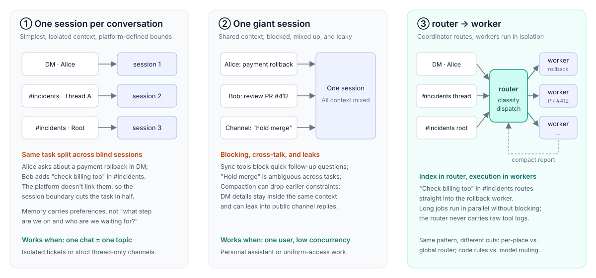
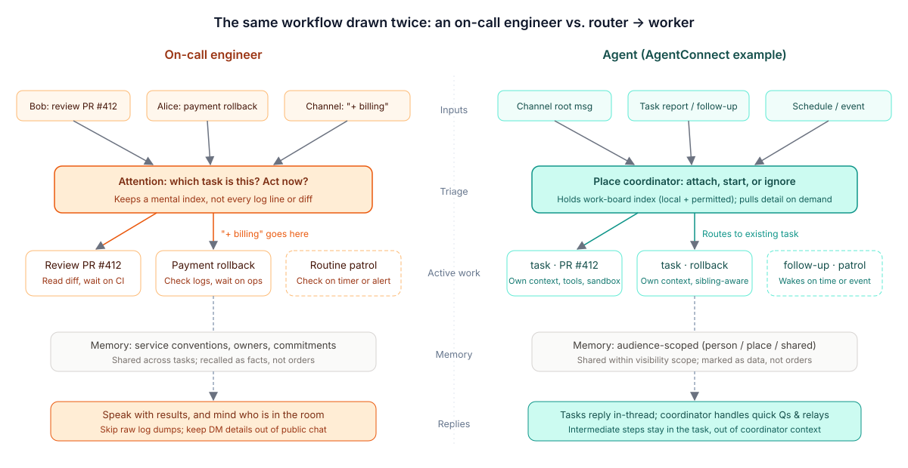
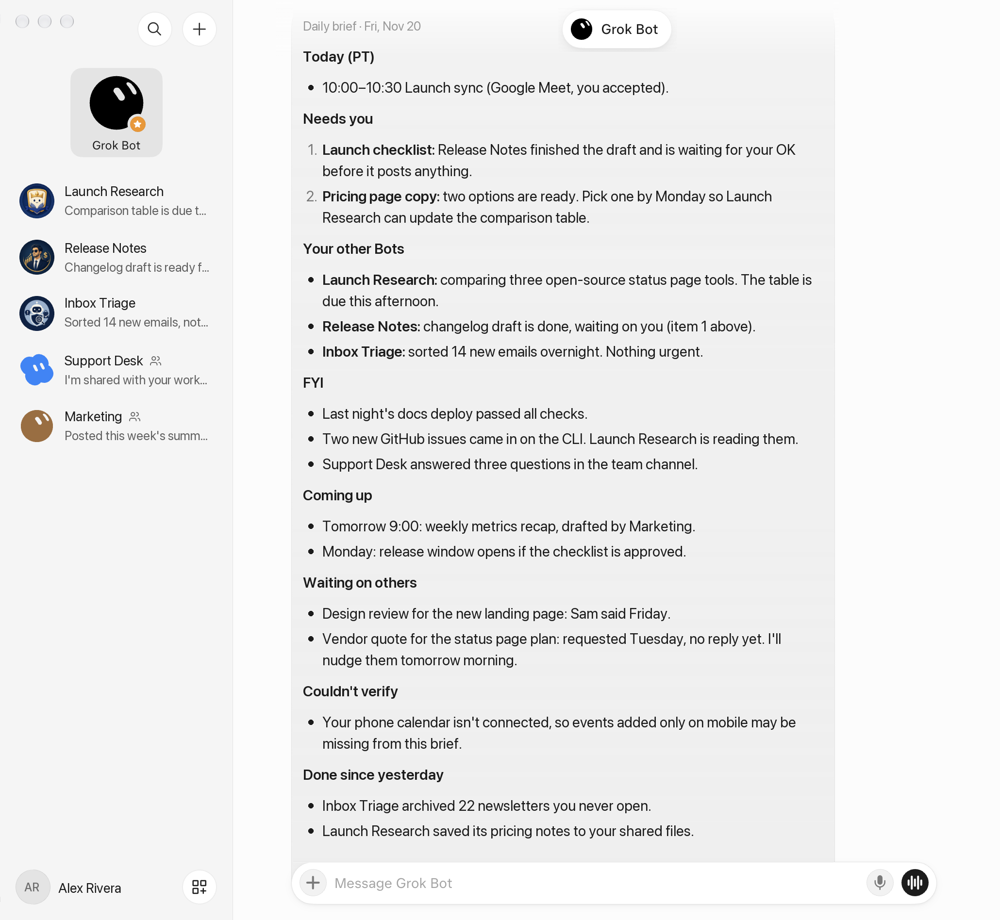
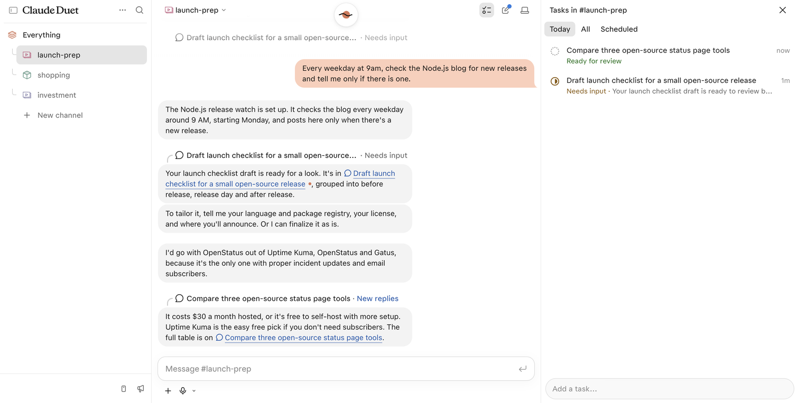
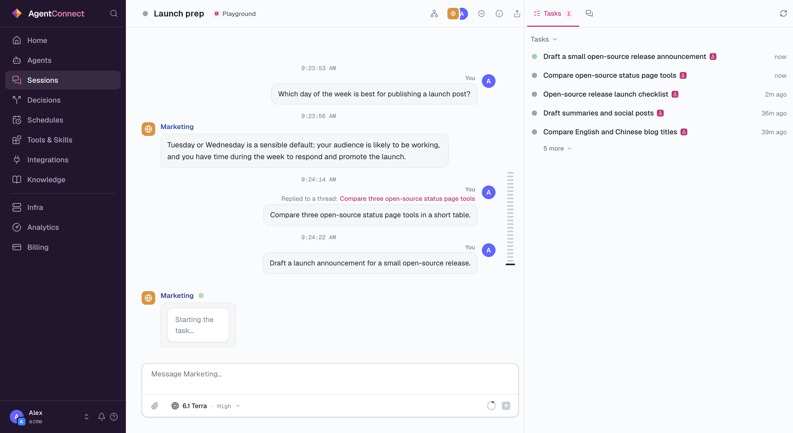

来源：https://www.agentconnect.md/blog/always-on-agents-router-worker/
取文：2026-11-28，直接下载

How always-on agents split routing, execution, and permissions

A comparative study of dsh-superagent, Grok Bot, Claude Duet, and other implementations.

The AgentConnect team

Comparisons · 2026-11-23

Once you drop an agent into a team's chat tool, one piece of work rarely stays in one thread. Context spreads across DMs, channels, and replies while several unrelated tasks run at the same time. A common response is to split message coordination from task execution: a routing layer (the router) decides which piece of work an incoming event belongs to, and an execution layer (the worker) carries out each task in its own context. Throughout this post, a *session* means one continuous model context processing messages, and an *always-on agent* means an agent that keeps receiving events and following up on work over time.

We studied three external implementations from public sources (`dsh-superagent` from DeepSeek, Grok Bot from xAI, and Claude Duet from Anthropic) and compared them with our own open-source platform, AgentConnect. These four do not sit at the same layer. `dsh-superagent` is an MIT-licensed research prototype built on DeepSeek Harness; Grok Bot (covering personal and Team Bots) and Claude Duet (currently single-user only) are hosted agents from xAI and Anthropic that provision a cloud VM per user; AgentConnect is an open-source multi-platform orchestration layer. All four move in the same direction on splitting coordination from execution. Where they diverge is on four practical decisions: how wide a scope the coordinator covers, how it recalls task state without dragging in execution logs, how it handles the failure modes that splitting introduces, and how it prevents cross-permission context leaks when multiple people share a workspace.

A few other products appear as reference points. Anthropic's hosted Slack feature Claude Tag is our baseline example of "one session per conversation" (even as it evolves toward channel-level routing), so it sits outside the four-way comparison. OpenAI's Dots and Meta's Muse also belong to the hosted personal-agent group, with simpler UIs built around one main chat plus a status table, and come up where their design choices are relevant. Anthropic's November 13, 2026 engineering post [*Building always-on agents*](https://claude.com/resources/articles/building-always-on-agents) covers general practices and never names Duet, yet its recommendations on schedules, auto-mode review, credential proxies, approval gates for sensitive actions, and speaking sparingly all show up in Duet's safety documentation, so we cite it where relevant. All sources come from public repositories, documentation, lectures, and third-party hands-on reviews (checked on November 20, 2026 for repositories and docs, and on November 21, 2026 for Claude Duet, Dots, and Muse), with links collected at the end.

## The simplest baseline: one session per conversation

The most obvious way to wire an agent into Slack is one session per conversation: one per DM, one per thread. Implementation is straightforward, boundaries are crisp, and the session key is simply `platform + channel + thread`. AgentConnect's original per-thread default worked this way before we added Auto session mode and Assistant mode, which route through a coordinator. Claude Tag follows the same shape. Its [documentation](https://claude.com/docs/claude-tag/concepts/how-it-works) explains that tagging `@Claude` at the top level of a channel hands the message to the channel's own session; work that needs investigation, tools, or multiple turns opens a worker session bound to the thread under that message. Two threads in the same channel are two sessions with separate sandboxes and no direct state sharing.

The catch is that isolated sessions know nothing about each other. Suppose engineer Alice DMs the agent to investigate a payment-service rollback, and her teammate Bob drops a note in `#incidents`: "check the billing service too." One investigation now lives in two separate sessions. Long-term memory can store conventions and preferences for future sessions to read, but unless something actively tracks task progress, memory cannot reliably answer "what step is the rollback on, and who are we waiting on?"

To pick up work across conversations in this layout, you need task records or state sync outside the thread. Claude Tag bridges threads through channel memory and look-backs: when asked to look back, it can list prior sessions in the channel and read their transcripts, though it cannot run full-text search across sessions, so you have to supply a timeframe or topic. Claude Tag is moving toward channel-wide routing as well: after its [August 2026 update](https://claude.com/blog/claude-tag-now-reads-even-more-of-the-room), it reads the full channel and picks for each message whether to answer directly, open a thread, route to in-flight work, or stay quiet.

Even with state sync, platform conversation boundaries rarely match how a team actually talks. You reply inside a thread; a teammate drops an addendum in the channel root. Conversely, one thread can drift across three unrelated topics in an afternoon. Keeping a task intact requires a routing decision: does this new message from somewhere else belong to work already in progress?

## Funneling everything into one giant session

The opposite extreme is pouring every message into one long-running session. Everything shares one context by default, so Alice's DM about the rollback and Bob's `#incidents` follow-up connect immediately.

Everything also collides. If tool calls run synchronously inside the loop, Bob's quick question about a PR stalls until the rollback script finishes (asynchronous tool execution eases blocking, though not the rest). Interleaved messages also cause cross-talk: if someone posts "hold the merge until metrics settle" in a channel, the model can easily confuse the rollback branch with another open PR. As context grows, compaction or offloading history to disk becomes mandatory, and a sloppy summary drops earlier constraints. Worse, sensitive DM discussions sit in the same context window and can bleed into replies in a public channel. One giant session is simple enough for a single user with low concurrency and uniform permissions. In a busy multi-user workspace, you end up bolting on scheduling, task tracking, and isolation anyway.

Anthropic's engineering post recommends starting with a queue: events do not invoke the agent directly; they land in an inbox processed by one background worker at a time. It suggests starting with one inbox per user and splitting further only when you need more parallelism. (Here "worker" means the queue consumer service, not the per-task worker discussed below.) The post does not prescribe how to split beyond that; router → worker is one concrete way to do it.

A router → worker split separates receiving messages from doing the work. The router classifies incoming events and dispatches them as needed; workers advance tasks in parallel inside isolated contexts. The coordinator tracks progress through a task index and short reports, pulling full details only on demand instead of carrying raw tool output in its own context. Whether the router is deterministic code or an LLM, and whether it spans one conversation or every source, is where the four implementations part ways.

## Why the split looks like an on-call engineer

Picture an on-call engineer juggling three things at once: investigating a payment rollback, reviewing PR #412, and keeping an eye on a routine patrol. When a teammate posts "include the billing service too" in chat, the first step is attention and triage: recognizing that the note belongs to the rollback, not PR #412.

Each item has a compact status: the rollback is waiting on ops confirmation, the PR is waiting on CI, and the patrol only needs a look on schedule. Remembering those states does not mean holding every log line and diff hunk in working memory. The moment ops posts "metrics look clean," the engineer picks up the rollback and closes it out.

Map that onto an agent and the triage step is the router, while the mental list of active items is the task index. Each piece of work runs in a worker with its own context so intermediate steps stay local. Memory holds durable facts (service conventions, preferences, ownership), working alongside task state that tracks what is blocked and who it is waiting on.

The right side uses AgentConnect as one concrete example: tasks reply directly in their own threads, while the coordinator answers simple questions and relays findings produced elsewhere. `dsh-superagent` makes the opposite choice, funneling answers, results, and follow-up questions through the Router while Workers post only a brief acknowledgment. The analogy explains concurrent coordination, but exit rules and boundaries vary sharply across implementations.

## Inside `dsh-superagent`: examining the Router and Worker parts

Among the four designs, DeepSeek's `dsh-superagent` (open-sourced on October 31, 2026) is the only one with public prototype source code, a companion design write-up, and ablation numbers. That makes it a good place to inspect the moving parts of a router → worker system before comparing how the other three swap those parts out.

[`dsh-superagent-prototype`](https://github.com/deepseek-ai/dsh-superagent-prototype) is a bundle for DeepSeek Harness that watches a GitHub repository and can connect to Feishu. Incoming work creates a work item, runs in its own session and directory, and reports back to the original conversation. Its README notes that this is research code and differs in places from DeepSeek's internal version and the companion article ([*Exploring Super-agent Design: Towards a More Autonomous Agent System*](https://x.com/DeepSeekHarness/status/2116857257245987236), published November 1, 2026; [Chinese original](https://mp.weixin.qq.com/s/zoS7GlReWPhfCjENGxXCdg), October 31, 2026). Every implementation detail below was checked directly against the open-source code.

In code, the Router is `orchestrator` and the Worker is `worker`. Three core objects organize state: a **Ticket** (one piece of work), a **Trigger** (one incoming event), and a **Thread** (a sequence of events on the same PR, IM topic, or email chain).

The Router is a long-lived LLM session and can run a different model than Workers. In the open-source code, the Router keeps shell and read-only file tools while dropping heavy tools like file writes, subagents, web search, and scheduling. To keep slow commands from stalling incoming events, foreground commands and task waits on both Router and Worker auto-background after 5 seconds and wake the session with a new message when finished; the code also explicitly blocks the Router from running `sleep` or long waits.

All state lives in SQLite (`trigger`, `thread`, `ticket`, `decision`, `outbox`, and related tables) rather than in the Router's prompt history. The coordinator pulls context on demand via paginated read tools addressed by resource path, and oversized Worker reports are truncated with read pointers attached. This implements the companion article's *Chain of Recall* and *Inline & Spill* patterns, treating the context window as a cache.

Triggers queued on the same Thread are merged into one evaluation batch, and a single Router tool call can assign `accept`, `attach`, `ignore`, or `stop` to multiple candidates independently so one rejection does not fail the batch. Anthropic's post gives the same batching advice: when a user sends several messages in a row, the agent should reply once.

The Router handles cold starts and cross-task coordination, not steady-state chatter. Once a Ticket subscribes to a Thread, subsequent messages skip Router evaluation and fan out directly to the Worker (human messages on an ended Ticket that was not manually stopped automatically resume it). Human follow-ups send the Router only a notice that requires no decision unless the person asks to `stop`; if a Worker decides a message falls outside its Ticket's scope, it hands the event back to the engine for re-evaluation. Threads and Tickets are many-to-many: multiple Tickets subscribed to the same PR all receive new comments, and the Router can pass findings from one Ticket to another as notes.

Code enforces egress rules. The reply tool that delivers answers, results, and follow-up questions is attached only to the Router and sits behind engine state gates: routine progress updates stay in internal Ticket logs without waking the Router; only ready or finished work, explicit question answers, or structured confirmation requests from a Worker reach the Router for external delivery. Workers themselves only send a short acknowledgment before starting work (deduplicated per trigger across restarts) and report everything else internally. On IM sinks like Feishu, the outbox code also enforces a hard 100-word cap (counted by tokenized words, including links) and rejects anything longer.

Admission follows the same code-first pattern. Watch scopes, per-platform allowlists (with no cross-platform identity mapping), and an "on allowlist × @-mentioned" matrix all run in deterministic code, mapping to off, observe-only, and auto-accept modes. Only candidates that clear those deterministic gates and still need semantic judgment reach the model.

The open-source prototype does not implement speculative execution, though DeepSeek's write-up discusses the idea: while a group is still debating a bug, the agent reproduces and attempts a fix in the background, delivering only if it confirms the issue and finds a clean fix, and staying silent otherwise.

## How the router sees the big picture

Once work is dispatched, new messages keep arriving. The router needs to know what is running and who owns it so follow-ups land in the right place. `dsh-superagent` stores that index in SQLite; the other three solve it differently.

**Grok Bot**'s public documentation describes the Bot layer: memory is isolated per Bot, while the cloud computer, private skills, and connected apps are shared across one user's Bots. Each user has a primary Bot that runs proactive check-ins and coordinates their other Bots.

The internal split inside a conversation comes from Lee Robinson's Stanford CS146S lecture. An entry router deduplicates events, assigns each event to a conversation, and decides whether to interrupt the user. Events enter a queue and execute one turn at a time, collapsing bursts of back-to-back messages into one turn. The owner's own messages take priority and preempt running loops; group chats, Slack threads, and background routines wait at the back of the queue. Inside a conversation, the main agent acts as an orchestrator that keeps its own thread lean and delegates heavy work to helpers (sub-agents) that return only results. The main agent tracks a to-do list to check progress, message helpers, or stop them.

The lecture also outlines several layers of context trimming for the main agent: long outputs go to files rather than context; expensive work like screenshots goes to helpers; old messages are compacted while the prompt cache is still warm; and memory splits into always-loaded core facts, dated conversation logs, and scratch notes, with everything else read from disk on demand.

**Claude Duet** puts this split right into the product UI. At the top sits **Everything**, the main conversation, analogous to Grok Bot's primary Bot. Underneath are user-created topic channels, each acting like a separate Bot with its own conversation and task list. Everything's task list aggregates tasks across all channels, tagged with their source channel, and you can drive tasks in other channels directly from Everything. Unlike Grok Bot, channels share one memory. Tasks are grouped by status and carry a one-line state such as `Ready for review`, `Needs input`, or `Resolved`. The main conversation speaks up only when a task finishes or needs a decision, and only the user can mark a task resolved.

Duet's internal architecture is not public, but using Duet alongside Claude Code Projects shows they share the same interaction model: pick a conversation (a project in Projects, a channel in Duet), talk to a coordinator, and watch a status-grouped work list alongside it (Projects groups threads into Ready for review, Waiting on you, Working, Landing, Idle, and Resolved). Projects' [documentation](https://code.claude.com/docs/en/claude-projects) states that the coordinator spawns a thread (by default a cloud session) for each job and reads only the thread's reports rather than every step. Judging from the UI and behavior, a Duet channel conversation plays that same coordinator role, with each task acting as an independently progressing worker thread.

Where Duet differs from Projects is proactivity, which lives under the `Scheduled` tab of the same task panel. In our preview account, Everything's `Scheduled` tab ships with two default recurring jobs: a Check-in running five times a day and a daily Morning brief, both supporting manual runs, pause, and run history. While an individual background task stays quiet in the main thread during execution, scheduled Check-ins surface updates during the day, follow up on quiet items, and post suggestions with a `Start` button. Skills and connected apps carry over from the user's Claude account as well.

**Muse and Dots** keep the surface even simpler: one main chat plus one status view. Muse lists active items on a Goals page with a one-line status per goal; Dots gives each task its own thread inside an activity list split into active, scheduled, and completed work. Neither exposes execution units directly.

**AgentConnect** injects a live work board into the coordinator context of each place (a channel, DM, or webchat), ordered by recent activity and split into tasks in the current place and visible tasks from other places. The board carries only a compact index (type, status, title, and requester) and is re-sent only when it changes; summaries and details are pulled on demand. Task reports that arrive while the coordinator is busy do not kick off a separate turn; they wait for the next batch and get processed alongside human messages.

All four designs keep execution details out of the coordination context. The difference is how they recover state: `dsh-superagent` and AgentConnect maintain a system-managed structured index that the router queries by ID; Grok Bot's main agent relies on a to-do list plus summaries and on-demand file reads; Duet turns the status table into the product UI itself, as do Muse and Dots.

## Scope, execution units, and reply egress

|  | dsh-superagent (open-source prototype) | Grok Bot (hosted SaaS) | Claude Duet (single-user proactive agent) | AgentConnect (open-source orchestration layer) |
| --- | --- | --- | --- | --- |
| Who replies | Router delivers all answers, results, and follow-up questions (engine state gates, 100-word hard cap on IM); Worker sends only a short ack, everything else goes to internal reports | Main agent replies via a single `send user` tool; helpers return results only to the main agent | Main chat speaks when a task finishes or needs a decision; intermediate progress and prompts live in the task list | Coordinator answers quick messages and opens tasks for hands-on work; tasks reply in their own thread, while the coordinator relays results produced elsewhere |
| Coordination scope | One LLM Router per agent across all sources; deterministic code filters first, subscribed-thread events fan directly to Workers | Entry router deduplicates and assigns events to conversations; context is isolated per conversation (app chat, Slack thread, group chat) while sharing the Bot's memory and computer | Everything is the main chat and can view/drive tasks across all channels; each channel has its own chat and task list, sharing memory | One coordinator per place (channel, DM, webchat), seeing tasks from other places the current requester is permitted to view via the work board |
| Execution unit & runtime | One Ticket = one session and directory; Worker holds Thread subscriptions | Helpers run on the user's cloud computer, with each Bot getting its own screen | One task per job on Duet's cloud VM; internal split undisclosed, UI/behavior matches Projects threads | One task = one session running in the message thread; can open a dedicated Slack channel when it needs separate room |
| Proactive follow-up | Thread subscriptions and linked-PR tracking; human follow-ups go straight to the Worker, Router gets notified only to allow `stop`; Worker hands out-of-scope messages back for re-evaluation | Routines (timed or event-driven) and primary Bot check-ins wake the agent; owner messages take priority and preempt background work | Default scheduled Check-in (5×/day in current preview) and daily Morning brief; Check-ins surface updates and follow up on quiet items during the day | Follow-ups wake on schedule or events with read-only checks and post approval proposal cards when action is needed; dedicated-channel tasks report each turn, and the coordinator periodically reviews quiet tasks |
| Where it runs | Plugin inside the host harness process | One persistent cloud microVM per user, shared by that user's Bots | Anthropic-managed cloud VMs; user device does not need to stay online | Self-hosted daemon or managed pool, with per-agent sandbox policies |

Funneling replies involves a clear trade-off. Putting every external reply through the coordinator gives you tight control over tone and cadence, at the cost of pushing all output through a single choke point. Both `dsh-superagent` and Grok Bot take this route (even with `dsh-superagent` allowing brief Worker acknowledgments and capping IM replies at 100 words in code, high concurrency can still queue behind the Router). Duet offloads intermediate updates to the task list so the main conversation only carries conclusions and decisions. AgentConnect takes the middle path: tasks answer directly inside their own threads to avoid bottlenecking the coordinator, while the coordinator relays conclusions produced elsewhere (such as background runs or tasks moved to a dedicated channel), trading away single-voice uniformity.

Deciding *whether* to speak matters as much as deciding *who* speaks. Anthropic's post lists "decide not to send a message" as one of three ways a turn can end (alongside sending a message and suspending on a tool call awaiting user input), advising teams to start quiet and tune frequency with evals. Grok Bot's router likewise judges whether an incoming event is worth interrupting the user. Silence has its own failure mode: one reviewer noted that because Duet stayed quiet while tasks sat open, he simply forgot about unfinished work. DeepSeek's speculative execution idea sits in the same design space: stay completely quiet unless a bug is confirmed and a simple fix is ready.

Coordination scope spans a spectrum between global visibility and context isolation. `dsh-superagent` uses deterministic filtering → one global LLM Router → Workers, giving it workspace-wide awareness out of the box. Grok Bot and Duet use two tiers, splitting context by conversation or channel with a primary Bot or Everything on top to coordinate across them. AgentConnect routes by thread in code, gives each place its own coordinator, and rebuilds cross-place awareness through the work board.

Splitting coordination from execution also creates failure modes that never appear in a single session. Building AgentConnect surfaced three:

- **Sibling task collisions in the same channel.** Two alerts arrived minutes apart for two services sharing a host. Neither looked related at dispatch time, so the coordinator opened two tasks. Both investigated the same outage, edited the same config, and requested approval, until one reported back that "someone already shipped the fix." We added active and recently touched sibling tasks in the same channel to each task's context and told workers to check before modifying shared resources. Even with a detail-read tool available, however, workers in testing still trusted the stale background from dispatch and skipped the read, so we had to inline each sibling's latest one-line status directly into the list. Even then, two tasks starting nearly simultaneously before either writes a finding (or a second agent working in the same channel) can still collide.
- **Direct replies falling off the tracking chain.** Letting the coordinator answer quick messages directly avoids spawning a task for every greeting. In testing, though, whenever the coordinator casually asked a question that needed human confirmation without opening a task, periodic reviews of quiet tasks had nothing to track. We had to enforce a prompt rule: if it needs a human reply, open a task.
- **Report batching trading latency for fewer turns.** Queuing task reports into the next batch while the coordinator is busy avoids spinning up isolated turns, at the price of slightly delayed status updates for people watching the thread.

## Coordination overhead of adding a router layer

Adding a router layer can add model calls; isolating worker contexts can cut mountains of irrelevant history. Total tokens, actual dollar cost, and wall-clock completion time are three different metrics, and you cannot tell which setup wins just by staring at an architecture diagram.

Among the four implementations, only DeepSeek has published controlled numbers, in Section 7 of its [companion write-up](https://mp.weixin.qq.com/s/zoS7GlReWPhfCjENGxXCdg) ([English edition](https://x.com/DeepSeekHarness/status/2116857257245987236)). Those runs use a **synthetic workload** (~300 messages, ~20 work requests) where task execution is simulated by timed stubs, repeated 5 times per variant, on an unpublished dataset. They show the directional impact of specific mechanisms; they do not rank real-world costs across the four products.

In the throughput and batching experiment (Section 7.2), raising the arrival rate of Triggers needing decisions from ~1/min to ~40/min grew average batch size from 1.0 to 2.8 and cut amortized inference time per decision from 6.4 seconds to 1.6 seconds. Batching amortized router latency under that setup, which does not automatically mean end-to-end message latency or dollar cost fell by the same ratio.

The direct-routing ablation is even more revealing. Removing "direct fan-out of subscribed-thread events to Workers" left task completion time unchanged, increased Router decisions by ~30%, and pushed cache reads from 23.23M to 31.77M tokens, a ~37% jump. Skipping redundant routing calls clearly trimmed coordination cache reads in that test; how much index layout or report batching each saves cannot be separated from these numbers.

Completion times also diverged. The paper reports a p50 of 12.4 minutes and p95 of 15.7 minutes for the Super-agent design, versus a 29.5-minute p95 for a single session with subagent tools under a neutral prompt (p50 and p95 being the 50th and 95th percentiles). Multi-session execution finished faster in these timed-stub runs, even though cache reads can still exceed a single session.

If you want to audit coordination overhead in your own system, trace one message end to end: did it trigger an extra routing turn, is the coordinator repeatedly re-reading full execution logs, and does every progress ping wake up a long-context call? Ideally the router looks like "long cacheable prefix + tiny routing output." Cutting redundant routing, full-log replay, and isolated pings is usually what brings the coordination tax down. When it comes time to count dollars, measure input tokens, cache reads, output tokens, and end-to-end time at comparable task success rates against actual model pricing.

## Once multiple people share channels, permissions dictate router topology

In a shared team workspace, dispatching work accurately is only half the job. The router has to answer a harder question: can I tell *this person* what I found?

A production vulnerability discussed in a DM must not surface when someone else asks a question in a public channel. A task running in a private channel must not show up when someone asks "what's everyone working on?" in `#general`. An external guest asking what is in flight should see only what belongs to their shared channel.

Anthropic's post calls permissions the highest-risk part of always-on agents, focusing on the execution layer: every wakeup runs unattended with user access, so credentials should be injected by a proxy outside the agent environment and sensitive tool calls should suspend for approval. That answers "may this tool call run?" Multi-user workspaces add a second question: who is asking, what may they see, and how do you stop information that enters a long-running context from bleeding to the next person?

If every user had identical read permissions, a single global LLM router would be convenient. Single-tenant does not mean uniform access, though: the same company still has DMs, private channels, external guests, and distinct roles. Once those boundaries exist, permissions cannot stay an after-the-fact filter; they directly shape how you partition the router.

Here is how we split those layers in AgentConnect, followed by how the other designs draw their boundaries.

**Partition topology by place first.** Rather than running one global LLM router across a workspace, AgentConnect gives each place (channel, DM, webchat) its own coordinator. DM and private-channel transcripts never enter a public channel's context in the first place. The trade-off is clear: you give up a global router's built-in omniscience and rebuild cross-place awareness through the work board index and on-demand reads.

**Enforce permissions inside the work board and batching.** Which tasks appear on the board depends on the current requester's read permission on each task's source; work from DMs, group DMs, and private channels never leaks elsewhere. Inside a shared channel with both org members and external guests, messages from different permission levels cannot be batched into the same turn. Nor will the system read extra context under a higher-privilege member's identity during a mixed batch, since that fetched text would remain in the turn's context and could inform the reply to a guest in the same batch.

**Pull details on demand instead of pushing them.** The board lists compact indexes only. When the coordinator needs detail, it reads on demand under the current requester's permissions; worker transcripts are never pushed raw into coordinator context.

Even with all three layers, long-lived sessions leave one gap that read-time authorization alone cannot close: information already pulled into context does not vanish when the next turn comes from another requester, when someone leaves a private channel, or when a channel flips to private. Revoking permission blocks the *next* read, not excerpts already sitting in history. Ensuring that summaries, reports, and replies stay within their original visibility scope across reused context takes room isolation, permission-split batching, and ongoing constraints on summary and reply boundaries.

**Scope memory by audience too.** AgentConnect splits memory into three tiers: `person`, `place`, and `shared`. Writes land according to the conversation's audience: public channels verified to contain only org members write `shared`, 1:1 DMs and webchats write `person`, and everything else (private channels, external group chats) writes `place`. Reads pull at most `shared` plus the current conversation's own tier (`person` or `place`, never both), and injected memory is tagged as reference data rather than instructions.

Other implementations draw the line differently:

- **Grok Bot** isolates mainly by person. Each member's chat with a Team Bot stays private; even the Bot's owner and Managers cannot read it. In shared Slack channels and threads, the Bot defaults to the owner's connected apps, asks consent before using a requester's own account, and lets only the requester answer approvals. Memory is isolated per Bot; team knowledge taught by Collaborators is saved as suggestions until an owner or Manager approves it, while personal details stay in individual chats. Execution splits too: personal chats run on each member's own cloud computer, while shared conversations run on a separate machine for the Bot.
- **Claude Tag** sits outside the four-way comparison, yet faces the same multi-user Slack environment. Admins scope access to an entire Slack org, a workspace, or specific channels. Its launch post gives an explicit example: a Claude identity set up for sales does not pass memory to engineering, does not expose sales data or tools to engineers, and does not relay content from private channels.
- **Claude Duet** serves a single user today and is not available on Team or Enterprise plans, so multi-user visibility does not arise. Its documented controls live at the execution layer, matching Anthropic's engineering post: sending messages, making payments, signing documents, or deleting data requires user approval; securities trading and transfers between accounts are disallowed even with approval; actions pass through an auto-mode classifier; and credential handling follows Claude Managed Agents so the agent never touches passwords or login tokens directly. Notably, its safety documentation states that disconnecting an external app immediately revokes future access, but facts already extracted into memory are not auto-deleted and must be removed manually—the same boundary issue as permission revocation not clearing existing context or memory.
- **Muse** is also single-user and focuses on the execution layer: the agent runs in an isolated sandbox without seeing real credentials, while all outbound requests and connector calls pass through an external proxy component called Sentinel that injects credentials on egress. Approvals are scoped grants (once, this session, this task, time-limited, or permanent) rendered directly in the client UI rather than in chat.
- **Dots** can connect to Slack, but answers only its owner: DMs or `@`-mentions from anyone else will not trigger work, and there are no shared multi-user dots today.
- **`dsh-superagent`**'s open-source code maintains per-source allowlists and watch scopes, explicitly avoids cross-platform identity mapping, and contains no per-requester visibility filtering (its README notes that the open-source prototype differs from the internal build).

In a multi-user team, giving the router a global view is only the opening move. Holding visibility boundaries without polluting long-running context is what actually determines how the architecture splits.

## Conclusion

When one task spans multiple conversations, an agent needs task records that live outside any single thread. When several tasks run in parallel, the coordinator should not have to carry every worker's execution log. Router → worker is a solid way to split the job. What separates real implementations are four trade-offs: how much scope the coordinator owns, how state gets recalled on demand, how you absorb the new failure modes like sibling collisions and batching latency, and how you hold permission boundaries across long-lived multi-user contexts.

This study draws on public documentation and code, third-party hands-on reviews, and our own usage. We did not run a unified cross-product benchmark, and the coordination overhead numbers apply only to DeepSeek's synthetic stub workload. If you are building or adopting an always-on agent for a team, walk through permissions end to end (across task indexes, on-demand reads, reused session context, and final replies) alongside routing accuracy and token cost.

AgentConnect is open source under Apache 2.0 and runs self-hosted or hosted. For how coordinator sessions, follow-ups, approvals, and permission boundaries work in practice, see the [Assistant mode guide](https://www.agentconnect.md/docs/build-your-team/agents/assistant-mode); the source is in the [AgentConnect repository](https://github.com/agentconnect-md/agentconnect).

## References

- General practices: Anthropic, [Building always-on agents](https://claude.com/resources/articles/building-always-on-agents) (William Hu, 2026-11-13)
- dsh-superagent: [deepseek-ai/dsh-superagent-prototype](https://github.com/deepseek-ai/dsh-superagent-prototype) (open-sourced 2026-10-31, MIT), [DeepSeek Harness](https://www.deepseek.com/en/harness/), and the DeepSeek Harness team's write-up [Exploring Super-agent Design: Towards a More Autonomous Agent System](https://x.com/DeepSeekHarness/status/2116857257245987236) (posted on X, 2026-11-01; [Chinese original](https://mp.weixin.qq.com/s/zoS7GlReWPhfCjENGxXCdg), 2026-10-31)
- Grok Bot: [Overview](https://docs.x.ai/grok-bot/overview), [Chat and collaboration](https://docs.x.ai/grok-bot/chat-and-collaboration), [Teams and enterprises](https://docs.x.ai/grok-bot/teams-and-enterprises), [Launch post](https://x.ai/news/introducing-grok-bot), [Team Bots](https://docs.x.ai/grok-bot/team-bots), and Lee Robinson's Stanford CS146S [lecture](https://www.youtube.com/watch?v=L1OBRtfPS34)
- Claude Tag: [Announcement](https://www.anthropic.com/news/introducing-claude-tag), [Product docs](https://claude.com/docs/claude-tag/overview), [How it works](https://claude.com/docs/claude-tag/concepts/how-it-works), [August 2026 update](https://claude.com/blog/claude-tag-now-reads-even-more-of-the-room)
- Claude Duet: [Product page](https://claude.com/product/claude-duet), [Launch post](https://claude.com/resources/articles/claude-duet) (2026-10-21), [Safety, privacy, and security](https://claude.com/resources/articles/claude-duet-safety-privacy-and-security) (2026-10-23), [Help Center](https://support.claude.com/en/articles/17631495), Claude Code Projects [docs](https://code.claude.com/docs/en/claude-projects), and hands-on reviews from [Every](https://every.to/vibe-check/vibe-check-duet-anthropic-s-always-on-agent) and [ChatPRD](https://www.chatprd.ai/how-i-ai/claude-duet-review)
- Muse: [Announcement](https://about.fb.com/news/2026/09/introducing-muse-personal-ai-agent/) (2026-09-08), [Engineering post](https://muse.ai/blog/security-and-safety-for-ai-agents-our-approach-with-muse), and hands-on reviews from [ChatPRD](https://www.chatprd.ai/how-i-ai/meta-muse-review-personal-ai-agent), [DataCamp](https://www.datacamp.com/tutorial/meta-muse-tutorial), and [CNN](https://www.cnn.com/2026/09/23/tech/meta-muse-ai-agent)
- Dots: [Announcement](https://openai.com/index/introducing-dots/) (2026-09-29), [Help Center](https://help.openai.com/en/articles/20001530-getting-started-with-your-dot), and [Workspace management](https://help.openai.com/articles/20001554)
- AgentConnect: [GitHub repository](https://github.com/agentconnect-md/agentconnect), [Assistant mode guide](https://www.agentconnect.md/docs/build-your-team/agents/assistant-mode), [Multi-agent work modes](https://www.agentconnect.md/docs/build-your-team/agents/multi-agent-work-modes), [Permissions overview](https://www.agentconnect.md/docs/operate-govern/permissions-overview), [Assistant Mode design doc](https://github.com/agentconnect-md/agentconnect/blob/main/docs/designs/assistant-mode.md), [Auto Session Mode design doc](https://github.com/agentconnect-md/agentconnect/blob/main/docs/designs/auto-session-mode.md)
