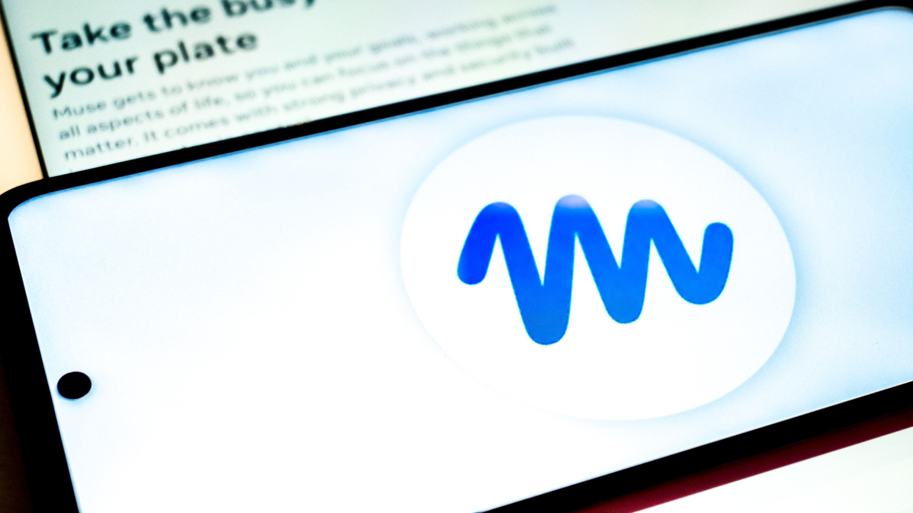
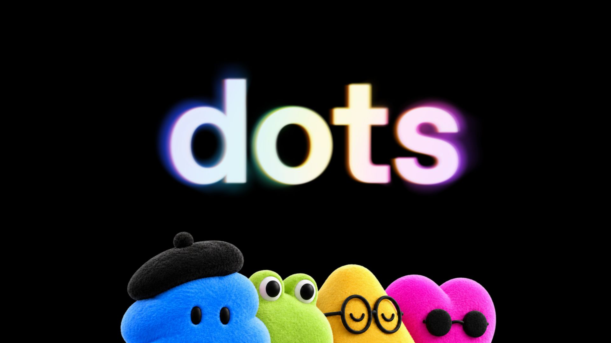



**收录说明**：直接下载；去掉了分享按钮、订阅提示、视频推荐、文中插入的「You may like」「What to read next」推荐区和文末的站内推荐，副标题「Both are arguably adorable, but they don't have the same abilities or purpose」与首图未收入 original.md。作者是 Tom's Guide 的 AI 编辑，文章依据两家的公开信息比较，没有上手实测。原文全文存于本目录的 original.md，网站上不显示，已翻译。

**内容摘要**：文章在 Dots 发布次日比较 Muse 与 Dots：两者都有自己的云端计算机和浏览器、离开后继续工作、做重要操作前请求批准，但模型、产品形态和目标用户不同。Muse 由 Muse Spark 驱动，运行在 Muse Secure VM 中，在美国和加拿大提供免费档和 20、100 美元/月的套餐，以 Sentinel 区分读写权限，并在扩展到 macOS、智能眼镜和小企业连接器。Dots 由 GPT-6 Astra 驱动，可连接 4,000 多个应用，可在 Slack、Microsoft Teams 中使用，起价为 100 美元/月的 Pro 100，Business Premium 每席 125 美元/月，Free 与 Plus 用户及 EEA、瑞士、英国的 Pro 用户暂不可用；OpenAI 还预告了面向企业的「specialist dots」和与 Microsoft Agent 365 的整合。作者认为最大的区别是客户：Muse 面向普通消费者和小企业，Dots 面向专业人士和团队。

**保留理由**：把两款产品发布时的开放范围、价格和定位并列整理，并提出「区别在客户而非模型」的判断，可作为两者定位差异的媒体视角。

---

如果你这个月眨了眨眼，你可能会以为 [Meta](https://www.tomsguide.com/tag/meta) 和 [OpenAI](https://www.tomsguide.com/tag/openai) 在三周内推出了本质上相同的 AI 智能体。

9 月 8 日，[Meta 推出了 Muse](https://www.tomsguide.com/ai/meta-just-launched-an-ai-that-can-actually-run-your-life-online-heres-what-muse-can-do)，一个个人 AI 智能体，它拥有自己的专用云端计算机，并在你关闭应用后继续处理你的任务。二十一天后，OpenAI 在旧金山 DevDay 2026 登台，发布了 [Dots](https://www.tomsguide.com/ai/openai-gave-chatgpt-a-virtual-computer-to-run-errands-for-you)——ChatGPT 内始终在线的 AI 智能体，每一个都在自己的云端计算机和浏览器上运行。

虽然它们听起来非常相似，互联网上各地的报道都因为它们的一些相似之处而比较它们，比如两者都有自己的云端计算机、在你离开后继续工作、能连接外部服务，但比较差不多到此为止。

Muse 和 Dots 不能互换。它们是不同的公司、不同的模型和非常不同的产品。对你的钱包来说最重要的是，它们面向不同的客户。Muse 可以免费开始使用，是为普通人和小企业打造的。Dots 从每月 100 美元的 Pro 套餐起步，显然面向专业人士和开发者团队。

以下是关于每一个你实际需要知道的东西、它们在哪里重叠，以及现在哪一个对你重要。

## Muse 与 Dots 一览

**Meta Muse：** 一个由 Muse Spark 驱动的个人智能体，运行在自己的 Muse Secure VM 中，为它提供专用的云端计算机和浏览器，在你离开后仍可继续工作。Muse 在美国和加拿大提供免费档，以及每月 20 美元和 100 美元的套餐。你可以在 iOS、Android 和网页上使用它，同时 Meta 已通过 Mac 应用控制、它自己的电子邮件地址、AI 眼镜支持和 Muse Charm 伴侣设备扩展了 Muse。它的 Sentinel 权限系统将读取和写入访问分开，Muse 可以连接包括 Asana、Slack、Shopify、Stripe、Zoom、QuickBooks 和 Notion 在内的服务，以及 [Facebook](https://www.tomsguide.com/tag/facebook) 和 [Instagram](https://www.tomsguide.com/tag/instagram) 商业账户。

**ChatGPT Dots：** 每个 dot 由 [GPT-6 Astra](https://www.tomsguide.com/ai/chatgpt/chatgpt-6-astra-is-here-this-one-prompt-shows-what-it-can-really-do) 驱动，拥有自己的专用云端计算机和浏览器，使它能在你离开 ChatGPT 后继续在后台工作。合格的 ChatGPT Pro 和 Business Premium 订阅者可以使用 Dots，Enterprise、Edu 和 Healthcare 则通过管理员启用的 beta 获得访问权限。你可以通过网页、桌面和移动端的 ChatGPT，以及 Slack 和 Microsoft Teams 与一个 dot 交互，语音通话可用，短信处于 beta。Dots 可以通过 ChatGPT 的插件生态系统连接 4,000 多个应用，并使用自定义规则、审批要求和自动审查来管理它们被允许做什么。目前，用户只能得到一个主 dot，尽管 OpenAI 已预告了专家 dot（specialist dots）以及多个 dot 可以协同工作的未来。

两个工具都异步向你更新，并在做任何有后果的事情前回来请求批准。自主智能体不应在没有你的情况下发送、花钱或做出敏感更改，这个观念正迅速成为这一类别的必备条件（table stakes）。

## Meta Muse 是什么

（图片来源：Shutterstock）

Muse 是 Meta 对个人 AI 智能体的版本，而公司做了一个 OpenAI 没有的大赌注：让它免费开始使用。

这个产品是目标优先而非聊天优先。你给 Muse 一件要完成的事——例如经营你业务的一部分、寻找新客户或处理物流——它就会制定计划，在你关闭应用后继续工作，并在有变化或需要你批准时回来。

Muse 运行在 Meta 所称的 Muse Secure VM 中，这是一个拥有自己浏览器的专用云环境，承载智能体和你的数据。你可以设置它的名字、头像和沟通风格，观看它的浏览器工作，并通过 Sentinel 管理它能接触什么，那是 Meta 的权限系统，将读取访问与写入访问分开。

Meta 一直在逐步扩大 Muse 可以操作的领域。它现在包括 macOS 应用控制、智能体自己的电子邮件地址，以及通过 Meta 智能眼镜与它交互的支持。Meta 还宣布了整合（integrations）和商业合作伙伴关系，覆盖包括 Stripe、Shopify、[Walmart](https://www.tomsguide.com/tag/walmart)、Expedia 和 Instacart 在内的服务。

面向小企业的 Muse（Muse for Small Business）进一步推进这一点，提供包括 Asana、Box、Canva、Dropbox、Figma、QuickBooks、Notion、Shopify、Slack、Stripe 和 Zoom 在内的第三方应用连接器，以及访问 Facebook 和 Instagram 商业账户的权限。这些不是单独的智能体，而是 Muse 内部的额外能力。

Muse 已经因用户授予智能体广泛权限后可能发生什么而受到审视。[最近的报道](https://www.businessinsider.com/meta-muse-facebook-marketplace-address-story-matt-robb-2026-9) 关于一次涉及 Muse 的 Marketplace 交互，是一个有用的提醒：自主智能体的便利也严重取决于你究竟授权了它做什么。

## ChatGPT Dots 是什么

（图片来源：OpenAI）

Dots 把同样的基本始终在线智能体架构带向一个非常不同的方向。

CEO Sam Altman 在 OpenAI 的 DevDay 演讲中把它们描述为「能力非凡、始终在线的智能体」，并表示公司对 Dots 的雄心超越了 ChatGPT 本身。

每个 dot 运行在 GPT-6 Astra 上，拥有自己的云端计算机和浏览器，并可以通过 ChatGPT 的插件生态系统连接 4,000 多个应用。

你给它一个目标——监控一条流水线、管理一个重复工作流，或花几天时间研究某件事——dot 就能全天候继续追求它，发送更新，并在到达边界时请求你的意见。

Dots 可以随时间学习偏好，并使用只读工具进行一些主动的后台调研。OpenAI 还把特别敏感的操作（包括更改密码）保留在人类手中。

发布时，每个人得到一个主 dot，可以命名并用头像自定义。OpenAI 还预告了面向公司的「专家 dot（specialist dots）」，并正与 Microsoft 合作，把这些智能体纳入 Agent 365 的管理和安全控制之下。更长期的愿景实际上是一支专业智能体团队与人们并肩工作。

设置完成后，可以通过移动端和网页上的 ChatGPT，以及包括 Slack 和 Microsoft Teams 在内的服务联系一个 dot。ChatGPT Space 提供一个共享环境，队友和 dot 可以在项目中一起工作。

但有一个重大陷阱：大多数 [ChatGPT 用户无法试用](https://www.tomsguide.com/ai/openai-just-launched-dots-heres-why-most-chatgpt-users-cant-try-them-yet)。

Dots 正逐步向 ChatGPT Pro 和 Business Premium 订阅者推出，而 Enterprise、Edu 和 Healthcare 工作区获得管理员启用的 beta。Free 和 Plus 订阅者目前被排除在外。

每月 100 美元的 Pro 100 是入门点。OpenAI 还提供 Pro 200 和 Pro 500 档，而 Business Premium 每用户每月 125 美元。EEA、瑞士和英国的 Pro 订阅者也还不能使用 Dots。

## 最大的区别不是模型——而是客户

（图片来源：djile / Shutterstock）

把技术上的相似之处放在一边，最大的区别就变得明显。

Muse 从 0 美元起。Dots 从每月 100 美元起。仅这一点就告诉你 Meta 和 OpenAI 期望谁来使用这些产品。

Meta 试图把自主智能体交到普通消费者和小企业手中。OpenAI 从已经愿意在 AI 上花更多钱的专业人士、团队和组织开始。

这一差异贯穿两家公司做出的几乎每一个其他决定。

Muse 是一个围绕智能体本身构建的独立产品。它有一个你塑造的性格、一个你可以查看的 Feed 和 Goals、移动应用、手掌大小的 [Muse Charm](https://www.tomsguide.com/ai/surveillance-tamagotchi-toms-guide-readers-weigh-in-on-metas-new-muse-charm) 以及与 Meta 眼镜的整合。感觉 Meta 在问：当一个 AI 智能体成为你生活中的另一个个人设备或服务时，会发生什么。

OpenAI 把 Dots 构建进 ChatGPT。这个智能体是专业人士和企业可能已经在使用的平台的另一项能力，OpenAI 把它放到工作已经发生的地方，包括 Slack 和 Teams。ChatGPT Space 和计划中的专家 dot 把这一概念进一步推向人与智能体共享同一个工作场所。

底层的想法可能相似。围绕它构建的产品则不是。

## 你应该用哪一个？

如果你想今天就试用 AI 智能体，又不想增加另一个昂贵的订阅，Muse 几乎默认获胜。

它可以免费开始使用，围绕个人用户构建，现在有足够的小企业整合（integrations），使其在简单个人任务之外也有用。代价是，让自主智能体访问账户、通信和其他服务需要密切关注它的权限，尤其是在 Muse 早期受到审视的情况下。

如果你已经在为 ChatGPT Pro 付费，或正在为企业选择智能体，你可能已经找到了 Dots 的用途。OpenAI 已经相当清楚地表明了其专业和企业雄心。

对于其他人来说，现在没有多少理由仅仅为了得到 Dots 而每月支付 100 美元，尤其是 OpenAI 还没有向 Plus 订阅者提供它们。Muse 想成为你的个人 AI 助手。Dots 想成为你团队中始终在线的一员。

它们可能相隔三周推出，底层技术非常相似，但它们并没有真正在争夺同一个用户——至少目前还没有。
