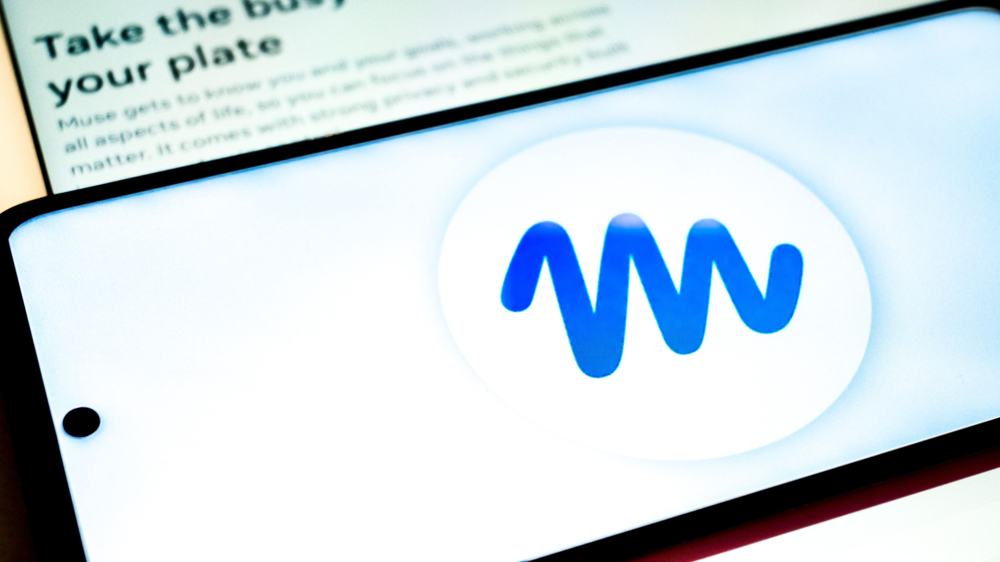
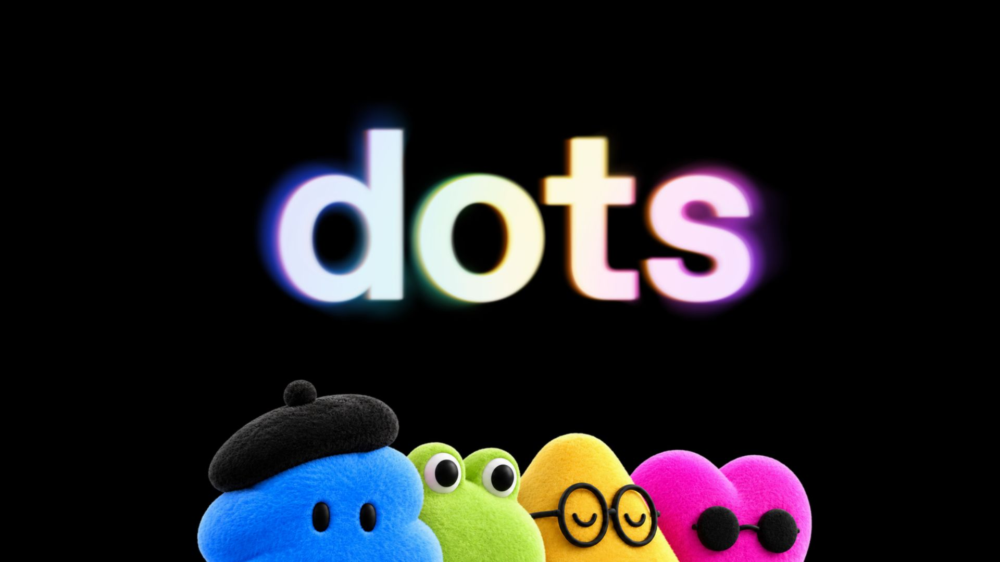

来源：https://www.tomsguide.com/ai/meta-muse-vs-chatgpt-dots-i-compared-the-new-ai-agents-and-theyre-not-as-similar-as-they-look
取文：2026-11-05，直接下载

If you blinked this month, you might think [Meta](https://www.tomsguide.com/tag/meta) and [OpenAI](https://www.tomsguide.com/tag/openai) launched essentially the same AI agent three weeks apart.

On September 8, [Meta launched Muse](https://www.tomsguide.com/ai/meta-just-launched-an-ai-that-can-actually-run-your-life-online-heres-what-muse-can-do), a personal AI agent that gets its own dedicated cloud computer and keeps working on your tasks after you close the app. Twenty-one days later, OpenAI took the stage at DevDay 2026 in San Francisco and unveiled [Dots](https://www.tomsguide.com/ai/openai-gave-chatgpt-a-virtual-computer-to-run-errands-for-you) — always-on AI agents inside ChatGPT, each running on its own cloud computer and browser.

And while they sound remarkably similar, with reports across the internet comparing them because of a few similarities like the fact that both get their own cloud computer, work after you leave, and can connect to outside services, that's about where the comparisons stop.

Muse and Dots are not interchangeable. These are different companies, different models and very different products. Most importantly for your wallet, they're aimed at different customers. Muse is free to start and was built for everyday people and small businesses. Dots starts with a $100-a-month Pro plan and is clearly aimed at professionals and developer teams.

Here's what you actually need to know about each one, where they overlap and which one matters to you right now.

## Muse vs Dots at a glance

**Meta Muse:** A personal agent powered by Muse Spark and runs inside its own Muse Secure VM, giving it a dedicated cloud computer and browser where it can continue working after you leave. Muse is available in the U.S. and Canada with a free tier, alongside $20 and $100 monthly plans. You can use it on iOS, Android and the web, while Meta has expanded Muse with Mac app control, its own email address, AI glasses support and the Muse Charm companion device. Its Sentinel permissions system separates read and write access, and Muse can connect to services including Asana, Slack, Shopify, Stripe, Zoom, QuickBooks and Notion, as well as [Facebook](https://www.tomsguide.com/tag/facebook) and [Instagram](https://www.tomsguide.com/tag/instagram) business accounts.

**ChatGPT Dots:** Each dot is powered by [GPT-6 Astra](https://www.tomsguide.com/ai/chatgpt/chatgpt-6-astra-is-here-this-one-prompt-shows-what-it-can-really-do) and gets its own dedicated cloud computer and browser, allowing it to continue working in the background after you leave ChatGPT. Dots are available to eligible ChatGPT Pro and Business Premium subscribers, with Enterprise, Edu and Healthcare access through an admin-enabled beta. You can interact with a dot through ChatGPT on the web, desktop and mobile, as well as Slack and Microsoft Teams, with voice calling available and texting in beta. Dots can connect to more than 4,000 apps through ChatGPT's plugin ecosystem and use custom rules, approval requirements and auto-review to govern what they're allowed to do. For now, users get one primary dot, although OpenAI has previewed specialist dots and a future where multiple dots can work together.

Both tools update you asynchronously and come back for approval before doing anything consequential. The idea that an autonomous agent shouldn't be able to send, spend or make sensitive changes without you is quickly becoming table stakes for this category.

## What Meta Muse is

(Image credit: Shutterstock)

Muse is Meta's version for a personal AI agent, and the company made one huge bet that OpenAI hasn't: making it free to start.

The product is goal-first rather than chat-first. You give Muse something to accomplish — running parts of your business, finding new customers or handling logistics, for example — and it builds a plan, continues working after you close the app and returns when something changes or requires your approval.

Muse runs inside what Meta calls the Muse Secure VM, a dedicated cloud environment with its own browser that holds the agent and your data. You can set its name, avatar and communication style, watch its browser work and govern what it can touch through Sentinel, Meta's permissions system separating read access from write access.

Meta has gradually been expanding where Muse can operate. It now includes macOS app control, an email address of the agent's own and support for interacting with it through Meta's smart glasses. Meta has also announced integrations and commerce partnerships spanning services including Stripe, Shopify, [Walmart](https://www.tomsguide.com/tag/walmart), Expedia and Instacart.

Muse for Small Business pushes that further with third-party app connectors including Asana, Box, Canva, Dropbox, Figma, QuickBooks, Notion, Shopify, Slack, Stripe and Zoom, alongside access to Facebook and Instagram business accounts. These aren't a separate agent but additional capabilities inside Muse.

Muse has already faced scrutiny over what can happen when users grant an agent broad permissions. [Recent reports](https://www.businessinsider.com/meta-muse-facebook-marketplace-address-story-matt-robb-2026-9) about a Marketplace interaction involving Muse are a useful reminder that the convenience of an autonomous agent also depends heavily on exactly what you've authorized it to do.

## What ChatGPT Dots are

(Image credit: OpenAI)

Dots take the same basic always-on agent architecture in a very different direction.

CEO Sam Altman described them as "remarkably capable, always-on agents" during OpenAI's DevDay presentation and said the company's ambitions for Dots extend beyond ChatGPT itself.

Each dot runs on GPT-6 Astra, gets its own cloud computer and browser and can connect to more than 4,000 apps through ChatGPT's plugin ecosystem.

You give it a goal — monitoring a pipeline, managing a recurring workflow or researching something over several days — and the dot can continue pursuing it around the clock, sending updates and asking for your input when it reaches a boundary.

Dots can learn preferences over time and use read-only tools for some proactive background research. OpenAI also keeps particularly sensitive actions, including changing passwords, in human hands.

At launch, each person gets one primary dot they can name and customize with an avatar. OpenAI has also previewed "specialist dots" for companies and is working with Microsoft to bring the agents under Agent 365's management and security controls. The longer-term vision is effectively a team of specialized agents working alongside people.

Once set up, a dot can be reached through ChatGPT on mobile and web as well as services including Slack and Microsoft Teams. ChatGPT Space provides a shared environment where teammates and dots can work together on projects.

But there's a major catch: most [ChatGPT users can't try one.](https://www.tomsguide.com/ai/openai-just-launched-dots-heres-why-most-chatgpt-users-cant-try-them-yet)

Dots are rolling out to ChatGPT Pro and Business Premium subscribers, while Enterprise, Edu and Healthcare workspaces get an admin-enabled beta. Free and Plus subscribers are locked out for now.

Pro 100, at $100 per month, is the entry point. OpenAI also offers Pro 200 and Pro 500 tiers, while Business Premium costs $125 per user each month. Pro subscribers in the EEA, Switzerland and UK also can't use Dots yet.

## The biggest difference isn't the model — it's the customer

(Image credit: djile / Shutterstock)

Put the technical similarities aside and the biggest distinction becomes obvious.

Muse starts at $0. Dots start at $100 a month. This alone tells you who Meta and OpenAI expect to use these products.

Meta is trying to put an autonomous agent in the hands of ordinary consumers and small businesses. OpenAI is starting with professionals, teams and organizations already willing to spend significantly more on AI.

That difference runs through almost every other decision the companies have made.

Muse is a standalone product built around the agent itself. It has a personality you shape, a Feed and Goals you can check, mobile apps, the palm-sized [Muse Charm](https://www.tomsguide.com/ai/surveillance-tamagotchi-toms-guide-readers-weigh-in-on-metas-new-muse-charm) and integration with Meta's glasses. It feels like Meta is asking what happens when an AI agent becomes another personal device or service in your life.

OpenAI built Dots into ChatGPT. The agent is another capability of a platform professionals and businesses may already use, and OpenAI is putting it in places where work already happens, including Slack and Teams. ChatGPT Space and the planned specialist dots push the concept even further toward people and agents sharing the same workplace.

The underlying idea may be similar. The products built around it aren't.

## Which should you use?

If you want to experiment with an AI agent today without adding another expensive subscription, Muse wins almost by default.

It's free to start, built around individual users and now has enough small-business integrations to make it useful beyond simple personal tasks. The trade-off is that giving an autonomous agent access to accounts, communications and other services requires paying close attention to its permissions, particularly given the early scrutiny around Muse.

If you're already paying for ChatGPT Pro or you're choosing an agent for a business, you've probably already found a use for Dots. OpenAI has made its professional and enterprise ambitions pretty clear.

For everyone else, there's little reason to pay $100 a month just to get Dots right now, particularly when OpenAI hasn't made them available to Plus subscribers. Muse wants to become your personal AI helper. Dots wants to become an always-on member of your team.

They may have arrived three weeks apart with remarkably similar technology underneath, but they're not really fighting for the same user — at least not yet.
