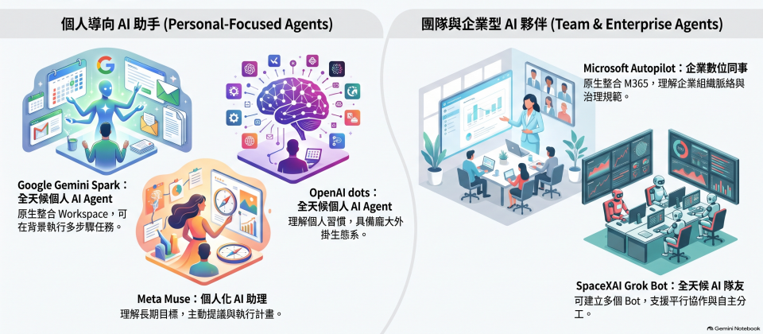



**收录说明**：直接下载，题图收入 images/。正文以一张比较表为主，原文表格照录。比较的五款产品中 Google Gemini Spark 和 Microsoft Autopilot 不在跟踪清单内。旧笔记 learning-ai-agent 的 Grok Bot 部分引用过这一篇，2026-11-06 复核后收入。

**内容摘要**：文章先梳理时间线：Google 在 5 月发布 Gemini Spark，微软 6 月发布 Scout、9 月改名 Autopilot，Grok Bot 8 月上线，Meta Muse 9 月 8 日、OpenAI dots 9 月 29 日发布。随后用一张表从 11 个方面比较这五款产品，包括产品定位、自主工作能力、模型、部署和执行、本机存取、协作、控管机制、扩充性、计费、版本和取用管道。表中记录 Grok Bot 不绑定单一模型、由 Cursor 管理模型选择，dots 用 GPT-6 Astra，Muse 用 Muse Spark；计费方面 Grok Bot 包含在 SuperGrok 和 Cursor 套餐中，Muse 有免费版和 20 美元、100 美元两档。资料来源注明为 iThome 整理，比较截至 10-01，不含后来发布的 Claude Duet。

**保留理由**：中文媒体对多款 Personal Agent 的逐项对照，便于横向查找模型、部署和计费信息。

---

主動型Agent助理產品大爆發。從今年5月開始，多家科技巨頭陸續跨進主動型Agent市場，到了8、9月更進入密集推出期，大廠紛紛推出了主打24小時全天候運作的AI Agent，在沒有新的提示指令下持續執行。

年初全球爆紅的OpenClaw（龍蝦），掀起了新一波AI代理的熱潮。相較於過去多半依據使用者指令行動的Agent，OpenClaw可以持續運作、定期執行任務，甚至在沒有持續提示的情況下主動完成工作，讓Agent從一次性任務執行，進一步發展為長時間、持續自主運作的模式。

不過，隨著Agent取得更多系統、檔案、憑證與工具權限，也帶來新的資安風險。不少企業開始關注主動式Agent的應用潛力，但也對OpenClaw的安全性問題有所顧慮。今年5月開始，多家科技巨頭，紛紛宣布跨進主動式Agent市場，相繼發表了自己的全天候Agent助手產品線，除了強調自主執行能力，也開始訴求雲端隔離、人工核准與更嚴格的安全控管能力。

先是Google在5月I/O大會發表了新的主動型Agent助手產品Gemini Spark，並在7月底以Beta版推出，主打全天候的個人AI代理。微軟則是在6月Build大會發表了Scout，採用OpenClaw與Work IQ技術打造，以企業「數位同事」角色登場，強調可理解企業組織和工作脈絡。SpaceXAI緊接著在8月11日推出了Grok Bot，定位成全天候的AI隊友，不只可以單獨承接工作，也能建立多個Grok Bot分工協作。

9月8日，Meta推出了Muse助手，可以持續理解使用者的個人目標，提出計畫並執行工作。微軟在9月25日推出了新版的Copilot，也將Scout改名為Autopilot，擴大私人預覽，並持續強化Agent在Teams、Outlook與Microsoft 365環境中的長時間自主執行能力，就算使用者離線也能推進任務。

最新加入戰局的是OpenAI，在9月29日的DevDay開發者大會上，發表了Dots，和Google一樣主打全天候的個人AI代理，特色之一是擁有龐大的外掛生態系，可連結超過4千款應用。

這五款主動型Agent都不再侷限於一次性的問答或任務，轉而透過雲端電腦、虛擬機器或其他雲端執行環境持續運作，在沒有新的提示指令下，可以繼續推進任務。像是定期執行重複性工作，持續監看郵件、頻道等資訊源，主動採取後續行動，也有Agent可以一路執行長期任務到遇到需要人工核准的敏感操作時，才回頭詢問使用者。

為了讓企業更了解這五款主動式Agent產品的差異，我們從11個項目來比較這些Agent產品的特色，涵蓋了產品定位、自主工作能力、採用模型、部署模式、本機存取、協作能力、控管機制、擴充性、計費方式、目前版本和取用管道等，希望企業可以快速了解五家大型科技業者主動式Agent的技術發展方向，也可作為評估和試用新型態Agent時的參考。

### **五大科技巨頭主動型Agent產品大比較（2026.10.1)**

| 比較項**目** | **Google Gemini Spark** | **Microsoft Autopilot** | **OpenAI dots** | **SpaceXAI Grok Bot** | **Meta Muse** |
| --- | --- | --- | --- | --- | --- |
| 產品定位 | **全天候的個人AI Agent。**  原生整合Workspace工具，長時間在背景代表使用者執行任務 | **企業數位同事。**  採用OpenClaw技術，原生整合Microsoft 365，可理解企業組織和工作脈絡 | **全天候的個人AI Agent。**  持續理解使用者習慣，長期運作來達成任務，特色是外掛生態系 | **全天候的AI隊友。**  可學習個人化的工作流程，能同時與多個Bot協作。 | **個人化的AI助理**。  能長期理解個人目標，主動提議計畫且直接執行工作 |
| 自主工作能力 | 可背景執行長時間、多步驟任務，也能設定重複性工作和學習 Skills。使用者授權下可操作Chrome帳密登入網站，處理複雜任務 | 不需要新指令也能持續工作，可監看頻道，追蹤進度，執行例行性工作，或在多日後重新接續處理先前的專案 | 可持續掌握使用者的目標、偏好及工作標準，主動尋找可協助處理的工作，可從使用者回饋學習。未來將提供組織型的專職Dot | 可登入和跨Apps、工具和網站來工作，直到需要人類核准才回來詢問 | 可以回答問題、完成任務、規畫長期目標，並在沒有持續人工指示下自主推進工作 |
| 主要模型 | Gemini 3.5系列 | 沒有公開綁定單一模型。Microsoft Copilot平臺支援多模型與模型路由 | GPT-6 Astra模型 | 官方未公開綁定單一模型，由Cursor管理模型選擇 | Muse Spark模型 |
| 部署和執行 | 在Google Cloud託管的安全runtime中執行；每項任務進入全新、嚴格隔離的暫時性VM | 部署在企業租戶帳號下的雲端託管環境中，具有自己的身份、記憶體、電腦、工作區。 | 每個dot有自己的雲端電腦，可瀏覽網頁、分析資料、建立檔案和執行工具。 | 每個使用者有一個專屬的Firecracker MicroVM（微型虛擬機器），提供同一帳號所有Bot共用檔案、瀏覽器和登入資訊。不同使用者的環境彼此隔離。 | 每一個使用者配置獨立的雲端VM與瀏覽器。未來計畫推出讓使用者自帶加密金鑰的Muse Confidential VM，可加密對話紀錄和用戶資料。 |
| 本機存取 | Mac桌面版可存取使用者本機檔案。但目前有方案和地區限制。 | Autopilot官方未公布直接存取使用者本機檔案；Windows Copilot App則可授權搜尋和讀取本機檔案 | 可授權dot使用本機檔案並在使用者電腦執行指令，但需保持電腦連線和ChatGPT App開啟。企業版預設關閉本機存取權限。 | 可授權在Ｍac和Windows本機電腦存取檔案和執行指令 | Mac版Muse可授權下存取本機資源和控制Mac上的任何App。使用者離開電腦後仍可繼續執行任務。 |
| 協作 | 代表使用者行動的個人Agent | 可加入共享工作空間的同事Agent。在企業專屬的租用戶識別碼下，依據企業給予的Agent權限和稽核治理規定來行動。 | 使用者自己指揮dot。加入Slack或Teams後，dot可以自己的身分發言，但不接受其他人的命令 | 使用者可建立多個Bot各自平行運作，Bot能加入對話群組自行分工和協作。團隊可使用同一個Team Bot，共享同一套Context、技能、檔案與工具 | 以個人Agent為主 |
| 控管機制 | 高風險操作會要求明確同意，如寄送郵件前可要求確認，處理付款也會歸還控制權 | 企業可設定目標、邊界和權限，授權Autopilot在邊界內執行和回報，非單一同意流程 | 企業可控制dots權限、本地端電腦存取和自訂規則，來限制Agent能力及確認行為。敏感操作會詢問使用者 | Bot自主完成所有工作，只有需要使用者同意時，才回來詢問 | VM內建獨立的哨兵Agnet負責把關，監督Muse對外連線，可提供完整稽核軌跡。敏感操作會向使用者取得許可。 |
| 整合和擴充性 | 原生整合Google Workspace和多項Google服務，如Youtube、地圖、NotebookLM等。也可連結第三方APP或MCP來源。授權下用Chrome登入帳號處理網站工作。 | 深度整合Teams、Outlook與 Microsoft 365企業環境。可透過Microsoft IQ來了解企業運作知識和資料。 | 透過外掛可連接4,000多個 App | 可直接登入使用者常用的應用程式和工具，包括不支援MCP或簡潔API的平臺。 | 可連結臉書和IG帳戶和Meta廣告帳號，以及十多項常見應用，如Figma、Lovable、Shopify、Slack、Stripe、Zoom等。提供自訂連結。 |
| 計費方式 | 在個人方案AI Pro（台幣每月650元)和AI Ultra(台幣每月3300元)訂閱中 | Autopilot 屬進階AI應用，採按用量計價模式（UBB）。企業可設支出政策、限額及監控。 | dot包含於Pro（每月100美元起）與Business Premium方案中，Enterprise方案則需由管理員開啟Beta功能。 | 沒有獨立Grok Bot方案，包含在多種SuperGrok（每月30美元標準版以上的方案）、Cursor個人版與Cursor Teams付費方案中；方案附帶每週用量，超過後依額外用量計費。 | 先在美國和加拿大推出，提供限額使用的免費版，訂閱方案分為Power方案（每月20美元每週5億Muse Token）和Maximum方案（每月100美元，每週30億個Muse Token） |
| 目前版本 | Beta版。台灣已開放部分AI Pro用戶使用 | 2026年9月進入私有預覽版 | Beta版 | Beta版 | 正式推出，目前僅部分市場。企業產品仍在早期階段 |
| 取用管道 | 透過Gemini的App、網頁版與Mac桌面版使用。也可透過Chrome執行網頁任務。可用文字、語音或排程，或設定背景任務來觸發 | Teams、Outlook、M365 Copilot介面。可用文字操作、@mention或預先設定的任務來觸發。 | ChatGPT網頁版、桌面版和行動版。支援Slack和Teams。可用文字、自然語音來操作。 | 桌面版支援macOS、Windows、Linux，另有iOS、Android App；支援文字、語音操作 | Muse Agent入口包括了Muse App、muse.ai Web、WhatsApp和Muse的Mac桌面版，也宣布將支援AI眼鏡。可透過文字、語音操作或網頁點擊來觸發 |

資料來源：iThome整理，2026年10月
