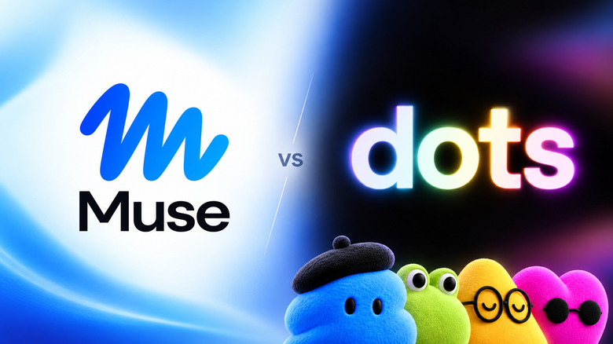
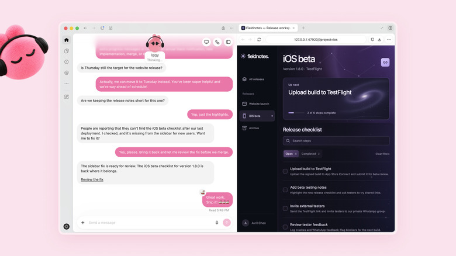
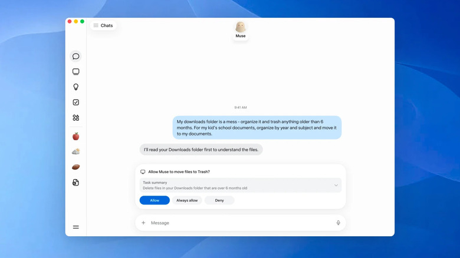



**收录说明**：直接下载；去掉了作者署名行、发布时间行和「Add Engadget on Google」推广。原文全文存于本目录的 original.md，网站上不显示，已翻译。

**内容摘要**：文章比较 Muse 与 Dots 的功能、监督方式、价格、隐私和开放范围。Muse 运行在专用 Secure VM 中，可通过 Muse 应用、网页或 WhatsApp 使用，Engadget 此前上手时，Muse 把收藏的 Instagram 和 Facebook 帖子整理成了食谱和餐厅合集；Dot 在 ChatGPT 内、由 GPT-6 Astra 驱动，可获准访问用户的本地计算机。监督方面，Muse 在发邮件、购买等敏感操作前请求许可，OpenAI 用权限、Custom Rules 和 Auto-review 约束 Dots。价格上 Muse 有带用量上限的免费档和 20、100 美元/月的 Power、Maximum 档，Dots 个人用户最低为 100 美元/月的 Pro 100。隐私上，Meta 称 VM 内的对话和数据不与其广告系统共享、用户可选择不让交互用于改进模型，但 Engadget 发现改进模型的设置默认开启；OpenAI 称个人套餐的 Dots 活动可能按用户设置用于改进模型，Business 与 Enterprise 数据默认不用于训练；Dots 主动做的研究在后续操作通过权限检查前是只读的。OpenAI 还称 Dot 的使用不计入用量限额，除非它在 ChatGPT Work 或 Codex 中工作。

**保留理由**：在功能对比之外，集中整理了两家关于审批机制、训练数据使用和开放地区的说法，并含少量上手观察，便于对照两者的隐私与权限设计。

---

两个智能体都能在你离开后继续工作，但它们在价格、权限以及可在哪里工作方面差异很大。

图片：Husain Parvez（Meta、OpenAI）

Meta 和 OpenAI 现在都拥有了旨在做更多事情的 AI 智能体，而不只是等待下一个提示。Meta 于 9 月 8 日发布 Muse，三周后 OpenAI 在 ChatGPT 中推出了[新的「始终在线」智能体](https://www.engadget.com/2272230/dots-are-openais-new-personal-agents-and-soon-youll-be-able-to-control-several-of-them/)。两者都能在你离开后继续工作、运行自己的云计算机，并连接外部服务。

承诺很诱人：给 AI 一项任务，然后就不用每五分钟查看一次。Muse 可以购物、填写表单、制定旅行计划、发送电子邮件，并监控价格之类的东西。Dots 可以管理持续进行的研究、跨已连接的应用程序工作并执行周期性任务，OpenAI 正将它们与 [ChatGPT、Work 和 Codex](https://www.engadget.com/2211869/openai-releases-chatgpt-work-tool-macos-windows-web-plans/) 紧密集成。

## Dots 与 Muse 能做类似的工作，但体验不同

OpenAI

Muse 运行在一台专用安全虚拟机（Secure VM）上，配有它自己的浏览器，设计上力求让人感觉很像在给另一个人发消息。它可以通过 Muse 的应用、网页或 WhatsApp 使用，当你准备好让它更强大时，还可以与电子邮件和日历等服务关联。在 [Engadget 的上手体验](https://www.engadget.com/2256577/how-to-get-started-with-meta-s-new-ai-agent-muse/)中，Muse 把收藏的 Instagram 和 Facebook 帖子整理成了有条理的食谱和餐厅合集。

Dot 存在于 ChatGPT 之中，由 GPT-6 Astra 驱动。每一个都有自己的云计算机，可以使用已连接的插件，记住相关上下文，并能持续处理定时或周期性任务。用户还可以授予 Dot 访问其本地计算机的权限，以检索文件或浏览互联网，OpenAI 还计划让用户能够同时管理多个 Dot。

科幻的光泽在这里稍微褪去，因为这些智能体仍然需要监督。Meta 表示，Muse 在发送电子邮件或进行购买等敏感操作前会请求许可；OpenAI 使用权限、自定义规则（Custom Rules）和自动审查（Auto-review）来管理 Dots 能做什么，两家公司都提醒说它们的智能体会犯错。甚至浏览器访问也有限制：[Amazon 已经禁止 Muse](https://www.engadget.com/2263659/amazon-bars-metas-muse-ai-from-shopping-on-its-site/)在其网站上购物。

## 试用 Muse 便宜得多，但两者的隐私控制都很重要

Meta

最明显的差别是价格。Muse 的免费档有用量上限，Power 和 Maximum 档分别为每月 20 美元和 100 美元。目前，个人用户必须支付高得多的订阅费才能使用 Dots，最低可选的是每月 100 美元的 Pro 100。一个 Business Premium 席位为每用户每月 100 美元（按年计费），或每用户每月 125 美元（按月计费）。

当然，订阅并不是唯一的事。你关联的账户越多，智能体就越能干，但这可能意味着它可以访问你的电子邮件、日历、文件和浏览器会话（这不是大多数人会轻易交出的东西）。Meta 表示，其虚拟机内的对话和数据不会与其广告系统共享，用户也可以选择不将其交互用于增强 Meta 的 AI 模型。Engadget 发现，改进模型的设置默认开启，同时还有一个默认权限选项，只对部分操作进行提示。

OpenAI 表示，个人套餐 Dots 的活动可能会被用于改进其模型，具体取决于用户的 ChatGPT 设置，而 Business 和 Enterprise 数据默认不用于训练。Dot 主动进行的研究是只读的，直到后续操作通过其常规权限检查。

可用范围是另一个麻烦。Dots 正向欧洲经济区（EEA）、瑞士和英国以外的符合条件的 Pro 用户逐步推出；Business Premium 用户可在受支持的 ChatGPT 地区使用 Dots；Enterprise 访问仍处于测试阶段。OpenAI 表示，Dot 的使用不会计入你的用量限额，除非该 Dot 正在 ChatGPT Work 或 Codex 中工作。Muse 目前在美国和加拿大可用。
