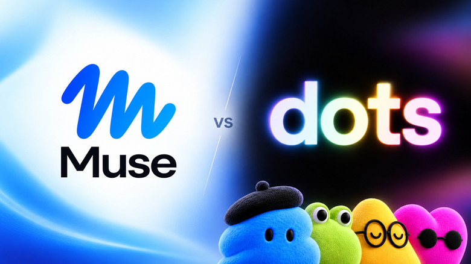
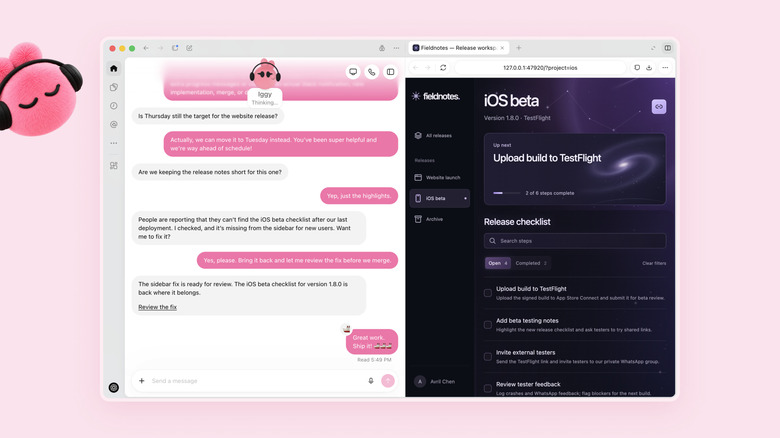
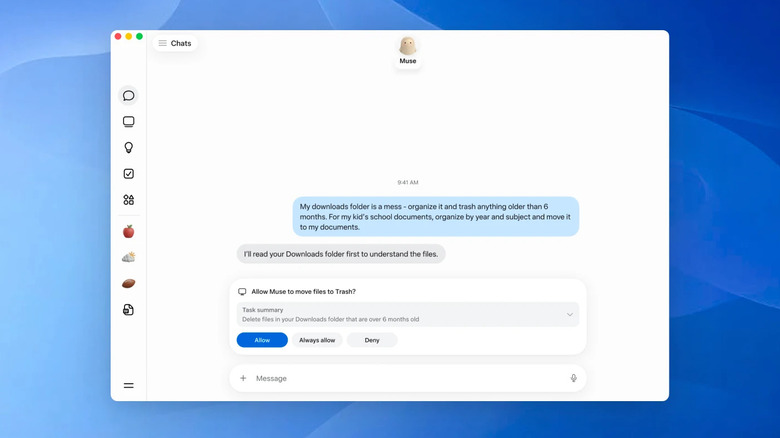

来源：https://www.engadget.com/2281289/openai-dot-vs-meta-muse-ai-agents-comparison/
取文：2026-11-05，直接下载

Both agents can keep working after you leave, but they differ considerably on price, permissions and where they can work.

Image by Husain Parvez (Meta, OpenAI)

Meta and OpenAI now have AI agents that are meant to do more than just wait for the next prompt. Meta released Muse on September 8, followed by [OpenAI's new always-on agents](https://www.engadget.com/2272230/dots-are-openais-new-personal-agents-and-soon-youll-be-able-to-control-several-of-them/) in ChatGPT three weeks later. Both can continue to work after you leave, run their own cloud computers and connect to outside services.

The promise is enticing: Provide an AI with a task and then stop checking on it every five minutes. Muse can go shopping, complete forms, make travel plans, send emails and monitor things such as prices. Dots can manage ongoing research, work across connected applications and perform recurring tasks, and OpenAI is closely integrating them with [ChatGPT, Work and Codex](https://www.engadget.com/2211869/openai-releases-chatgpt-work-tool-macos-windows-web-plans/).

## Dots and Muse can do similar jobs, but the experience is different

OpenAI

Muse runs on a dedicated Secure VM with its own browser and is designed to feel a lot like messaging another person. It can be used via Muse's apps, the web or WhatsApp, and then linked with services like email and your calendar when you're ready to make it more powerful. In [Engadget's hands-on](https://www.engadget.com/2256577/how-to-get-started-with-meta-s-new-ai-agent-muse/), Muse turned saved Instagram and Facebook posts into organized recipe and restaurant collections.

Dot lives within ChatGPT and is powered by GPT-6 Astra. Each one has its own cloud computer, can utilize connected plugins, remembers relevant context and can keep working on scheduled or recurring jobs. Users can also grant a Dot access to their local computer to retrieve files or browse the internet, and OpenAI plans to enable users to manage multiple Dots simultaneously.

That's where the sci-fi sheen fades a bit, since these agents still need supervision. Meta states that Muse asks for permission before taking sensitive actions like sending an email or making a purchase, and OpenAI employs permissions, Custom Rules and Auto-review to manage what Dots can do, with both companies cautioning that their agents can make mistakes. Even browser access has limits: [Amazon has already blocked Muse](https://www.engadget.com/2263659/amazon-bars-metas-muse-ai-from-shopping-on-its-site/) from shopping on its site.

## Muse is much cheaper to try, but privacy controls matter on both

Meta

The most obvious difference is price. The free tier of Muse has a usage cap, and the Power and Maximum tiers are $20 and $100 per month, respectively. At present, individual users must pay a much higher subscription fee to use Dots, with the lowest available option being Pro 100 for $100 per month. A Business Premium seat costs $100 per user per month (billed annually) or $125 per user per month (billed monthly).

The subscription isn't the only thing, of course. The more accounts you link, the more capable the agent becomes, but that can mean access to your email, calendar, files and browser sessions (which is not something most people would give away lightly). Meta states that conversations and data within its VM aren't shared with its advertising systems, and that users can choose not to have the interactions used to enhance Meta's AI models. Engadget found the model-improvement setting enabled by default, along with a default permission option that prompts for only some actions.

OpenAI states that activity from personal-plan Dots may be used to improve its models, depending on the user's ChatGPT setting, while Business and Enterprise data is not used for training by default. Proactive Dot research is read-only until a subsequent action passes its normal permission checks.

Availability is another complication. Dots are rolling out to eligible Pro users outside the European Economic Area (EEA), Switzerland and the UK, while Dots are available to Business Premium users across supported ChatGPT regions, and Enterprise access is still in beta. OpenAI states that Dot usage won't count toward your usage limits unless the Dot is working within ChatGPT Work or Codex. Muse is currently available in the US and Canada.
