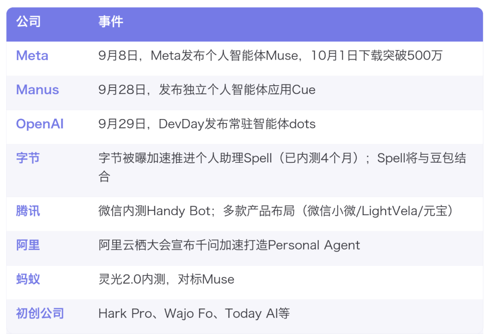
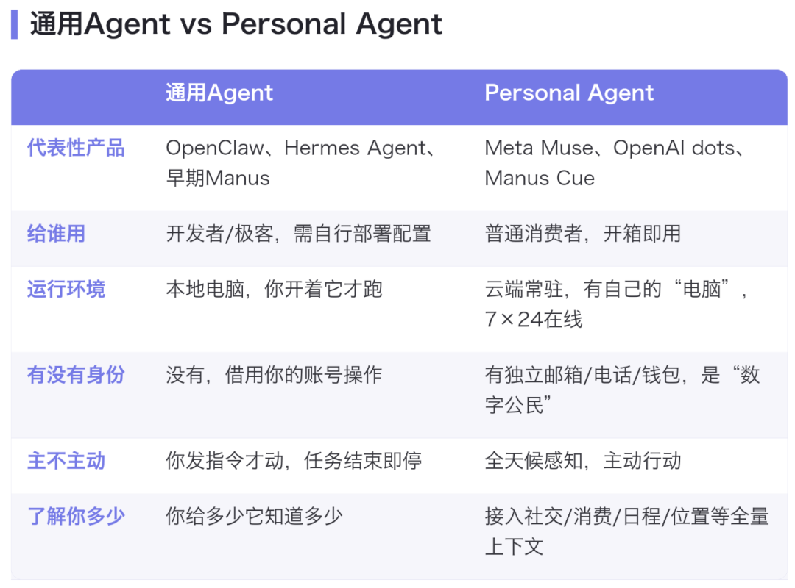
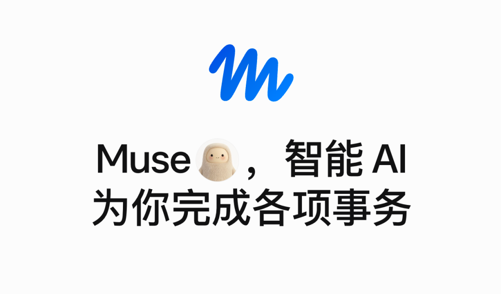
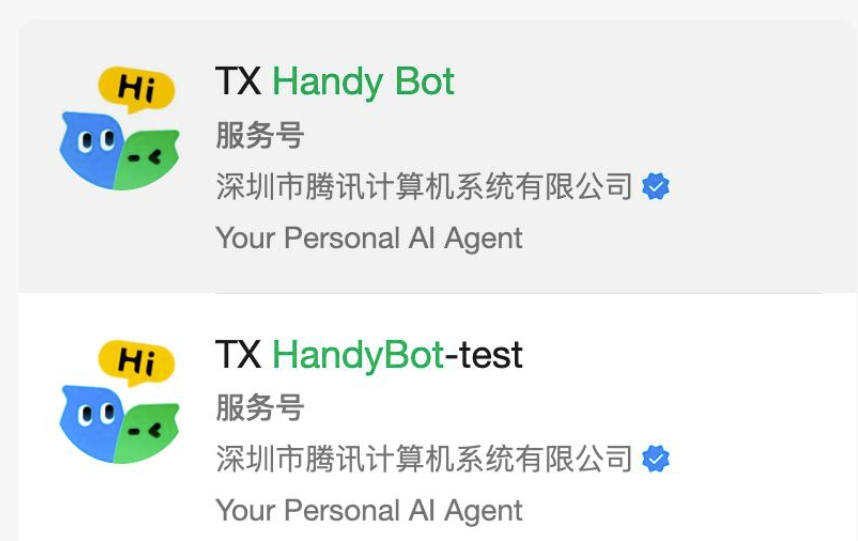
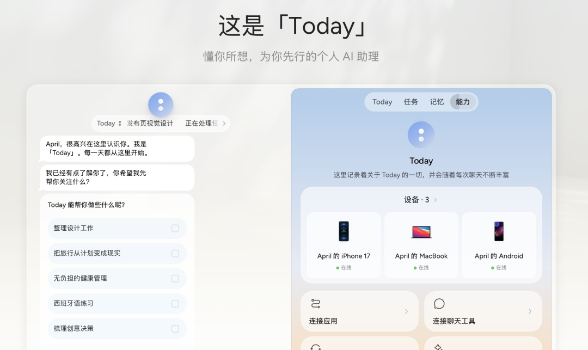



**收录说明**：用户提供链接。原文在微信公众号，用浏览器的客户端标识直接下载页面，从 `#js_content` 抽取正文，图片地址取自 `data-src`。文末推荐文章卡片与分享引导未收入；题图是超过 600 KB 的动图，改为链接。

**内容摘要**：文章梳理海外产品动态：Meta 的 Muse 下载量突破 660 万，OpenAI 于 9 月 29 日发布智能体 dots，Manus 于 9 月 28 日发布 2.0 版本并推出个人智能体应用 Cue。国内方面，字节的 Spell、腾讯的 Handy Bot 和蚂蚁灵光 2.0 处于内测或筹备阶段，阿里千问也宣布加速打造 Personal Agent。创业产品 Today AI 于 9 月 24 日面向国内用户开放下载与注册，功能包括长期记忆与早晚简报等。文章最后认为，用户真正关心的是产品能否解决棘手的问题、是否更便宜、更方便。

**保留理由**：汇总了 9 月至 10 月中外多款 Personal Agent 产品的上线时间与下载数据，覆盖面较广。

---

[动图：题图](https://mmbiz.qpic.cn/mmbiz_gif/fnqGwV7dTuEPdUTOFxcRjDOKzDebdtKxia7aO6cKjlIdaPkeXB4aTlKiaEXuWP5ogJoINEZNsdJQenNt4D8jtDHqjhVLcB8FwgBUffSD4mfc4/640?wx_fmt=gif&from=appmsg)（收录说明：动图超过 600 KB，未下载，链接到原图。）

作者 | 哪吒 编辑 | 张洁

作者｜懒人

编辑｜赖捷

国庆放个假回来，AI圈又变天了。从“龙虾热”到“通用Agent”，最近一个新名词又开始频频出现在AI新闻里，那就是Personal Agent（个人智能体）。

火到什么程度？一个月内，国内外六大巨头集体下场，创业公司也扎堆往外掏新产品。

10月8日，Meta上线一个月的个人智能体Muse，下载量突破660万。自推出后，Muse连续多日登顶App Store，12天下载量赶超ChatGPT。感受到危机的OpenAI，也在9月29日发布了智能体**dots，**由GPT-6 Astra驱动，订阅用户可用。就在前一天，Manus也发布了独立个人智能体应用**Cue。**

国内这边也很热闹。字节已内测了一段时间个人助理，代号“**Spell”**，据财新10月10日消息，“Spell”计划要与豆包结合，以尽快对外发布。腾讯此前也被发现在内测“Handy Bot”，并布局了LightVela等多款相关产品。此外，蚂蚁灵光2.0近日开启小范围内测，新增“我的生活”板块，直接对标Muse；9月底的云栖大会上，千问也公布了打造Personal Agent的计划。

这个让所有大厂都坐不住的Personal Agent，到底是个什么东西？

#### **从“帮你干活”到“替你做主”，**

#### **Personal Agent到底新在哪****？**

今年上半年，AI圈最火的概念之一是“AI Agent”。OpenClaw横空出世，全民兴起“养虾热”，很多办公Agent先后推出，让所有人第一次看到AI可以自己操作电脑完成任务。这一波的核心叙事是AI终于不只会聊天，它能干活了。

但如果你不是AI圈子里的人，大概率没真正用起来过。因为通用Agent依然是个有门槛的东西，你得自己装环境、配技能，盯着它跑。甚至你指挥它干活也需要点技巧，不然很可能会感觉和聊天AI没什么区别。打个比方，你丢个链接给Agent，它可能会告诉你因为反爬机制无法读取，但你加个MCP或者让它操纵浏览器打开，就可以成功读取。

Personal Agent则不同，它不只是帮你干活的一个工具，更像是一个有独立身份的“数字分身”。以Meta Muse为例，它为每个用户分配一台独立的云端虚拟机，7×24小时后台运行，即使你关掉App它也在继续工作。它接入你的社交关系、消费记录、兴趣图谱，能主动感知你的需求并替你行动，订餐、购物、打电话、处理邮件，不需要你一步步指挥。

Manus的Cue走得更远，它给Agent配了独立邮箱、电话号码和钱包。Agent不再借用你的账号偷偷摸摸地操作，而是以一个“数字公民”的身份光明正大地替你办事。

这个区别为什么重要？因为它直接触及了三件事：入口、身份和信任。

Personal Agent比App Store更底层，比搜索引擎更前置。你不再需要打开20个App去比价、预订、沟通，你的Agent替你跟所有App对话。这也是为什么Meta、OpenAI、腾讯、字节、阿里会争相下场，这很可能是一个平台级入口，意味着流量的彻底重分配。

#### **海外已经“上菜”，**

#### **但比用户先来的是吃瓜群众**

海外已经陆续把Personal Agent产品端上桌，而其中用户数据最夸张的要属Meta的Muse。9月8日上线，底层是自研的Muse Spark模型（100万token上下文），核心卖点是接入Instagram、WhatsApp、Messenger的社交数据和Meta Pay支付能力，而且有免费版本。

尝鲜用户蜂拥而至，10天就把Muse干到了App Store下载榜第一，12天下载反超ChatGPT，23天下载量破500万，一个月直接冲到660万以上。对一个全新品类来说，这个增速可以说是恐怖。

随后，OpenAI在9月29日的DevDay上发布了智能体dots。由GPT-6 Astra驱动，拥有独立的云端电脑，7×24在线，能连接4000多个应用。但也许是算力有限或吃过安全亏，OpenAI比较谨慎，先面向Pro和企业用户开放，权限控制严格，不像Muse那样激进地接入社交和支付。

但很多用户还没用上Personal Agent，反倒先吃起了瓜。

10月5日，Grok Bot的工程师Lauren Tan发了一条帖子，她对Grok Bot说：“帮我想几条狠一点的帖子，吐槽一下那个你的Temu平替。”这里是在讥讽dots是Grok Bot的廉价复制品，Grok Bot是SpaceXAI 8月11日推出的智能体。OpenAI Codex的产品负责人Tibo则迅速回怼，暗示Grok团队是被dots的发布吓到了。

这通骂架最终以Lauren讽刺“OpenAI没有算力”收尾。这句话可以说是直击要害——当SpaceXAI有剩余的算力可以出租给Anthropic和谷歌时，OpenAI仍然严重依赖其他公司的数据中心。

还是先说回Personal Agent。热闹的不只是三巨头，更多玩家还在涌入这个赛道。

Manus这个中国用户很熟悉的公司，历经风波，借Personal Agent重新回到牌桌。9月28日，Manus发布2.0版本，同时推出独立的个人Agent应用Cue。Cue的激进之处在于给每个Agent配了独立身份，自己的邮箱、电话、钱包和电脑，Agent之间还能协作分派子任务。

还有两个主打差异化的新玩家，走的都是“独立开发者/小团队”路线。10月6日上线的Hark Pro，主打“隐私优先”：**Agent操作你电脑的全过程对你可见，每一步都展示给你看，用透明换信任。**创始人Brett Adcock此前创办过电动飞机公司Archer Aviation。

另外一家Wajo Fo更有趣，由硅谷顶级VC Vinod Khosla投资，创始人是前Google Jules工程负责人。它的理念是“AI干不了的事，直接叫真人上”：Agent会替你打电话、用虚拟信用卡代付、管理独立邮箱，**但如果AI搞不定，背后有真人团队兜底**。

而在产品与玩家之外，还有一条不太起眼，却可能影响深远的暗线。10月7日，Meta联合Sierra、Walmart、Stripe、Shopify等多家公司，宣布共同开发Personal Agent Protocol——一个基于OAuth的开放标准，解决“当你的Agent替你去商家办事时，商家怎么知道它是合法的、代表谁、能做什么”。

这意味着，Agent不再是偷偷模拟你的登录去操作网页，而能够自己被识别和授权。这可能是Personal Agent从“产品”走向“基础设施”的关键一步。

#### **国内：人未至，声先闻**

海外已经在用产品抢市场，国内大厂也在争分夺秒，要成为“国内首个Personal Agent产品”。字节、腾讯、阿里的相关产品都还没正式向用户开放，但内测的声势已铺天盖地。

先看腾讯。9月30日有消息称，腾讯正在通过服务号内测一款代号“Handy Bot”的个人智能体，定位“你的私人AI助手”。不过当天下午，该服务号就被发现已注销。此外，媒体曾将腾讯相关探索归纳为四条产品线并行：微信小微、LightVela、TXHandyBot（即Handy Bot）、元宝。

再看字节。据财联社科创板日报9月29日消息，字节跳动旗下豆包正在开发个人助理产品，代号“Spell”，今年4月已开始内测，由豆包手机助手团队主导。据财新最近从字节内部人士处获悉，Spell已确定要与豆包结合，以尽快对外发布。

豆包在国内的DAU很高，如果和Spell结合，它庞大的用户基础将是个优势。不过最终产品形态是什么样，也要等待正式发布才能知晓。

相比腾讯和字节的“被曝光”，阿里的动作更加主动。9月22日云栖大会上，千问公开宣布加速打造Personal Agent，将依托Qwen3.8系列模型，经用户授权后支持健康、运动和理财等数据连接。

蚂蚁也在内测灵光2.0，据新浪科技11日消息，灵光2.0把原本的灵光APP重构，打造“我的生活”板块直接对标Muse，从能聊天、能生成应用的AI助手，转向拥有长期记忆、可主动推进任务的AI原生个人智能体。

在大厂之外，国内真正已经让用户上手体验的Personal Agent，反而来自一批创业团队和独立开发者。

Today AI被很多人称为“中国版Muse”，是创始人齐俊元离开豆包后的首个创业项目。9月24日面向国内用户开放下载与注册，功能包括长期记忆、主动的早晚简报、任务拆解与后台并行执行、24小时云端电脑，并接入邮箱、飞书、钉钉、腾讯文档等。

还有我们此前[对话过的ColaOS](https://mp.weixin.qq.com/s?__biz=MzA3NzUxMzQ5Mw==&mid=2648142307&idx=1&sn=8452626236476184150422f68bbe3c83&scene=21#wechat_redirect)，自称首个“有灵魂的Agent”，4月上线内测。通过读取你电脑里的文件、浏览记录、笔记和偏好形成上下文，支持一句话布置任务并打通桌面与浏览器操作。另外，在外滩大会亮相，由米羊科技推出的Alice，也是一款“活人感”Agent，主打任务规划与追问、风险操作确认、记忆增删、定时任务，并接入微信、飞书。

这几个产品没有那么破圈，但已经把“主动、常驻、有记忆、能替你办事”这套Personal Agent的核心体验，交付到了用户手里，也先一步验证了这个品类在中国用户身上到底成不成立。

#### **写在最后**

概念一轮轮在换，可用户真正在等的从来不是一个新名词。

普通用户可能根本分不清楚什么是办公Agent，什么又是Personal Agent，因为很多时候，工作和生活本身就很难分开。用户只会问一个问题：这个产品能不能帮我解决棘手的问题，解决方案是不是比以前更便宜、更方便。

Muse在海外的火爆，其中一个原因，是因为欧美互联网各个服务和应用之间相对分散，需要一个方便的统一入口，帮用户操作诸如退款、砍价等问题，就拿购物来说，美国互联网上就存在着很多独立站，用户操作起来很麻烦。而中国互联网的服务相对集中，购物、社交、娱乐，已经集合到了几家大厂的领地里，用户通过简单点击已经能满足大部分生活所需。

这就带来了两大问题，首先是这些大厂能在多大程度上，包容Personal Agent调用自家服务；其次是在移动互联网已经很发达的前提下，AI自动化对普通人的赋能还有多大空间。

大厂忙着给Agent配电脑、配邮箱、配电话、配钱包，安排得比员工入职还齐全。但卷生卷死后归根结底还是要问一句——到底想让AI干什么？
