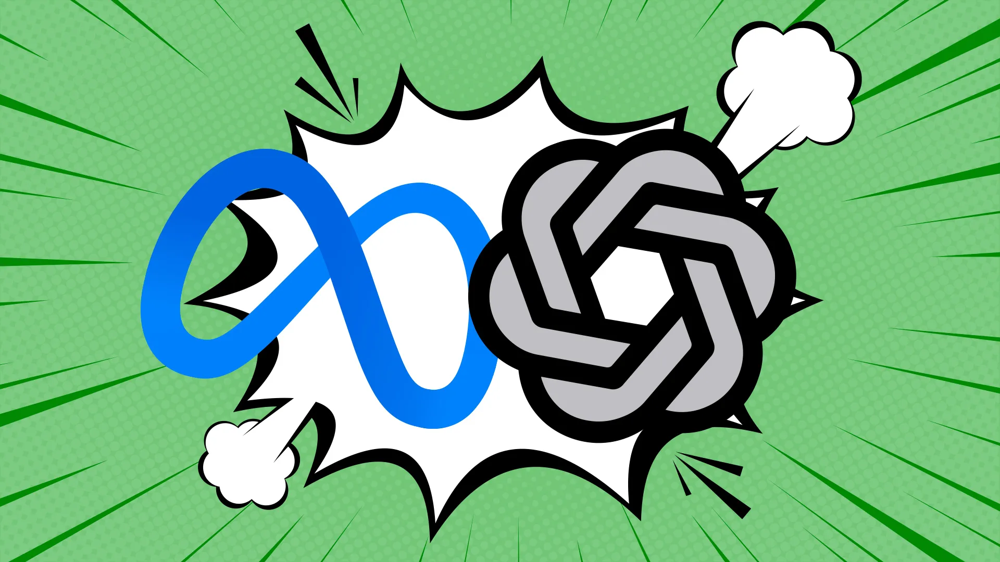



**收录说明**：原站拒绝自动访问，原文依据 Internet Archive 快照（20261026005351）存档；原标题依据页面正文标题更正（此前依据网址整理），作者依据页面元数据补上；去掉了作者头像、订阅提示和「What to read next」推荐区。原文全文存于本目录的 original.md，网站上不显示，已翻译。

**内容摘要**：Axios 记者 Ina Fried 以 WNBA 总决赛为题材测试 Dots 和 Muse：规划去亚特兰大看比赛的行程、组织紫色主题早午餐观赛派对、制作纪念节目册，以及购买球队周边。两者都能处理复杂的多步骤任务，都发现第三场比赛提前了一天且门票尚未公开发售；创作类任务成品丰富但仍需人工把关。真正「动手」时都受阻：Muse 卡在 Target 的登录环节，Dots 的半自动方式反而更快。作者结论是这类智能体最适合做调研和跑腿，由人做最终决定。

**保留理由**：同一组任务下 Dots 与 Muse 的并排实测，特别记录了购买环节的受阻点和用户对授权付款的顾虑。

---

插图：Aïda Amer/Axios。图片素材：Getty Images。

我们不妨称之为「机器人之战」第一部分：我决定让两个最新的个人 AI 智能体——[OpenAI 的 Dots](https://www.axios.com/2026/09/29/openai-dots-ai-assistant-devday) 和 Meta 的 [Muse](https://www.axios.com/2026/09/08/meta-debuts-muse-personal-ai-agent)——接受检验，而 WNBA 总决赛提供了一个天然的试验场。

**为什么重要：** AI 公司正竞相打造那个我们从购物到旅行规划都要求助的数字助理。但这些智能体能做的事，与我能放心让它们做的事之间，仍有差距。

- 它们还需要通过我们所说的[「人类基准」（The Human Benchmark）](https://www.axios.com/2026/10/20/hark-ai-agent-startup-free-pizza-doordash)：也就是说，它们能否像人一样快、或一样好地完成某件事？答案是……还不完全能，但能力仍然令人印象深刻。

**测试：** 我让每个助理规划一趟去亚特兰大的梦幻之旅，去看我心爱的 Golden State Valkyries，组织一场紫色主题的早午餐观赛派对，并制作纪念节目册。

- 我还让它们帮我购买 Valkyries 周边商品，这最终变成了一场寻找 WNBA 篮球卡的支线任务。

**成本：** Muse 大多数用途免费，另有可选的每月 20 美元和 100 美元订阅。Dots 需要 ChatGPT Pro 订阅，起价每月 100 美元，或通过商业版或企业版套餐使用。[更多关于 Dots 的内容](https://www.axios.com/2026/09/29/openai-dots-ai-assistant-devday)。

**它们出彩的地方：** 两个智能体在处理复杂、多步骤的任务上都出奇地好。

- 当我让它们查找飞往亚特兰大观看第三场比赛的航班和门票时，两者都发现比赛提前了一天，而且门票尚未向公众发售。可售座位通过转售市场提供，价格很可能被抬高。
- 两者都找到了不错的航班选项。Muse 打开了一个浏览器，让我输入信息，尝试登记门票预售。
- 与此同时，Dots 指出了一项与入学说明会的时间冲突，这是它从我借助 AI 跟踪在旧金山找到合适高中这件「乐事」的记录中得知的。

**它们有创意但不完美的地方：** 两个智能体都能把宽泛的指示变成出人意料地精细的成品，不过两者都还不太能取代人类编辑。

- 对于我的紫色主题早午餐，Muse 设计了一本色彩丰富的 10 页食谱小册子，主打紫薯华夫饼和薰衣草蜂蜜黄油。Dots 则制作了一份更实用的 8 页材料，包含详细的烹饪说明，并照顾到饮食偏好。
- Muse 的购物清单需要 12 个鸡蛋，而它的食谱需要 13 个。两个智能体还设计了邀请函，但在我发给朋友之前，都需要在审美和语言上做修改。
- 两份菜单都远比我实际上会为一场篮球观赛派对做的任何东西都要精致。要是让我自己来，我大概只会买些紫色糖霜甜甜圈。

**另一项创意测试：** 我让两个智能体制作一本 1980 年代风格的 WNBA 总决赛纪念节目册，后来又让它们把我第一场比赛的照片做成纪念品。

- Dots 的 38 页复古节目册在视觉上更吸引人，有球员照片、图形和大量统计数据。Muse 的 35 页版本没那么好看，但有一些有趣的细节，包括一则虚构的电脑广告，以及一则为我虚构的早午餐做的广告。
- 两本节目册都含有可疑的统计数据。Muse 后来主动发来一条更新，更正了几处事实错误。
- 至于照片节目册，Dots 仅在 47 秒内就交付了一个 12 页的版本，而 Muse 花的时间长得多。不过，Muse 提出了一个有趣的图片跨页创意，突出不同世代的 Valkyries 球迷。

**它们吃力之处：** 真正动手做事。我让两个智能体帮我购买 Valkyries 周边商品，最终定在 WNBA 球星卡上。

- 两者都帮忙比较了选项和价格。我选择了 Target，我的商店信用卡在那里提供 5% 折扣和免运费。
- Muse 尝试完成购买，但卡在了 Target 的登录页面。Dots 则引导我打开 Target 应用，我的账户和支付信息已经保存在那里。
- Dots 自动化程度较低的方式反而更快，尽管两项服务都支持经用户批准后购买。

**信任问题：** 如果我愿意让它们更多地访问我的账户和钱包，两个智能体本可以做得更多。我还不放心授权数百或数千美元的购买，也还没到足够信任它们、让它们做重大决定的程度。

**结论：** 对我来说，这些智能体的最佳定位是做好调研和跑腿的活，把最终决定留给我。

- 附言：由于其他安排，我实际上没能去成亚特兰大，也没能举办早午餐会。但我确实最终买了三盒 WNBA 篮球卡。你知道的，为了研究。
