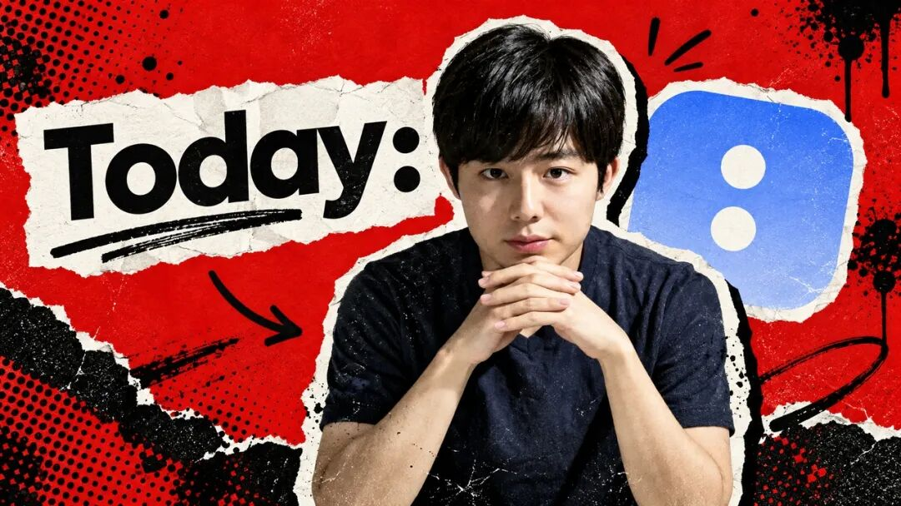
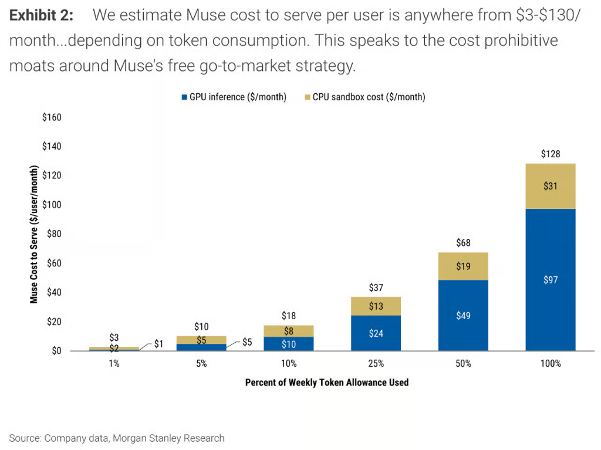
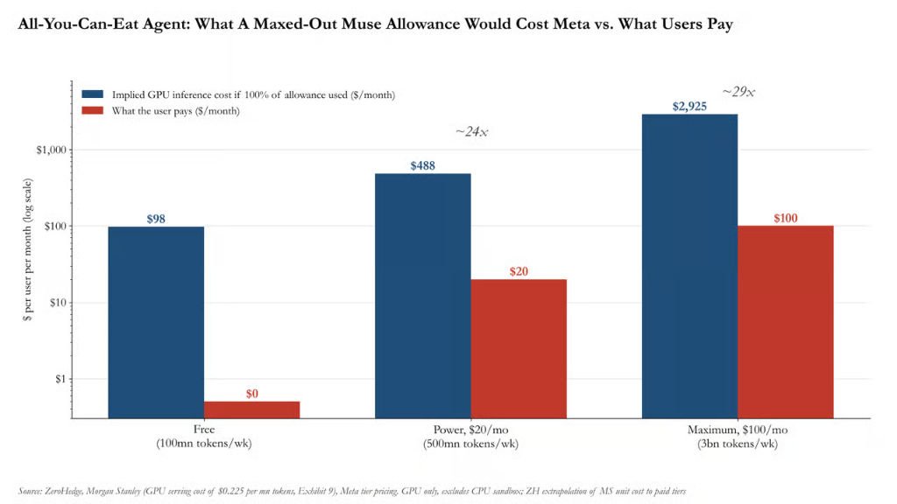
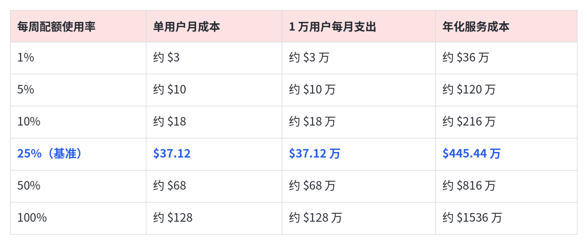
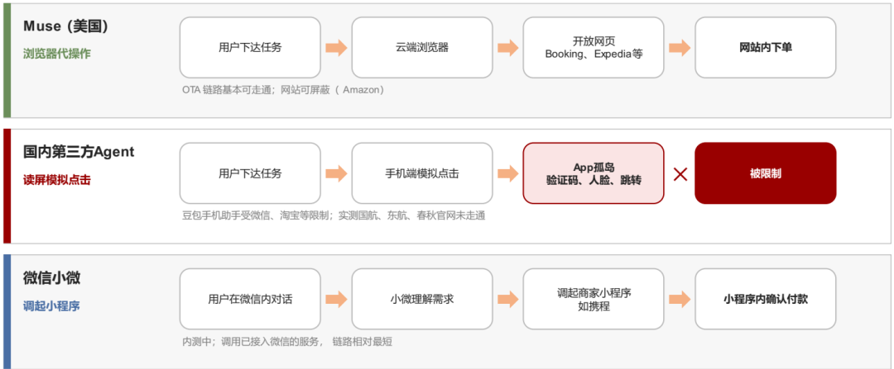
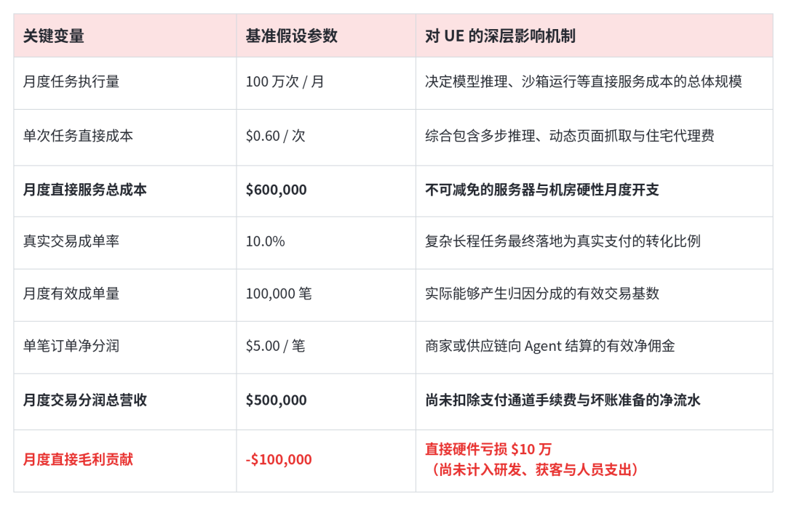
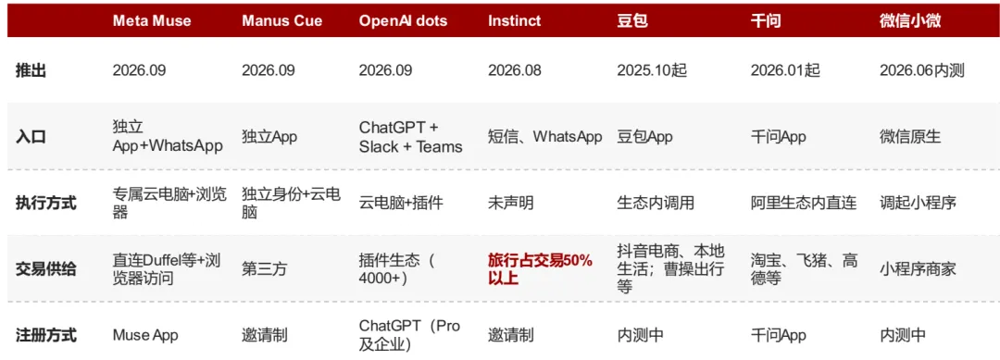



**收录说明**：用户提供链接。原文在微信公众号，用浏览器的客户端标识直接下载页面，从 `#js_content` 抽取正文，图片地址取自 `data-src`。文章以 Today AI 创始人齐俊元的融资为引子，主体讨论 Muse 等 Personal Agent；用户要求放在行业综合。文首 Z Finance 横幅与文末 FIN 图、招募和栏目推广图未收入。

**内容摘要**：文章以 Today AI 创始人齐俊元宣布累计超 2 亿美元融资（投资方包括 IDG 资本、五源资本、红杉中国及腾讯、蚂蚁集团、传音控股）为引子，主体分析 Personal Agent 的商业逻辑。文中引用 Muse 数据：9 月 8 日推出，Sensor Tower 10 月 20 日披露全球累计下载 1090 万次，10 月 16 日日活约 250 万，7 日和 14 日留存率分别为 30% 和 23%。文章引用摩根士丹利 9 月 30 日研报，估计 Muse 单用户月服务成本约 3 至 130 美元（另一处写作 3 至 128 美元），25% 配额情景下为 37.12 美元，并把成本拆为 GPU 推理、CPU 沙箱、接口与反爬、失败重试四层。文章推算 100 万日活对应单月服务器账单 3712 万美元，认为 Personal Agent 仍然是个伪命题。

**保留理由**：系统推演 Personal Agent 的单位经济与成本结构，是现有资料中成本测算最细的一篇；与 Today 融资的时间线也有关。

---

今天，齐俊元再次站到中国 AI 创投的聚光灯下。

这位曾创办 Teambition、先后负责阿里与字节核心协作和 AI 产品的连续创业者，带着成立仅七个月的新项目 Today AI，披露了累计超 2 亿美元的巨额融资。投资方囊括 IDG 资本、五源资本、红杉中国，以及腾讯、蚂蚁集团、传音控股等产业巨头。

从今年 3 月立项到 9 月推出产品，再到斩获超 2 亿美元，用时七个月，Today AI 是今年融资规模最高的应用公司，仅次于业务模式已经成熟的 manus。Personal Agent 创业的入场筹码，被资本以不可思议的速度急速推高。

资本为何急于对一家商业化尚在襁褓中的公司押下重注？答案藏在过去一个多月全球技术生态的热点中。

9 月 8 日，Meta 推出个人智能体 Muse，12 天狂揽 280 万下载并登顶美区 App Store 免费榜，10 月日活已达 250 万。它让硅谷第一次看清了下一代超级入口的雏形。

国内大厂同样感受到了刺骨的近身肉搏感。但在冲刺的关口，最具进攻性的字节跳动反而按下了暂停键，内部代号为「小豆」的 Personal Agent 虽已测试多时，上线节点却被一再推迟。

这种迟疑，恰恰照出了 Personal Agent 与上一轮 AI 应用创业的本质分野。过去两年，AI 应用的黄金法则是轻骑兵打法：三五人的小团队，套一层前沿模型的 API，外加精巧的交互与增长策略，就能迅速跑出一款爆款。

但 Personal Agent 恰恰相反，它要在云端沙箱中长期维系运行状态，持久保存个性化记忆，并在后台不间断轮询、纠错与执行。用户越依赖它，委托的任务就越复杂长程，背后消耗的模型推理与虚拟机开销非但不会被规模摊薄，反而会呈几何级膨胀。

这场竞赛因此演变为创始人的三项硬核底牌的比拼：必须有极深的长周期融资能力，抵御前置且漫长的算力亏损；必须懂模型微调、动态路由与沙箱快照工程，以美分为单位抠掉冗余成本；还必须拥有极强的商业组网手腕，才能刺破封闭的商户与支付生态。

齐俊元的 2 亿美元，只是 Personal Agent 的入场券。

## Muse 究竟为何成功？

先看 Muse 的成绩。

9 月 8 日，Meta 正式推出个人智能体 Muse。仅仅 40 天后，这款产品在美国的累计下载量便突破 1000 万次。根据 Sensor Tower 10 月 20 日披露的数据，Muse 的全球累计下载量达到 1090 万次，10 月 16 日的日活跃用户达到约 250 万，较前一周增长 15%。

更值得注意的是留存。Muse 的 7 日和 14 日留存率分别达到 30% 和 23%，均明显高于 Sensor Tower 统计的同类 AI 产品平均水平。这是消费级 Personal Agent 第一次如此迅速地触达百万级日活用户。

从回答问题到完成任务，看似只是产品形态的变化，背后却意味着完全不同的技术架构、成本结构与商业逻辑。

结合 Meta 的公开披露、第三方监测数据及行业访谈纪要，可以从六个方面理解 Muse 的快速增长。

**第一，Muse 的定位是争夺下一代消费者入口****。**

Meta 并不需要在每一个模型 Benchmark 上全面超过 OpenAI 和 Anthropic。它更独特的优势，是 Facebook、Instagram 和 WhatsApp 积累的庞大用户网络，以及围绕广告、内容和商业交易建立的生态。

截至目前，Meta 旗下应用每天触达约 36 亿用户。这些产品构成了 Muse 潜在的分发渠道，也让 Meta 有机会将个人助理与社交关系、消费兴趣和商业服务连接起来。与 ChatGPT 主要依靠用户主动打开对话框不同，Muse 的长期目标是成为一个持续存在的个人代理。它既理解用户的需求，也能够在授权范围内调用工具，完成具体行动。

对 Meta 而言，真正重要的不是用户每天向 AI 提出多少问题，而是未来有多少消费决策会首先经过 Muse。

**第二，Muse 的爆发，是产品能力、免费补贴和****Meta****分发资源共同推动的结果。**

行业访谈纪要显示，Muse 早期提供了每周约 1 亿 Token 的免费额度。对于普通消费者，这意味着可以相对自由地尝试复杂任务，而不必担心每次调用模型都会产生费用。

与此同时，Muse 将 Computer Use、Tool Call 和独立云端运行环境结合起来，让用户能够直接委托现实任务。例如，为一次购物比较五六家不同商户的报价，反复查询库存和优惠，或者尝试联系商家处理售后问题。

但增长并不完全来自产品本身的传播。Sensor Tower 数据显示，Meta 在 10 月将其广告投放支出的约 39% 用于推广 Muse，高于 9 月的 23%。Muse 已经成为美国广告曝光量排名前列的品牌之一。换句话说，Meta 不仅在补贴用户的计算成本，也在利用庞大的营销预算加速获取用户。

这正是独立创业公司很难复制的增长方式：Meta 可以同时承担获客成本与服务成本，迅速验证一个新的产品入口。

**第三，百万级日活背后，Muse 的订阅变现仍然处于早期阶段。**

尽管 Muse 已经拥有约 250 万日活跃用户，但公开市场至今没有获得完整的 MAU、付费订阅人数和订阅收入数据。

行业访谈纪要曾估计，Muse 上线初期的付费用户仅有千人量级，原因之一是免费额度足够慷慨，普通用户缺乏立即升级的动力。但这一数字并未得到 Meta 官方确认，也不能用早期付费人数与最新 DAU 直接计算付费转化率。

这反映了 Personal Agent 一个重要的商业难题：用户愿意让 AI 帮自己做事，并不意味着愿意立即为每一次任务执行付费。Meta 显然不急于依赖订阅回收全部成本。相比短期收入，它更需要观察用户是否愿意持续把真实任务交给 Muse，以及哪些使用场景能够形成长期习惯。

**第四，Muse 需要警惕用户增长背后的持续性计算开支。**

传统移动互联网产品的主要成本通常来自服务器、带宽和存储，新增用户的边际成本相对有限。但 Muse 不同。一个 Agent 要完成复杂任务，往往需要连续调用模型、操作浏览器、检索信息、维护任务状态，并在失败时重新规划。用户使用越深入，系统消耗的计算资源就可能越多。

摩根士丹利互联网研究主管 Brian Nowak 团队的专题研报中，对 Muse 的 Unit Economics 进行了专门测算。根据不同 Token 使用强度，研究模型估计每位用户每月直接服务成本约为 3 至 130 美元。在使用每周 Token 配额 25% 的基准情景下，单用户月服务成本约为 37.12 美元，其中既包含 GPU 推理，也包含用于实际任务执行的 CPU Sandbox。

也就是说，Personal Agent 的用户规模即使只有数万，也可能形成可观的持续性服务费用。

对于拥有成熟广告业务和大规模数据中心的 Meta，这可以被视为长期战略投资。对于独立创业公司，却可能迅速成为现金流压力。

**第五，****Meta****不打算只靠订阅赚钱，而是希望让 Agent 重新连接广告与交易。**

Muse 上线首日便集成了 Stripe 旗下的 Link 支付系统，可以调用用户已经保存的支付方式，在超过 100 万家 Link 商户完成交易。对于未接入 Link 的商家，系统还可以根据用户批准的订单生成一次性虚拟卡。随后，Meta 又陆续将 Shopify、PayPal 及多家大型零售商纳入合作网络。

这背后隐藏着比订阅更大的商业想象。

苹果推出 App Tracking Transparency（ATT）后，Meta 跨应用获取用户行为信息的能力受到限制，广告投放与最终成交之间的归因链条变得更加复杂。而 Muse 如果能够从用户最初提出购物需求开始，参与商品筛选、价格比较直到完成支付，Meta 就有机会更直接地理解消费意图和交易结果，建立订阅之外的收入来源。

**第六，****Meta****的优势在于商业生态，但下一代入口的竞争远未结束。**

Muse 的成功并不意味着 Meta 已经赢得 Personal Agent 市场。一方面，OpenAI、Anthropic 等前沿模型厂商仍在提升复杂推理、工具调用和长程任务执行能力。Meta 也持续推出新的 Muse 系列模型，希望缩小基础模型能力上的差距。

另一方面，苹果和谷歌掌握着移动操作系统、应用权限和硬件入口。如果未来个人 Agent 被直接整合进手机系统，它们就可能获得更加原生的上下文访问和操作能力。

而 Meta 主要依靠 App、云端计算环境及外部连接器，仍然需要处理跨应用授权、支付、数据访问和操作可靠性等问题。

因此，Muse 的下一阶段竞争，不只是模型能力，也将取决于谁能将个人数据、工具权限、商业服务和执行环境组织成足够稳定的产品体系。

Muse 的增长至少证明了一件事：消费者愿意尝试将真实任务交给 AI，Personal Agent 不再只是少数技术爱好者的实验。但它还没有证明另一件同样重要的事：当这些用户形成长期使用习惯之后，服务产生的收入能否覆盖推理、计算环境和任务执行成本。

这也引出了 Personal Agent 创业真正的第一道门槛：当用户增长意味着持续增加的服务成本，创始人究竟需要多强的融资能力，才能支撑公司走到 Unit Economics 成立的那一天？

## **解构 Personal Agent 的四层成本黑洞**

在 Personal Agent 成为全行业焦点之前， AI2C 领域已经亮起过两记刺眼的警灯。

2024 年初，Inflection AI 倾力打造的陪伴式助理 Pi 已积累约 100 万 DAU、600 万 MAU，全网累计交互消息超过 40 亿条。然而，强烈的用户依恋与高频互动并没有兑现为自洽的商业模型。数月后，联合创始人 Mustafa Suleyman 率领核心团队转投微软，公司业务重心随即调头转向 B 端。

到了 2026 年 10 月，估值曾超 10 亿美元的明星独角兽 Character.AI 正式递交 Chapter 11 破产重组申请。法庭披露的财务文件揭开了一个惊悚的经营切面：截至 2026 年 8 月，公司单月总营收已达到 530 万美元，但同期单月运营开支高达 1330 万美元，前八个月累计付给云厂商的计算账单更突破 5610 万美元。

尽管法律纠纷与团队动荡同样重创了公司，但算力支出以失控之势吞噬营收，无疑是最致命的一根导火索。

而 Personal Agent 的出现，则把这笔账推向了更加超出想象的极限。

2026 年 9 月 30 日，摩根士丹利互联网首席分析师 Brian Nowak 团队发布了一份深度研报，将 Muse 的单用户服务成本，清晰地拆分为“GPU 推理”与“CPU 沙箱环境”两大物理支柱。

研报显示，当用户的每周免费 Token 配额使用率从 1% 递增至 100% 时，单用户每月产生的服务成本在 3 至 128 美元之间宽幅震荡。而在大摩设定的 25% 配额基准使用情景下，单个用户的月度直接服务成本约为 37.12 美元，年化开销高达 445.44 美元。

***摩根士丹利 Exhibit 2：单用户******GPU******与 CPU 成本分解***

在 25% 配额的基准使用强度下，一个活跃用户每月大约消耗 1.08 亿 Token，直接对应 37.12 美元的月度服务硬支出。以此为锚点，我们可以清晰地剥离出埋藏在 Agent 体系之下的四层成本黑洞：

### **第一层：Token 膨胀与****GPU****推理成本**

摩根士丹利模型以 Meta 部署的下一代 GB300 GPU 为基础，假设单卡有效吞吐量为每秒 3500 Token 的有效吞吐量，在 75% 的全天平均利用率下，推导出每百万 Token 约 0.225 美元的内部自建推理成本。即便按此极致的成本估算，在每月 1.08 亿 Token 的基准负载下，光是 GPU 推理一项，每月就需要硬性烧掉 24.30 美元。

当这种成本结构撞上传统的包月订阅制，用户使用得越多，公司的毛利率反而越发恶化。知名科技分析机构 Macrostream 在大摩披露的 GPU 效率参数基础上进行了极限压力推演。在每月 20 美元的 Power 套餐中（包含每周 5 亿 Token 配额），如果一位重度用户全额用满配额，其单月产生的 GPU 推理成本将飙升至约 488 美元；而在每月 100 美元的 Maximum 高阶套餐中（包含每周 30 亿 Token 配额），完全用满配额对应的 GPU 账单将达到惊人的 2925 美元。

在统一定价下，越是重度依赖你的忠诚用户，在资产负债表上越是严重的流血负资产。

**********

*****摩根士丹利 Exhibit 4：***订阅套餐额度全部用满时的 GPU 成本**

### **第二层：CPU****沙箱****与计算环境**

Agent 要脱离对话框替人类跑腿，就必须拥有隔离的操作系统环境。

模型为此假设每个用户配备一个 2 vCPU、8GB 内存的标准隔离沙箱，参照 AWS AMD 实例的公开按需报价（约每小时 0.1217 美元），并另计每月约 0.60 美元的存储维护费。在 25% 配额情景下，月度 37.12 美元总成本中扣除 24.30 美元的 GPU 费用后，余下的 12.82 美元便由沙箱运转、存储以及配套开销所占据。

工程的关键在于，用户真正需要长期驻留的是个性化记忆与任务状态，而不是一台 24 小时空转挂机的虚拟机。若采用最原始的 24/7 常驻模式，一台 2 vCPU、2 GiB 的基础沙箱每月仅闲置租金就达 95.90 美元。但若改用‘按需拉起 + 状态快照休眠’架构（将运行状态压缩存储在 S3 等对象存储中，任务到来时毫秒级唤醒，单日累计运行 1 小时），月成本便能骤降至 4 美元以内。

如何管理沙箱的休眠与弹性唤醒，成了决定 Agent 团队生死的核心工程分水岭。

### **第三层：网络通信与外部协议接入**

跨平台的比价与预订，本质上是一场对抗现实世界软件阻力的消耗战。当 Agent 缺乏官方授权接口，被迫依赖 Computer Use 模拟人类点击时，各大电商与酒旅平台森严的反爬网关、频繁变动的动态 DOM 树以及层出不穷的图形验证码，都会导致任务耗时成倍拉长，甚至陷入死循环。

为了穿透反爬封锁，团队不得不采购昂贵的高匿住宅代理网络（每 GB 流量可达数美元），这进一步蚕食了本就微薄的利润空间。摩根士丹利在模型中虽未将代理与接口采购单列，但业内心知肚明，这构成了隐秘而刚性的摩擦税。

这也是为什么扎克伯格在 Muse 上线第一天，就竭力拉来 Stripe Link 整合免密支付，随后火速连通 Shopify 与大型零售商的核心原因：结构化商户协议与原生支付接口，能把脆弱、昂贵的视觉模拟点击，替换为确定、廉价的毫秒级 API 通信，这不仅大幅拉升了履约成功率，更是从源头上斩断算力浪费的唯一正道。

**第四层：失败重试与人工干预溢价**

对 Agent 而言，真正决定生死存亡的北极星指标，是“单次成功交付任务的总成本”（Cost per Successful Task）。设想一项订票任务的基础执行成本为 1.00 美元，若真实环境下的成功率仅为 70%（假设各次尝试独立同分布），为换取一个确定的成功交付，系统期望需要尝试 1.43 次，使得单次有效任务的真实成本上浮至 1.43 美元（即 43% 的重试溢价）。

将上述单用户模型放大至具备统计意义的群体规模，便能勾勒出一张现金流消耗表：

*数据说明：表中圆整数据源于摩根士丹利公开 Exhibit 2。上述测算未计入获客推广、核心研发薪酬、渠道税与人工兜底成本*

哪怕仅仅服务 1 万名达到 25% 基准负载的活跃用户，一家初创公司单月支付给云厂商的纯硬件账单就高达 **37.12 万美元**。若要支撑典型的 18 个月产品打磨与商业验证周期，在不买量、不计团队工资的真空状态下，光机房账单就需备足 **668 万美元**的真金白银。

对于账面趴着百亿级广告现金流的 Meta，这种失血是一笔抢夺下一代流量话语权的战略前置投资。但对于独立创业公司而言，融资规模直接决定了你在死生之地里能买到多长的时间窗口。

## **模型能力成为刚需**

过去两年，AI 创投界曾流行过一种近乎理想的分工：OpenAI、Anthropic 负责把底层模型训得越来越聪明，应用层创业者负责寻找场景、打磨交互，中间只隔着一层明码标价的 API。

这套模式催生了大批小团队的神话——十几人的团队，凭借出色的审美与增长裂变，就能在几个月内推出一款风靡全球的爆款。但 Personal Agent 的到来，把这种轻巧的默契撕得粉碎。

原因很朴素：**一个真正的全天候个人代理，每天接管的任务离散度太大了。**

用户清晨可能随口问一句“今天出门要不要带伞”，午休时让它从收件箱里归集过去半年的报销发票，傍晚又丢来一个长程复杂指令——跨越五个电商平台监控同款降噪耳机的价格走势，并在降价时自动联系客服锁定优惠券。

在计算世界里，这些任务对底层模型的要求有着天壤之别。查天气不过是极简的实体抽取，归类邮件连初阶模型都能轻松胜任；但跨平台的自动化比价、页面解析与交易反思，却动辄牵扯到数十轮工具调用与自我纠错。

如果系统不分青红皂白，把所有请求一股脑儿抛给最昂贵的前沿旗舰模型，产品在早期或许能换来体面的准确率，但每多一个功能、每多一位深度依赖的重度用户，都会进一步推高公司的现金失血速度。

这场技术竞赛的重心，正在被迫发生转向：**它不再单纯比拼谁调用的模型更聪明，而是比拼谁能用最低的计算底噪，把一件真实世界的任务稳定做完。**

最早在工程上尝试破局的，是估值已冲上百亿美元的 Instinct。

今年 9 月，创始人诺亚·辛（Noah Shinn）在与投资人帕特里克·奥肖内西（Patrick O'Shaughnessy）的对谈中，道破了他敢于坚持“全免费个人助理”背后的工程算盘。

如果 Instinct 每天处理的海量购物、订票与日常琐事，全量依赖上游商业大模型的实时接口，商业模式在几个月内就会被算力账单击穿。Instinct 最终选择自建一套异构的混合推理与任务调度管线。

诺亚·辛抓住了 Personal Agent 与聊天机器人之间一个关键的时间差：**个人助理绝大部分的后台代工，根本不需要像聊天界面那样，在 500****毫秒****内把字吐在屏幕上。**当用户委托 Agent 在未来数小时内比对机票价格、整理发票或追踪包裹动态时，只要最终能在约定节点交付结果，系统完全可以把这部分计算需求推迟到低谷时段，利用价格极低的点存算力进行大规模异步批处理。

诺亚·辛透露，在特定的后台工作负载中，这种脱离了“即时响应”枷锁的专门化推理架构，能让同一份算力资源的吞吐效率直接拔高 3 到 8 倍。

如果说 Instinct 是在推理调度层面寻找算力套利，那么拥有自有智算中心的 Meta，则试图将这套手术直接动在基础模型里。

9 月，扎克伯格在接受科技播客《Sources》采访时，首次系统披露了 Meta 内部代号为「Watermelon」的模型战略。在他看来，消费级 Agent 绝不能简单等同于“通用底座 + 一层外挂 Prompt + 几个工具插件”。他认为，“要让 AI 长期理解一个人、自主规划并在物理世界里稳定干活，这种代理能力必须在模型预训练的第一天就埋进去。”

通常的创业路径是先挑选市面上最强的通用模型，再靠外挂的 RAG、系统提示词、短期记忆库和函数调用强行拼装成助理。Meta 却把逻辑彻底倒置：先在业务层面定义清楚下一代个人助理需要哪些行为特征，再反哺到模型训练阶段定制专属的权重与结构。

10 月 12 日，Watermelon 以「Muse Wonder」之名面世，重点固化了两项过去必须依赖外部工程外挂的底层能力：

- **主动记忆（Active Memory）**：模型不再被动依赖外部向量数据库把历史对话粗暴塞满上下文，而是能在交互中自主甄别关键事实并原生保留；
- **主动聚焦与容错（Active Focus）**：当遇到失效链接或反爬阻碍时，模型不再机械式地弹窗报错，而是原生具备在多条分支路径中自主回溯、尝试替代方案的反思本能。

这两项突破表面上看是在打磨用户体验，深层逻辑全是账本考量。更精准的记忆调用，意味着无需在提示词里长年累月地拖着膨胀的上下文；更稳健的自主纠错，意味着大幅削减了任务失败导致的连环重试开销。

但更大、更强的模型，往往也意味着更沉重的推理能耗。扎克伯格为此建立起了一套梯次分明的模型舰队。这背后藏着一笔能够直接改写公司毛利率的经典算账模型：

设想一家拥有百万级活跃用户的 Agent 平台，每月需要执行 100 万次代表性代工任务。依照真实分布，其中 80% 属于天气查询、邮件归类、日程确认等机械性低阶事务，仅有 20% 属于跨平台比价、长程反思与复杂研究。

若不加节制，全量调用单次均价 0.20 美元的高性能前沿模型，单月仅推理账单就高达 **20 万美元**；

但如果搭建起灵敏的路由中枢，将那 80% 的日常杂务无缝下沉给单次调用仅需 0.01 美元的专用轻量模型，仅在攻坚阶段唤醒旗舰大模型，全月的推理账单会瞬间被砸到 4.8 万美元，**直接在财务报表上减少 76% 的计算成本。**

在百万 DAU 的放大镜下，哪怕单次任务仅节省区区几美分，放到年化维度上，就是数百万甚至上千万美元的生死之差。而对于身处中国战场的齐俊元和 Today AI 而言，技术取舍还要面临更独特的本土现实。

这是两代 AI 应用创业者的分水岭。在上一代移动互联网甚至通用大模型初期，创始人的首要职责是“懂用户、懂增长”；底层技术的演进是一种外生变量，可以完全打包交给供应商。但在 Personal Agent 时代，**只懂****产品经理****哲学的创始人，大概率会被自己失控的****算力****账单吞噬。**

## **OTA 的中国式困局**

在真实世界里，Personal Agent 最重要、最高频、也最容易让用户掏出钱包的场景，极其明确地集中在三件事上：**订票、购物与跨平台比价**。

扎克伯格在推出 Muse 时比谁都清楚这一点。他**在上线第一天，就火速把西方主流商业网络做成了 Muse 的出厂设置**：

- **首发绑定 Stripe Link 钱包**：直接打通超 100 万家商户的免密支付，并在对话框内一键授权扣款；面对长尾商家，则直接调用接口签发单次虚拟信用卡，在限额内完成结算，降低信息泄露和未经授权交易的风险。。
- **极速结盟电商与零售巨头**：紧随其后，Shopify 的数十万独立站商品目录与 Shop Pay、PayPal 账户体系，以及沃尔玛（Walmart）、Best Buy、Sephora 等主流零售接口被全线接入。

这直接在物理层面上改写了成本与确定性。当订票、购物与比价能够调用 API 而非模拟点击时，**任务交互变成了****毫秒****级的确定性纯文本请求，Token 消耗直接暴跌一个数量级，****显著降低交互开销并提升任务成功率**。

但在中国，这套逻辑会立刻撞上高墙。

资料来源：Skift，Bloomberg，新浪科技，中金公司研究部

国内的订票、购物与本地生活，早已被携程、飞猪、淘宝、京东、美团分为封闭的超级 App 孤岛。当你的 Agent 烧掉昂贵算力、跨平台替用户比对了十几个酒店套餐后，最终依然必须把用户踢回携程或美团的 App 内部结账。没有底层归因协议，垄断平台只会将这判定为自发访问，渠道佣金分文不给。**独立 Agent 跑断了腿，最终不过是自掏电费为大厂免费打长工。**

更值得创业者冷水浇头的是佣金模式背后脆弱的 Unit Economics。即便抛开平台封锁不谈，单纯从算力成本与抽佣收入的数学天平来看，这笔账依然极难算平：

*交易抽佣型 Agent 的单月单位经济（UE）压力推演模型*

从上表可以看出，哪怕平台每月促成了 10 万笔真实交易、产生 50 万美元佣金，也仅仅能够覆盖八成左右的基础算力成本，直接毛利依然净亏 10 万美元。在交易闭环尚未跑通之前，空有庞大的任务调用量，不仅无法形成规模效应，反而是加速现金流枯竭。

因此，中金前瞻性地提出，消费级 Agent 最终的商业归宿大概率将演变为‘免费基础服务 ＋ 交易导向的效果广告’（CPS 模式）。从过去搜索时代的‘按点击计费（CPC）’，顺理成章地迈向 Agent 时代的‘按成交与销售额提成（CPS）’。

然而，这一终极形态的实现门槛极高，它不仅需要强大的模型执行力，更需要一整套成熟的广告竞价算法、千万级商家协作网络、全链路订单归因技术，以及金融级结算基础设施——而这恰恰是阿里、腾讯、字节、美团等存量互联网巨头深耕了十数年的看家本领。

*****注：原中金研报图表 13，海内外个人 Agent 的对比*

这就把中国的独立 AI 初创团队推向了一条进退维谷的窄门：

若选择向用户收取订阅费（如海外主流的 20 美元/月模式），面对国内豆包、千问、元宝等依托大厂雄厚现金流提供大量免费功能的产品，独立产品几乎没有任何胜算。若选择向商家收取交易佣金，又无力打破垄断巨头的围墙花园，无法独立获取稳定的供给、归因与结算通道。

因此，对于当下的中国 Agent 创业者而言，真正的解题之道绝非盲目追逐大而全，而是必须在极少数高客单价、供应链离散、巨头统治力相对薄弱的高价值垂直纵深中，先咬牙把第一张闭环账本做实：**到底由谁提供不可替代的供给、由谁负责履约担保、由谁确认订单归因、由谁按期结算佣金，以及任务一旦遭遇幻觉或失败，昂贵的赔付责任究竟由谁承担。**

## **Image**

## **结语**

Personal Agent 是这一轮 AI 浪潮中，极少数在 Day 1 就形成高度共识的赛道。从 Meta Muse、Instinct 到齐俊元的 Today AI，科技巨头和创业者都在押注：一个拥有长期记忆、能在云端自主执行任务的个人中枢，就是下一代互联网的超级入口。

但共识来得太早，往往意味着门票从第一分钟起就被哄抬到了天价。

不妨算一笔账：

假设 Today AI 做出一款真正被大众接受的爆款，日活触达 100 万，使用强度与当前的 Muse 相当。按照摩根士丹利对 Muse 建立的基准模型，100 万日活，对应的单月服务器账单是 3712 万美元，年化约 4.45 亿美元——超过 31 亿人民币。这还是一张被高度简化的账单，未计入顶尖团队薪酬、商务拓展与昂贵的获客投放。

立在独立创业者对面的，是 Meta、字节、腾讯与阿里。这些科技巨擘账面上趴着百亿级现金流与海量自建算力。大厂在用生态防御的零花钱打仗，独立创业公司却在押上全部身家。

这不再是“以小博大”的游戏，而是一场从诞生起就必须与失血速度赛跑的极限马拉松。

参考资料

[1] Morgan Stanley Research. 23 Days of Musing... Top Investor Questions and Our Answers. September 30, 2026.

[2] Macrostream. Morgan Stanley's Muse Unit Economics Analysis. October 2026. 

[3] TechCrunch. Meta's Muse Hits 10M US Downloads in 40 Days. October 20, 2026. 

[4] 投资界.《Today 累计完成超 2 亿美元融资》. 2026 年 10 月 21 日. 

[5] 中金公司.《中金 | AI应用参考（3）：600条数据实测Muse如何重塑旅游预订链路》. 2026 年 10月 16 日. 

[6] Invest Like the Best. “Noah Shinn — Building Instinct.” 2026. 

[7] Stripe. Stripe Helps Meta Muse Shop with Link. September 2026.
