

**收录说明**：TechCrunch 的短信类智能体合集，列出 24 款产品，其中包括跟踪中的 Poke 与 Instinct。11-21 版新增 Haven（“数字分身”）、去掉 Ollie，其余内容与 10-24 版一致；正文取自 11-21 地址直接下载，删去了文末的作者简介与推荐阅读。原译文随更新作废，已重新翻译。

**内容摘要**：文章是一份 24 款可通过短信等消息渠道使用的 AI agent 清单，开头称它们可记忆上下文、连接应用并代用户完成任务；当前最受关注的是 Instinct，在最新一轮 10 亿美元融资后估值 100 亿美元。涉及 Poke 的部分称其 2026 年 3 月作为通用助手发布，覆盖日历、规划、健康健身、智能家居、照片等；6 月获 Apple 批准成为 Apple Messages for Business 上首个 AI agent，约一个月后其母公司被 Cognition 以“low nine figures”收购。Instinct 部分称其先融资 3.5 亿美元（估值 25 亿美元），2026 年 9 月融资 10 亿美元（估值 100 亿美元）；可通过文字或语音使用，连接邮件、日历、Google Workspace；9 月起为用户的助手提供专属邮箱地址以代为注册服务和联系商家，文中提到该自主性引发隐私与安全担忧，并已开始支持打电话；仍处于私测。新增的 Haven 自称“数字分身”而非短信助手，基于互动建立个性化记忆图谱，理解用户的偏好、习惯与决策方式，目前在 iPhone、Android 与网页上免费测试。其余条目包括 Ask Proxy、Caddy、Comma、Fambot、Wajo（给 agent 配独立邮箱、电话和支付卡）、Underdog（模型完全在用户设备运行）等。

**保留理由**：提供 2026-11 市场格局的横向对照和 Instinct 融资、专属邮箱等细节，以及 Poke 在同类产品中的位置；Poke 部分只是对 TechCrunch 自家前文的概括。

---

越来越多的智能体不需要你再下载一个应用，直接像给普通人发短信一样给它们发消息就行。

你发消息告诉它你需要什么，它能记住上下文、连接你已经在用的应用和服务，并代你完成任务。这可能意味着预约、整理日历、研究一次旅行、发一封邮件、订位、网购，或者过几天提醒你某件事。

Instinct 是目前最有话题度的 AI 智能体之一，[这要归功于它最新一轮 10 亿美元融资后达到的 100 亿美元估值](https://techcrunch.com/2026/09/28/viral-ai-agent-instinct-raises-1b-series-c-at-a-10b-valuation/)，但还有许多其他产品也在争夺这个领域。

以下是目前最值得注意的一些选择，从通用型个人助手到为家庭、旅行和工作设计的智能体。

## Ask Proxy

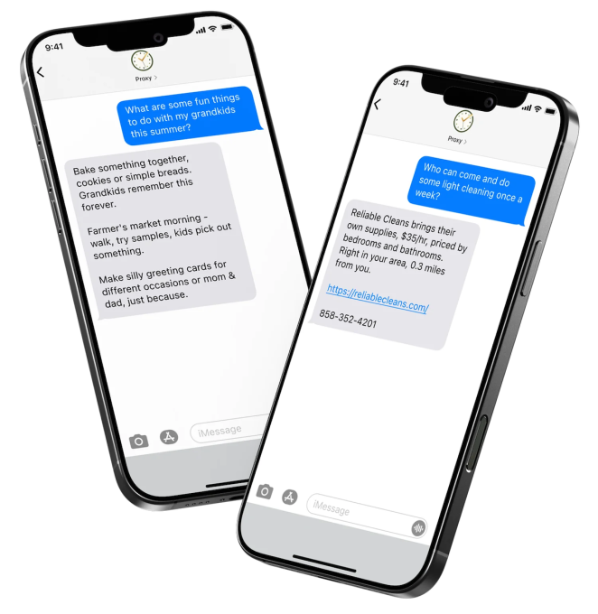

**图片来源：**Ask Proxy

[Ask Proxy](https://askproxy.com/) 最大的差异点是它「像女人一样思考」，公司在其网站上解释说，这意味着它力求在你开口之前就预判你的需求。

它的用法像一个你可以像朋友一样发短信的聊天机器人，无论你需要送礼点子、帮忙策划一场活动，还是周末去哪玩的推荐。你可以让它把重要日子加进日历、设置提醒，或者帮你在日常决定上拿主意。你也可以给它发照片，比如一张空桌子，让它想办法为晚宴布置这张桌子。

与典型的聊天机器人不同，Ask Proxy 还会主动出击。当它注意到你可能忘记某件事，或者碰上一项你可能喜欢的新活动、新餐厅、新体验时，它会主动联系你。

它还有一个面向工作的版本，公司解释说这个版本「让员工更快回到工作上，同时把个人数据挡在公司系统之外」。

个人版每天 1 美元。企业版方面，大公司每名员工每月 15 美元起，少于 49 人的小团队每名员工每月 23 美元起。

Ask Proxy 通过短信工作。你可以向 820-732-2625 发「start」。

## Caddy

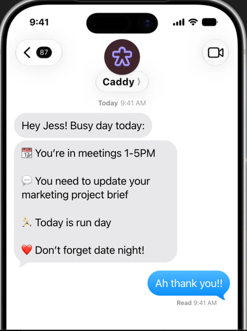

**图片来源：**Caddy

[Caddy](https://caddy.app/) 是一个 AI 助手，把散落在你手机里的信息变成你真正能据以行动的东西。对 iPhone 用户它住在 iMessage 里，对 Android 用户它住在 RCS 里，所以没有单独的应用或收件箱需要你不停去看。

比如，一封邮件里有一个需要加进日历的预约，或者一位朋友发来一份要买的东西清单。与其担心这些细节被埋没，Caddy 会连接你的日历和对话，然后找出可能需要行动的事项。它能把事件加进日历、设置提醒、跟踪后续，甚至替你做一些研究。

Caddy 自 2026 年 4 月起公开测试。

## Comma

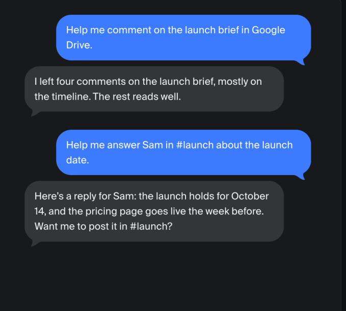

**图片来源：**Comma

[Comma](https://comma.surf/) 的设计目标是管理横跨工作与日常生活的任务。Comma 把任务一直推进到完成，自己检查自己的工作，并判断一项任务何时算完成。

完成的工作会在需要决策或批准时呈现出来供你审阅。它还会主动通知用户并建议下一步。

它可以在用户的浏览器、电脑和文件之间工作，同时能通过 Signal、Telegram 和微信等消息应用远程访问。Comma 跨设备和跨对话维持上下文与记忆，能提供每日简报、标记紧急事项，并总结录音通话。

Comma 可以免费起步，并且是开源的。

## Fambot

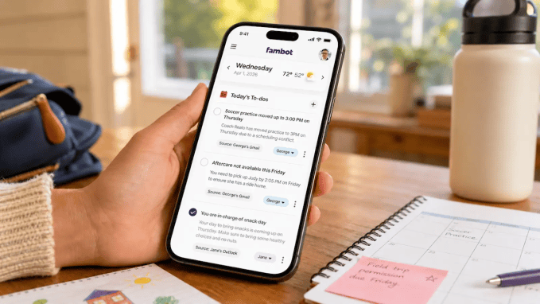

**图片来源：**Fambot

[Fambot](https://fambot.com) 是一个面向家庭的 AI「幕僚长」，旨在把家庭生活里众多流转的部件——学校通知、体育活动、餐食计划、日历以及其他日常责任——整合成一份有条理的计划。

这项服务设计为同时通过应用和短信工作。Fambot 在 iOS 设备、Android 设备和网页上可用，家庭也可以直接通过短信与它互动。每天晚上，Fambot 会自动发送一份次日的摘要，包括即将到来的事件、待办事项，以及校服或打包要求之类的细节。家长可以回复这些消息来提问、核对信息，或者改动自己的日历。

Fambot 目前连接 Gmail、Google Calendar、Outlook 和 WhatsApp，未来计划支持 Apple 日历。

公司于 2026 年 9 月初[以测试版推出](https://techcrunch.com/2026/09/01/fambot-introduces-an-ai-chief-of-staff-for-families/)，已筹集 350 万美元种子前轮融资。测试期间这项服务免费，但 Fambot 预计最终会收取大致相当于一份 Netflix 订阅的费用。

## Folk

**图片来源：**Folk

[Folk](https://www.folk.com/) 被设计成一个你可以通过 iMessage、WhatsApp 和 Telegram 触达的 AI 助手。它能记住个人上下文、管理提醒、研究话题、跟踪航班、处理邮件，并完成餐厅订位这类现实世界的任务。

一个区别是 Folk 跑在自己的私有云电脑上。它还能运行代码、执行多步任务，而不只是做对话式回答。

Folk 于 2026 年 5 月推出测试版，可免费使用，但也提供每月 8.33 美元的 Pro 订阅，供你想要在后台无限运行任务时使用。

## Haven

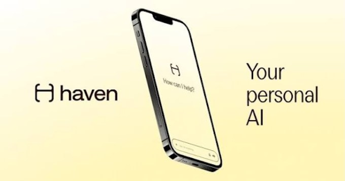

**图片来源：**Haven

[Haven](https://my.hellohaven.ai/) 的不同之处在于它提出的是「数字分身」的概念，而不只是一个基于文本的 AI 助手。

据公司称，Haven 会理解并适应你的偏好、日常习惯和决策方式，基于你的互动建立一张个性化记忆图谱。正如公司[所描述的](https://my.hellohaven.ai/press/hello-haven-your-digital-twin-not-just-an-assistant)：「个人助手知道你让它做什么。Haven 知道你会做什么、以及你会怎么做。」

值得注意的是，公司设想未来会有跨设备定制你体验的功能，比如电视和汽车。

目前，Haven 在 iPhone、Android 设备和网页上以测试版免费提供。

## Instinct

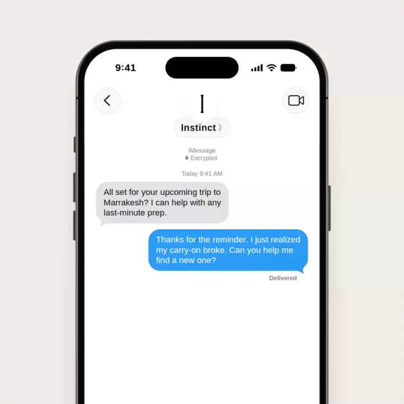

**图片来源：**Instinct

[Instinct](https://instinct.com/) 首次登上头条，是在以 25 亿美元估值融资[3.5 亿美元](https://techcrunch.com/2026/08/26/viral-ai-startup-instinct-has-raised-350-million-at-a-2-5-billion-valuation/)之后。2026 年 9 月，它又融资[10 亿美元](https://techcrunch.com/2026/09/28/viral-ai-agent-instinct-raises-1b-series-c-at-a-10b-valuation/)，估值达到 100 亿美元。

这个随时在线的智能体能代你采取行动，而不只是回答问题。用户可以通过文字或语音与 Instinct 交流，并把它连接到已经在用的应用和服务，比如邮件、日历、Google Workspace 等。公司称早期用户用 Instinct 做过各种任务，从规划旅行、买菜，到订票和取消订阅。

9 月，Instinct 开始为用户的助手提供[专属邮箱地址](https://techcrunch.com/2026/09/09/viral-ai-assistant-instinct-now-has-its-own-email-address/)。其思路是让 Instinct 代用户创建和管理账户，而不必塞满用户的个人收件箱。这个智能体可以用自己的地址注册服务、联系商家、跟进请求，并处理需要邮箱账户的任务。（不过，这种自主程度也引发了关于[隐私与安全](https://techcrunch.com/2026/08/24/instincts-powerful-ai-assistant-is-raising-privacy-and-security-concerns/)的担忧。）它还开始[推出发起电话的功能](https://techcrunch.com/2026/09/17/rival-ai-agents-instinct-and-metas-muse-both-add-the-ability-to-make-calls/)。

公司仍处于私测阶段。

## Iris

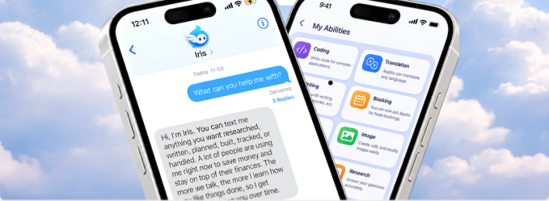

**图片来源：**Iris

[Iris](https://iris-agent.co/personal-assistant) 由 Hermes Agent 驱动，设计目标是让用户直接通过 iMessage 把任务委派给 AI 助手。用户可以连接自己使用的应用，用一条简单的消息把任务交出去。智能体随后走完所需步骤，同时保留此前互动中的相关上下文。它也被设计成主动跟进用户，而不是等着下一个请求。

## Martin

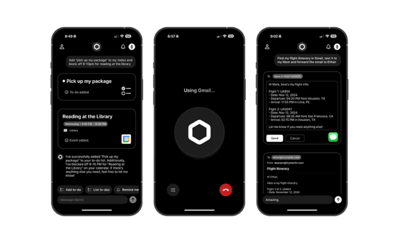

**图片来源：**Martin

[Martin](https://www.trymartin.com) 是一个通用型个人助手，可通过短信以及电话、WhatsApp、邮件、Slack 和它自己的 [iOS](https://apps.apple.com/us/app/martin/id6453473083?ajs_aid=29fc544b-f16e-410e-8f0a-b57ab3f4bc9a) 应用触达。

它能帮忙管理日历、邮件、提醒、任务、笔记和沟通。它也能代用户行动，比如发消息或打电话，同时每天提供一份需要关注之事的摘要。

它偏贵一些，订阅每月 21 美元起。

## Maverick

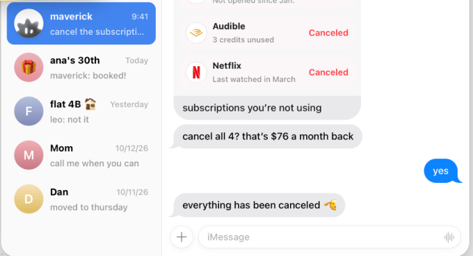

**图片来源：**Maverick

[Maverick](https://usemaverick.io/) 自称「住在你短信里的 AI 伙伴」，充当一个直接从你的消息里帮忙管理日常任务的个人助手。

它能改错别字、取消订阅、从语音笔记里安排会议，还能帮群聊敲定一个活动的日期。一个值得注意的功能是，Maverick 在采取行动前会先征求你的许可。

这个平台还提供数百种集成，包括 Discord、Gmail 和 Slack，让它能连接你已经在用的应用。

它目前处于测试阶段，在 iMessage 上免费使用。另有一个 Pro 版，每月 27 欧元（约合 30.25 美元），包含每月 500 项任务、连接 20 个应用、定时任务和记忆。

## Miso

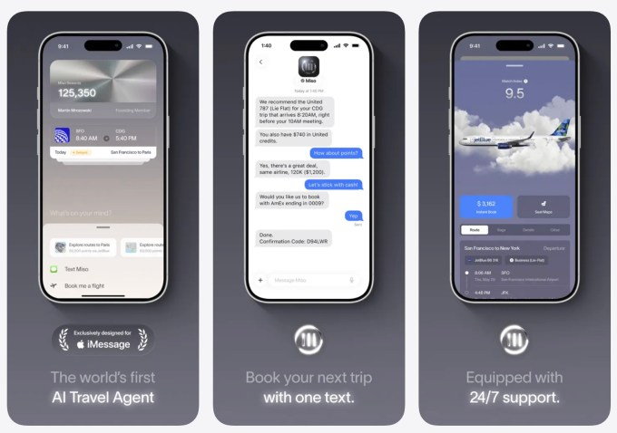

**图片来源：**Miso

[Miso](https://miso.com/) 把个人助手的概念专门用到了旅行上。

它通过 iMessage 运作，把 AI 行程规划与一支专属旅行团队的支持结合起来。用户可以通过消息安排航班，Miso 会考虑他们的旅行偏好、常旅客积分和其他优先事项。Miso 还为旅行者提供行程详情和航班动态，以及个性化推荐。

## Ohai

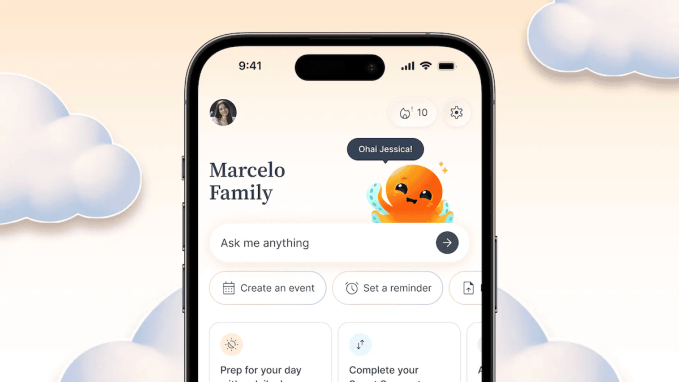

**图片来源：**Ohai

[Ohai](https://www.ohai.ai/) 是另一个家庭助手，专注于帮家庭应对日常家庭生活中源源不断的信息和任务。

用户可以发消息、转发邮件或发出语音请求，助手能把它们变成日程、提醒和计划。它还能在多个家庭成员之间协调日历、家务和餐食。

它包含一个免费基础选项，也提供按家庭人数计费的不同订阅，每月 9.99 美元起。

## Orbits

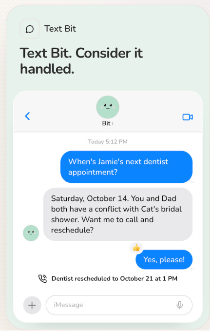

**图片来源：**Orbits

[Orbits](https://tryorbits.com/) 也有一个专注于家庭的 AI 助手。

它同时通过 Orbits 应用和短信工作，能把日历、清单和对话聚合在一起，同时替你执行任务。这可以包括搜索网页、购物、订餐厅、改预约，以及为家庭服务询价。

此外，Orbits 能提醒家庭成员做家务、与服务提供方沟通，并帮助协调直系家庭之外的各项责任。

Orbits 的投资方包括 Andreessen Horowitz（a16z）Speedrun 基金、N49P 和 Garage Capital。

## Pally

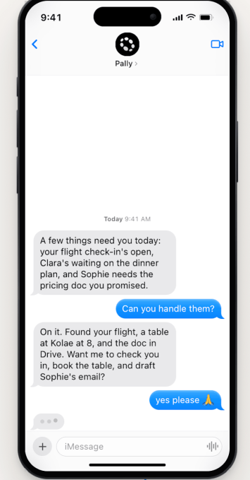

**图片来源：**Pally

用户可以像对待朋友一样与 [Pally](https://pally.com) 互动，同时让它访问自己已经依赖的应用。这个助手能连接散落在 WhatsApp、Gmail、日历和 Google Drive 等服务中的信息，帮用户跟踪计划、收据、日期、文件和其他细节。

有一个免费方案。它通过 iMessage、RCS 和 Telegram 工作。

## Poke

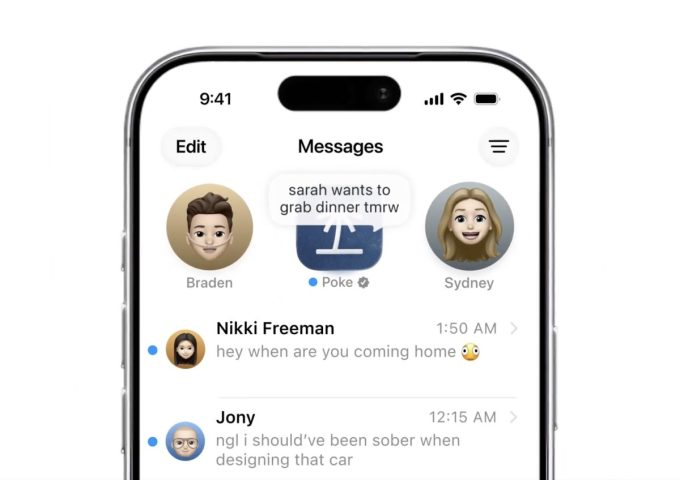

**图片来源：**Poke/The Interaction Company of California

[Poke](https://poke.com/) 于 2026 年 3 月[推出](https://techcrunch.com/2026/04/08/poke-makes-ai-agents-as-easy-as-sending-a-text/)，是一个可通过短信触达的通用型助手。它能处理涉及日历、规划、健康健身、智能家居控制、照片和其他日常活动的任务。

Poke 在 2026 年 6 月变得格外引人注目，当时 Apple [批准](https://techcrunch.com/2026/06/04/apple-approves-poke-as-the-first-ai-agent-on-its-messages-for-business-platform/) Poke 成为 Apple Messages for Business 平台上的首个 AI 智能体。一个月后，母公司 The Interaction Company of California 被 AI 编程初创公司 Cognition [收购](https://techcrunch.com/2026/07/24/why-cognition-bought-poke-ai-personality-is-becoming-a-competitive-advantage/)，交易估值在 1 亿美元出头的低位区间。

## Rene

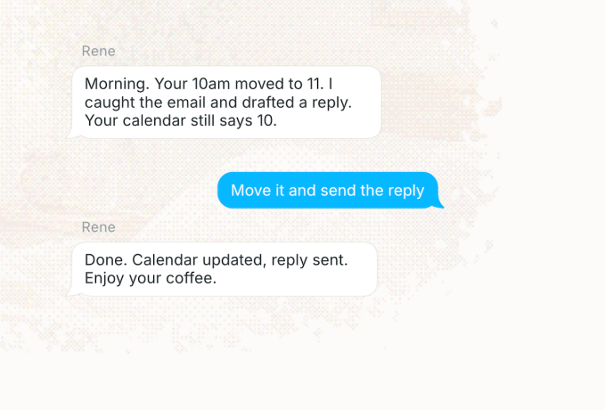

**图片来源：**Rene

[Rene](https://rene.co/) 是一个 AI 个人助手，设计目标是成为用户的「最佳联系人」，而不是又一个生产力智能体。它基于文本，能把自然语言对话变成任务、提醒、摘要和其他后续行动。Rene 还跨对话维持上下文，让它能记住细节，并在之后把可能需要关注的事提出来。

此外，它有一个浏览器，能写代码、替你购物，还能制作幻灯片和图片。

Rene 目前在 iMessage、Telegram 和 WhatsApp 上可用。

## Skye

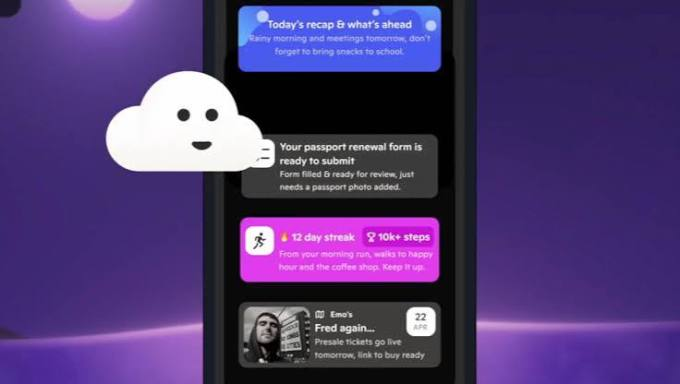

**图片来源：**Skye

与其等用户打开某个应用，[Skye](https://skyeapp.ai) 是 iPhone 上的一个「[智能体式主屏](https://techcrunch.com/2026/04/27/investors-back-skye-signull-labs-ai-home-screen-app-for-iphone-ahead-of-launch/)」，它分析来自已连接服务的信息，并通过情境卡片、建议和每日简报把认为相关的内容呈现出来。这个助手能生成音频简报、在会议前准备好信息、提出提醒，并识别可能有用的信息。

其公司 Signull Labs 于 2025 年筹集了约 360 万美元种子资金。它于 2026 年 4 月进入内部测试和测试版，尚未宣布公开发布日期。

## Stanley

**图片来源：**Stanley

[Stanley](https://www.getstanley.ai/welcome) 是一个 AI 内容助手，面向内容创作者而不是通用个人生产力。它可通过 iMessage、Telegram 和网页使用，充当某种 AI 内容总监，帮用户想点子、把点子变成帖子，并维持稳定的发布节奏。

例如，Stanley 能连接用户的 Instagram 账户，用那份上下文根据用户实际在做的事来建议内容。用户也可以发语音笔记，Stanley 会把它变成脚本、文案和其他社交素材。它包含一个内容日历，能安排发布，更宏大的目标是让内容创作变成一个更连续、更自动化的过程，而不是用户得坐下来从头规划的事。

## Szn

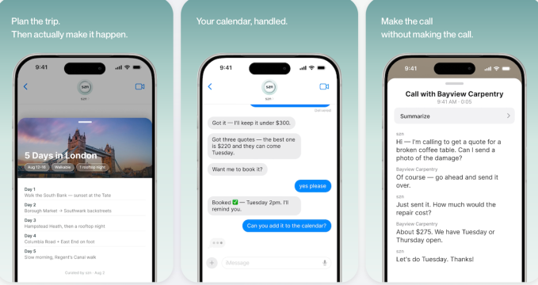

**图片来源：**Szn

[Szn](https://theszn.ai/start) 的设计目标是通过一条对话线程协调任务和后续跟进。用户可以发文字消息、语音笔记、照片或转发的邮件，助手代他们采取行动，包括打电话、发邮件和管理后续事项。

据公司网站，Szn 已服务 16 个国家的 7,500 多家企业，完成超过 10,000 项工作，处理了 95 小时的通话。

## Tab

**图片来源：**Tab

[Tab](https://techcrunch.com/2026/10/07/another-personal-ai-assistant-has-launched-meet-tab-which-emerged-from-stealth-with-a-300m-valuation/) 让用户通过熟悉的消息平台委派日常任务。用户可以通过 iMessage 或 WhatsApp 向助手发请求，从订菜到找生日礼物，Tab 代他们走完流程。

公司于 10 月初结束隐身状态，估值 3 亿美元。其投资方包括 SV Angel、Valar Ventures 和 American Spirit。

## Tomo

[Tomo](https://www.tomo.ai/) 的 iMessage 个人助手最大的差异点是：它不是一个只有你会互动的私密助手，而是能成为群聊的一部分。

同时，和其他智能体一样，它被设计来帮助目标、问责、排期和日常组织。它还能发提醒、搜索网页、处理日历和邮件、看视频、编辑照片。

基础方案每月 19.99 美元起。

## Town

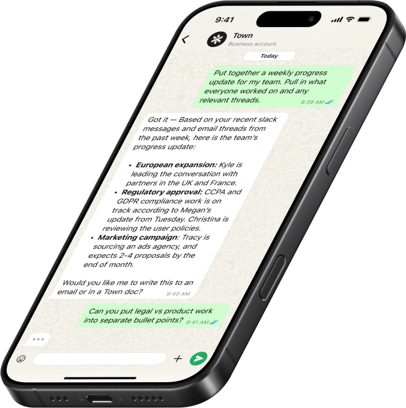

**图片来源：**Town

[Town](https://www.town.com) 更偏向职业生活。它给用户一位「Townie」，一个被设计来了解他们如何工作、并处理重复性职业任务的 AI 助手。它能处理邮件、日历、文档、Slack 和其他平台。

2026 年 6 月，公司由 Andreessen Horowitz 和 Forerunner 领投，融资[5,500 万美元 A 轮](https://finance.yahoo.com/sectors/technology/articles/town-raises-55m-series-a16z-134500847.html)。

## Underdog

[Underdog](https://techcrunch.com/2026/10/06/silicon-valleys-ai-wunderkind-launches-underdog-the-most-private-instinct-muse-competitor-yet/) 是一个注重隐私的 AI 助手，于 2026 年 10 月初推出仅限邀请的测试版。与基于云的 AI 服务不同，它的模型完全跑在用户设备上，把个人数据留在他已经拥有的硬件里。首个版本支持 Mac 和 Windows 电脑，Linux、iPhone 和 Android 版本计划在未来推出。

公司计划最初免费提供这个应用，并表示永远不会加入广告。

## Wajo

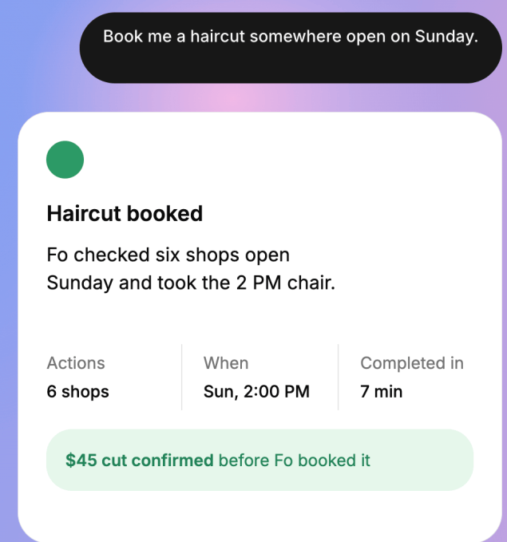

**图片来源：**Wajo

[Wajo](https://wajo.ai/join-wajo) 的第一个消费级智能体 Fo 能打电话给商家、发邮件、加入群聊、预订和购物，并与他人协调以完成日常任务。

Wajo 做法的一个关键部分是给 Fo 一个独立身份。这个智能体有自己的邮箱地址、电话号码和支付卡，让它能与商家互动，而不需要用户交出自己的凭据。

值得注意的是，当 Fo 碰到自己处理不了的事时，Wajo 说它可以请一位人类助手来完成这项任务。

Fo 于 2026 年 9 月公开发布，带一个免费档，更重的工作量和定制智能体则通过付费的 Pro 方案提供。

*本文已更新。*
