

**收录说明**：TechCrunch 的短信类智能体合集，列出 24 款产品，其中包括跟踪中的 Poke 与 Instinct。原站地址现在返回 404，正文取自 Wayback 快照，删去了文末的作者简介与推荐阅读。已翻译。

**内容摘要**：文章是一份 24 款可通过短信等消息渠道使用的 AI agent 清单，开头称它们可记忆上下文、连接应用并代用户完成任务；当前最受关注的是 Instinct，在最新一轮 10 亿美元融资后估值 100 亿美元。涉及 Poke 的部分称其 2026 年 3 月作为通用助手发布，覆盖日历、规划、健康健身、智能家居、照片等；6 月获 Apple 批准成为 Apple Messages for Business 上首个 AI agent，约一个月后其母公司被 Cognition 以“low nine figures”收购。Instinct 部分称其先融资 3.5 亿美元（估值 25 亿美元），2026 年 9 月融资 10 亿美元（估值 100 亿美元）；可通过文字或语音使用，连接邮件、日历、Google Workspace；9 月起为用户的助手提供专属邮箱地址以代为注册服务和联系商家，文中提到该自主性引发隐私与安全担忧，并已开始支持打电话；仍处于私测。其余条目包括 Ask Proxy、Caddy、Comma、Fambot、Wajo（给 agent 配独立邮箱、电话和支付卡）、Underdog（模型完全在用户设备运行）等。

**保留理由**：提供 2026-10 市场格局的横向对照和 Instinct 融资、专属邮箱等细节，以及 Poke 在同类产品中的位置；Poke 部分只是对 TechCrunch 自家前文的概括。

---

与其再下载一个应用，越来越多的 agent 可以直接像给一个普通人发短信那样给它发消息。

你把需求发给它，它能记住上下文、连接你已经在用的应用和服务，并代你完成任务。这可以是预约、安排日程、研究一次旅行、发送邮件、订座、网上购物，或者在几天后提醒你某件事。

尽管 Instinct 凭借[最新一轮 10 亿美元融资后 100 亿美元的估值](https://techcrunch.com/2026/09/28/viral-ai-agent-instinct-raises-1b-series-c-at-a-10b-valuation/)，是当下最受关注的 AI agent 之一，但还有许多其他产品也在争夺这一领域。

以下是目前最值得关注的选项，从通用型个人助手到面向家庭、旅行和工作的 agent。

## Ask Proxy

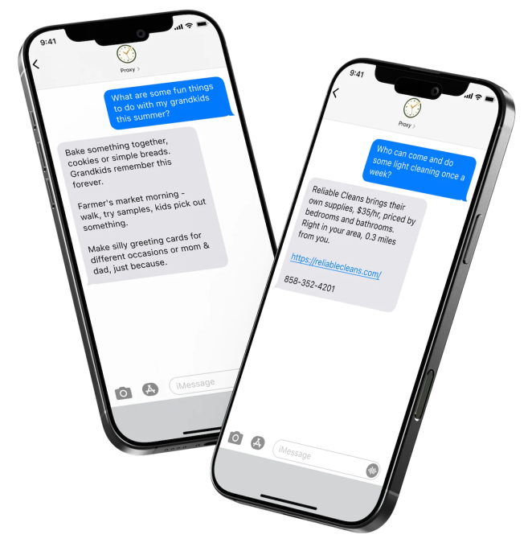

**图片来源：**Ask Proxy

[Ask Proxy](https://askproxy.com/) 最大的差异化在于它「像女性一样思考」，也就是说，它力求在你开口之前就预判你的需求，该公司在其网站上解释说。

它就像一个可以像朋友一样发短信的聊天机器人，无论你需要礼物点子、帮忙策划活动，还是想找那个周末可以做的事情的推荐。你可以让它把重要日期加到你的日历、设置提醒，或帮你做日常决定。你也可以给它发照片，比如一张空桌子，来琢磨晚宴该怎么布置这张桌子。

与典型的聊天机器人不同，Ask Proxy 还采取主动。当它注意到你可能忘记的事情，或遇到你可能喜欢的新活动、餐厅或体验时，它会主动联系你。

它还有一个面向工作的版本，公司解释说该版本「让员工更快回到工作中，同时把个人数据挡在公司系统之外」。

个人版每天 1 美元。对企业而言，大公司的定价为每名员工每月 15 美元起，49 人以下的小团队为每名员工每月 23 美元起。

Ask Proxy 通过短信（SMS）工作。你可以向 820-732-2625 发送「start」。

## Caddy

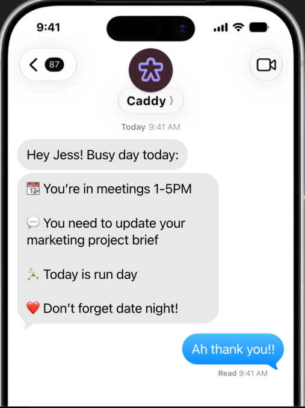

**图片来源：**Caddy

[Caddy](https://caddy.app/) 是一款 AI 助手，它把散落在你手机里的信息变成你真正可以据以行动的事项。对 iPhone 用户，它住在 iMessage 里；对 Android 用户，它住在富通信服务（RCS）里，因此没有单独的应用或收件箱需要不停查看。

例如，一封邮件里有一个需要加到日历的预约，或者一位朋友发来一份要买的东西清单。与其担心所有细节被埋没，Caddy 会连接你的日历和对话，然后找出可能需要处理的事项。它可以把事件加到你的日历、设置提醒、跟踪后续事项，甚至替你做研究。

Caddy 自 2026 年 4 月起以公开测试版提供。

## Comma

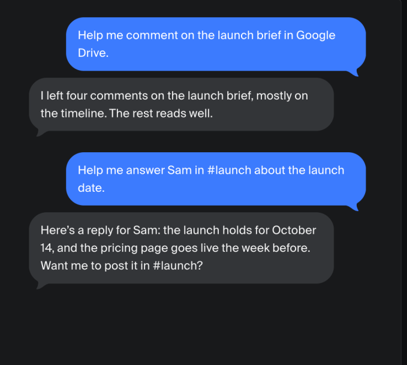

**图片来源：**Comma

[Comma](https://comma.surf/) 旨在管理横跨工作和日常生活的任务。Comma 会把任务推进到完成，自行检查工作，并判断任务何时结束。

当需要决策或批准时，已完成的工作会被呈现出来供审阅。它还会主动通知用户并建议下一步。

它可以在用户的浏览器、电脑和文件中工作，同时还能通过 Signal、Telegram 和微信等消息应用远程访问。Comma 跨设备和跨对话保持上下文与记忆，可以发送每日简报、标出紧急事项，并总结通话录音。

Comma 可免费开始使用，并且是开源的。

## Fambot

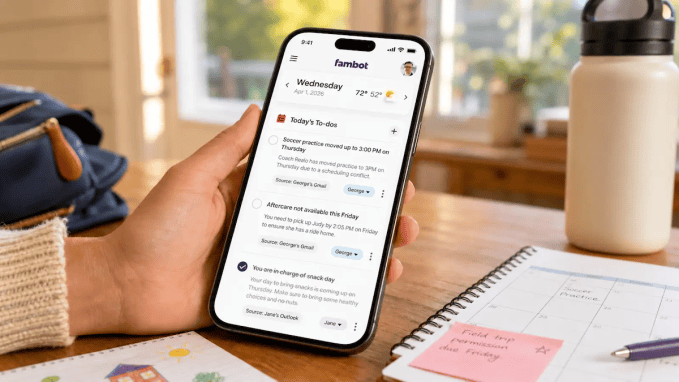

**图片来源：**Fambot

[Fambot](https://fambot.com) 是一款由 AI 驱动的家庭「幕僚长（chief of staff）」，旨在把家庭生活中众多变动不居的部分——包括学校通知、体育活动、膳食计划、日历和其他日常责任——汇集起来，变成一份有条理的计划。

该服务被设计为同时通过应用和短信工作。Fambot 可在 iOS 设备、Android 设备和网页上使用，家庭也可以直接通过短信（SMS）与它互动。每天晚上，Fambot 会自动发送第二天的摘要，包括即将到来的事件、待办事项，以及校服或打包要求等细节。家长可以回复这些消息来提问、核对信息或更改日历。

Fambot 目前可连接 Gmail、Google Calendar、Outlook 和 WhatsApp，并计划未来支持 Apple Calendar。

该公司于 2026 年 9 月初[推出](https://techcrunch.com/2026/09/01/fambot-introduces-an-ai-chief-of-staff-for-families/)测试版，并已融资 350 万美元种子前（pre-seed）轮。该服务在测试期间目前免费，但 Fambot 预计最终收费大致相当于一份 Netflix 订阅的价格。

## Folk

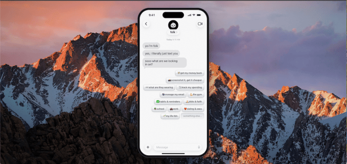

**图片来源：**Folk

[Folk](https://www.folk.com/) 被设计成一款可以通过 iMessage、WhatsApp 和 Telegram 联系到的 AI 助手。它能记住个人上下文、管理提醒、研究主题、跟踪航班、处理邮件，并完成餐厅订座等现实世界任务。

一个不同之处是，Folk 运行在它自己的私有云电脑上。它还可以运行代码、执行多步任务，而不只是以对话方式回应。

Folk 于 2026 年 5 月推出测试版，可免费使用，但也提供每月 8.33 美元的 Pro 订阅，如果你想在后台运行无限量的任务。

## Instinct

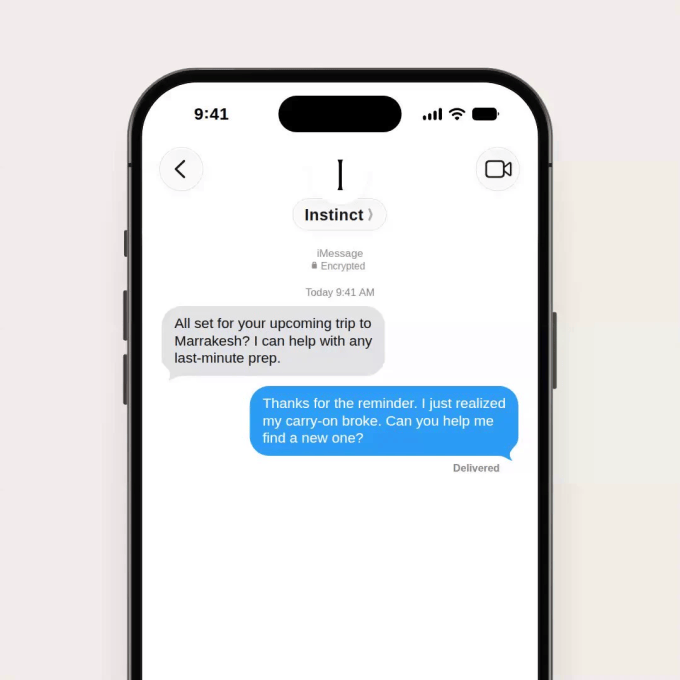

**图片来源：**Instinct

[Instinct](https://instinct.com/) 首次登上头条是在以 25 亿美元估值融资[3.5 亿美元](https://techcrunch.com/2026/08/26/viral-ai-startup-instinct-has-raised-350-million-at-a-2-5-billion-valuation/)之后。2026 年 9 月，它又融资[10 亿美元](https://techcrunch.com/2026/09/28/viral-ai-agent-instinct-raises-1b-series-c-at-a-10b-valuation/)，估值达到 100 亿美元。

这个随时可用的 agent 能代你采取行动，而不只是回答问题。用户可以通过文字或语音与 Instinct 交流，并把它连接到已经在用的应用和服务，比如邮件、日历、Google Workspace 等。该公司称，早期用户使用 Instinct 的任务从规划旅行、购买食品杂货，到订票和取消订阅，范围很广。

9 月，Instinct 开始为用户的助手提供[专属邮箱地址](https://techcrunch.com/2026/09/09/viral-ai-assistant-instinct-now-has-its-own-email-address/)。其思路是让 Instinct 代用户创建和管理账号，而不必填满用户的个人收件箱。该 agent 可以使用自己的地址注册服务、联系商家、跟进请求，并处理需要邮箱账号的任务。（不过，这种程度的自主性也引发了关于[隐私和安全](https://techcrunch.com/2026/08/24/instincts-powerful-ai-assistant-is-raising-privacy-and-security-concerns/)的担忧。）它也已开始[逐步支持拨打电话](https://techcrunch.com/2026/09/17/rival-ai-agents-instinct-and-metas-muse-both-add-the-ability-to-make-calls/)。

该公司仍处于私测阶段。

## Iris

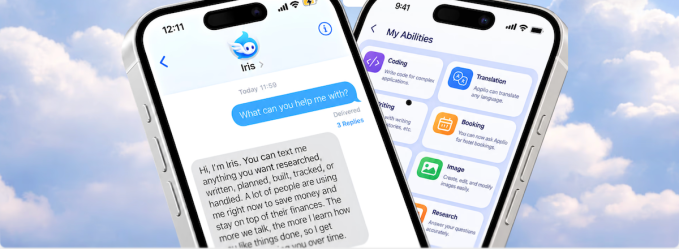

**图片来源：**Iris

[Iris](https://iris-agent.co/personal-assistant) 由 Hermes Agent 驱动，旨在让用户直接通过 iMessage 把任务委派给 AI 助手。用户可以连接自己使用的应用，用一条简单的消息交出任务。随后该 agent 会逐步完成所需步骤，同时保留此前互动中的相关上下文。它还被设计为主动跟进用户，而不是等待下一次请求。

## Martin

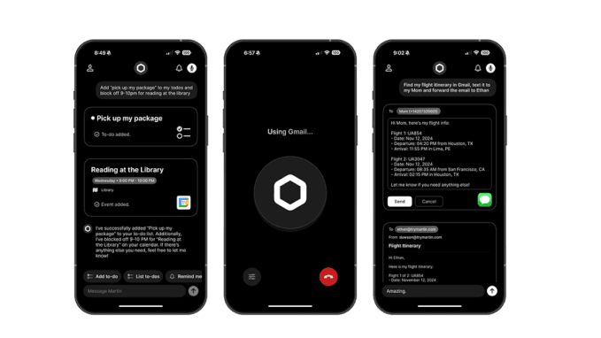

**图片来源：**Martin

[Martin](https://www.trymartin.com) 是一款通用型个人助手，可通过短信以及电话、WhatsApp、邮件、Slack 和它自己的 [iOS](https://apps.apple.com/us/app/martin/id6453473083?ajs_aid=29fc544b-f16e-410e-8f0a-b57ab3f4bc9a) 应用联系到。

它可以帮助管理日历、邮件、提醒、任务、笔记和沟通。它还可以代用户行动，比如发送消息或拨打电话，同时每天提供需要关注事项的摘要。

它的价格偏高一些，订阅从每月 21 美元起。

## Maverick

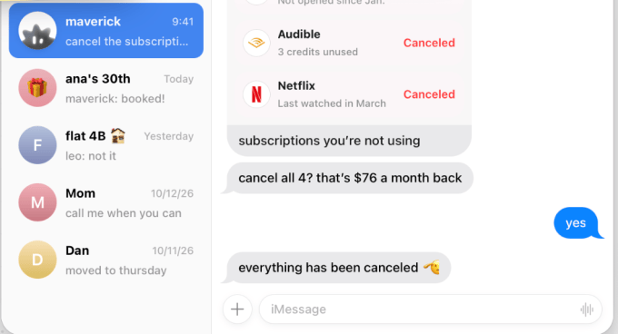

**图片来源：**Maverick

[Maverick](https://usemaverick.io/) 自称是「住在你短信里的 AI 伴侣」，充当个人助手，直接在你的消息里帮助管理日常任务。

它可以修正错别字、取消订阅、根据语音笔记安排会议，还能帮群聊敲定某个活动的日期。一个值得注意的特点是，Maverick 在采取行动前会征求你的许可。

该平台还提供数百种集成，包括 Discord、Gmail 和 Slack，使它能够连接你已经在用的应用。

它目前处于测试阶段，在 iMessage 上免费使用。另有一个 Pro 版本，每月 27 欧元（约合 30.25 美元），包含每月 500 个任务、20 个连接的应用、定时任务和记忆。

## Miso

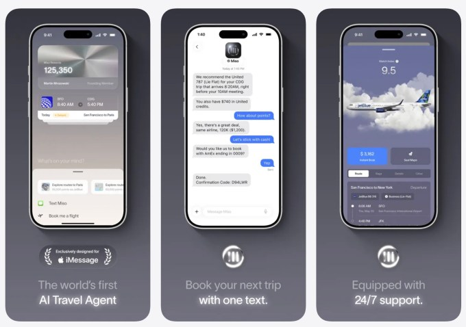

**图片来源：**Miso

[Miso](https://miso.com/) 把个人助手的概念专门应用到旅行上。

它通过 iMessage 运作，把 AI 旅行规划与专属旅行团队的支持结合起来。用户可以通过消息安排航班，同时 Miso 会考虑他们的旅行偏好、常旅客积分和其他优先事项。Miso 还为旅客提供行程详情和航班更新，以及个性化推荐。

## Ohai

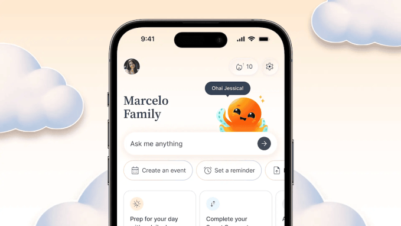

**图片来源：**Ohai

[Ohai](https://www.ohai.ai/) 是另一款家庭助手，专注于帮助家庭管理日常家庭生活中源源不断的信息和任务。

用户可以发送消息、转发邮件或发出语音请求，助手可以把它们转化为日程、提醒和计划。它还可以在家庭多个成员之间协调日历、家务和餐食。

它包含一个免费的基础选项，但也根据家庭人数提供不同的订阅，从每月 9.99 美元起。

## Ollie

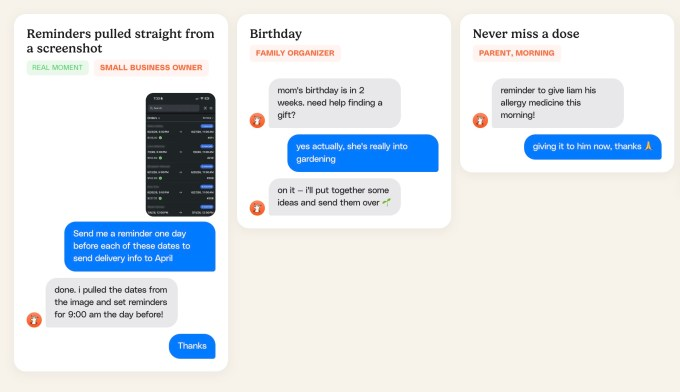

截图**图片来源：**Ollie

与其他面向家庭的 agent 类似，[Ollie](https://ollie.ai/) 的理念是家庭已经拥有所需信息，但这些信息散落在学校消息、日历、任务清单和群聊中。Ollie 旨在把这些碎片汇集起来并保持同步。它可以跟踪日历、邮件、提醒、任务和其他家庭细节，然后通过短信把相关信息送达用户。

它与其它 agent 最大的不同之处在于，Ollie 是[最早实现 SOC 2 合规（SOC 2 compliance）的主流家庭向 AI 助手之一](https://techcrunch.com/2026/09/03/ollie-is-betting-privacy-can-win-the-ai-assistant-race/)，这是一项被广泛使用的安全标准。

Ollie 于 2026 年 6 月推出，提供免费档，付费方案从每月 25 美元（含 150 条消息）起。每月 100 美元的方案包含最多 1,000 条消息。

## Orbits

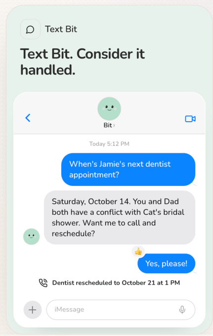

**图片来源：**Orbits

[Orbits](https://tryorbits.com/) 也有一款专注于家庭的 AI 助手。

它同时通过 Orbits 应用和短信工作，可以汇集日历、清单和对话，同时替你执行任务。这可以包括搜索网页、购物、预订餐厅、更改预约，以及为家庭服务询价。

此外，Orbits 可以提醒家庭成员做家务、与服务提供方沟通，并帮助协调自己家庭之外的责任。

Orbits 的投资方包括 Andreessen Horowitz（a16z）Speedrun 基金、N49P 和 Garage Capital。

## Pally

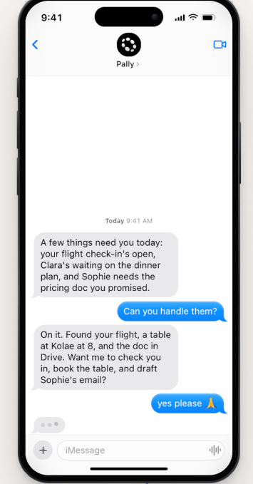

**图片来源：**Pally

用户可以像与朋友相处一样与 [Pally](https://pally.com) 互动，同时让它访问自己已经在用的应用。该助手可以连接散落在 WhatsApp、Gmail、日历和 Google Drive 等服务中的信息，帮助用户跟踪计划、收据、日期、文件和其他细节。

它提供免费方案。它通过 iMessage、RCS 和 Telegram 工作。

## Poke

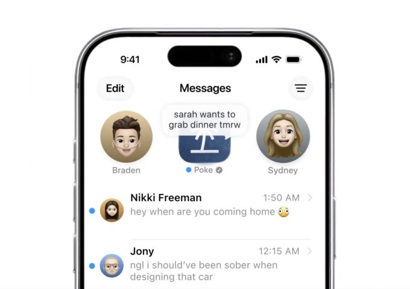

**图片来源：**Poke/The Interaction Company of California

[Poke](https://poke.com/) 于 2026 年 3 月[推出](https://techcrunch.com/2026/04/08/poke-makes-ai-agents-as-easy-as-sending-a-text/)，是一款通用型助手，可以通过短信联系到。它可以处理涉及日历、规划、健康健身、智能家居控制、照片和其他日常活动的任务。

2026 年 6 月，Apple [批准](https://techcrunch.com/2026/06/04/apple-approves-poke-as-the-first-ai-agent-on-its-messages-for-business-platform/) Poke 成为 Apple Messages for Business 平台上的首个 AI agent，这让 Poke 格外引人注目。一个月后，其母公司 The Interaction Company of California 被 AI 编程创业公司 Cognition [收购](https://techcrunch.com/2026/07/24/why-cognition-bought-poke-ai-personality-is-becoming-a-competitive-advantage/)，交易估值在「low nine figures」（九位数低位）。

## Rene

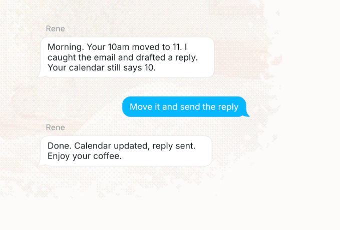

**图片来源：**Rene

[Rene](https://rene.co/) 是一款 AI 个人助手，旨在成为用户的「最佳联系人」，而不是又一个生产力 agent。它基于文字，可以把自然语言对话转化为任务、提醒、摘要和其他后续行动。Rene 还在对话之间保持上下文，让它能记住细节，并在之后呈现可能需要关注的事情。

此外，它有浏览器，可以写代码、替你购物，还能制作幻灯片和图片。

Rene 目前在 iMessage、Telegram 和 WhatsApp 上可用。

## Skye

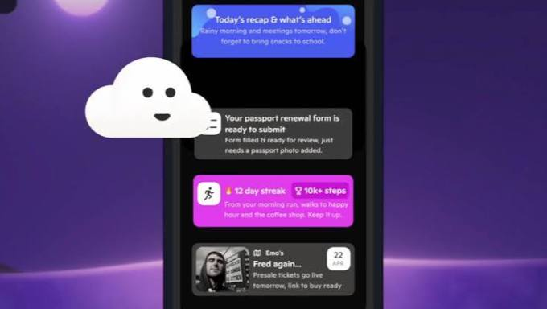

**图片来源：**Skye

[Skye](https://skyeapp.ai) 不等待用户打开某个应用；它是一个面向 iPhone 的「[智能体主屏幕（agentic homescreen）](https://techcrunch.com/2026/04/27/investors-back-skye-signull-labs-ai-home-screen-app-for-iphone-ahead-of-launch/)」，它分析来自已连接服务的信息，并通过情境卡片、建议和每日简报呈现它认为相关的内容。该助手可以生成音频简报、在会议前准备信息、呈现提醒，并识别可能有用的信息。

该公司 Signull Labs 于 2025 年融资约 360 万美元种子轮。它于 2026 年 4 月进入私测与测试版阶段，尚未公布公开发布日期。

## Stanley

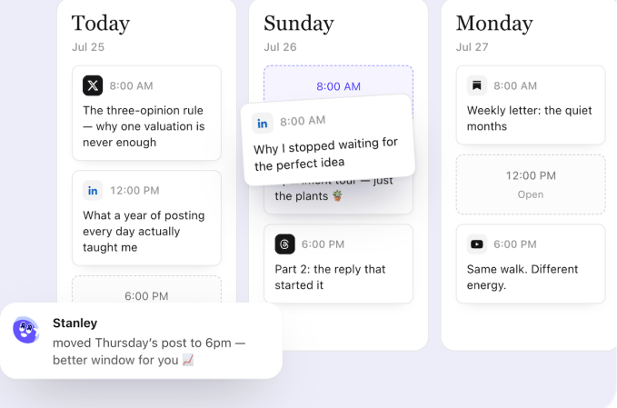

**图片来源：**Stanley

[Stanley](https://www.getstanley.ai/welcome) 是一款 AI 内容助手，面向内容创作者而非一般个人生产力场景。它可通过 iMessage、Telegram 和网页使用，充当某种 AI 内容主管，帮助用户想出点子、把点子变成帖子，并保持稳定的发布节奏。

例如，Stanley 可以连接用户的 Instagram 账号，利用这些上下文，根据用户实际在做的事情建议内容。用户还可以发送语音笔记，Stanley 会把它们变成脚本、配文和其他社交素材。它包含内容日历，可以安排发布，更宏大的目标是让内容创作成为一个更连续、更自动化的过程，而不是用户必须坐下来从零规划的事情。

## Szn

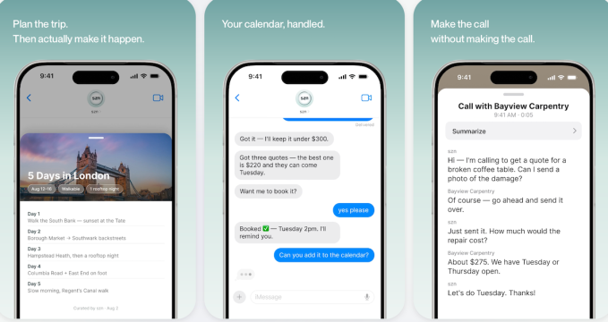

**图片来源：**Szn

[Szn](https://theszn.ai/start) 旨在通过一个对话线程协调任务和后续跟进。用户可以发送短信、语音笔记、照片或转发的邮件，助手会代其采取行动，包括拨打电话、发送邮件和管理后续事项。

据该公司网站，Szn 已服务 16 个国家的 7,500 多家企业，完成 10,000 多个任务，并处理了 95 小时的通话。

## Tab

**图片来源：**Tab

[Tab](https://techcrunch.com/2026/10/07/another-personal-ai-assistant-has-launched-meet-tab-which-emerged-from-stealth-with-a-300m-valuation/) 让用户通过熟悉的消息平台委派日常任务。用户可以通过 iMessage 或 WhatsApp 向助手发送请求，从订购食品杂货到寻找生日礼物，Tab 会代其处理整个过程。

该公司于 10 月初结束隐身状态，估值 3 亿美元。其投资方包括 SV Angel、Valar Ventures 和 American Spirit。

## Tomo

[Tomo](https://www.tomo.ai/) 的 iMessage 个人助手最大的不同之处在于，它不是只有你一个人与之互动的私人助手，Tomo 可以成为群组对话的一部分。

此外，与其他 agent 一样，它旨在帮助处理目标、问责、日程安排和日常组织。它还有能力发送提醒、搜索网页、处理日历和邮件、观看视频和编辑照片。

基础方案从每月 19.99 美元起。

## Town

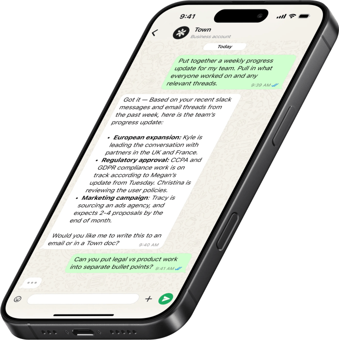

**图片来源：**Town

[Town](https://www.town.com) 更偏向职业生活。它为用户提供一个「Townie」，这是一款 AI 助手，旨在学习他们的工作方式并处理重复性的职业任务。它可以与邮件、日历、文档、Slack 和其他平台协作。

2026 年 6 月，该公司融资[5,500 万美元 A 轮](https://finance.yahoo.com/sectors/technology/articles/town-raises-55m-series-a16z-134500847.html)，由 Andreessen Horowitz 和 Forerunner 领投。

## Underdog

[Underdog](https://techcrunch.com/2026/10/06/silicon-valleys-ai-wunderkind-launches-underdog-the-most-private-instinct-muse-competitor-yet/) 是一款注重隐私的 AI 助手，于 2026 年 10 月初推出仅限邀请的测试版。与基于云的 AI 服务不同，该模型完全运行在用户设备上，把个人数据留在自己已经拥有的硬件里。初始版本支持 Mac 和 Windows 电脑，计划未来推出 Linux、iPhone 和 Android 版本。

该公司计划最初免费提供该应用，并表示永远不会加入广告。

## Wajo

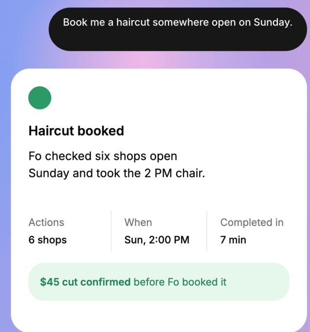

**图片来源：**Wajo

[Wajo](https://wajo.ai/join-wajo) 的首个消费级 agent Fo 可以给商家打电话、发送邮件、加入群聊、进行预订和购买，并与人们协调完成日常任务。

Wajo 方法的一个关键部分是给 Fo 自己的身份。该 agent 有自己的邮箱地址、电话号码和支付卡，让它能够与商家互动，而无需用户交出自己的凭据。

值得注意的是，Wajo 称当 Fo 遇到自己无法处理的事情时，它可以引入人类助手来完成任务。

Fo 于 2026 年 9 月公开发布，提供免费档，而更繁重的工作负载和自定义 agent 可通过付费的 Pro 服务获得。
