来源：https://web.archive.org/web/20261101075904/https://techcrunch.com/2026/10/24/all-the-ai-agents-that-can-live-in-your-text-messages/
取文：2026-11-09，原站该地址现返回 404，取自 Wayback 快照 20261101075904

Rather than downloading another app, a growing number of agents can simply be texted like an ordinary person.

You text it what you need, and it can remember context, connect to the apps and services you already use, and complete tasks on your behalf. That can mean scheduling an appointment, organizing a calendar, researching a trip, sending an email, making a reservation, shopping online, or reminding you about something days later.

While Instinct is one of the buzziest AI agents at present, [thanks to its $10 billion valuation after its latest funding round](https://techcrunch.com/2026/09/28/viral-ai-agent-instinct-raises-1b-series-c-at-a-10b-valuation/) of $1 billion, there are many others also making a play for this space.

Below are the most notable options so far, from general-purpose personal assistants to agents designed for families, travel, and work.

## Ask Proxy

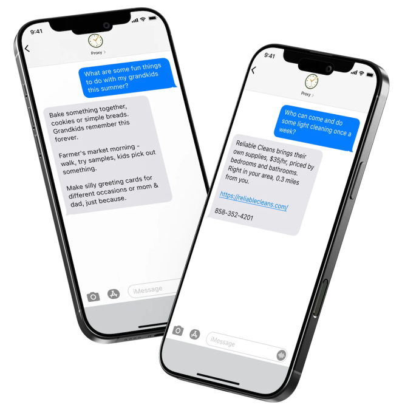

**Image Credits:**Ask Proxy

[Ask Proxy](https://askproxy.com/)’s biggest differentiator is that it “thinks like a woman,” meaning it aims to anticipate your needs before you even ask, the company explains on its website.

It works like a chatbot you can text like a friend, whether you need gift ideas, help planning an event, or recommendations for things to do that weekend. You can ask it to add important dates to your calendar, set reminders, or help with everyday decisions. You can also send it photos, like an empty table, to figure out how to decorate the table for a dinner party.

Unlike a typical chatbot, Ask Proxy also takes a proactive approach. It can reach out when it notices something you might forget or when it comes across a new activity, restaurant, or experience you might enjoy.

There’s also a work-focused version, which the company explains “gets employees back to work faster, while keeping personal data off company systems.”

The personal version costs $1 per day. For businesses, pricing starts at $15 per employee per month for large companies and $23 per employee per month for small teams with fewer than 49 employees.

Ask Proxy works over SMS. You can text “start” to 820-732-2625.

## Caddy

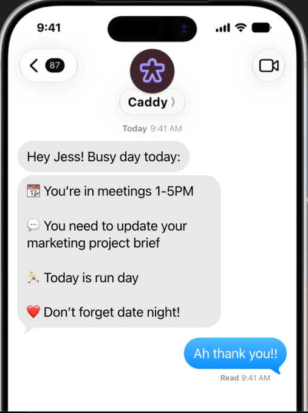

**Image Credits:**Caddy

[Caddy](https://caddy.app/) is an AI assistant that turns the information scattered across your phone into things you can actually act on. It lives in iMessage for iPhone users and RCS for Android users, so there’s no separate app or inbox to constantly check.

For instance, an email contains an appointment that needs to be added to your calendar or a friend sends a list of things to pick up. Instead of worrying about all the details getting buried, Caddy connects to your calendars and conversations, then identifies things that may require action. It can add events to your calendar, set reminders, keep track of follow-ups, and even do research for you.

Caddy has been available in public beta since April 2026.

## Comma

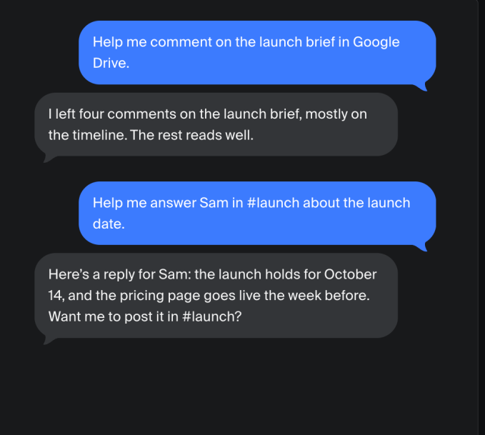

**Image Credits:**Comma

[Comma](https://comma.surf/) is designed to manage tasks across both work and everyday life. Comma carries tasks through to completion, checking its own work and determining when a task is finished.

Completed work is surfaced for review when a decision or approval is needed. It also proactively notifies users and recommends the next steps.

It can work across a user’s browser, computer, and files, while remaining accessible remotely through messaging apps such as Signal, Telegram, and WeChat. Comma maintains context and memory across devices and conversations, and can deliver daily briefings, flag urgent matters, and summarize recorded calls.

Comma is free to start and open source.

## Fambot

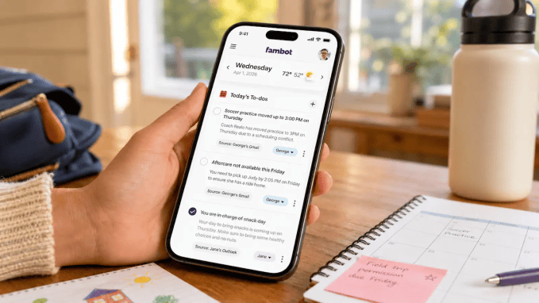

**Image Credits:**Fambot

[Fambot](https://fambot.com) is an AI-powered “chief of staff” for families, designed to bring together the many moving parts of family life, including school communications, sports activities, meal planning, calendars, and other day-to-day responsibilities, and turn them into an organized plan.

The service is designed to work across both an app and text messages. Fambot is available on iOS devices, Android devices, and the web, and families can also interact with it directly over SMS. Every night, Fambot automatically sends a summary of the following day, including upcoming events, to-dos, and details such as school uniform or packing requirements. Parents can reply to those messages to ask questions, check information, or make changes to their calendar.

Fambot currently connects to Gmail, Google Calendar, Outlook, and WhatsApp, with support for Apple Calendar planned for the future.

The company [launched](https://techcrunch.com/2026/09/01/fambot-introduces-an-ai-chief-of-staff-for-families/) in beta in early September 2026 and has raised $3.5 million in pre-seed funding. The service is currently free during the beta period, but Fambot expects to eventually charge roughly the equivalent of a Netflix subscription.

## Folk

**Image Credits:**Folk

[Folk](https://www.folk.com/) is designed to be an AI assistant you can reach through iMessage, WhatsApp, and Telegram. It can remember personal context, manage reminders, research topics, track flights, handle email, and perform real-world tasks such as restaurant reservations.

One distinction is that Folk runs on its own private cloud computer. It can also run code and execute multi-step tasks rather than merely responding conversationally.

Folk launched its beta in May 2026, and it’s available for free but also offers a Pro subscription for $8.33/month if you want unlimited tasks running in the background.

## Instinct

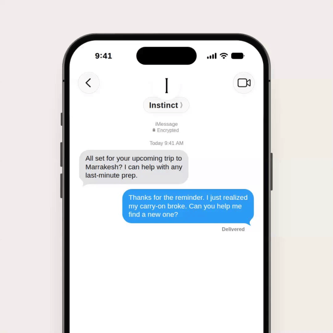

**Image Credits:**Instinct

[Instinct](https://instinct.com/) first made headlines after raising [$350 million](https://techcrunch.com/2026/08/26/viral-ai-startup-instinct-has-raised-350-million-at-a-2-5-billion-valuation/) at a $2.5 billion valuation. In September 2026, it raised [$1 billion](https://techcrunch.com/2026/09/28/viral-ai-agent-instinct-raises-1b-series-c-at-a-10b-valuation/), valuing it at $10 billion.

The always-available agent can take actions on your behalf, rather than simply answer questions. Users can communicate with Instinct by text or voice and connect it to the apps and services they already use, such as email, calendar, Google Workspace, and more. The company says early users have used Instinct for tasks ranging from planning trips and buying groceries to booking tickets and canceling subscriptions.

In September, Instinct began giving users [dedicated email addresses](https://techcrunch.com/2026/09/09/viral-ai-assistant-instinct-now-has-its-own-email-address/) for their assistants. The idea is to let Instinct create and manage accounts on a user’s behalf without filling the user’s personal inbox. The agent can use its address to sign up for services, contact businesses, follow up on requests, and handle tasks that require an email account. (However, this level of autonomy has also raised concerns about [privacy and security](https://techcrunch.com/2026/08/24/instincts-powerful-ai-assistant-is-raising-privacy-and-security-concerns/).) It’s also begun [rolling out support for placing calls](https://techcrunch.com/2026/09/17/rival-ai-agents-instinct-and-metas-muse-both-add-the-ability-to-make-calls/).

The company remains in private beta.

## Iris

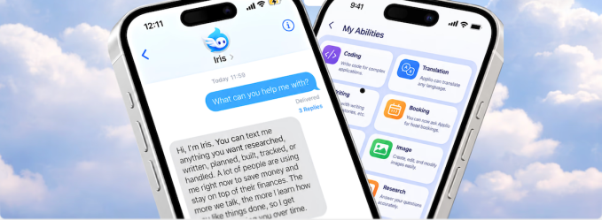

**Image Credits:**Iris

Powered by Hermes Agent, [Iris](https://iris-agent.co/personal-assistant) is designed to let users delegate tasks to an AI assistant directly through iMessage. Users can connect the apps they use and hand over a task with a simple message. The agent then works through the required steps, while retaining relevant context from previous interactions. It’s also designed to follow up with users proactively rather than waiting for another request.

## Martin

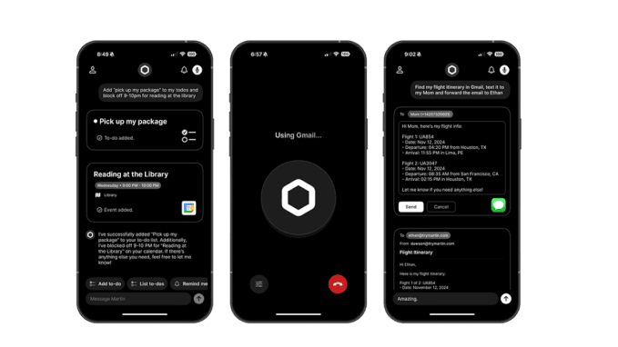

**Image Credits:**Martin

[Martin](https://www.trymartin.com) is a general-purpose personal assistant reachable through SMS as well as phone, WhatsApp, email, Slack, and its own [iOS](https://apps.apple.com/us/app/martin/id6453473083?ajs_aid=29fc544b-f16e-410e-8f0a-b57ab3f4bc9a) app.

It can help manage calendars, email, reminders, tasks, notes, and communications. It can also act on behalf of users by sending messages or making phone calls, while providing daily summaries of what needs attention.

It’s a bit on the pricier side, with subscriptions starting at $21 per month.

## Maverick

**Image Credits:**Maverick

[Maverick](https://usemaverick.io/) describes itself as an “AI companion who lives in your texts,” acting as a personal assistant that helps manage everyday tasks directly from your messages.

It can fix typos, cancel subscriptions, schedule meetings from voice notes, and help group chats settle on a date for an event. One notable feature is that Maverick asks for your permission before taking action.

The platform also offers hundreds of integrations, including Discord, Gmail, and Slack, allowing it to connect with the apps you already use.

It’s currently in beta and free to use on iMessage. There’s also a Pro version for €27 per month (or approximately $30.25 USD), which includes 500 tasks a month,  20 connected apps, scheduled tasks, and memory.

## Miso

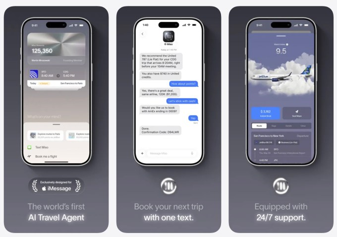

**Image Credits:**Miso

[Miso](https://miso.com/) takes the personal-assistant concept and applies it specifically to travel.

It operates through iMessage and combines AI trip planning with support from a dedicated travel team. Users can arrange flights through messaging while Miso takes into account their travel preferences, loyalty points, and other priorities. Miso also gives travelers access to trip details and flight updates, along with personalized recommendations.

## Ohai

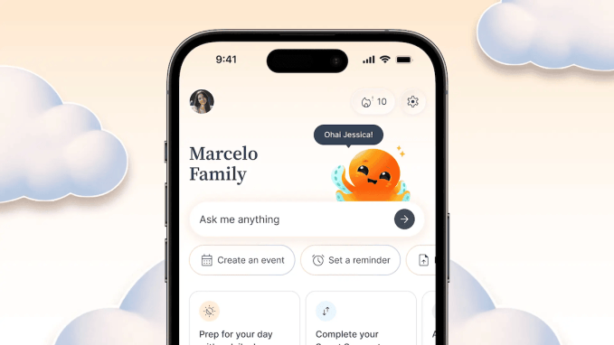

**Image Credits:**Ohai

[Ohai](https://www.ohai.ai/) is another family assistant focused on helping households manage the constant stream of information and tasks involved in everyday family life.

Users can send messages, forward emails, or make voice requests, and the assistant can transform them into schedules, reminders, and plans. It can also coordinate calendars, household chores, and meals across multiple members of a family.

It includes a free basic option, but also offers different subscriptions based on family size, starting at $9.99 per month.

## Ollie

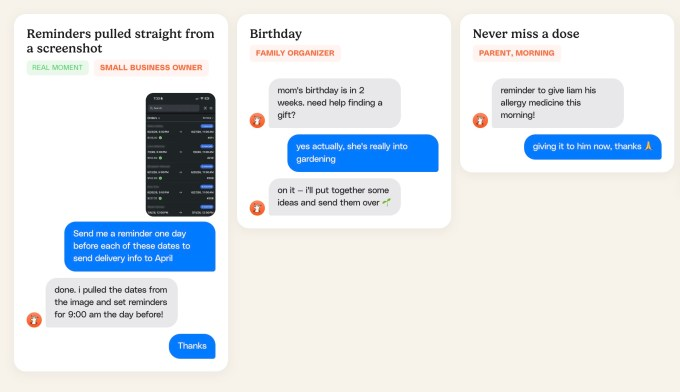

Screenshot**Image Credits:**Ollie

Similar to the other family-focused agents, the idea behind [Ollie](https://ollie.ai/) is that families already have the information they need, but it lives across school messages, calendars, task lists, and group chats. Ollie aims to bring those pieces together and keep them in sync. It can keep track of calendars, emails, reminders, tasks, and other household details, then deliver relevant information to users through text.

Its biggest differentiator from other agents is that [Ollie](https://techcrunch.com/2026/09/03/ollie-is-betting-privacy-can-win-the-ai-assistant-race/) is one of the first mainstream, family-focused AI assistants to achieve SOC 2 compliance, a widely used security standard.

Launched in June 2026, Ollie offers a free tier, as well as paid plans starting at $25 per month for 150 messages. A $100-per-month plan includes up to 1,000 messages.

## Orbits

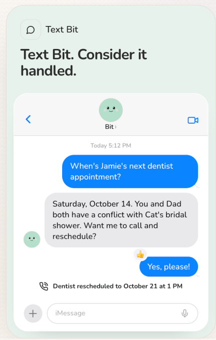

**Image Credits:**Orbits

[Orbits](https://tryorbits.com/) also has an AI assistant that is focused on the household.

It works through both the Orbits app and text messaging, and can bring together calendars, lists, and conversations while also carrying out tasks for you. That can include searching the web, making purchases, booking restaurants, changing appointments, and requesting quotes for household services.

Additionally, Orbits can remind family members about chores, communicate with service providers, and help coordinate responsibilities beyond the immediate household.

Orbits is backed by investors like Andreessen Horowitz (a16z) Speedrun fund, N49P, and Garage Capital.

## Pally

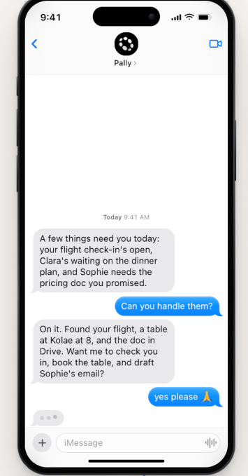

**Image Credits:**Pally

Users can interact with [Pally](https://pally.com) as they would with a friend while giving it access to the apps they already rely on. The assistant can connect information spread across services such as WhatsApp, Gmail, calendars, and Google Drive, helping users keep track of plans, receipts, dates, files, and other details.

There’s a free plan available. It works over iMessage, RCS, and Telegram.

## Poke

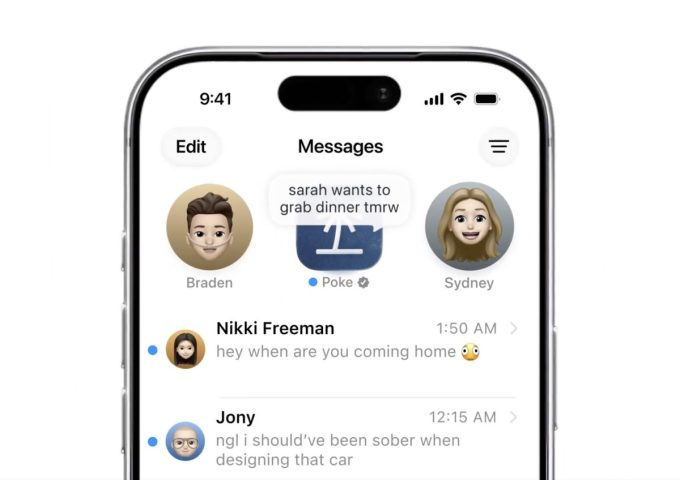

**Image Credits:**Poke/The Interaction Company of California

[Poke](https://poke.com/) [launched](https://techcrunch.com/2026/04/08/poke-makes-ai-agents-as-easy-as-sending-a-text/) in March 2026 as a general-purpose assistant that you can reach through text messaging. It can handle tasks involving calendars, planning, health and fitness, smart-home controls, photos, and other everyday activities.

Poke became particularly notable in June 2026 when Apple [approved](https://techcrunch.com/2026/06/04/apple-approves-poke-as-the-first-ai-agent-on-its-messages-for-business-platform/) Poke as the first AI agent on the Apple Messages for Business platform. A month later, parent company The Interaction Company of California was [acquired](https://techcrunch.com/2026/07/24/why-cognition-bought-poke-ai-personality-is-becoming-a-competitive-advantage/) by AI coding startup Cognition in a deal valued in the low nine figures.

## Rene

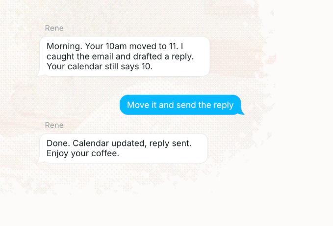

**Image Credits:**Rene

[Rene](https://rene.co/) is an AI personal assistant designed to be a user’s “best contact” rather than another productivity agent. It’s text-based and can turn natural-language conversations into tasks, reminders, summaries, and other follow-up actions. Rene also maintains context across conversations, allowing it to remember details and surface things that may need attention later.

Additionally, it has a browser, can write code, shop for you, as well as create slides and images.

Rene is currently available on iMessage, Telegram, and WhatsApp.

## Skye

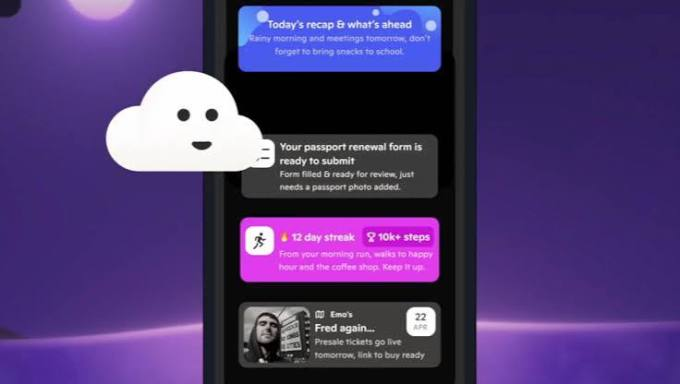

**Image Credits:**Skye

Instead of waiting for users to open an app, [Skye](https://skyeapp.ai) is an “[agentic homescreen](https://techcrunch.com/2026/04/27/investors-back-skye-signull-labs-ai-home-screen-app-for-iphone-ahead-of-launch/)” for the iPhone that analyzes information from connected services and surfaces what it thinks is relevant through contextual cards, suggestions, and daily briefings. The assistant can generate audio briefings, prepare information ahead of meetings, surface reminders, and identify potentially useful information.

The company, Signull Labs, raised about $3.6 million in seed funding in 2025. It entered private testing and beta in April 2026, and hasn’t yet announced a public release date.

## Stanley

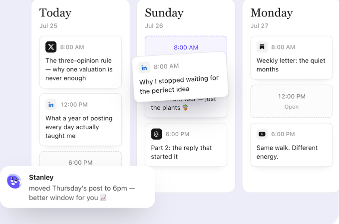

**Image Credits:**Stanley

[Stanley](https://www.getstanley.ai/welcome) is an AI content assistant aimed at content creators rather than general personal productivity. Available through iMessage, Telegram, and the web, it acts as a kind of AI head of content, helping users come up with ideas, turn them into posts, and maintain a consistent publishing schedule.

For instance, Stanley can connect to a user’s Instagram account, using that context to suggest content based on what the user has actually been doing. Users can also send voice notes, which Stanley turns into scripts, captions, and other social assets. It includes a content calendar and can schedule posts, with the broader goal of making content creation a more continuous, automated process rather than something users have to sit down and plan from scratch.

## Szn

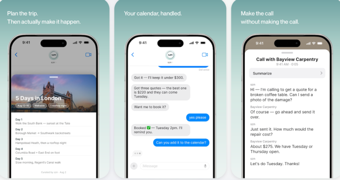

**Image Credits:**Szn

[Szn](https://theszn.ai/start) is designed to coordinate tasks and follow-ups through a single conversation thread. Users can send text messages, voice notes, photos, or forwarded emails, and the assistant takes action on their behalf, including making calls, sending emails, and managing follow-ups.

According to the company’s website, Szn has served more than 7,500 businesses across 16 countries, completed over 10,000 jobs, and handled 95 hours of calls.

## Tab

**Image Credits:**Tab

[Tab](https://techcrunch.com/2026/10/07/another-personal-ai-assistant-has-launched-meet-tab-which-emerged-from-stealth-with-a-300m-valuation/) allows users to delegate everyday tasks through familiar messaging platforms. Users can send requests to the assistant via iMessage or WhatsApp, ranging from ordering groceries to finding birthday gifts, and Tab handles the process on their behalf.

The company emerged from stealth in early October with a valuation of $300 million. Its investors include SV Angel, Valar Ventures, and American Spirit.

## Tomo

The biggest differentiator with [Tomo](https://www.tomo.ai/)’s personal assistant for iMessage is that, instead of being a private assistant that only you interact with, Tomo can become part of group conversations.

Also, like other agents, it’s designed to help with goals, accountability, scheduling, and everyday organization. It also has the ability to send reminders, search the web, work with calendars and email, watch videos, and edit photos.

The basic plan starts at $19.99 per month.

## Town

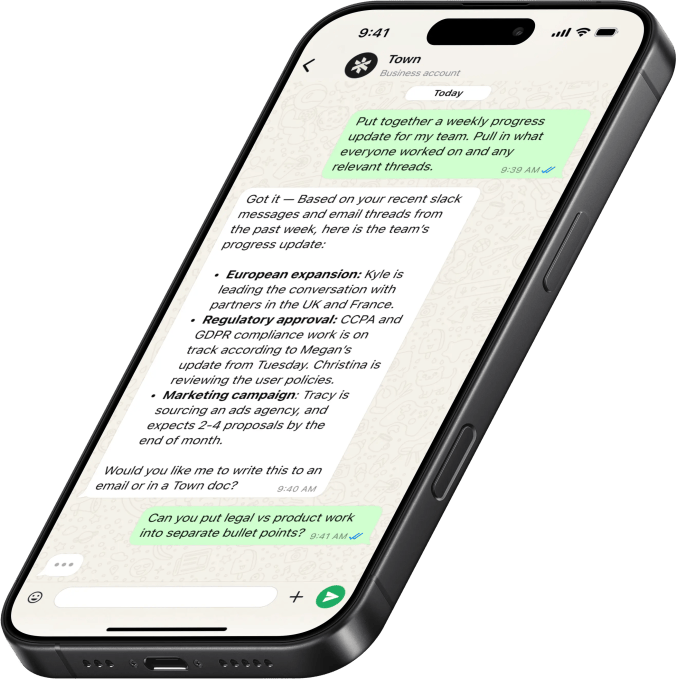

**Image Credits:**Town

[Town](https://www.town.com) is aimed more at professional life. It gives users a “Townie,” an AI assistant designed to learn how they work and handle recurring professional tasks. It can work with email, calendars, documents, Slack, and other platforms.

In June 2026, the company raised a [$55 million Series A](https://finance.yahoo.com/sectors/technology/articles/town-raises-55m-series-a16z-134500847.html) led by Andreessen Horowitz and Forerunner.

## Underdog

[Underdog](https://techcrunch.com/2026/10/06/silicon-valleys-ai-wunderkind-launches-underdog-the-most-private-instinct-muse-competitor-yet/) is a privacy-focused AI assistant that launched an invite-only beta in early October 2026. Unlike cloud-based AI services, the model runs entirely on the user’s device, keeping personal data on hardware they already own. The initial release supports Mac and Windows computers, with Linux, iPhone, and Android versions planned for the future.

The company plans to offer the app for free initially and has stated that it will never include advertising.

## Wajo

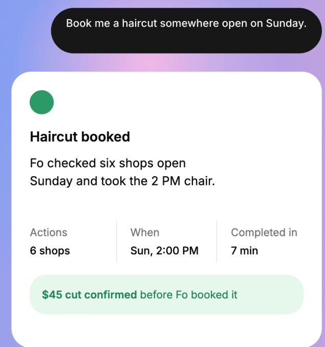

**Image Credits:**Wajo

[Wajo](https://wajo.ai/join-wajo)’s first consumer agent, Fo, can call businesses, send emails, join group chats, make bookings and purchases, and coordinate with people to complete everyday tasks.

A key part of Wajo’s approach is giving Fo its own identity. The agent has its own email address, phone number, and payment card, allowing it to interact with businesses without requiring users to hand over their own credentials.

Notably, when Fo encounters something it cannot handle on its own, Wajo says it can bring in a human assistant to finish the task.

Fo launched publicly in September 2026 with a free tier, while heavier workloads and custom agents are available through a paid Pro offering.
