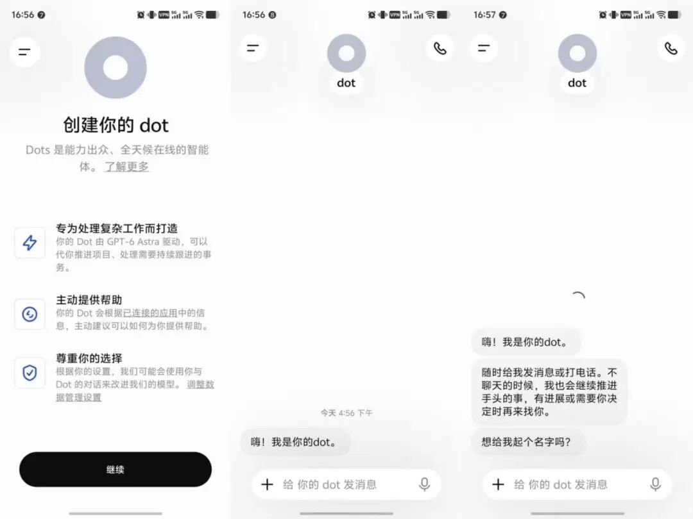
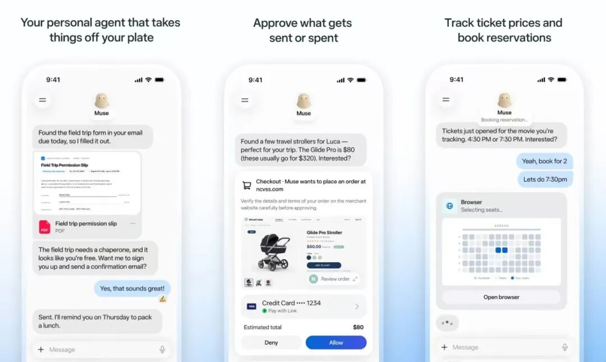
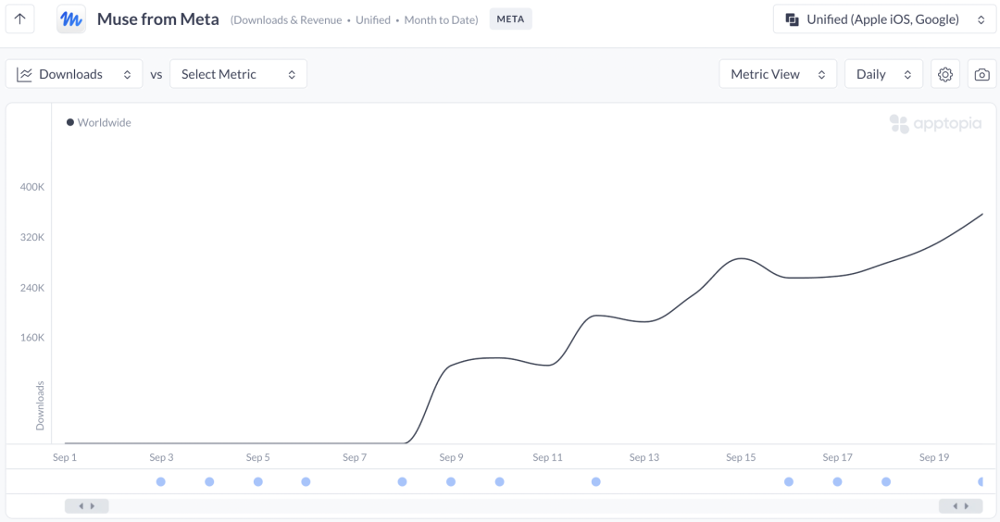
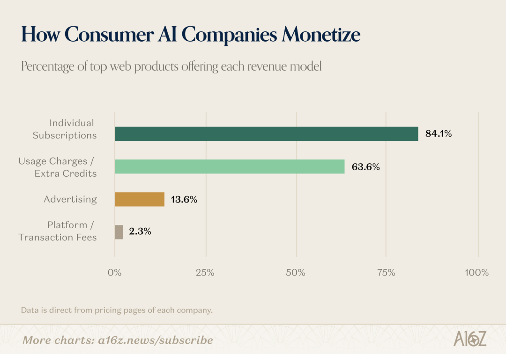



**收录说明**：用户提供链接。原文在微信公众号，用浏览器的客户端标识直接下载页面，从 `#js_content` 抽取正文，图片地址取自 `data-src`。文首关注引导横幅、文末作者名片与公众号推广图未收入；原文多个一级标题按规则降为二级。

**内容摘要**：文章开篇称 Muse 上线三周下载 500 万，Instinct 以 14 人团队、100 亿美元估值融走 10 亿美元；据 Assistant Benchmark 统计，截至 9 月收录的个人 AI 助理共 122 个，其中通用型 64 个。前 TikTok 产品经理莫唯书认为 Personal Agent 的上下文「不是围绕任务构建，而是围绕人来构建」。文章称 Personal Agent 单次复杂任务平均消耗超过 256K token，是传统聊天机器人约 8K token 的 32 倍，并引用 Barclays（运行成本约为免费 ChatGPT 的 10 倍）和 a16z（每用户每天成本可能高达 20 美元）的估算，认为通用产品难以靠订阅打平；国内方面，10 月 14 日豆包手机助手披露微信、美团、支付宝等 150 余款应用明确拒绝接入。文章认为「垂直细分」或许是创业公司的最优解，举了 K2Lab、Karpo 和首发定价 1799 美元的 Oki Home 等例子。

**保留理由**：以「是不是好生意」为主线，汇集算力成本、订阅与佣金、平台封杀等经济性数据，并对比中美生态差异。

---

你用过Personal Agent了吗？

作者｜栗子

“究竟有多少普通人，需要一个真人助理？”

今年10月，在「甲子光年」参加的一场关于Personal Agent的闭门会上，有人问了这样一个问题。

在场的人没有立刻回答。

因为这个问题背后，还藏着另一个朴素的问题：

Personal Agent不就是个会帮人订票的App吗？

尽管在AI已大行其道的今天，这个问题看上去很外行。但要认真回答起来，也似乎确实没人能给出一个让所有人都满意的答案。

每个人对Personal Agent的理解都不同。

有人说，它是一个能替你订机票、写邮件、退订阅的私人助理；有人说，它是一个有记忆、有性格、能主动帮你的数字分身；还有人说，它就是一个更厉害的OpenClaw。

虽然没有标准答案，但Personal Agent已然成为全球最热门的赛道。

Meta的Muse上线三周下载500万；Instinct以14人团队、100亿美元估值融走10亿美元，其内测邀请码在eBay上被炒到了300美元。

据个人AI助理评测网站Assistant Benchmark统计，截至今年9月，被其收录的个人AI助理共122个，其中通用型64个，占比超过50%。

一边是困惑，一边是狂欢。

这就是Personal Agent现在最真实的处境。

在科技圈逢人必谈Personal Agent的今天，「甲子光年」想搞懂的问题是，Personal Agent到底是什么？为什么它如今这么火？谁在这个赛道里真正赚钱？

一句话：**Personal Agent到底是不是一门好生意？**

## **1.Personal Agent到底是什么？**

之所以一千个人心中有一千个Personal Agent，是因为**Personal Agent还没有一个统一的产品形态。**

比如，国外的Muse和国内的Today都是独立App；Instinct根本没有App，操作方式是打电话和发短信；而OpenAI的Dots则藏在ChatGPT中。

Dots产品截图 图片来源：甲子光年

虽然Personal Agent的产品形态并未收敛，但行业对Personal Agent的本质基本达成共识：**它是一个以人为长期状态中心、拥有专属云端运行环境与持续记忆、并能在权限边界内主动替用户完成跨应用闭环的硅基代理。**

与过去的所有AI产品相比，Personal Agent至少有3个本质变化。

**第一个变化，是从“输出答案”到“交付结果”。**

过去，基于大模型的传统AI助手，严格遵循“输入Prompt，输出文本结果”的被动响应式循环，无法给用户完成比价、填表等执行动作。

而Personal Agent交付的是端到端的执行结果，消耗的算力也更多。

据测算，传统聊天机器人单次对话平均仅消耗约8K token。而Personal Agent为了在后台完成多步拆解、跨网页试错与验证，单次复杂任务平均需要消耗超过256K token，是前者的32倍。

**第二个变化，是状态中心从“任务”变成“人”。**

一个简单的问题是，像Codex、Claude Code这样的办公类AI Agent早已具备了极强的自主执行力，它们没能直接演变成如今的Personal Agent？

前TikTok产品经理莫唯书指出：“Personal Agent区别于办公Agent的核心，在于它的上下文（Context）不是围绕任务构建，而是围绕人来构建。”

严格来说，Codex、Claude Code等产品的核心用户是开发者，所以这些产品的界面才会围绕项目、代码库、工作区进行设置，获取专属上下文，目的是为了完成各种开发任务。

但普通人的日常生活往往是：改签航班、预订纪念日餐厅、取消忘了退订的会员等高度碎片化场景。这导致Personal Agent的上下文必须围绕用户本人进行构建，也就必须以人为中心。

**第三个变化，是使用门槛的极大降低。**

事实上，今天各大Personal Agent展示的跨应用操作能力，在年初爆火的OpenClaw和Hermes上就已初具雏形。但为什么直到半年之后才真正迎来消费级爆发？

“Muse之所以能火，最重要的原因还是它把用户的交互门槛拉到了极低。”

不久前**刚刚完成凯泰资本数千万元天使+轮（半年内第三轮）融资的K2Lab（攀峰智能）**创始人王铭对「甲子光年」分析。

“我们都觉得Codex已经很好用了，但对大众来说，门槛还是太高。而Muse就像一个人人都能用的高级版Codex，界面足够极简，交互方便，并且背后的Computer Use、Browser Use都很健全，能全天在线帮你干活。”王铭直言。

Muse产品界面 图片来源：Apple store

而支撑上述变化，引爆Personal Agent流行的**决定性推手**，是**底层技术在今年夏天的集中可用。**

比如**长链路操作成功率比此前更高。**

据专注于城市生活体验的Personal Agent创业公司Karpo创始人Leah透露，之前几代模型的模型执行长任务能力基本都在60%左右。而今天夏天Fable 5、GPT-5.6 Sol这一波，成功率基本超过了80%。

再比如**云端虚拟机和独立数字身份基建的普及。**

为了解决早期Agent占用用户本地设备屏幕、关机断网即中断的痛点，Muse、Dots等产品都选择配置了独立的云端虚拟机，以保证任务持续运行。

此外，不少产品也开始给每个Agent发放独立的数字工牌，给Agent配备专属邮箱、手机号甚至是支持限额授权的加密钱包，让AI拥有了在数字社会独立行事的合法身份。

显然，当产品与技术都在今年夏天万事俱备后，Personal Agent的走红便水到渠成。

但问题在于，**为什么看上去Personal Agent在美国如火如荼，而中国却并未出现想象中的爆发？**

## **2.美国的真刚需，中国的伪需求？**

Personal Agent在大洋彼岸掀起了现象级的消费狂潮。

据应用分析机构Apptopia估算，Muse上线后前12天，美国移动端日活达到约64.2万，几乎是当年ChatGPT同期表现的3倍。

Muse下载数据 图片来源：Apptopia

而没有任何图形界面、全靠短信和电话交互的Instinct，在硅谷更是一码难求。

一个流传很广的故事是：一对美国情侣在美网现场看球时，把座位号发给Instinct，让它帮忙找两人出现在现场大屏幕上的镜头。

Instinct愣是在后台哼哧哼哧干了18个小时——发邮件、查录播、问客服，最终顺藤摸瓜联系上负责剪辑的美网工作人员，把视频文件要了回来。

但在中国，Personal Agent暂时并未出现今年初OpenClaw式的跟风热潮。

不少从业者认为，**Personal Agent在中国可能是伪需求。**

这种天渊之别，背后原因其实并不难理解。

**首先，美国的互联网生态是高度碎片化的。**

或许我们很难想象，时至今日，美国的互联网依旧保留着高度分散的Web生态。

普通人在美国要完成支付、订餐、报税等需求，往往要在几十个独立网站、App以及电子邮件之间反复横跳，甚至一些本地中小商户、社区诊所甚至只接受电话和短信预约。

根据媒体援引的一项跨国行政负担调查数据显示，美国成年人平均每月需耗费11.8小时处理医疗健康核销、福利申请、税务申报等行政杂务，全美每年仅填写联邦政府表格就累计耗费超过120亿小时。

在这种高度碎片的场景下，一个只要接上邮箱、学会操作浏览器并能替人排队打电话的Personal Agent，确实可以帮用户瞬间释放巨大的信息整合价值。

**而中国则完全不同。**

在中国，移动互联网的进化早已深入骨髓。水电缴费、买菜外卖、政务办理、出行酒旅，早已被微信、支付宝、美团等高度集成在少数几个超级入口之中。

“**国内移动互联网进化得太彻底了**，产生了蛙跳效应，降低了AI的存在感。”K2Lab创始人王铭直言。

他以年初AI奶茶大战为例：“其实体验之后就会发现，用千问AI点奶茶，和用户自己打开淘宝闪购下单，无论操作步骤还是实现方式，都没有形成明显的体验代差。”

**其次是，生态壁垒的封闭程度也不一样。**

在海外，用户的账单、机票确认函、日程邀请最终大多汇集在个人邮箱，网页端依然是服务的主力承载者。

而在中国，用户的个人上下文与交易闭环被封锁在各大巨头的App中，数据墙迟迟难以打破。

并且，**一旦有人想越过生态触碰别家利益，必然会遭到反击。**

10月14日，豆包手机助手官方披露《屏幕自动化操作声明协议》（SAEP）最新进展及拒绝操作清单。微信、美团、支付宝等高频应用均在列，共计150余款应用明确拒绝接入豆包手机助手。

「甲子光年」在走访交流中发现，不少从业者都认为，中国Personal Agent的机会可能只会出现在阿里、腾讯等能够闭环完成所有生活需求的生态中。

**还有一层隐秘的差异，就是人力成本与用户为“省时间”买单的意愿。**

根据王铭的观察，Personal Agent能在海外大行其道，一个重要原因就是“懒”。

“美国电商平台有几十个，并且人工成本极高，跨平台比价是真需求，也愿意为此付费。但中国人太勤快了，但凡能找到薅羊毛的空间，根本不需要AI帮忙，自己就干了，更不用提付费。”

## **3.通用Personal Agent是一场烧钱大赛**

既然海外市场需求真实存在，那么试图“什么都管”的通用型Personal Agent，是不是早已跑通商业闭环？

答案可能恰恰相反。

根据「甲子光年」的观察，无论是增长速度远超ChatGPT的Muse，还是一码难求的Instinct，其**商业模式都在承压。**

**最大的问题就是，Personal Agent实在太烧算力了，这是一切的根源。**

目前基本所有通用Personal Agent都宣称自己可以全天帮用户完成各种需求。而为了保持7x24小时的云端常驻、维护独立虚拟机、每隔几分钟扫描一次邮箱日历并在网页上反复多步推理，其算力消耗必然呈指数级膨胀。

据巴克莱银行（Barclays）分析师Ross Sandler估算，免费Personal Agent的运行成本是免费ChatGPT服务的10倍左右。

而据a16z测算，一个被充分利用的Personal Agent，**每个用户每天的成本可能高达20美元。**这意味着要服务10万名活跃用户，一年就要烧掉数亿美元的算力。

然而，**与大幅消耗的算力成本相比，消费者的订阅费可以说是杯水车薪。**

a16z对44款AI原生产品做过一次统计：84.1%提供订阅，63.6%按用量或积分收费，13.6%有广告，2.3%依靠平台交易。也就是说，超过八成的AI产品，主要采用的还是订阅制收费。

消费级AI的收费模式统计 图片来源：a16z

例如，OpenAI将自家Personal Agent产品Dots捆绑进每月100美元的ChatGPT Pro会员。

但问题在于，真的有那么多人愿意为了帮自己节省10分钟的订票时间，而长期掏上百美元每月的订阅费吗？

据a16z基于YipitData美国消费者电子小票样本的统计，截至今年8月，至少订阅了ChatGPT、Gemini、Claude中的一个的美国消费者比例仅有4.5%，付费用户的月支出中位数仅为25美元，且长期没有明显增长。

另一份数据是，据风投机构Menlo Ventures在今年7月对5067名美国成年人的调查，64%的美国人用过AI。在用过AI的这些人里，**每月超过100美元（有资格使用Dots）的付费者仅占14%。**

既然产品很难向C端收取订阅费，Personal Agent便选择了另一条**极具移动互联网色彩的商业策略：对C端免费，从B端收费。**

典型的就是**Muse和Instinct。**

Muse的做法是基础功能免费、重度使用需要订阅。

而Instinct的策略更互联网：目前免费使用，靠替用户省钱、代办消费把交易流水做大，再向酒店、服务商等B端收佣金。

单看前端的增长与交易流水，Instinct确实交出了一份看上去还不错的成绩单。

据Instinct创始人Noah Shinn自己在播客中披露，Instinct用户在三周内绑定信用卡的比例达到40%，在至少授权过一项敏感信息的用户中，留存率高达80%。

更值得关注的是，这些用户一旦产生购买，平均每月通过Instinct花掉超过1300美元。基于这个数据测算，凭借10万出头种子用户的Instinct，年化交易流水已超过10亿美元。

但即便如此，**Instinct却一直并未开放注册，核心原因还是算力成本。**

Noah Shinn在播客中坦言，Instinct在现有邀请制下算力成本每周翻倍，由于算力交付有滞后性，公司不可能等到需要时才买，只能提前采购。

这意味着Instinct实际上顶着很高的财务杠杆，一旦预测错了就会亏很多钱。

另一方面，**向B端收费这条路可能也不一定好走。**

至少到目前为止，海外通用Personal Agent的价值都建立在碎片信息整合之上，靠全网比价等方式促成交易，向商家抽佣。但这显然直接**动了电商与本地生活服务商的奶酪。**

9月20日，Muse上线不到两周就被亚马逊全面封杀。

原因非常简单，亚马逊去年仅站内广告收入就高达686亿美元。如果放任外部Agent替用户跳过瀑布流广告、直接全网比价下单，电商巨头的广告商业模式将瞬间崩塌。

## **4.谁在真正跑通商业闭环？**

既然就连明星项目都暂时未能跑通商业闭环，那是否意味着火爆的Personal Agent其实是一门“看上去很美”的生意？

未必。

在「甲子光年」看来，通用Personal Agent由于高昂的算力成本很难通过微薄的订阅费打平，所以最终必然会成为巨头与融资能力极强的明星创业公司烧钱争夺下一个AI入口的战场。

而更多的**创业公司要想在Personal Agent赛道立足，“垂直细分”或许才是最优解。**

在K2Lab创始人王铭看来，创业公司如果去选超级通用的入口，肯定会被大厂干死。

“我们从第一天起就想清楚了，只做垂直人群的Personal Agent，只走直接交付商业结果的路径。”

其实，目前市面上已有不少垂类Personal Agent崭露头角。**他们依靠聚焦某类特定人群，解决特定需求的方式跑通商业闭环。**

比如**K2Lab就是专门帮人赚钱的代表样本。**

K2Lab联合创始人汤明磊把**Personal Agent分为四个象限，省时间（提效）、杀时间（消遣）、省钱和赚钱。**

作为“帮人赚钱的Personal Agent”的典型案例，「甲子光年」曾多次跟踪报道K2Lab，拆解其商业模式。

简单来说，K2Lab帮助海外视频平台的内容达人带货赚钱，并按CPS（按成交结果分润）的方式与达人分享利润。

K2Lab的打法非常直接，他们切入的是海外TikTok内容电商的庞大产能真空：

TikTok在全球坐拥超10亿美元DAU，但海外广大的中腰部达人与普通素人（如全职宝妈、兼职白领）既不懂选品、写脚本、剪辑与投流，又极度反感MCN机构那种前期漫长无收益的培训与长期合约绑定。

为此，K2Lab打造了面向海外达人的Personal Commerce Agent——Moras，端到端包揽从爆款选品、脚本创作、多模态带货视频生成到发布复盘的全链路。

此前，一位遭遇美国邮政系统裁员、独自抚养两个幼童的失业宝妈，试用Moras不到一周就跑出了1.4万美元GMV，单月成交更是突破10万美元大关。

在商业模式上，K2Lab在过去半年完成了一次看似不可能的跃迁。

「甲子光年」了解到，今年4月底的百人种子用户共创期，当时团队还在测试“每月20美元订阅费+佣金提成”的收费门槛。

然而今年6、7月左右产品正式上线后，K2Lab取消了20美金的订阅费，全面推行“三零模式（零订阅费、零Token费、零MCN绑定协议）”，完全落实纯CPS结果付费！

也就是海外达人无需掏一分钱即可免费使用全套AI能力，账号永远自由归属个人，创作者可选择协作创作（Copilot）、滑动审核（Swipe）或长期托管（Autopilot）等多种模式，只有当Moras真正帮达人把货卖出去、赚到带货佣金后，系统才会按比例分成。

这个策略让Moras用户量开始快速增长，海外注册达人从百人迅速裂变至将近10万人，正式上线首季度累计GMV直接突破1000万美元。

“真正创造价值永远比省钱重要，所有的用户都希望让自己赚更多钱。”王铭直言。

**除了帮人赚钱，还有产品选择在特定人群的模糊意图里截胡本地交易。**

**典型代表是Karpo。**

既然在“帮人订确定性机票、退订账单”的后链路执行上拼不过大厂和百亿独角兽，Karpo选择把战场收缩到特定高消费人群的“晚上、周末和假期”，往前半步，去抓用户还没有形成明确搜索词之前的模糊意图。

上一代互联网满足的是用户的明确需求，用户必须自己先把“最近睡不好”或“周末想放松”翻译成具体的商品。

而Karpo发现，这其中超过70%的用户意图都非常模糊，他们只会说一句“Food”或者“Nature walk”。这就给了Karpo拦截意图的机会。

为了实现这一目的，Karpo避开了下沉与泛大众市场，精准锁定纽约、旧金山、伦敦等大都会圈25～35岁、中高收入、没有育儿负担且热爱探索的都市青年，用跨维度品味把模糊情绪变成订单。

比如，针对用户“想出去吃点东西但说不清吃什么”的高频痛点，团队开发了一个四象限可视化滑杆“VibePad”——用户只需滑动选择今晚想要“轻松随性”还是“隆重讲究”，系统便实时生成上下文Prompt，直接给出从街边小店到米其林餐厅的定制行动方案，并在获得信用卡授权后自动帮用户预订餐厅。

通过把命题收窄，Karpo跑通了高客单价的商业变现。

目前单个典型用户每月由Karpo促成的真实交易额平均达到500至600美元，重度用户甚至高达两三千美元。

依靠掌握高净值人群的消费委托权，Karpo也顺畅跑通了与大型连锁商家、票务平台的交易抽佣，以及与金融机构的绑卡支付分润。

**还有没有第三条路？**

硅谷的一批硬件派创业者的解法是：**直接为Personal Agent重新造一台个人计算机**，用硬件买断锁定最舍得花钱的Top 1%专业用户。

今年10月初，入选Y Combinator W25孵化计划、由加州大学伯克利分校00后华裔创业者Luofei Chen创立的团队Oki，正式面向海外推出了一款专为Personal Agent 7x24小时常驻运行设计的**个人电脑——Oki Home**，首发定价1799美元。上线仅3天，首批预订份额便全部售罄。

软硬一体的Personal Agent，其商业逻辑的巧妙之处在于，它既可以通过售卖硬件设备直接回笼资金产生利润，还能用本地硬件锁死用户的上下文资产，后续还有机会提供端云协同、模型与技能商店等多个延展性服务，极大程度提高了商业天花板。

王铭也在与「甲子光年」的访谈中做出了类似的预判：

“现在Personal Agent的产品形态大概率都是过渡形态，因为它们现在基本都是出现在手机上。但Personal Agent需要不断获取用户的上下文才能够极度了解你，所以它极有可能是软硬一体的，比如以后人均一个AI眼镜也不是不可能。”

显然，Personal Agent还没有统一的标准答案。

但无论是美国还是中国，通用还是垂直，toC还是toB，软件还是硬件，2026年的秋天，Personal Agent的战火才刚刚点燃。

（封面图来源：AI生成）
