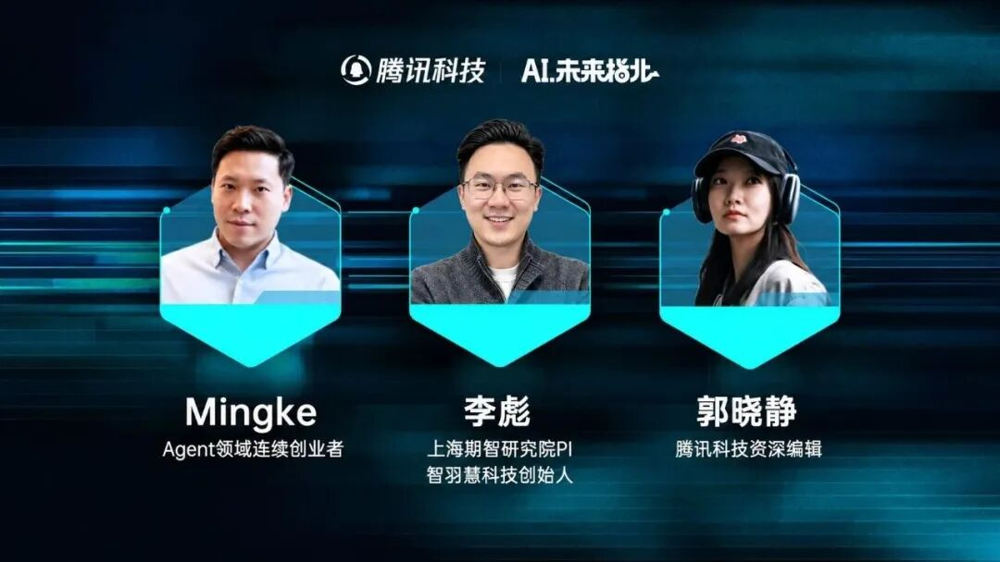
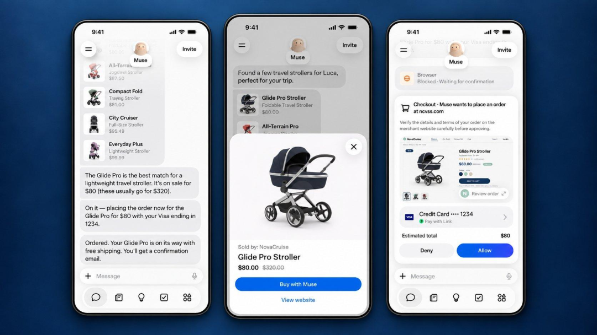
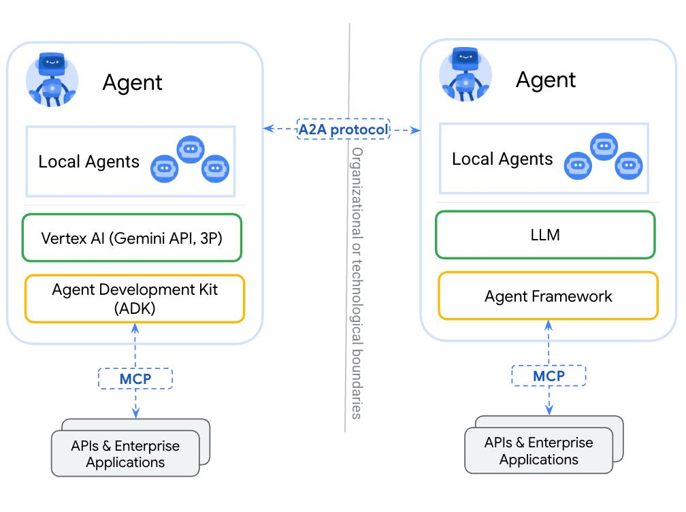
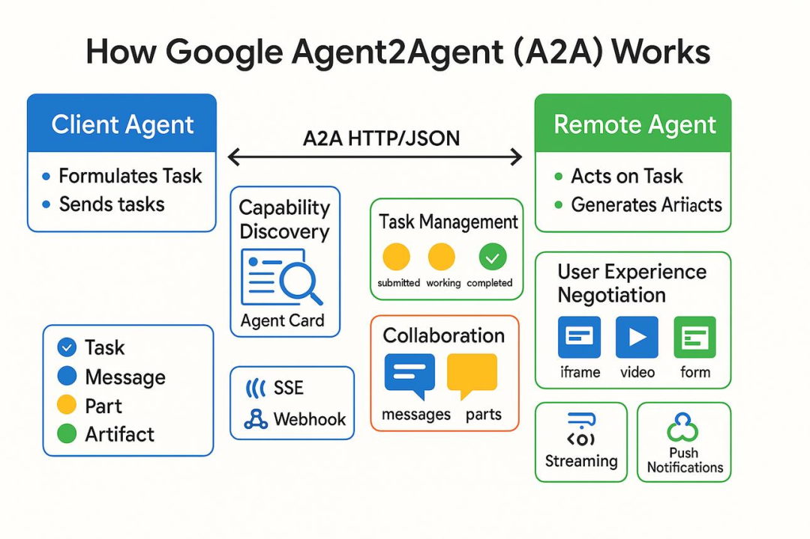



**收录说明**：用户提供链接。原文在微信公众号，用浏览器的客户端标识直接下载页面，从 `#js_content` 抽取正文，图片地址取自 `data-src`。页面 author 字段为「值得关注的」，正文署名「文｜晓静」，按正文署名填写。文章整理自腾讯科技《AI未来指北》的对话。删去文末推荐阅读与关注引导。

**内容摘要**：腾讯科技的文章（文｜晓静）整理了 10 月 22 日《AI未来指北》中 Mingke 与李彪（上海期智研究院 PI、智羽慧科技创始人）的对话。Mingke 讲述自己 2015 年创办 PA 公司时遇到的「API 困境」——服务提供商没有动力向外部 Agent 开放接口，并提出由用户拥有和控制的「主权 Agent」设想；李彪希望有独立的可信上下文系统，让各 Agent 在授权范围内共用，并期待按结果付费。两人认为当前 PA 仍沿用入口、订阅、广告、佣金等旧商业逻辑，对创业公司做与大厂相似的通用 PA 持谨慎态度。

**保留理由**：两位从业者对 PA 商业模式、上下文归属和服务接口开放问题的独立论述，补充产品动态之外的行业视角。

---

图片由AI生成

文｜晓静

编辑｜徐青阳

Personal Agent（PA）正在成为AI To C的新战场，但这并不是一个全新的故事。

PA以“AI Native”之名，但围绕它们展开的商业竞争，逻辑却似曾相识，入口、增长与留存，再通过订阅、广告或交易佣金实现盈利。**一个以减少用户操作为目标的产品，为什么还在沿用以争夺用户注意力为核心的商业逻辑？**

至少在中国投资圈，PA还没有成为一个令人信服的创业逻辑。金沙江创投主管合伙人朱啸虎最近在一场活动中直言，自己不知道PA到底能干什么。

这个疑问很有代表性。让AI帮忙订一杯咖啡、买一张机票，听起来很方便，但用户真的需要为此购买一项独立服务吗？如果手机里的App已经足够好用，为什么还需要多一个Agent？

但也不排除还有另外一种可能，也许PA的真正意义，眼下根本还没有通过这些产品的初始形态呈现出来。

它可能只是一个开始。

如果未来AI能够代表个人提出需求、寻找供应商、比较价格、调用其他Agent并完成交易，那么改变的就不只是人们使用软件的方式，也可能出现新的分工，新的商业体系。

一个由Agent参与决策和交易的Agent Economy，或许正在形成。

只是今天，无论大厂还是创业公司，都倾向于沿着自己最熟悉的道路前进。大模型公司希望推动更多模型调用，创业公司需要尽快证明产品的增长与商业化能力。**每一条路径都有现实的商业理由，却未必能充分释放Agent的潜在价值。**

10月22日，腾讯科技《AI未来指北》邀请**Agent领域连续创业者Mingke、****上海期智研究院PI****、****智羽慧科技创始****人****李****彪****，**讨论了PA的底层逻辑，以及一种新的Agent经济究竟会如何长成。

2015年，Mingke就曾创办一家PA公司，后来又亲手关掉了它。这段经历让他遇到了一个至今仍未彻底解决的难题——“API困境”。

当时，AI已经能够通过自然语言理解用户需求，却缺少完成真实交易所需的服务接口。航空公司、酒店和互联网平台掌握着服务资源与客户关系，为什么要把这些能力开放给一个外部Agent？

这让他开始追问一个更根本的问题：**PA面临的究竟****是技术问题，还是商业运营问题？**

十年过去，大语言模型已经解决了许多自然语言理解和推理问题，Computer Use也让AI能够操作浏览器和电脑，但服务供给与商业合作的问题仍然存在。

在Mingke看来，如果PA仍然主要依靠入口、广告和交易佣金盈利，这种商业运营问题就几乎不可能被接近。

更深一层的问题是，**Agent究竟是一种新的智能，还是一种新的应用？如果它要代表用户行动，当用户利益与平台收入发生冲突时，它究竟应该忠于谁？**

Mingke由此提出**“主权Agent”（Sovereign Agent）**的构想：真正的个人Agent应该代表用户的意图和利益，由用户自己拥有和控制，而不是由商业平台提供的一项云端订阅服务。

李彪的观察视角是，“我们为什么总在讨论Agent能不能帮人订咖啡、买鲜花？”

他认为，衡量Agent的价值，**应该看它能否让人以更低的成本完成目标，能否扩展普通人的能力边界，以及能否把人从大量消耗注意力的事务中解放出来。**过去需要雇佣助理、掌握专业技能，甚至根本没有想过要做的事情，未来都有可能变得触手可及。

这也许才是Agent Economy最有想象力的部分：**当获取智能和执行任务的成本足够低，社会可能出现一批过去从未被满足、甚至从未被明确提出的需求。新的交易由此发生，新的市场也可能随之形成。**

但在此之前，行业还有一系列问题没有解决：个人的记忆和数据究竟属于谁？Agent应当拥有多大的权限？商业平台为什么愿意开放服务？如果Agent替用户做出错误决定，谁来承担责任？

围绕这些问题，两位嘉宾给出了并不完全相同的答案。

十年后的大模型时代，在PA（这次）能不能成之上，还有一个值得继续讨论的问题：**当Agent真正开始代表人参与经济活动，Agent Economy能否在现有互联网商业体系的基础上，创造新的经济增量，并发展出不同的商业逻辑？**

以下为对话实录，经编辑整理。

01

PA到底能做什么？

**腾讯科技：**最近PA产品越来越多，从Muse、Dot到Cue，都在强调替人办事。但回到真实需求，一个很简单的问题反而很难回答：我们真的需要PA吗？

图：Meta Muse可以借助专用云端虚拟机执行网页操作、预订等任务，并在敏感操作前征求用户确认。

**李彪：**我认为不应该简单地从某件事情出发，比如让Agent帮我订一杯咖啡，或者情人节帮我挑选一束花送给伴侣。我们需要从几个更抽象的角度考虑。

**第一个是，完成同样的目标，能不能使用更少的资源？**这些资源包括金钱、时间、精力和注意力。

第二个是，Agent能不能扩展我的能力边界。

我身边有不少研究人员，过去主要研究数学，现在也会尝试考古、建模，以及各种原本不熟悉的领域。以前他们可能不会编程，也不懂专业软件，现在借助Agent就可以开始做。

第三个是扩展一个人的行动范围。

我们每天都有大量事务没有精力处理，比如邮件、项目沟通、回复别人对文章或者开源项目的询问。现在，个人Agent或者自己创建的Agent，都有可能帮我们完成这些工作。

所以，我认为我们确实需要Agent。但它究竟能做什么，没有一个固定答案。很多时候取决于你的想象力。

**腾讯科技：**但这也带来一个矛盾。成熟的互联网产品，用户通常很清楚它能做什么，比如打开美团，就是点外卖、订餐厅。PA似乎需要用户自己去想象它的用途，这似乎不太符合“应用”的定义？

**Mingke：**我觉得需要先理解Agent是什么。

Agent这个概念已经存在很多年了。过去我们做对话系统、个人助手，也会把它称为Agent。后来Coding Agent发展起来，大家又重新开始讨论它。

从本质上讲，**Agent很重要的特征是能够采取行动。**

**我们评价一个Agent，关键是看它能不能通过行动改变环境，实现目标**。如果它做了一个动作，却没有产生任何实际影响，这个动作的价值就很有限。

这里的环境可以是虚拟世界，也可以是现实世界。比如信息收集、3D建模，是在数字环境中完成任务；订机票、酒店，则涉及现实世界中的服务交付。

一个人能够改变环境的范围原本是有限的。Agent可以放大这种能力，让每个人能够做更多事情。

我认为PA还有一个很重要的价值，就是消除个人的认知负担。你可以把大量琐碎的事情交给它，让自己更专注于真正重要的目标。

我们十年前做个人代理的时候，就有一个理念：生活中的麻烦交给代理，你去专注于自己认为重要的事情。当然，如果一个人本来就没有什么明确的目标，每天只是刷短视频，那么Agent帮他刷短视频，也没有太大意义。

**腾讯科技：**我们需要一个包办所有事情的通用Agent，还是多个各有所长的专业Agent？

**Mingke：**我会把它分成两类。

**一类是供给端的服务Agent**。比如一家航空公司，它能够提供机票服务，那么它的Agent就代表航空公司。我希望通过它使用航空公司的服务，但我不希望航空公司的Agent帮我点外卖，也不希望美团的Agent帮我订机票。

另一类是消费者一侧的PA。

我希望有一个Agent能够真正代表我的利益，再由它去调用不同服务提供商的能力。

这两种Agent所代表的主体是不一样的。

**李彪：**对我来说，一个Agent、多个Agent，甚至无限多个Agent，其实没有太大区别。

因为我自己会创建Agent，所以我不太关心具体使用哪个产品。它可以是Claude、Codex，也可以是我自己搭建的。

我真正关心的是Context，也就是上下文。

比如我经营一家公司，我不会说公司应该只有一个员工，还是需要十一个员工。**关键是所有员工都能共享必要的信息，围绕同一个组织目标工作。**

个人Agent也是如此。

我希望有一套属于我自己的统一上下文体系，所有Agent都可以在授权范围内使用它，服务于我的利益。

如果Dot有自己的上下文，Muse有自己的上下文，另一个Agent又拥有另一套，彼此无法连通，那对我来说就很麻烦。

所以，我认为关键不在于Agent的数量，而在于上下文由谁掌握。

02

个人Agent要“忠于”谁？

**腾讯科技：**我自己试用这些产品时，到了授权环节就会犹豫。两位会怎么选择？

**Mingke：**这里其实有两个问题：它能不能做到，以及你要不要让它做。

假设一个Agent能力非常强，你是否就愿意把权限全部交给它？

这两件事情需要分开考虑。

我自己不太愿意把大量个人上下文都放在某一家云端PA里。因为一旦长期使用，大量信息就会积累在它的系统中。如果以后出现一个更强的Agent，我可能很难迁移过去。

但如果这些信息保存在我的本地设备，我就可以让Claude、Codex或者其他Agent访问，不必被某个云端平台绑定。

**腾讯科技：**如果是这样，我们是不是应该有一个拥有最高权限的个人Agent，由它调用其他专业Agent？而且最好部署在用户自己的设备上？

**Mingke：**这是我比较期待的一种形态。

未来也许会出现真正基于本地环境的PA。最开始成本可能比较高，就像早期个人电脑一样。

比如你买一台Mac mini，部署模型、Agent框架和各种软件，自己管理上下文。也可以有人帮你安装和配置，最终形成一套比较容易使用的消费级产品。

这里的关键，是这个Agent属于你自己。**我认为未来应该出现一种Sovereign Agent，也就是主权Agent。**它只代表你的利益，而不代表某个平台的利益。

**腾讯科技：**普通消费者是不是很难拥有这样的系统？

**Mingke：**所以需要有人把软硬件组合起来，做成更容易使用的产品。

你购买硬件、购买模型或者软件服务，也可以付费请人帮你部署和维护。这就像个人电脑的发展过程。

我并不是说PA应该免费。硬件、软件、模型、安装和维护都需要成本。

我质疑的是另外一种模式：**一家云端公司持续提供所谓的个人代理服务，通过订阅、广告或者交易佣金赚钱，但用户无法真正决定这个Agent的最高目标。**

这里有一个经济学上的问题，就是委托人与代理人的利益关系。

当你使用一个Agent时，它口头上可以说你是它的主人。但如果你试图修改它的某些最高目标，它又会告诉你，平台不允许这样做。

那么，究竟谁是它的主人？

Agent执行的具体任务可以由用户决定，但它的Meta Goal，也就是最底层的目标（普通用户根本感知不到，但作用于所有需求之上），可能仍然由平台定义。

从这个角度来说，我认为真正的个人Agent，**应该能够让用户决定它最终服务于谁。**

**腾讯科技：** 所以你更在意的是控制权，而不只是隐私和数据安全？

Mingke：对，主权和隐私并不是完全相同的问题。

一个人可能愿意用自己的隐私换取更方便、更便宜的服务。这是他的选择。

Sovereign Agent不一定便宜，也不一定是所有人的选择。

很多消费者可能根本不在意“Agent最终是不是服务自己的利益”这些问题，只要产品能满足眼前的需求，价格能够接受，就愿意使用某个云端超级Agent。

这是现实存在的市场需求。

但另一些用户希望真正控制自己的数据、权限和Agent的目标，他们可能愿意为此承担更高的成本。我认为这样的市场也应该存在。

**李彪：**对我来说，更重要的是我能否真正掌握自己的数据，以及是否有权决定哪些Agent可以使用这些数据。

**腾讯科技：**这是不是意味着，在未来的PA产业链中，用户长期记忆和上下文管理可能成为一个独立的机会？

**李彪：**这是我很感兴趣的方向。

我希望有一个可信的上下文系统，保存我的数据、记忆，以及我与不同Agent互动过程中积累的信息。

这个系统可以由我自己管理，也可以交给值得信任的服务商管理，就像我们使用iCloud一样。只要经过授权，任何Agent都能够访问必要的信息。这样我就不需要纠结究竟使用哪家公司的产品。

比如我每个月给某家服务商支付200元，如果这个月使用体验不好，我就可以立刻换一家，因为我的上下文并没有被锁定在那里。

我非常愿意为这样的服务付费。如果我去创业，也会对这种基础设施很感兴趣。

**Mingke：**但这件事没有那么容易。

首先，记忆本身就没有得到很好的解决。

什么信息应该存储？什么时候存储？哪些是短期记忆，哪些是长期记忆？什么时候需要把这些信息提取出来？

这些都和Agent框架有很大关系。

其次，不同Agent处理上下文的方法并不一样。目前还不存在一套所有Agent都能使用的通用数据结构。

当然，未来可能出现协议和标准，但现在各家的框架还在快速发展，距离统一还很早。

另外，授权和记忆也要分开。

比如某个Agent拥有访问你账户的权限，这属于授权体系。它在与你互动的过程中积累的信息，则属于记忆体系。

二者不能简单混为一谈。

还有一个问题是，记忆本身就可能形成锁定效应。

假设两个Agent拥有相同的模型能力，但其中一个长期使用了你的上下文，了解你的工作、关系和偏好，另一个没有。

你会觉得前者更聪明。实际上它们的智力可能相同，只是前者掌握了更多背景信息。

你使用得越多，它越了解你，你就越难离开它。所以，建立独立、可迁移的上下文系统很有价值，但技术和生态层面都还有不少问题。

03

PA的商业难题，十年前就存在

**腾讯科技：**现在很多PA希望成为AI时代的新入口。但如果未来人人都有自己的Agent，服务提供商也有自己的Agent，过去围绕入口、流量和广告形成的商业模式，会不会发生变化？

**Mingke：**我想讲一段自己的经历。

2015年，我创办了一家PA公司。当时还没有大语言模型，我们主要使用传统NLP技术，进行意图识别和Slot Filling，也就是把用户的自然语言需求转换成结构化参数。

比如用户说，我想订一家餐厅，系统需要理解时间、地点、人数等信息。我们最开始做了一个类似Chatbot的系统，用户可以通过自然语言查询机票、酒店和餐厅。

我把产品演示给投资人看，他问我，这有什么用？当时我有点不理解这个问题，因为它已经能够帮用户查这么多东西了。

后来我们才发现，仅仅能够查询是不够的。用户想订餐厅，你究竟能不能把餐厅订下来？当时中国的API生态还不成熟，很多服务没有开放接口。

我们甚至雇佣了一支人工团队，由AI接收订单，再由人打电话联系餐厅，最后把预订结果返回给用户。显然，这种方式很难规模化。

后来我与一位投资人讨论过这个问题，他问我：**这究竟是技术问题，还是运营问题？**

这个问题对我影响很大。

如果美团、大众点评自己做同样的产品，它们本来就拥有大量商家资源，能够完成交易。而我即使拥有更好的自然语言理解技术，也不意味着商家就愿意把自己的服务接口开放给我。

这就是我们当时遇到的API困境。

**腾讯科技：**但十年过去，技术条件已经完全不同。大语言模型解决了自然语言理解和推理问题，Computer Use可以操作浏览器，MCP也提供了新的工具调用方式。

这个问题现在是不是已经能够解决了？

图：MCP与A2A的分工图

**Mingke：**技术确实发生了很大的变化。

我在2016年前后总结过，当时PA有三个主要障碍。

**第一个是自然语言处理能力不足**。现在大语言模型已经基本解决了这个问题。

**第二个是逻辑推理能力不足**。过去我们需要人工设计很多逻辑，现在模型可以完成大量推理。

第三个就是供给端的问题，也就是API困境。

这个问题至今仍然存在。

Personal Agent不拥有飞机，因此不拥有航空公司的交付能力。如果航空公司不愿意给你提供服务的接口，你能怎么做？你可能用computer use去打开航空公司的网站。这就回到了web时代就有的经典博弈：“爬虫和反扒”的对抗，只是从web变成了agent，从信息变成了action。**本质上，这是博弈，而不是合作，就很难撑起大规模的经济。**

更关键的是，为什么它要把自己的客户交给你，让你来控制这个用户关系？你必须给服务提供商一个非常有说服力的答案。

这个问题与十年前相比，并没有因为模型能力提高就自动消失。

**腾讯科技：**这也是当年Siri、Alexa、智能音箱遇到的问题吗？

**Mingke：**对。

过去无论是Siri、Alexa、小爱同学、Bixby还是其他智能助手，都面临第三方服务接入的问题。

很多品牌不愿意变成另一个平台背后的API。因为它们原本拥有自己的用户、品牌和服务溢价。

如果用户只通过一个统一Agent来使用所有服务，服务提供商可能失去直接触达用户的机会，最后只能通过价格竞争。

所以如果没有更好的市场机制，今天的PA仍然可能面对上一代智能助手遇到的商业难题。

**腾讯科技：**那有没有可能通过Agent与Agent之间的协作来解决？过去平台之间需要开放API，**未来我的Agent可以直接与你的Agent沟通，双方协商并完成交易。**

**Mingke：**我认为这非常有可能，而且是少数真正值得期待的方向之一。

但仍然需要回答：为什么航空公司要把服务封装成Agent，而不是直接提供API或者MCP服务？

这里面始终存在商业博弈。

可以参考航空公司与OTA的合作。航空公司愿意通过OTA获取新客户，因此开放一定的查询和预订接口。但获得用户之后，航空公司仍然希望消费者回到自己的App。

未来Agent之间可能形成类似的合作关系。**关键是设计一种机制，让消费者和服务提供商都能够获得收益，而不是某一个平台把所有用户关系都拿走。**

图：Google发布的Agent2Agent（A2A）协议旨在支持不同厂商、不同框架的Agent之间进行通信和任务协作。但协议互通并不能直接解决服务商开放接口与客户关系的商业问题。

**腾讯科技：**现在PA的商业模式其实已经形成了差异化。像Muse这样的产品可能延续互联网平台的免费服务模式，再探索交易佣金；Dot、Claude相关产品与模型订阅和使用额度联系更紧密。创业公司也在探索独立订阅。

这些公司是否还在按照自己原本熟悉的商业逻辑做Agent？

**Mingke：**我认为这是一个演进过程。

在真正的新模式出现之前，现有方式可能就是当下最容易采用、也最合理的选择。

从消费者角度来说，很多人其实不会关心那么多。只要你的服务足够好用，价格也能接受，即使它不是完全属于我的Agent，我也可能愿意使用。比如每月20美元，就能获得一个很不错的个人助手。对于绝大多数消费者，这可能已经足够有吸引力。

至于未来会不会出现更先进的模式，我认为是有可能的。

但现在还很早。

就像移动互联网刚出现的时候，很多产品最初仍然沿用Web时代的设计理念，后来才逐渐发展出移动端原生的产品形态和商业模式。

今天Agent的发展可能也处于类似阶段。从商业模式、产品形态、用户关系到估值方法，很多东西都还在延续过去的经验。新的模式究竟是什么，能不能被市场接受，还需要探索。

**李彪：**我认为这也取决于不同公司的利益结构。

在市场经济中，**一个很基本的问题是谁付费，以及服务最终为谁创造收益。**

模型公司推出Agent，有一个直接的商业逻辑，就是让更多用户使用模型和Token。

互联网平台原本拥有广告、推荐和交易体系，自然也可能围绕这些能力来探索Agent的商业模式。

这不奇怪，因为不同公司会从自己已经具备的能力出发。

但对于用户而言，我希望Agent能够真正帮我节省时间、金钱和注意力。

如果一个Agent通过交易佣金赚钱，它可能希望完成更多交易，也可能希望交易金额更高。

但这不一定符合我的利益。

比如我买东西，一个Agent帮我找到最合适的商品，和一个Agent努力促成佣金更高的交易，背后的目标可能不同。

我比较期待未来出现按结果、按效果付费的模式。假设一家Agent公司承诺替我完成某项任务，或者实现某种效果，如果没有达到预期，就退还费用。

我认为这种模式值得探索。

**腾讯科技：**这是否意味着，PA当下不是创业公司的机会？

**Mingke：**如果创业公司只是做一个与大厂相似的通用PA，我会比较谨慎。

现在创建一个Agent已经没有那么困难了。

模型、框架、运行环境都有相对成熟的选择。很多Agent创业公司所做的事情，有点像2023年出现的大量模型包装层产品。

真正困难的是商业模式。你有多少流量？怎么与供给侧合作？如何完成交易？谁来付费？

互联网大厂在这些方面已经拥有完整的基础设施，包括用户、流量、广告、商业化系统和BD能力。

对于创业公司来说，很多东西都需要重新建立。所以，如果做的事情与大厂一样，竞争会非常困难。

但这并不意味着创业公司没有机会。

大厂的优势是可以沿着现有业务体系做产品，能够很自然地利用已有的生态和资源。但如果出现一种完全不同的产品形态或者商业机制，这也可能成为创业公司的机会。

关键是它有没有真正的差异化，以及消费者能不能感受到这种差异，愿不愿意为此付费。比如我强调主权Agent，但如果普通用户并不在意主权问题，那这个差异就未必能够形成市场。

**李彪：**我可能不会与大厂直接竞争，做一个完整的通用PA。

Agent实际上是一套分层系统，包括模型、Agent框架、运行环境、上下文管理等。创业公司没有必要把所有部分都自己做一遍。

比如刚才谈到的可信上下文系统，就是我很感兴趣的方向。

另外，如果一家创业公司能够做到真正代表用户利益，或者能够对任务的最终效果做出承诺，这也可能成为很好的差异化。

假设你告诉用户，我能够保证达到某种效果，否则退款。这可能会吸引一部分愿意为此付费的用户。

它未必需要数十亿用户。即使只有百万级别的客户，只要能够形成持续的付费关系，也可能是一家有价值的公司。

所以，我认为创业机会仍然存在，但需要找到自己真正有优势的环节。

04

Agent Economy的增量

**腾讯科技：**我们再往前讨论一步。如果未来Agent能够自主寻找服务、调用其他Agent并完成交易，它究竟是存量博弈，还是能够创造出增量？

**Mingke：**我认为PA本身一定能够带来增量，因为它扩展了人的行动范围。

但这里需要区分两个问题：**有没有价值增量，以及这个增量最终由谁获得。**

对于企业来说，可能是原有服务能力被进一步放大；对于消费者来说，可能是获得了过去无法获得的服务。

至于新的市场有没有可能出现，我认为有很大的空间。

我们可以从人类社会中已经存在的各种中介和服务机构来理解。比如房产中介，帮助买方和卖方建立联系，解决信息不对称的问题。还有律师、专业服务机构，以及各种负责撮合交易的人。

这些机构存在的原因，是人与人之间的信息交流和服务协作存在成本。

一个很重要的限制就是沟通带宽。

你可能有一个需求，但不愿意花很多时间去寻找服务提供商、了解条件、谈价格。有些交易并不是没有需求，而是因为完成交易太麻烦，最后根本没有发生。

如果Agent可以代表你去沟通，这些过去没有发生的交易，就可能发生。

**腾讯科技：**也就是说，它有可能让一部分原本不存在的市场需求变得真实？

**Mingke：**对。

过去人和人之间有很多沟通成本。你可能不想跟某个服务提供商打交道，但如果有人能够替你完成沟通，这笔交易就可能发生。

我们可以参考过去互联网平台的发展。

滴滴让司机与乘客之间更容易建立联系，淘宝、亚马逊也让大量原本难以连接的买方和卖方形成交易。

未来Agent可能创造更多类似的机会。这些机会不一定都发生在商品买卖中，也可能是专业服务、信息服务，或者新型的市场组织方式。

我认为未来可能存在无数个不同的市场。这些市场拥有不同的交易规则，而同一个Agent能够代表个人或企业进入其中，与其他主体互动和交易。

这才是我所理解的Agent Economy很有意思的地方。

**腾讯科技：**但现在互联网平台本身已经在做大量撮合工作。Agent Economy的新增量，会不会只是原有平台效率的进一步提升？

Mingke：有可能一部分是效率提升，但也可能出现以前没有形成的交易。

核心是Agent能否降低需求和供给之间的连接成本。

我比较关注一个概念，**可以理解为意图的流动性。**

一个用户可能并没有非常清楚地表达需求。Agent可以先帮助他理解和完善需求，再去寻找服务提供商，与对方沟通、协商，最后完成交付。

这就让原本没有明确表达、没有进入市场的需求，有机会成为真实交易。不过，要实现这一点，需要供给端也发生变化。

个人Agent代表消费者，而服务Agent代表服务提供商。双方可以通过市场机制进行协作。这可能是一个更完整的经济体系。

**腾讯科技：**但如果Agent只是让消费更便宜、交易效率更高，是否一定能创造社会整体的经济增量？

**李彪：**不一定，需要区分个人收益和整体经济增量。

比如我的Agent发现，我每个月订阅一个10美元的服务，但其实不怎么使用。于是它建议我取消订阅。

对我来说，我每个月节省了10美元，这是收益。但对提供服务的公司来说，它少了一笔收入。

从单笔交易看，这未必意味着社会整体的经济活动增加了。不过，如果用户能够把钱和时间用于更有价值的事情，那么资源配置可能变得更加有效。

所以，我更关注Agent能否让服务对象获得实际收益。一个人能够做更多事情，或者用更少的资源完成原来的目标，都可能带来新的价值。

**腾讯科技：**那么理想的Agent Economy，今天还缺少什么？我们已经有MCP、A2A，还有各种Agent支付和商业协议，但距离真正的Agent之间协作、交易，似乎还有很远。

**Mingke：**我认为还缺少好几个部分。

首先是个人Agent的主权和权限体系。

它必须能够真正代表用户，知道自己可以做什么、不可以做什么，以及如何获得用户授权。

第二是供给端的Agent化。

很多企业已经拥有服务能力，但今天大部分业务系统仍然是围绕人类操作设计的。如果只是让它们开放API，并不能完全解决问题，因为企业不愿意失去用户关系。它们可能需要自己的服务Agent，既能够提供服务，又能代表企业的利益。

这就需要适合企业使用的Agent框架，能够与现有业务系统结合，满足安全、审计、权限等要求。

第三是Agent之间的交互，以及能够支持它们交易的市场基础设施。

现在有一些通信协议、工具调用方式，但这些还不等于完整的经济体系。我们可能还需要新的市场设计，让不同Agent能够发现服务、沟通需求、协商条件、完成交易。

这里真正困难的，仍然是商业机制。如何让供给方愿意参与，而不是担心自己的客户被别人抢走？有没有可能把原本的零和博弈，变成大家都能够从中获得增量的正和博弈？

这是我认为Agent Economy很重要的问题。

**腾讯科技：**从技术角度看，模型能力是不是仍然是制约Agent发展的主要因素？还是说，对大量日常需求而言，今天的前沿模型已经足够强了？

Mingke：我认为模型能力已经经过了一个重要的转折点。

过去两年，模型之间的差异很明显。使用不同模型，Agent的表现可能相差很大。但现在，像Opus 5.5这样的模型已经非常强了。

对于大量普通用户的日常场景来说，进一步提高模型智能水平，未必能带来非常明显的效果变化。**这意味着在不少场景中，模型能力已经超过了当前的实际需求。**

当然，对于前沿科研、AI for Science等领域，仍然需要更强的模型。但普通用户和企业的大量应用，可能已经具备了开始落地的技术条件。

**李彪：**我对此有不同的看法。我认为模型能力还有很大的提升空间。Coding Agent之所以率先取得进展，一个重要原因是编程任务比较容易验证。

代码能不能编译，测试能不能通过，这些都有相对明确的判断标准。现实世界有太多不同的任务，模型如何泛化到这些场景，仍然是一个很大的问题。

所以我认为，无论模型架构、训练方法还是数据，都还有大量工作要做。

**腾讯科技：**近期资本市场对AI投资回报的质疑明显增多，部分投资者开始担心AI泡沫。但与此同时，也有企业发现，真正的推理需求可能才刚刚开始。

两位怎么看这种预期与现实之间的差异？

Mingke：从我个人的判断来说，英伟达的股票，我还是会继续买。

因为我认为真正的企业级Agent需求还没有完全开始释放。

我接触到的一些B端业务，已经开始把Agent引入生产环境，用它处理日常运营、客户服务以及完整业务流程。

我们谈的是有相当规模的企业，并不只是小型商户或者一个人经营的公司。

但实际上，这类企业对Agent的部署还处于很早的阶段。未来如果更多企业真正把这些系统用起来，推理需求可能会非常大。

从个人用户角度来说，现在能够每个月花200美元、并且把大量Token额度用完的人，仍然只占很小一部分。

这让我想到个人电脑发展的早期。最初只有少数专业人士购买电脑，后来电脑进入普通家庭，越来越多普通人开始使用。

今天Claude Code、Codex这些工具的用户，可能还处在类似的早期阶段。如果未来个人Agent能够让更多普通人使用智能能力，需求的规模可能完全不同。

但另一方面，**我觉得中美AI产业短期内都可能遇到一个小低谷。**

过去一段时间，模型突破、AI提升生产率、替代部分工作岗位的消息不断出现，整个社会对AI的期待已经很高了。可当大家真正开始要求AI在经济上交卷的时候，可能发现成果还没有及时出现。

这也是为什么我现在特别关注Agent Economy。

我们最终需要看AI在真实经济活动中产生了什么影响，而不能一直停留在科研突破或者模型排行榜上。

企业从尝试Agent，到真正把它部署到生产环境，并持续创造经济价值，是需要时间的。如果这个过程没能及时接住市场的期待，热情和信心就可能下降。

有些人因此认为AI只是泡沫，但我不这么看。它确实有巨大的价值，关键在于下一波实际应用能不能在合适的时间发展起来。

**腾讯科技：**最后再回到Agent Economy。两位最期待它创造的增量，分别会在哪里？

Mingke： 我最期待的是它能够创造新的交易机会和市场机制。

过去人和人打交道，受到时间、信息和沟通能力的限制，有很多需求没有真正形成交易。

如果未来Agent能够代表不同主体行动，消费者有自己的Agent，服务提供商也有自己的Agent，它们可以在不同的市场中协作，就可能出现更多新的经济活动。

但需要有一套市场机制，让参与者都愿意合作，而不是互相争夺已有的收益。

我认为这里有非常多值得探索的机会。

李彪： 我关注的还是Agent如何拓展人的能力。

无论是个人Agent还是工作Agent，只要能够提高服务对象的能力，让人以更少的时间、精力和金钱完成目标，就能够创造价值。

很多今天没有发生的事情，可能会因为Agent降低了执行成本而成为现实。当更多人能够做过去做不到的事情，这本身就可能创造新的经济增量。
