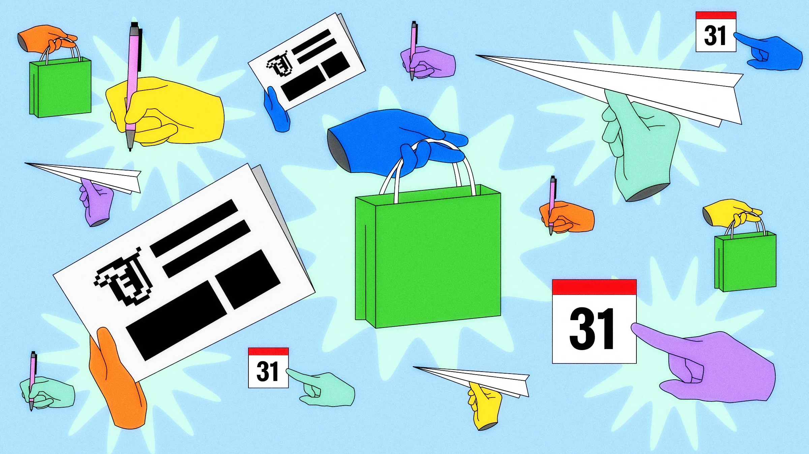



**收录说明**：此前只找到 DNYUZ 的转载，本次找到 WIRED 原文并直接下载，`sourceUrl` 改为 WIRED 原文，DNYUZ 地址移入 `altUrls`。原文全文存于本目录的 original.md，网站上不显示，已翻译。

**内容摘要**：WIRED 记者 Reece Rogers 用一天时间，以五项日常任务给六个智能体打分（每项 5 分）：Muse、Dots、Claude Duet、Gemini Spark、Grok Bot 和 Instinct；OpenClaw 因设置太复杂未列入。任务包括为周会准备选题、为自己和吃素的上司点午餐外卖、发现邮件提醒与日历的冲突、规划中国旅行行程、失眠时让智能体建议一件小事。只有 Dots 和 Claude Duet 发现了日程冲突。评选结果：最佳整体 Dots，最易上手 Muse（总分紧随其后、免费），最佳界面 Claude Duet，最烦人 Instinct。

**保留理由**：覆盖六个主流智能体的同题横评，逐项给分并引用各智能体的原始输出，是比较主动性（日程冲突）等能力的直接材料。

---

我给六个 AI 智能体——从 Meta 的 Muse 到 Anthropic 的 Claude Duet——按它们完成基本任务的好坏排了名。

插图：Jacqui VanLiew；Getty Images

去年，我记得坐在 WIRED 的办公室里，不停地向同事抱怨 [AI 智能体](https://www.wired.com/story/ai-agents-are-about-to-flood-the-workforce-no-ones-ready-for-it/) 有多烂。它们什么都做不好。

作为一名[软件](https://www.wired.com/tag/software/)记者，我参加了一场又一场会议，会上[科技男](https://www.wired.com/story/tech-bros-dating-palantir-tesla/)——大多是男性——演示他们的新智能体将如何彻底改变我的日常生活，把乏味的事自动化掉。问题是，这些所谓的「智能体」没有一个是真正能用的。

快进到今天，常驻在线的 [AI 智能体正在蓬勃发展](https://www.wired.com/story/ai-agents-dots-devday-muse-battling-it-out/)，各大玩家竞相发布自己的版本以吸引早期采用者。这些个人智能体之所以进入更广泛的时代思潮——而不只是[硅谷书呆子](https://www.wired.com/story/why-normal-people-arent-using-ai-agents/)的圈子——关键在于它们确实能用。好吧，至少比去年更可靠。AI 智能体仍会犯错，但我也看到它们在贯彻任务和控制浏览器方面有显著进步。这些小东西变漂亮了。

面对 AI 智能体，可能很难知道从哪里开始，以及哪一个最适合你的自动化需求。于是我花了一天时间试用每一个主要 AI 智能体，以了解它们的长处和短处。上周三睡前，我在 iPhone 上设置了六个常驻在线的智能体：[Meta 的 Muse](https://muse.ai/)、[OpenAI 的 Dots](https://openai.com/index/introducing-dots/)、[Instinct](https://instinct.com/)、[Anthropic 的 Claude Duet](https://support.claude.com/en/articles/17631495-get-started-with-claude-duet)、[Google 的 Gemini Spark](https://blog.google/innovation-and-ai/products/gemini-app/next-evolution-gemini-app/)，以及 [xAI 的 Grok Bot](https://x.ai/bot)。

每个智能体在价格和功能上略有不同。**Muse** 免费使用，自[9 月发布](https://www.wired.com/story/meta-releases-muse-a-personal-ai-agent-with-privacy-built-into-it/)以来一直占据智能手机应用下载榜榜首。**Instinct** 也免费，但你需要用户的[邀请码](https://www.wired.com/story/i-finally-found-an-ai-agent-worth-the-risk/)；它通过短信而不是应用来操作。OpenAI 的 **Dots** 位于[每月 $100 的付费墙](https://www.wired.com/story/openai-dots-always-on-ai-agents-that-proactively-help/)之后，是我测试过的最贵的一个，构建在 ChatGPT 内部。Google 的 **Gemini Spark** 是 [Gemini 应用内的 beta 版](https://www.wired.com/story/googles-response-to-openclaws-24%E2%80%937-ai-agent/)，每月 $20。xAI 的 **Grok Bot** 每月 $30，[有自己的应用](https://www.wired.com/story/elon-musk-bragged-about-his-grok-lego-star-wars-haul-then-x-users-punked-him/)。最后，Anthropic 的 **Claude Duet** 每月 $20，是这批里最新的——在我测试前一晚作为需候补名单的研究预览版发布。

[OpenClaw](https://www.wired.com/story/malevolent-ai-agent-openclaw-clawdbot/) 不在我的名单上。尽管这个 AI 智能体在今年早些时候催生了这一波创新的大部分，它对普通人来说太难设置了。也许它会在未来的排名中出现，届时我也可以纳入 [Nous Research 的 Hermes](https://hermes-agent.nousresearch.com/) 和 [Poke](https://poke.com/) 等较小的玩家。

## AI 智能体到底是什么？

如果你从没用过 AI 智能体——我对[观望者](https://www.wired.com/story/why-normal-people-arent-using-ai-agents/)毫无评判——它就像给一个数字助理发短信来完成事务：扫描你的[邮件](https://www.wired.com/tag/email/)找漏掉的重要消息、追踪度假[机票优惠](https://www.wired.com/story/airfare-keeps-going-up-here-are-some-tricks-to-finding-cheaper-tickets/)、帮你做日常购物决定。

与聊天机器人[回合制的体验](https://www.wired.com/story/maybe-chatbots-shouldnt-get-to-say-i-or-me/)相比，这些工具更主动，会在发现能帮上忙的机会时先来提醒你。你与这些智能体的所有消息通常存在一个线程里，感觉像群聊。AI 智能体完成这些任务，很多是靠控制一个虚拟浏览器——本质上就是它们自己用来上网的电脑。

## 评分标准

过去几年，我一直从非技术角度测试 AI 软件，所以我觉得自己特别有资格带你走过这一刻。我设计了五项基本测试让每个智能体跑一遍，在 24 小时里制造这一团混乱，以衡量它们的主动性、遵循指令和浏览能力。（不知怎么的，我的 iPhone 没有化成一摊水。）我给每次尝试按 1 到 5 分打分，最后汇总结果，评出赢家——并颁发一个最烦人奖。

这不是对其中任何 AI 智能体的背书。这些软件仍处于早期，常常伴随[隐私](https://www.wired.com/story/an-ai-agent-joined-a-listserv-of-top-internet-researchers-the-reply-all-chaos-is-still-unfolding/)和[安全担忧](https://www.wired.com/story/ai-hacks-leave-a-mess-that-ai-companies-arent-cleaning-up/)。这些智能体在连接你的个人数据（如邮件和日历）时表现最好，但这需要一定程度的信任，可能会让一些用户望而却步。例如，一位 [X 用户声称](https://x.com/ShaneMac/status/2107486740491669879)，他最近把 AI 智能体连接到自己的银行账户和工作 Slack，结果一个智能体把他有多少钱发出来给同事看，让他羞愧难当。

此外，这些测试只是这些工具能力的一小片。所有智能体都会随着你分享更多关于自己的数据、以及你喜欢的做事方式而改进。我只把个人 Google Calendar 和 Gmail 分享给了这些工具，所以我没有像 [Billy Evans 那样](https://www.wired.com/story/the-story-of-billy-evans-and-theranos-20/)把 AI 智能体完全暴露给一切。

## 晨间简报

周四上午，WIRED 的 Gear 团队会开会聊当前报道计划，有时为下周提选题。所以我想看看哪个 AI 智能体能做出最好的科技新闻简报，并利用这些信息生成一个吸引人的标题。公司常把这些工具吹捧为编制晨间档案的好帮手，让你随时了解重要事件和突发新闻。

我给每个 AI 智能体发了一段详尽的提示词，说明我在 WIRED 的报道领域，以及这个选题会如何被使用。尽管我要求 AI 智能体花 30 分钟、在回答前真正做深度研究，只有 Meta 的 Muse 和 OpenAI 的 Dots 真的在大部分规定时间里持续研究。其他 AI 智能体要么瞬间吐出一个选题，要么搜索几分钟后就把标题发给我。这虽不是大错，但说明在这个例子里 Muse 和 Dots 更擅长遵循我的指令——这是 AI 智能体的一项关键功能。

这六个 AI 生成选题的内容则是另一回事。你可能已经猜到，这些选题在编辑会上并不太受欢迎。我读每个标题和描述时，能看到同事的眼神开始发直。Gemini Spark 提出了最好的角度，对比 Walmart 如何为第三方智能体使用其购物平台创造条件，而 Amazon 最近把 Muse 踢了出去。我的同事们在停止打哈欠后，似乎并不太担心[被智能体抢先报道](https://www.wired.com/story/ai-agents-are-trying-to-be-journalists-now/)。

**Gemini Spark：** 5/5。一个点出网络核心张力的、像对话一样的标题。

*Walmart 想让你的 AI 智能体替你买杂货。Amazon 却要叫警察。当零售巨头围绕自动结账展开冲突时，给 Meta 的 Muse 这样的 AI 伙伴每周一笔消费额度，揭示了当我们不再点击「加入购物车」、把家里的胃口外包给软件时会发生什么。*

**Claude Duet：** 4/5。另一个有趣且应时的选题。

*ChatGPT 的锁定聊天对所有人隐藏你的秘密，唯独对 OpenAI 不隐藏。OpenAI 新的 PIN 保护聊天把 ChatGPT 当作很多人早就在用的日记本，但它防的是室友和同事看到你说的话，而不是公司本身。*

**Muse：** 3/5。不差，但没那么强。

*我让 Claude Duet 先给我发短信——结果它趁我不注意花掉了我的 Claude 套餐。Anthropic 的新主动式智能体承诺替你盯着收件箱、日历和发票，但每次它来查看你、起草一封你没要求的回复，或一夜之间搭出一个仪表盘，它都悄悄把这部分工作记到你已经付费的同一个聊天用量限制上。*

**Dots：** 2/5。更像常青选题，而不是新闻。

*这个反末日刷屏应用想当你的手机老板。我会测试 SHIFT，其开发者决定专注时段内哪些应用保持可用，以探究逃离末日刷屏是否值得把手机控制权外包出去。*

**Grok Bot：** 1/5。旧闻。

*Meta 的 Muse 品味平庸——而且是故意的。一份泄露的指令集告诉 Meta 的 AI 智能体，在它的精选里填入知名商店，并且每个请求只查三个网站，而此时数百万人正开始把假日购物清单交给它。*

**Instinct：** 1/5。一个平淡且难以衡量的实验。

*我花了一周操控我的信息流。算法几乎没注意到。Instagram、Facebook、TikTok 和 YouTube 都在推出「告诉算法你想要什么」的控制项——我会测试它们是否真的改变你看到的内容，还是只让你觉得自己说了算。*

---

## 午餐时间

接下来，我想测试这些工具在小额日常购买上有多大帮助。于是我把[午餐决定](https://www.wired.com/story/ugly-ai-food-photos-are-only-the-beginning/)外包给我这支 AI 智能体团队，并承诺从表现最好的那个下单。

我把另一个人——我出色的老板——加进了外卖订单，让任务再复杂一点。他吃纯素，当时很想吃越南菜。我想要肉多的东西和大量咖啡因。我需要从离 WIRED 办公室近的地方下单，这样我能伸伸腿、取餐，然后立刻继续写这篇文章。

它们都选了相似的地方：DragonEats 或 Freshroll。这些越南餐厅作为合理、就近的午餐去处很说得通。DragonEats 更好吃一点也更便宜，所以我们选了那家。Instinct 和 Claude Duet 构建的购物车比其他选项贵了一点。唯一真正在这项任务上失败的是 Gemini Spark。这个智能体只给我老板加了一个 $5 的卷。我得说，这更像零食！

**Dots**：5/5。真的按这个机器人放进购物车的东西下了单。通过餐厅网站选了 DragonEats。

*你：烤猪肉越南法包（bánh mì）+ 越南冰咖啡。你老板：照烧豆腐鲜春卷，用酱油代替鱼露。小计：税前/费前 $30.57。*

**Muse**：4/5。和我实际下的单非常相似。通过 DoorDash 选了 DragonEats。

*给你：烤猪肉越南法包（BM）——$13.19，越南冰咖啡——$5.29。给你老板（全素）：照烧豆腐卷——$12.09——鲜春卷，保留默认花生酱，不是鱼露；照烧豆腐越南法包（BM）——$12.09。商品总计 $42.66。DoorDash 在结账页之前不显示税或任何费用，所以最终总额会稍高一些。*

**Grok Bot**：4/5。另一个强有力的替代方案。通过 DoorDash 选了 Freshroll。

*给你：Power Hour 米粉碗，配蒜姜蜂蜜猪肉和 NamNam 酱，$15.85。越南冷萃冰咖啡，$5.85。给你老板（纯素）：Rainbow Bowl，米粉配芝麻青柠豆腐和柑橘姜酱，$15.85。Freshroll 豆腐春卷配花生酱，不要炸物，$5.85。税前和费前是 $43.40*。

**Claude Duet**：3/5。选了 Freshroll，并问我要通过 DoorDash 还是 Uber Eats 下单。我选了 Uber Eats。

*你：Power Hour 碗，配猪肉、NamNam 酱和米粉（$15.85），外加一杯越南冷萃冰咖啡（$5.85）。你老板：2 个豆腐 Freshroll（芝麻、青柠）配柑橘姜酱（$11.70），外加一个配豆腐和柑橘姜的 Rainbow Bowl（$15.85）。费前和税前共 $49.25。*

**Instinct**：2/5。创建的购物车和 Claude Duet 相似，但贵了 $4。通过 DoorDash 选了 Freshroll。

*老板：2 个豆腐鲜春卷 + 豆腐 Rainbow Bowl。你：猪肉 Power Hour 碗加额外猪肉 + 越南冷萃。税前/费前小计 $53.73。*

**Gemini Spark**：1/5。如果我给老板带一个 $6 的春卷当午餐，他很快就会饿得发火，跑到自动售货机前。通过 DoorDash 选了 Freshroll。

*给你老板，购物车包含一个纯素 Freshroll 鲜春卷，内馅是芝麻青柠豆腐，配 Grandma's 花生酱（$5.85）。给你，有一个普通越南法包三明治，塞满蒜、姜、蜜烤猪肉（$10.85），配一杯越南冷萃冰咖啡（$5.85）作下午提神——使自取小计达到 $22.55。*

---

## 日程冲突

这些工具的另一大卖点是主动性，相比之下，[聊天机器人](https://www.wired.com/tag/chatbots/)基本上只对你的提示作出反应。开始测试前，我在 Google Calendar 建了一个下午 2 点的活动，标注为不能挪动的重要消息源会议。我还从工作账户给自己个人账户发了一封邮件，虚构了这样一个场景：我妈妈今天出院，我需要下午 2 点给她打电话，从远方送去爱与支持。

哪些 AI 智能体会读那封邮件和日历活动，识别出冲突，并在时间重叠之前给我发消息提出替代方案？只有两个机器人做到了，比我预期的少。

**Dots**：5/5。几乎立刻指出了问题，并提出了合理的替代方案。

*今天下午可能有一处冲突：你给妈妈的备忘说下午 2 点，而你的重要消息源会议是太平洋时间 2—3 点。在她出院时间允许的情况下，会前或 3 点后给她打可以吗？*

**Claude Duet**：4/5。在冲突发生前几小时就指出来了，但没找到替代方案。

*Reece，早上好。你下午 2 点的消息源会议开到 3 点，正好是你自己的提醒说该给妈妈打电话的时候。*

**Grok Bot**：2/5。漏掉了我日程上的冲突，不过它分享了如何避免再次发生。

*我本该抓住它，从现在起我会在检查日历的同时检查你的自我提醒邮件。*

**Instinct**：2/5。它没有指出重叠，但提供了未来修复类似问题的提示。

*我没有任何东西把收件箱和日历交叉核对。想让我每天早上跑这个检查，在撞车发生前标出来吗？*

**Muse**：2/5。犯了同样的错误，并提供了类似的修复。

*我的错误是把你的日历当成唯一来源——我从未把那封邮件提醒和它交叉核对，尽管 Gmail 就在那里。*

**Gemini Spark**：1/5。它没有指出重叠的活动，也没有建议未来避免这种情况的简单方法。

*因为提醒是以电子邮件而非日历条目或计划任务的形式到达的，这个跨应用重叠在下午 2:00 之前没有被呈现出来。*

---

## 度假行程

我很少度假，所以每次度假，我都会花多得离谱的时间做研究，而且乐在其中。我喜欢看 YouTube 街头美食游，漫无目的地刷航班找最划算的。所以我不想把这项任务完全自动化。即便如此，我也愿意接受这些 AI 智能体能在一些后勤规划上帮忙。

和任何 AI 生成的产出一样，我仍然建议在相信这些行程、或把整个旅行围绕智能体推荐来安排之前，核对多个非 AI 来源。最近加利福尼亚的一些旅行者信任聊天机器人为一次艰苦的徒步远足规划一切，结果[这群人不得不被救援](https://www.yahoo.com/news/us/articles/climbers-rescued-mount-shasta-relying-214819015.html?guccounter=1)，因为他们缺少关键物资（也许还缺少一些批判性思考）。

这次测试，我给所有 AI 智能体发了一段长文字，说明我和伴侣正在考虑明年年底去中国探索，来一次为期两周的冒险。我要一份潜在行程的初稿，包括：航班、酒店、夜生活和美食推荐。我还要求 AI 智能体规划一条融合历史时刻与大都市氛围的路线。我受不了不停换地方，所以我告诉智能体我最多住四家不同的酒店。

值得注意的是，它们都选择了完全相同的中国路线——这可能开启一个[《Lonely Planet》效应](https://www.businessinsider.com/long-sad-decline-lonely-planet-america-coolest-travel-guide-2025-4)的新时代，成群旅行者被引导去相似的地点、商店和餐厅。

**Muse**：5/5。这份行程初稿极其易读，有可视化表格和直白的提示。

*黄金周后那一周从 SFO 飞出去，直飞北京，从上海直飞回国。四家酒店，不走回头路——先帝国历史，中间四川美食和大熊猫，最后上海夜生活。*

**Dots**：4/5。Dots 的初稿很强但过于冗长，足有 24 页。

**AI 智能体片段：** *我的建议：飞进北京，坐高铁到西安和成都，然后飞上海再回国。你能得到帝国历史、兵马俑、四川美食和大都市收尾，而不用坐夜车或多换一家酒店。*

**Grok Bot**：4/5。Grok Bot 的产出易读，充满现实中真正有用的提示和建议。

*一份为期 13 晚的两人行程初稿：北京、西安、成都和上海，10 月 13 日从 SFO 出发，10 月 27 日返回，在黄金周之后。*

**Gemini Spark**：3/5。这份行程还行，但缺乏排名更高者的可读性或更精细的细节。

*一条首次旅行者路线，融合帝国历史、四川美食、活力夜生活与 4 酒店枢纽的舒适。*

**Instinct**：3/5。这份行程不错也有帮助，不过我更喜欢其他智能体的排版。

*北京进，上海回，中间西安和成都：四个基地，不走回头路，历史在前，美食和酒吧每一站都更好。*

**Claude Duet**：3/5。尽管产出中没有使用任何图片或其他视觉元素，Claude Duet 的行程很扎实。

*2027 年 10 月 9 日星期六飞进北京，然后北京 → 西安 → 成都 → 上海，10 月 23 日星期六从上海飞回家。那是 13 晚、四家酒店、两趟高铁和一次短途飞行。*

---

## 失眠检查

这一通 AI 智能体混乱之后我睡不着，虽然越南咖啡大概也没帮忙。当你给这些工具一个宽泛、开放式的任务时会发生什么？有时我最需要帮助的时候，正是我甚至不知道从哪里开始的时候。

如果我有一个人类助理，我*绝对不会*在半夜给他们发消息，所以这也许是这些数字帮手的一个加分项。在这项任务上真正搞砸的两个智能体，Gemini Spark 和 Claude Duet，回应我时没有真人可能有的那种柔和触感或情境理解。

**Grok Bot**：5/5。这个产出对我有意义，如果场景是真的，我很可能会照做。

*我可以设个提醒，今天上午晚些时候去看看你妈妈，看看她的腿怎么样了，这样你现在就能放下这件事。*

**Dots**：4/5。虽然 Dots 和 Gemini Spark 给了我类似的任务——说出你脑子里的事，我们之后再处理——Dots 的措辞感觉更有支持性、更直接。

*把占着你脑子的三件事发给我；乱一点没关系，我会把它们变成一份简短清单，配一个清楚的第一步。然后你就可以放下手机了。*

**Instinct**：4/5。不同于这个智能体的一些其他回答，这个建议感觉合理。

*这里有一件你可以躺在床上做的事：浏览一下中国行程草案，告诉我你会改的一件事。你醒来时我会准备好 v2。*

**Muse**：4/5。Muse 的另一个有力回应。这个智能体似乎被积极地设计成每天改进，并更贴近对用户有帮助的东西。

*我会交叉核对今天的日历和你发给自己的邮件提醒，找出任何冲突或不能错过的事项——这是我昨天本该做好的检查——并且只在合理的时间提出来，除非早上有紧急的事。*

**Gemini Spark**：2/5。好吧，对于一个抱怨睡眠问题的用户，这建议还行。同时，关于我早上日历空着的评论很烦人。失眠并不只是和我的 Google Calendar 上有什么相关。

*现在最好的快速任务是做一次大脑卸载，把在你脑子里循环的东西写到纸上，这样你的大脑就能放下它——尤其是今天你的日历完全空着，早上没有任何约定在等你。*

**Claude Duet**：2/5。Claude Duet 最弱的回答之一。虽然两者严格说都是未了结的事，但我并不太想在半夜重新处理我的午餐订单和工作项目。

*我们来收掉昨天的两件未了事。你周四的选题已经交付，你的午餐购物车已由 DragonEats 的订单覆盖。说一声，我就把两件都标为完成，然后你可以继续睡。*

---

## 最佳整体：OpenAI Dots

是的，它仍在昂贵的付费墙后，所以我建议大多数人等 OpenAI 免费推出这个智能体，或者至少等到每月 $20 的套餐，再试用。即便如此，Dots 在这些测试中整体表现最好，并且在一个相当特定于我这一行的任务上失败了。

发布一个月以来，Dots 已经感觉更精致了。相比目前并入 ChatGPT 的形态，我更喜欢独立应用，不过智能手机小组件选项是一个不错的折中。Dots 胜出。

## 最易上手：Meta Muse

Muse 是给普通人的！这没什么不好。它在测试中表现不错，在记分卡上以微弱差距位居第二，而且最容易设置。哦，它还免费。尽管 Meta 保证它会在[安全的虚拟机](https://www.wired.com/story/meta-releases-muse-a-personal-ai-agent-with-privacy-built-into-it/)中负责任地处理用户信息，鉴于该公司[过去对用户数据的处理不当](https://www.wired.com/story/how-many-billions-would-it-take-to-hold-meta-accountable/)，我仍有顾虑。

## 最佳界面：Anthropic Claude Duet

我在这个 AI 智能体作为研究预览版正式发布仅一天后就测试了它，所以一些粗糙边缘在所难免。尽管 Claude Duet 在大多数测试中得分处于中游，它的专用应用在导航和跟进进行中的任务方面极其易用。我能看到痴迷于生产力和精简软件体验的用户在未来几个月里真的会喜欢上 Claude Duet。不过你目前必须注册 Anthropic 的等候名单才能使用 Duet，而且它在每月 $20 的付费墙后。

## 最烦人：Instinct

你可能会喜欢这种完全整合进你通讯应用的稀疏设计；我不喜欢。虽然其他 WIRED 作者曾[称赞 Instinct](https://www.wired.com/story/i-finally-found-an-ai-agent-worth-the-risk/)，说它好到他们不在乎自己的隐私会怎样，但仅靠短信这一点对我来说像是一个无法接受的缺陷。结束体验时，我感觉与我的智能体代表我所做的事太脱节，并对它的表情回应感到恼火，比如当我告诉它漏掉了我的日程冲突时，它回了一个苦脸。
