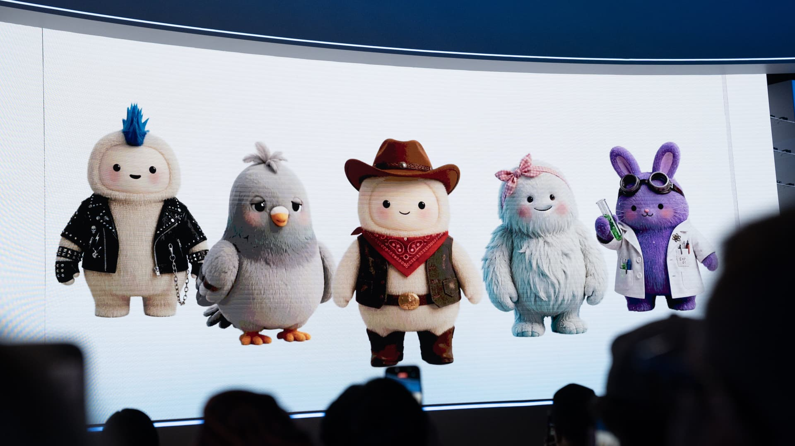



**收录说明**：2026-11-06 直接下载；去掉了文首导航与分享元素、两段嵌入视频的推广块、文末的「WATCH」推荐和「Choose CNBC as your preferred source on Google」提示；首图下载到 `images/`。原文全文存于本目录的 original.md，网站上不显示，已翻译。

**内容摘要**：CNBC 报道，Dazzle AI、Duckbill 和 Wajo AI 等个人智能体创业公司会把 AI 难以完成的电话、预约、CAPTCHA 等任务交给真人承包商。Dazzle 的 Marissa Mayer 说，基础模型擅长给出建议和候选名单，但实际预订、安排时仍可能出错，Dazzle 会把这类任务标记出来转给人工。Duckbill 推出 API，让其他智能体开发者把容易失败的任务拆成小步骤交给合同工，并按类似 Uber 的模式管理。Wajo AI 也用人来处理电话和 CAPTCHA。Meta 表示，目前不会用真人来完成用户的 Muse 请求；此前内部测试用人工代打电话曾引发隐私担忧。

**保留理由**：给出了「智能体背后有人工兜底」的具体公司、做法与 Meta 的边界说明，是理解个人智能体能力边界和人工介入模式的一手报道。

---

仍有真人在为一些 AI 智能体干活

Minh Connors | Bloomberg | Getty Images

下一次，当某人那台性能强大的 AI 智能体试图打电话与客服协商有线电视账单时，真正与客服讨价还价的可能不是软件，而是一个真人。

这是因为，由 [Meta](https://www.cnbc.com/quotes/META/) 和 [OpenAI](https://www.cnbc.com/quotes/OPENAI.FG/) 等公司开发的前沿基础模型（foundation models）驱动的 AI 智能体，仍然无法可靠地在网上执行操作，尤其是涉及电话的操作。前 Yahoo 首席执行官 Marissa Mayer 现在执掌智能体创业公司 Dazzle AI。她说，当前顶级 AI 模型擅长为消费者找出网上的房屋翻新服务，但在需要预订并安排屋顶翻新时，可能就会搞砸。

「我们依靠前沿模型给出好的建议和一份好的候选名单，但我们会再检查一遍，确保我们真正提供的是自己敢背书的服务，」Mayer 说。她指的是 Dazzle 如何把某些任务转交给真人承包商。

目前，AI 驱动的数字助手重新受到关注，原因是 Meta、OpenAI 等公司正在宣传这项技术能够完成诸如在网上搜寻鞋子之类的任务。

[Meta 的 Muse、OpenAI 的 Dots](https://www.cnbc.com/2026/09/30/openai-follows-meta-into-the-red-hot-market-for-personal-agents.html) 以及许多其他智能体能够完成大量网页浏览方面的壮举，但这项技术仍处于早期，经常会遇到数字路障。数字智能体创业公司 Duckbill 的首席执行官 Meghan Joyce 说，这些障碍通常涉及需要 AI 智能体打电话、替人预约医生，或向本地清洁服务预订沙发清洗的任务。

Joyce 说，对于需要现实世界判断的任务，人类仍然胜过 AI，而开发消费级数字助手的公司需要接入真人来接手。这就是为什么 Duckbill 最近推出了一套应用程序编程接口（API），供开发个人智能体的公司连接真人合同工。

「我们采用的模式与 [Uber](https://www.cnbc.com/quotes/UBER/) 并无太大不同：我们把任务拆解成一个个原子化的小块，」Joyce 说。她提到了这家她曾任职的网约车公司。

开发智能体的公司可以用 Duckbill 的 API，把智能体可能搞砸的任务委托出去。Duckbill 会把这些任务转换成普通成年人能够稳定、可靠完成的小块工作。

「然后我们会跟踪后续发生了什么，」Joyce 说。

## 困惑的智能体

Mayer 说，AI 模型仍然可能缺乏常识。她说，Dazzle AI 的一位超级用户曾试图让这项技术同时处理一系列房屋翻新项目，包括更换屋顶、修理一扇破窗，以及购买一块玻璃桌面。

但 Mayer 说，这个 AI 智能体把窗玻璃和桌面玻璃搞混了，结果这个数字助手「试图弄清楚他能不能把桌面装进窗户里」。

Mayer 说，这次失误没有持续多久，因为 Dazzle 的技术标记了这项任务，并把它外包给一个人来完成。

「几秒钟之内，那个人就把事情理清了。而智能体可能会烧掉数量惊人的 token，」Mayer 说。「或者它们可能永远都找不到好的解决方案。」

个人 AI 智能体创业公司 Wajo AI 的首席执行官 Shivani Poddar 也在引入真人来处理电话，甚至处理那些用来阻止机器人访问网站的 [CAPTCHA 测试](https://www.cnbc.com/2022/12/17/why-annoying-captcha-is-still-big-for-google-e-commerce-in-bot-battle.html)。

「我认为，AI 加人类、协作式 AI，才是真正完成任务所需要的，」Poddar 说。她强调，如果智能体无法完成任务，人们就会停止使用这项技术。

聊天机器人和智能体的交互可能极其私密，用户有充分理由担心真人介入，尤其是当公司没有告诉他们这套机制如何运作时。

Meta 员工此前曾对公司的一项内部测试提出隐私担忧：该测试使用[真人承包商](https://www.404media.co/meta-tests-muse-ai-agent-calls-that-are-actually-made-by-humans-in-a-call-center/)代替其 Muse AI 智能体处理电话。Meta 发言人当时在一份声明中表示，这类测试是「产品开发流程的核心」。

Meta 目前不会用真人来完成用户的 Muse 请求。

Duckbill 的 Joyce 说，她的创业公司会对所使用的 1099 承包商进行「全面的背景调查」，并将他们比作 Uber 和 DoorDash 的司机，也就是「住在美国、希望获得额外收入来源的人」。Duckbill 还会使用那些通常向企业提供呼叫中心劳动力的公司的合同工。

Mayer 说，Dazzle 会进行背景调查，并寻找具备人们可能期望真人私人助理拥有的那些素质的承包商。

「我们通常会筛选那些我们认为极其谨慎、有品味、有良好判断力的人，既包括他们如何与我们的用户互动，也包括他们事后能否忘掉并隔离这些信息的能力，」Mayer 说。「我明白这是一种特权，但我拥有私人助理已经有一段时间了，我知道我想要什么样的助理，也知道该如何指导他们。」

Mayer 说，尽管基础模型仍在进步，但在该技术能够像人一样高效地执行更复杂的网络任务和电话之前，市场仍处于「过渡期」。

「我们甚至没有试图隐瞒这一点，我们认为人在回路（human in the loop）是一种优势，」Mayer 说。
