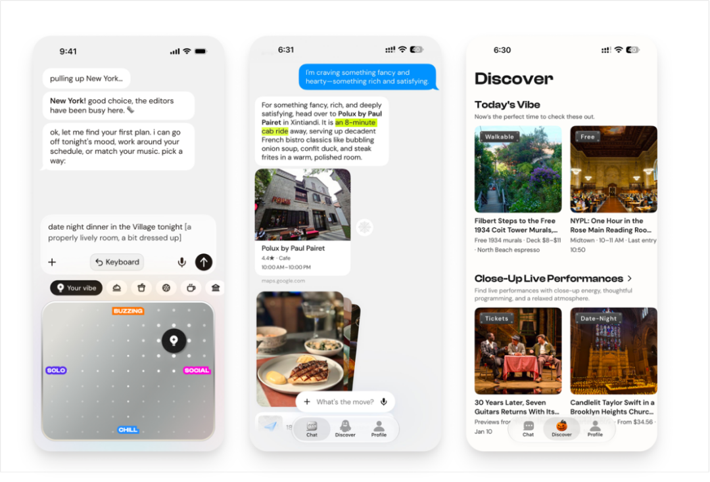
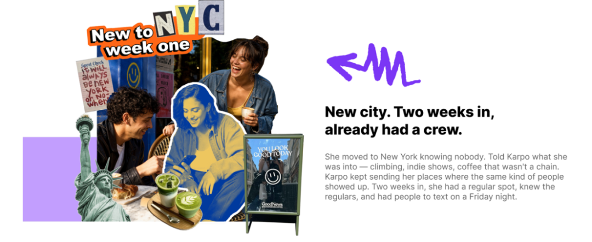
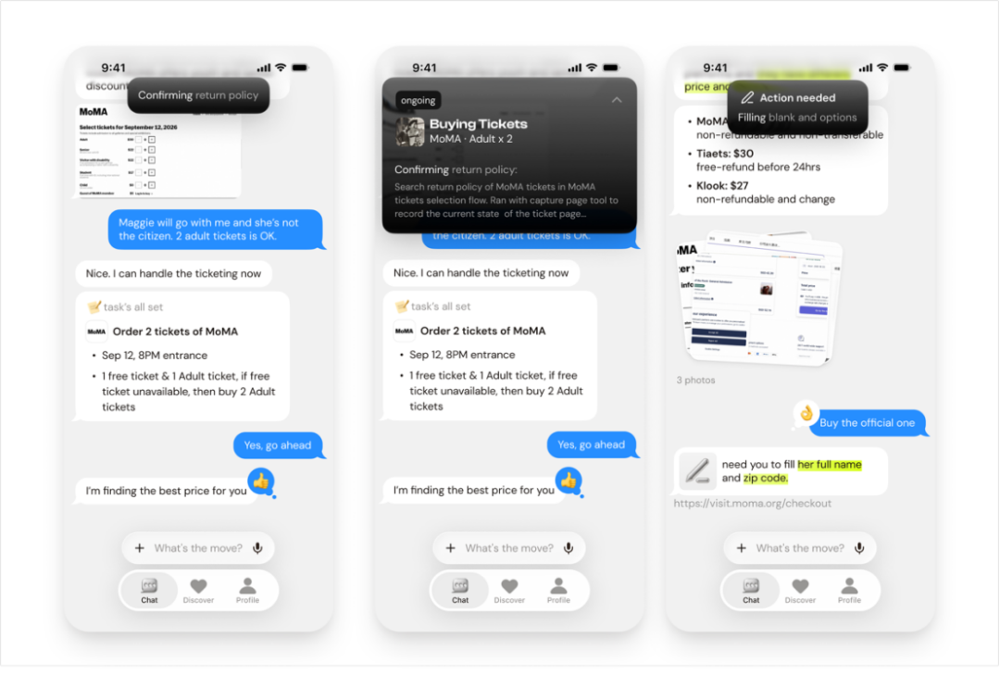



**收录说明**：用户提供链接。原文在微信公众号，用浏览器的客户端标识直接下载页面，从 `#js_content` 抽取正文，图片地址取自 `data-src`。文首「36氪Pro」栏目横幅、文末分隔图之后的推荐阅读、公众号关注引导与二维码属于推广，未收入。正文主要以 MachinePulse 的 Karpo 为例，Karpo 不在跟踪清单中。

**内容摘要**：文章认为消费的起点早于下单付款：在店名、品类、价格这些具体信息出现之前，消费就已经开始了，谁能更早承接用户尚未明确的需求，谁就更有机会成为新的消费入口。文章以 MachinePulse 的 Karpo 为例，介绍它如何把用户模糊的念头变成具体安排，例如把巴塞罗那转机约 8 小时的间隙组织成一条闭合路线。创始人 Leah 是豆包早期团队成员，参与了豆包从 0 到 1 亿 DAU 的全过程。Karpo 已获得 Creekstone Ventures、高瓴创投、蓝驰创投等机构支持，累计融资数千万美元。

**保留理由**：从消费入口的角度讨论 Personal Agent 承接「尚未明确的意图」，与现有以任务执行为主的横向评测形成对照；全文围绕一家创业公司展开，Karpo 的团队与融资信息可作出处。

---

|  |
| --- |
| 谁能更早承接用户尚未明确的需求，谁就更有机会成为新的消费入口。 |

一笔消费，究竟从什么时候开始？很多人会觉得，是下单付款的那一刻。但只要回想一次最近的外出，就会发现它的起点其实早得多。

订下一家餐厅之前，可能经历过想见朋友、想庆祝、想换个环境等不同念头；同样一句今晚想出去，最终可能对应一顿饭、一场演出，也可能是一条没有预设目的地的路线。

换句话说，在店名、品类、价格这些具体信息出现之前，消费就已经开始了。只是在那个阶段，它还没有名字，更像一种模糊的心情、一个尚未成形的愿望。而搜索、内容推荐、朋友的建议，都在影响这个过程。

MachinePulse推出的Karpo，正是在这个环节做出选择的一款聚焦城市生活的AI产品。

从一种心情出发：选好状态、说出想要的感觉，Karpo就能给出具体去处。图片来源：Karpo

它和Resy、Google Maps这类工具并不站在同一个起点。后者处理的，是你已经知道要找什么之后的事，查地点、看评分、规划路线等等；而Karpo关注的，是用户还没有确定目的地、甚至还没有确定要做哪一类活动的时候，如何帮他从一个模糊的念头，走向一个具体的安排。

这一选择背后，是一支有消费级AI产品经验的团队。创始人Leah，是豆包早期团队成员，参与了豆包从0到1亿DAU的全过程；联合创始人Allen曾在豆包和TikTok担任工程师，有过多次创业经历；另一位联合创始人Alex，此前是阶跃Agent产品团队的负责人。

带着这些经验，团队选择面向海外市场探索“生活方式×AI”。在他们看来，服务好一个人，需要贴近具体场景、理解个人品味，也需要与现实供给打交道。这为消费级Personal Agent提供了一个具体切口。

那么，当AI有能力在用户形成明确需求之前就介入决策，Personal Agent这场竞争，会随之发生什么变化？

#### **从寻找答案，到参与需求的形成**

首先我们应当清楚，Personal Agent带来的关键变化，除了它能多办几件事外，也把“需求到底明不明确”这个过去默认由用户自己解决的问题，变成了产品需要处理的对象。

这里其实是两种能力的分野。执行能力解决的是如何把一件事办成：目标一旦确定，剩下的是拆解步骤、调用工具、推进流程；而理解意图要解决的，是更靠前的问题，帮助用户一步步弄清楚，他想要的究竟是什么。后者在生活决策场景中尤其常见。

生活体验经常混合情绪、审美、关系和临时起意，人们可能已经期待某种感受，却还不知道哪一种活动、哪一个地方能够满足它。需求并非不存在，只是还没有被整理成可以直接执行的要求。

这种理解，也会体现在那些没有重复说出的信息中。比如向Karpo询问：“想去安静的地方跑步，哪里适合？”这里没有提狗，也没有提车。

但Karpo的回答开头是：“你和Koda去跑河边完全没问题。”Koda是家中的狗，Karpo记得。它推荐了两个安静、狗友好、方便下水的地方，随后补充：“Sportage开过去没问题，那台车的机油需要更换，但不影响今天的往返。”

不必每次都重新跟它解释你的生活，这就是收到回复后最真实的感觉。

当然，这是个人理解积累到一定程度之后才能发生的交互：依据不只是当前这一条消息，还有此前对话叠加形成的上下文。意图捕捉不只发生在单次问答里，它需要一段持续关系作为基础。

而要做好这件事，仅仅记住喜欢什么，还不够。

刚到纽约的用户把自己的兴趣告诉 Karpo，Karpo 持续推荐同类人常去的地方，帮她在新城市找到固定去处和朋友。

一个人长期喜欢艺术，并不意味着他每个周末都愿意去美术馆。过去的偏好提供了理解的基础，当下的情绪、同行关系和时间安排，则决定这次建议应该怎样调整。同样是看展，独自出门时可能愿意花半天研究作品，和朋友同行时，则可能更看重双方是否都有兴趣。

反馈也需要放回具体处境中理解。用户放弃一场展览，可能因为内容不合兴趣，也可能只是距离太远。两种原因，会为下一次建议提供不同的依据。对个人的理解，需要能够容纳这些变化，区分稳定偏好与一次性的选择条件。

“主动式体验”同样建立在这层理解之上。主动发来一条消息，只是交互形式，建议的价值更取决于上下文和时机，以及是否帮助用户走向下一步。产品需要基于对话、偏好和具体场景，在合适的时候提出相关选择，让用户能够继续确认、调整，并逐步形成安排。

意图竞争的起点，是降低用户表达需求、形成选择的成本。而选择能否真正成为一次体验，还取决于另一件事：AI如何把对一个人的理解，与城市里真实存在的供给连接起来。 

#### **理解一个人之后，还需要重新组织他面前的世界**

事实上，让一个模糊的意图变得清晰并不等于完成了服务。附近有什么、什么时候开放、是否适合同行的人、交通和活动如何衔接，都会影响一个建议能不能成为现实安排。主观感受再准确，最终也要接受时间、空间和供给条件的检验。

这意味着，AI需要理解的除了什么值得推荐外，还有不同选项之间的关系。一个地点适合停留多久，与下一个目的地相距多远，整段安排的节奏是否符合用户期待，都会影响最后的体验。

确认需求后，Karpo比价、核实退改规则、推进购票，下单前交给用户确认。

有一类需求更能检验这种能力：时间窗口被压缩时，AI能不能把城市供给组织成一条有节奏的路线。比如在飞机中转间隙发来消息：“我1:10落地巴塞罗那，9:20下一班飞机，这中间我能做点什么吗？”

Karpo把约8小时的约束转化成一条闭合路线：先去El Born，沿Santa Maria del Mar走到Port Vell，再继续到Barceloneta海滩，将老城和海景串在一起，避免折返；然后在Can Solé提前预约好一张桌，“不然中转时间会耗在等位上”；下午去Montjuïc看日落，6:45离开，直接返回El Prat机场。

这时你可能会疑问：“等等，我能看海、吃海鲜饭、还能赶上日落？”Karpo的回答是：“而且还能赶上飞机。”

重点不在于Karpo推荐了哪几个地方，而在于每个地方出现的顺序和时机都围绕中转窗口安排：路线减少折返，餐厅预约减少等位，返程节点则服务于赶上下一班飞机。

这正是“供给组织”和“信息检索”的区别：检索是找到一个合适的选项，而组织供给，是把多个原本分散的商家和地点，按这一个人的需求和节奏组合起来，让它们共同满足一次完整的生活安排。

想清楚这一点，也就理解了Karpo为什么选择城市生活作为切口。

吃喝玩乐看似是轻场景，却同时包含个人品味、本地信息和行动安排等复杂问题。用户往往不是没有选择，而是不知道当下最适合自己的选择是什么。一座城市提供的内容足够丰富，也意味着筛选与组合需要付出精力，地点越多、活动越丰富，找到合适安排的过程，未必越简单。

供给端同样如此。商家拥有供给，却未必能够被恰好需要它的人发现；一家餐厅有自己的氛围，一场展览有特定的表达，这些特征，并不总能被评分、品类、热门程度等标签完整呈现。

AI的机会，就存在于这两端之间。

#### **谁承接意图，谁就有机会影响消费的去向**

当AI参与需求形成，并进一步组织选择和行动，它就有机会改变消费入口与分发关系，这才是意图竞争值得行业关注的商业含义。

正如前文所说，一笔消费的去向，往往在下单之前就受到影响，Personal Agent所探索的，是通过围绕个人的持续交流，把对意图的理解与后续安排进一步连接起来。

如果一个人不必先确定品类、目的地或商家，就可以启动一次生活安排，那么需求可能在与AI的交流中跨越原有分类。从想散心，到决定看展，再到安排附近的餐厅，几个原本需要分别寻找和比较的选项，可以围绕同一个念头逐步展开，供给端的逻辑也随之改变，服务也有机会从提供一个商品，变成承接一整段需求。

在搜索和点评的时代，一个商家、一场活动能不能被发现，很大程度取决于它是否匹配用户输入的关键词、评分够不够高、位置够不够靠前。而当选择由AI围绕具体的人来组织，就更依赖它和某个具体用户、具体场景的契合程度。

这会带来一个重要变化：那些很难用关键词描述、过去因此很难被找到的体验，反而可能因为精准契合了某个人的兴趣，第一次进入他的选择范围。供给的可见度，不再只由搜索框决定。

正是看到了这个位置的分量，资本已经开始提前下注。

目前Karpo已获得Creekstone Ventures、高瓴创投、蓝驰创投等机构支持，累计融资数千万美元。

把它放进整个Personal Agent的赛道里，这个动作的意义会更清楚：当Muse、Instinct这类产品主要在任务执行层面激烈竞争时，也有一批资本和创业者愿意为更上游的“意图竞争”定价。

他们赌的，是消费入口会不会从你已经知道要什么之后，前移到你还没想要什么之时。这就引出了比谁的推荐更准更深一层的竞争逻辑。

一次孤立的推荐，是很容易被替代的，用户随时可以换一个工具再问一次。真正难以替代的，是一段持续的关系。AI长期理解一个人的偏好、不断承接后续的行动，这是一个会自我强化的过程，用户的反馈让建议越来越准，更准的建议提升了他把事情托付出去的意愿，而更多的委托，又带来更丰富的理解和数据。

换句话说，这里真正的竞争指标，更接近用户愿意把多少事情、多早地交给这个AI，而不是单轮问答的胜负。Karpo围绕个人品味和城市供给所做的探索，正是在积累这样一种关系，也呈现了“生活方式×AI”的一种可能。

纽约马拉松期间，Karpo 与纽约当地跑团合作，支持现场活动并融入城市跑步社区。

当意图能被更早、更顺畅地接住，消费的形态也会随之改变。大量过去因为说不清、懒得找、怕麻烦而没有发生的需求被释放出来。Karpo迈出的只是第一步，一个让更多念头能被看见、被实现的时代，正在拉开序幕。
