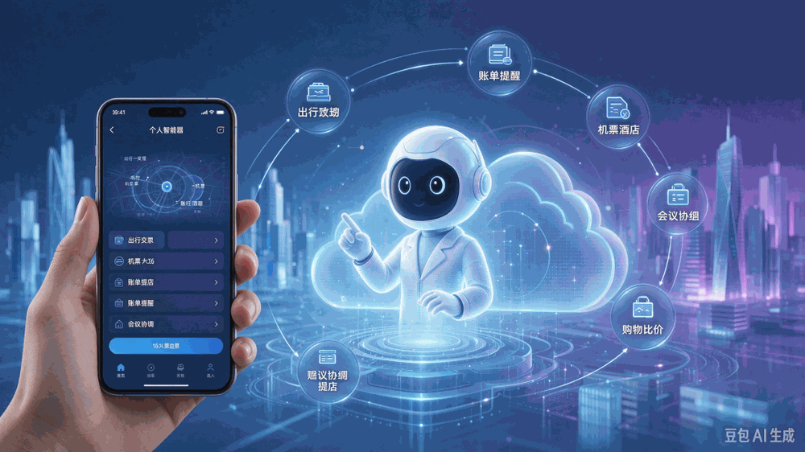



**收录说明**：用户提供链接。原文在微信公众号，用浏览器的客户端标识直接下载页面，从 `#js_content` 抽取正文，图片地址取自 `data-src`。删去文末栏目招募、推荐阅读与公众号信息。

**内容摘要**：财经网科技的文章（作者胡磊）称，Meta 披露 Muse 上线约一个半月，在美国和加拿大已有超 1000 万人设置个人智能体；蚂蚁灵光 2.0 一周管理超 116 万项事务、执行超 360 万次任务，累计用户突破 2000 万。文章转述知情人士称豆包内部今年 4 月起内测代号为「Spell」的个人助理项目，并引用腾讯刘毅、汤道生和学者的看法。文中比较了灵光、Claude Duet 的行动前审批与 Muse 的 Sentinel 等安全设计，并讨论支付宝 AI付、Stripe 等代理支付的进展。

**保留理由**：集中提供国内大厂动态（豆包 Spell、灵光 2.0 数据）和高管、学者的观点，以授权与信任机制为主线横向比较。

---

**作者|胡磊**

**编辑|靖程**

今年9月，Muse的出现，让Personal Agent（个人智能体）成为业内关注的焦点。10月底，扎克伯格在Meta的财报会上披露，Muse上线约一个半月，在美国和加拿大已有超1000万人设置个人智能体。

而在国内，各家大厂早已开始紧密布局。阿里、腾讯、字节、蚂蚁均已推出或在筹备自己的个人智能体。

11月5日，蚂蚁灵光2.0宣布，一周内已帮助用户管理超116万项事务，执行超360万次任务；灵光累计用户已突破2000万。相比此前版本，灵光2.0是推动AI助理从“任务执行者”走向“事务管理者”。

10月中旬，千问Personal Agent“千问Go！”发布。而在国外，OpenAI、Anthropic、xAI相继发布个人智能体。

Personal Agent的出现，开始代表用户调用服务、安排事务，除了推理和执行能力，智能体的信任基建，也成为了厂商们竞争的关键维度。

**大厂押注Personal Agent**

Personal Agent是以具体个人的偏好、信息、目标和授权为依据，能够感知变化、规划步骤、调用软件工具并反馈任务结果的人工智能服务。与传统聊天助手相比，其价值不只体现在回答问题，更体现为用户离开对话界面后，系统仍可依照既定目标开展跟进。同样，与一般企业流程智能体相比，个人智能体的服务对象是自然人，执行范围跨越生活、消费、出行、个人办公等多个场景。

比如用户交代给Personal Agent“帮我处理下周出差”，Agent需要理解日程限制、比较机票酒店、征得必要授权、完成预订，并在航班变更时持续跟进。这些环节连接起来，才构成真正的个人代办服务。

目前来看，蚂蚁灵光2.0不仅能根据用户指令问答和完成任务，还能在获得授权后持续跟进，在关键节点主动提醒用户，推进事务进程。这一能力已应用于消费、出行、家庭等多个场景。

灵光能管事依托于跨会话记忆、长程任务调度、工具连接能力以及独立云主机，即使用户退出对话，相关任务仍可持续运行。

比如用户订完机票后，助手可以继续关注价格变化，发现降价机会及时提醒；授权接入支付宝账单后，还能梳理消费记录，发现可能被遗忘的自动续费订阅。

千问Go 则是嵌于千问App，依托已有的生活服务连接，尝试处理需要多步骤操作和反复沟通的事务。千问Go还可执行汽车保养、运动预约和购物比价等任务。

字节跳动方面，据报道，一位知情人士表示，今年4月豆包内部就已开始内测个人助理方向的探索产品。该探索项目当时代号为“Spell”，主要由豆包手机助手团队主导，但由于豆包手机发布等原因，一直没有正式对外。该人士表示，Muse、Instinct 等个人助理类产品在海外获得关注后，豆包也在加速personal agent能力的对外发布，计划将此前的Spell项目与豆包产品更深度结合，新产品将由Spell项目与豆包对话团队共同负责，预期较快会对外推出。

这些Personal Agent的背后，押注的是从任务执行到事物管理，腾讯云副总裁、腾讯CodeBuddy & WorkBuddy负责人刘毅此前与财经网科技对话时表示，Personal Agent作为新的Agent，就是Agent发展下一个阶段必然的事情，但Agent大模型能力越来越强，Harness配套连接用户的数据和权限以及底层保护的安全性越来越强，用户自然就会更信任这个工具或者Agent，把更多的东西交给它以后，模型拥有用户更多的数据权限以后，就可以尝试帮助用户主动给一些建议，甚至主动给一些没有太多危险性的事情。

一位长期研究Agent的人士表示，人工智能开始获得有限的“代理权”。过去用户向模型提问或要求生成文本，结果通常要靠用户自行采纳；现在用户可能授予系统读取邮件、管理日历、提交订单乃至付款的权限。能调用的服务越多，授权范围和关键操作的确认方式就越需要说清楚。

“国际企业主要沿独立云端、操作系统和应用生态三条路线展开竞争。我国企业更倾向于依托既有超级应用和终端体系推进落地。国内企业的突出特点是可以把原有交易、协作、支付与设备能力直接接入智能体。”他说。

**上下文很关键，**

**信任基建很重要**

 

要持续理解用户的需求，智能体往往需要接入更多个人信息和服务；能获取什么、能进一步做什么，也就需要更清楚的授权设计。

当AI替用户办的事越深、跨度越长，考验的是能不能拿到关键的上下文。腾讯集团高级执行副总裁、云与智慧产业事业群CEO汤道生在与财经网科技对话时表示，Muse会自己去看用户获得的信息、通知，然后主动去帮用户想可能需要什么。真正能不能做到像Muse这个体验，很大程度取决于Agent拿到的上下文是不是足够多，能不能有一个很好的环境让它可以主动去为用户去想它需要的东西。Agent能不能获得相关的上下文，把一件事所需要的信息、目标、指标或者路径，能够都完整的拼出来，让大模型知道怎么去干非常重要。

查询价格、选择商品、提交订单和完成付款，可以属于同一项任务，却需要不同程度的授权。任务持续时间更长、调用的服务更多，个人智能体就需要一套把委托关系和授权边界厘清的信任基建。

北京邮电大学人工智能学院教授邓伟洪指出，“大多数情况下一句话表达的意图是多意的”，理解需求往往需要结合用户的背景和上下文。用户给出一个目标，并不总是会把预算、偏好和具体条件一次说全。

但安排路径也不能变成事事请示。对外经济贸易大学法学院副院长、教授张欣提醒：“每个用户的行为偏好和决策偏好并不相同。对于有的用户而言，如果智能体每执行一项活动、推进一个环节不断地让用户逐一确认，那从产品设计角度而言给用户带来的产品体验并不好。”产品需要判断，哪些操作可以依据已有授权继续，哪些变化需要重新交给用户决定。

上述研究Agent人士认为，海外路线中，Meta拥有社交触点，谷歌拥有邮箱与搜索，苹果拥有终端和操作系统，OpenAI等企业依靠通用模型、云端运行环境和连接器争取成为统一入口。国内路线中，阿里巴巴与蚂蚁集团接近交易和支付环节，腾讯接近社交与办公关系，华为控制操作系统入口，字节跳动着力于手机使用界面与跨应用执行。比较这些企业，关键不是谁能把回答写得更漂亮，而是谁能够在合法授权范围内调动更多高质量服务，以及在失败、退款和争议发生时把责任处理好。

当Personal Agent需要持续调用不同服务，账号连接、授权范围和后续调整，也就成为办事流程的一部分。在灵光2.0中，蚂蚁为此引入了APASS。

在乌镇峰会上，蚂蚁集团副总裁、支付宝及大安全事业群首席技术官陈亮表示，智能体时代需要构建信任基础设施，让“身份、授权与责任进入每一次连接”。这不仅关系单个产品的能力，也是整个行业需要共同解决的问题。

作为面向跨设备、跨应用与服务场景的统一账号与安全管理基础设施，APASS将账号和授权凭证独立加密保护，让智能体在“不接触”底层密钥的情况下也能安全办事；同时把控制权交还给用户，随时可以查看、调整或撤销授权，决定助手的办事范围。

从海内外个人智能体产品来看，均在保证Agent能够安全办事。Duet将读取、起草和准备工作，与发送消息、付款、签署文件等行动作了区分。按照官方设计，后者执行前会展示具体内容并等待批准，它不会直接看到用户的账号密码和登录令牌。

Muse则设置了与主智能体分离的Sentinel，检查对外联网和服务调用，并在需要时请求用户许可。用户可以选择连接哪些应用、开放多大权限，查看操作记录，也能调整访问权限或断开服务。

**Personal Agent拼的是综合能力**

一款个人智能体要把事持续管好，背后需要多项能力协同。模型能力边界的提升可以更好的理解个人需求、拆解任务，但任务在真实生活中能否完成，还取决于它能接入哪些服务，以及如何打通现实中跨平台服务的门槛。这些工作涉及对业务流程的理解，以及长期积累的服务和工程经验。

上述Agent研究人员表示，交易、支付和身份体系可能成为下一轮平台竞争的关键基础设施。

今年9月，Stripe披露其Link体系中智能体完成的购买笔数在此前一个月增长38倍，并推出面向代理支付的限额授权与购买保护安排。该数字是Stripe特定渠道、特定时间窗口的增速，不能外推全球交易规模，但揭示支付渠道正在为“人委托机器买东西”建立专门流程。谷歌等企业亦推进代理支付协议，试图让商家、支付机构和智能体可核验用户意图、交易授权与执行结果。具备可信支付和责任分配机制的智能体，更有可能从信息服务走向真实交易。

过去围绕用户和商户建立的账号体系、交易流程、客服与售后机制，都有机会成为智能体办事的基础。高频使用场景也让这些平台长期面对具体的体验问题：怎样少让用户跳转一次，如何在必要时完成确认，一笔交易中断后又该怎样接续。

蚂蚁此前推出的AI付，就提供了一个具体例子。2025年9月，支付宝发布AI付，率先接入瑞幸咖啡的点单助手Lucky AI。此前，用户通过AI下单后，仍需跳转支付页面完成操作；接入后，用户可以在对话中点咖啡、发出下单指令，完成身份核验后支付，无需离开对话界面。

对用户来说，变化只是少了一次页面切换。对服务提供方来说，则需要把对话中的购买需求转成明确订单，衔接商户、账户和支付流程，让交易能够在新的交互方式下完成。支付体验的改进，也与身份核验、授权和风控设计一起发生。

过去支付安全处理的是人在什么条件下发起交易，如今则多了一层代理关系：智能体代表谁、获得了什么授权、实际行动是否对应用户需求。原有的账户、交易和风控经验，需要适应这一变化，再通过APASS等能力进入更多服务场景。

个人智能体的发展，正在让过去分布在模型、应用、商户和支付体系中的能力重新组合。有人提供更强的理解和推理，有人连接具体服务，也有人把长期积累的交易与安全经验带入其中。能否将这些能力组织成一套顺畅、可靠的服务，将影响个人助手在真实生活中能走多远。
