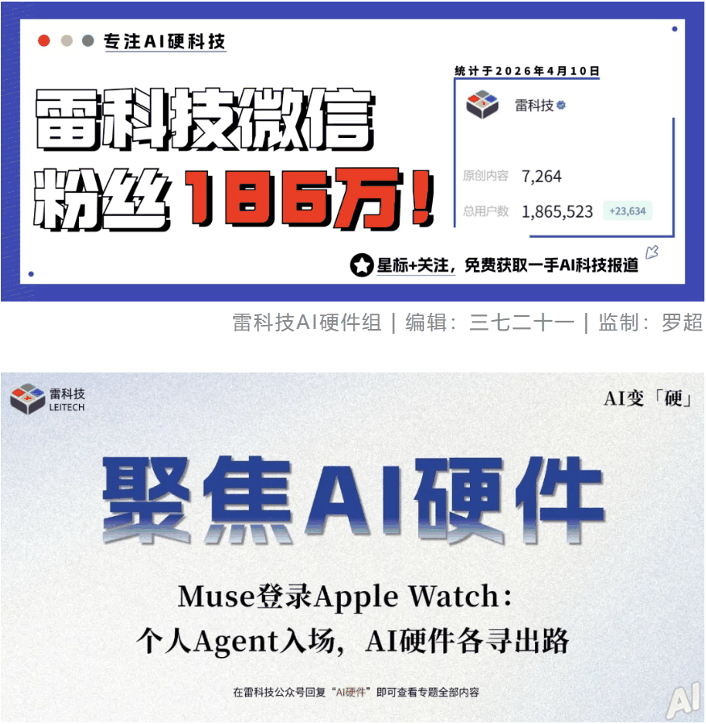
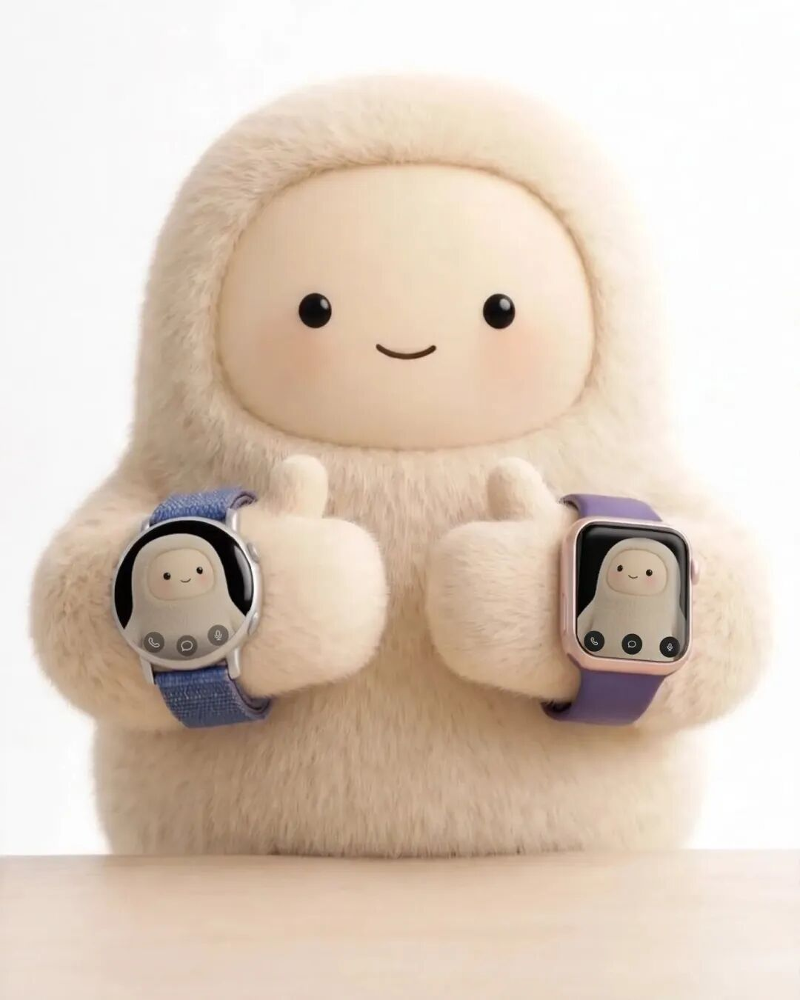
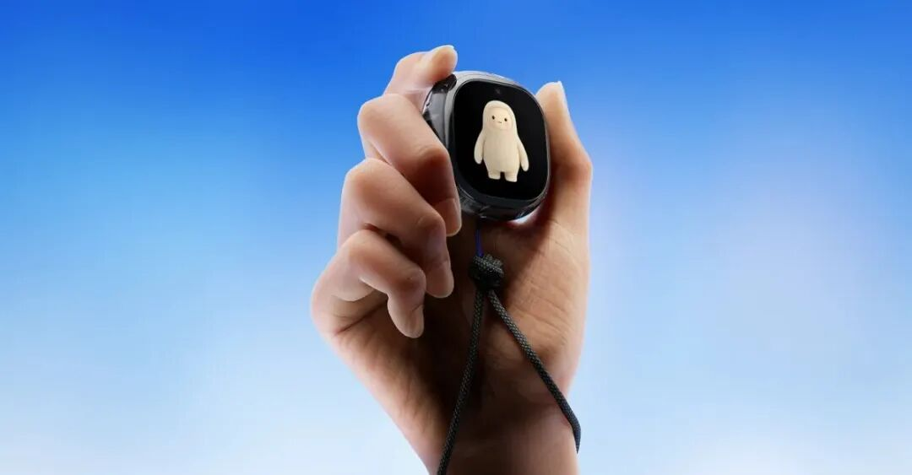
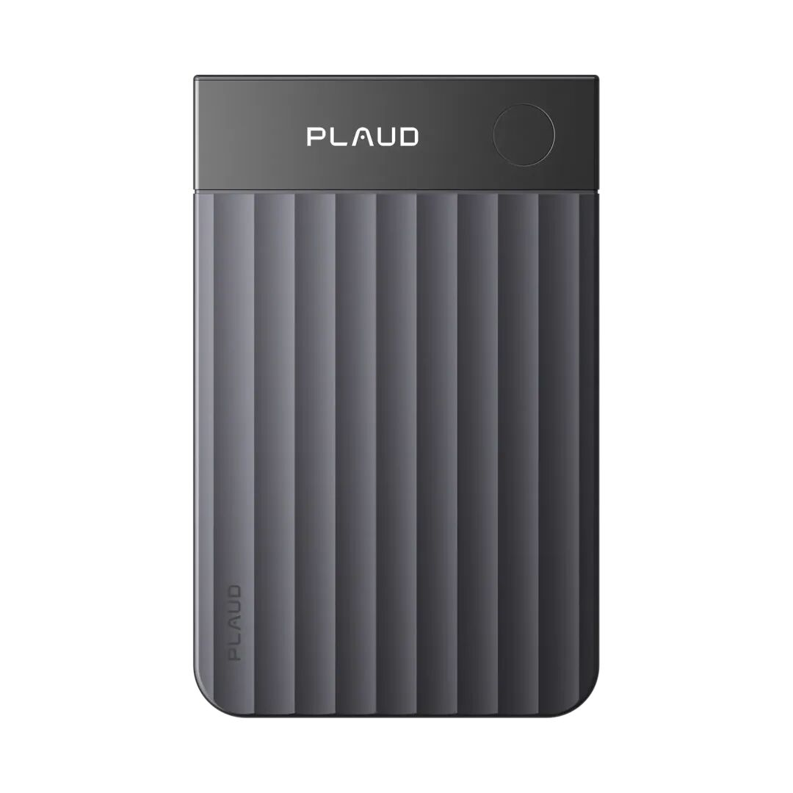



**收录说明**：用户提供链接。原文在微信公众号，用浏览器的客户端标识直接下载页面，从 `#js_content` 抽取正文，图片地址取自 `data-src`。删去文末「End」标记及前后的推广图片；文末话题标签照录。

**内容摘要**：雷科技的文章报道，北京时间 11 月 10 日 Meta 宣布 Muse 正式支持 Apple Watch 和 Google Wear OS 智能手表，用户可在手腕上用语音、文字交办任务、查看执行进度，Apple Watch 还支持表盘快速唤醒。文章称 Muse 的长期记忆和任务执行主要在云端，手表负责指令、提醒和确认，并回顾 Muse 此前接入 AI 眼镜、推出 Muse Charm。随后以 Even G2、Plaud、千问系列硬件为例，讨论硬件厂商对第三方 Personal Agent 的不同态度。

**保留理由**：Muse 登陆智能手表的中文报道，附对可穿戴硬件厂商影响的分析。

---

北京时间11月10日一早，Meta宣布旗下Personal Agent产品Muse正式支持Apple Watch和Google Wear OS智能手表，一石惊起千层浪。

最直接的结果是，智能手表用户可以直接在手腕上通过语音、文字与Muse交流，交办任务、查看执行进度，Apple Watch还支持表盘快速唤醒。

Muse接入Apple Watch和Wear OS，图片来源：Meta

在官方介绍的场景中，Muse可以帮用户关注电影票开售，或者发现日程安排冲突后，主动提出调整建议。用户只需要在手表上作出选择，后续工作就能交给Muse处理。

今年9月发布的Muse，作为一款Personal Agent，能够结合用户的长期记忆、个人偏好以及邮件、日历等外部服务，主动发现需求、执行复杂任务。**Meta之前就准备将其带到自家的AI眼镜，甚至推出了一款专门设计的独立AI硬件Muse Charm。**

如今，Muse又直接进入了苹果和谷歌的智能手表。

但让人在意的问题是，当Personal Agent开始进入用户的手表、耳机、眼镜以及更多硬件，会带来什么体验上的变化？又会改变今天AI可穿戴硬件市场的格局吗？

**Muse和智能手表，都只是开始**

过去几年，AI厂商一直在寻找比手机App更自然的交互方式。从语音助手、桌面客户端到各种AI硬件，目的都是让AI能够随时响应用户的需求。

但Personal Agent的出现，让这件事有了新的意义。严格来说，Personal Agent的产品定义并不新鲜，就是我们听过无数次的理想个人AI助手，但Personal Agent爆发的关键在于AI技术上的进步。

与普通AI助手相比，Muse这类Personal Agent更强调长期记忆、主动服务和复杂任务执行，在交互设计上需要持续了解用户的生活与工作，在不同时间、不同应用之间保持任务的连续性，并在必要时主动提供帮助。

**这也决定了，Personal Agent很难只依靠一个手机App满足所有需求。**

举个例子，用户可以在电脑上让Muse规划一次旅行，随后继续处理工作。几个小时后，Muse发现预订的航班发生变动，需要用户确认调整方案。

这时候，如果用户正在外面散步，能直接通过智能手表收到提醒并作出决定，显然比掏出手机、重新打开App方便得多。

尤其是对于一些需要持续数小时甚至数天的任务，用户与AI之间的交互可能只有短短几秒钟，可穿戴设备恰好适合完成这些零散但重要的交互。

**而且，Personal Agent不需要一直运行在手表上。**Muse的长期记忆、任务执行主要发生在云端，手表可以只负责接收指令、提醒和确认。这也降低了Personal Agent进入不同硬件设备的技术门槛。

Meta当然清楚这一点。9月的Connect大会上，Meta就宣布Muse将接入AI眼镜，未来用户甚至可以直接让Muse理解眼前看到的事物，再执行相应任务。同场亮相的Muse Charm，则希望让用户随身携带一个专用的Muse入口。

Muse Charm，图片来源：Meta

从手机、电脑到智能眼镜、智能手表，再到独立硬件，Meta正在尽可能扩大Muse的使用场景。

**这条路也不会只有Meta一家。**

国内的千问GO！已经开始内测，尝试利用阿里生态完成购物、出行、预约等个人事务；Today同样在围绕长期记忆、主动提醒和跨应用任务执行，构建自己的Personal Agent。

虽然目前还没有充分证据表明它们已经像Muse一样登陆主流智能手表，但这也可以说是题中应有之义。毕竟，Personal Agent想要持续服务用户，就需要尽可能融入用户的日常生活。而手机、电脑之外的智能手表、眼镜、耳机，恰好提供了更多接触用户的机会。

更重要的是，Personal Agent越能够跨设备使用，用户就越不需要为了获得某种AI能力，专门购买一件新硬件。

**Personal Agent空降，**

**欢迎还是警惕？**

对于可穿戴和AI硬件厂商来说，这可能是一件喜忧参半的事情。

好的一面很直接。今天有不少AI硬件，仍然停留在语音问答、录音总结、简单提醒等功能上。引入成熟的Personal Agent，有机会让这些设备获得长期记忆、主动服务和复杂任务执行能力，甚至扩展出原本无法覆盖的使用场景。

问题是，当不同品牌的设备都可以调用相同的Personal Agent，原本由厂商自己提供的AI功能，也可能逐渐失去吸引力。

尤其是那些缺少独特传感器、交互能力和使用场景，仅仅把AI助手装进一个新外壳的产品，受到的冲击可能更大。消费者已经拥有手机、手表和耳机。假如现有设备就能方便地使用Muse，为什么还要购买一件功能相近的AI项链或者AI胸针？

**当然，也未必只能被动应对。**

实际上，已经有一些厂商开始尝试开放自己的AI能力和硬件接口。虽然它们接入的主要还是普通Agent、工具或外部AI服务，不能直接等同于支持Personal Agent，但这些实践能够帮助我们理解不同厂商的选择。

比如智能眼镜厂商Even Realities。Even G2支持通过自定义Agent配置连接OpenClaw等外部工具，还可以通过Terminal Mode与电脑端的AI编程工具交互。

Even G2没有摄像头和扬声器，主要依靠轻量化显示、语音输入以及配套戒指提供交互。假如未来Muse、Today能够通过Even G2提供连续的任务提醒、进度反馈和操作确认，就可能给用户带来新的购买理由。

Even G2，图片来源：Even Realities

对于Even Realities来说，与其投入大量资源开发一套能够和Meta、Google竞争的Personal Agent，让更多成熟AI产品在自己的眼镜上获得良好体验，或许是更现实的选择。

还有Plaud。

就在本月初，Plaud正式推出MCP和CLI，让ChatGPT、Claude等第三方AI工具可以读取用户授权的录音、转写和摘要等资料，用户可以直接将它们交给更熟悉的AI工具，结合其他工作资料继续使用。

Plaud Note Pro，图片来源：Plaud

**对于Plaud来说，这能够扩大录音设备的价值。**只要用户还需要可靠的录音、转写和专业信息采集能力，就仍然有使用Plaud的理由。实际上，QwenNote A2也有类似的设计，通过CLI接入Codex、Claude Code等电脑Agent，可以让Codex/ChatGPT Work直接使用QwenNote A2的转录或者摘要。

不过有意思的是，Plaud同期也推出了自己的Plaud Agent，开始向跨应用工作流、文档生成和任务执行扩展。**一边开放数据，一边加强自己的AI服务，恰好说明Plaud也知道不能将后续的软件价值全部交给第三方。**

如果未来Muse或者Today能够直接读取Plaud录音，结合用户的邮件、日程和工作资料完成后续任务，用户是否还需要为Plaud自己的部分高级AI服务付费，就成了一个现实问题。

相比之下，千问的情况又有所不同。就在前段时间的云栖大会上，千问一口气推出了新一代千问AI眼镜N1系列、QwenNote A2录音卡、QwenNote Eva桌面机器人，甚至是千问电脑等硬件产品，同时还有自己的Personal Agent千问GO。

对于拥有模型、应用、服务生态和硬件的千问来说，它有理由让第三方提供更多专业能力，同时继续通过千问GO！协助用户处理个人事务、满足各种服务需求。

**总的来说，硬件厂商对第三方AI的态度，很大程度上取决于自己究竟依靠什么建立竞争优势。**

对于Even Realities这样的厂商，开放有可能让硬件变得更有吸引力；Plaud需要在专业数据服务和自有AI业务之间寻找平衡；而千问、Meta这样同时拥有完整AI生态的厂商，则有更强的动力保留主要的Personal Agent入口。

追根究底，硬件自身的价值并不会因为Personal Agent变得强大而消失。专业录音设备仍然需要可靠的收音能力，AI眼镜需要足够好的显示、拍摄和佩戴体验，智能手表则离不开长期健康监测、运动算法和成熟的交互系统。

但那些原本更多依赖软件功能建立卖点的产品，可能越来越难说服消费者。

**大浪淘沙，AI硬件还有时间**

公允地讲，Muse进入Apple Watch，对智能手表市场未必立即产生多大影响。苹果和Google本来就有自己的AI助手，Muse也还远没有获得完整的系统级权限。

但一方面，Muse已经可以通过普通智能手表使用，还准备推出Muse Charm，希望让用户拥有一个随身使用Muse的独立设备。对用户来说，他们可能不再需要在每件AI硬件上重新认识一个AI助手、重新积累个人信息。

相反，他们更希望自己长期使用的Personal Agent，能够在不同设备之间自然延续。

另一方面，对硬件厂商来说，既可以借助第三方Personal Agent扩大产品价值，也可能失去一部分原本由自己掌握的AI服务与用户关系。

Muse现在还谈不上对整个可穿戴AI市场形成降维打击。但对那些主要依靠通用AI助手作为卖点、缺少独特硬件价值的产品来说，压力恐怕已经开始出现。

#Meta #Muse #智能手表
