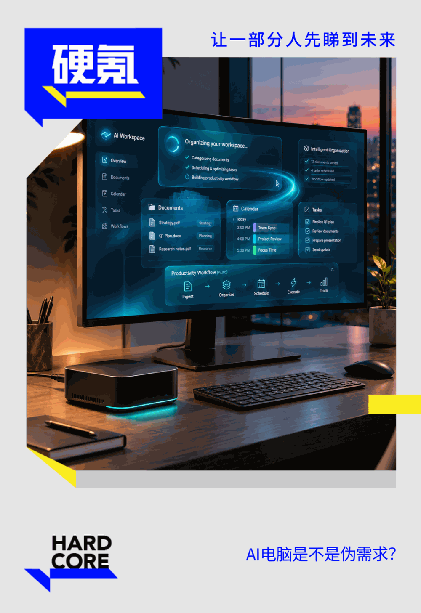



**收录说明**：用户提供链接。原文在微信公众号，用浏览器的客户端标识直接下载页面，从 `#js_content` 抽取正文，图片地址取自 `data-src`。删去文首阅读时长行后的空图片占位和文末的推广图片。

**内容摘要**：硬氪的文章（作者张子怡）报道做 Personal Agent 专用硬件的创业公司，引用 Dealroom 数据：49 家 Personal AI Agent 创业公司中，2026 年前 9 个月有 21 家获得融资，总额 18 亿美元。文章采访了吾云创新（Zettlab Memo）CEO 郭亚楠和 Violoop 的何佳霖：前者是数据留在本地、经飞书等入口接收任务的独立设备，后者通过 HDMI/USB-C 接入现有电脑，硬氪看到了它在简历、合同场景的演示。Violoop 希望把约七成基础任务留在设备上、三成交给云端；文中还引用 IDC 数据讨论内存涨价对硬件的影响，并引投资人称这类产品很大概率是过渡形态。

**保留理由**：少见的 Personal Agent 硬件形态报道，含两家硬件创业公司负责人的采访和端云分工的具体说明。

---

本文约3200  
字，建议阅读8分钟

作者 | 张子怡

编辑 | 袁斯来

打开电脑，打开AI，只需看着电脑屏幕， AI Agent就帮你接管待办事项，包括订票、购物，也可以帮你看面试者的简历，今日工作的日程提醒，预定会议......

这是今年已经发生的场景。9月，Meta发布Personal AI Agent Muse。与普通聊天机器人不同，Muse能够在后台持续执行任务：填写表格、发送邮件、购物等等。

在国内，千问接入淘宝、支付宝、飞猪和高德后，将订票、点外卖和支付串成一个任务；豆包手机助手开始读取屏幕、调用本地数据，并跨应用操作手机。

从互联网巨头到初创公司，所有人都在争抢Presonal AI这个新概念。Dealroom统计的49家Personal AI Agent创业公司中，2026年前9个月有21家获得融资，融资总额达到18亿美元。

硬件企业也想挖出一些商机。

今年春天“龙虾”爆火，催生第一批Agent Computer，有的像Mini PC，有的只是接在电脑上的外设。这一仓促诞生的品类，甚至没有一个统一的名字：Agent Box、Agent主机、Personal AI Computer都被糅进一个框架。

风潮很快随着龙虾过气而消退。回过头看，“这种产品像传统主机的升级和延续，很大概率是过渡形态的产品。”一位投资人告诉硬氪。

但这并不意味着AI Computer本身是个伪命题。

在硬件公司吾云创新创始人兼CEO郭亚楠看来，很多产品都会给云端Agent配上一台电脑。只是现在，大家给Agent配电脑，每个人实现的思路不同。他们选择了Bot这种形式，而有些公司则运用更复杂的后台接管模式。最终的目的，都是让Agent无障碍地运行在工作环境里。

在Agent越来越智能和复杂后，需要一个硬件外设似乎顺理成章。但人们尚未解答：当云端服务已经可以给Agent提供虚拟机，现有电脑也能运行Agent，再增加一台Agent电脑，究竟要解决什么问题？

当Agent进入工作流

为什么需要单独的本地Agent外设硬件？

郭亚楠给出了一个比喻：“本质上像你有两个员工，一个在北京，一个在硅谷。放在公司里的那一个，更容易接触本地的数据和系统。你愿意用哪一个？”

事实上，工作场景很可能是Personal AI Computer突围的关键。

在消费互联网里，Personal AI首先表现为“替人办事”。千问能够订票和点外卖，依赖的是阿里内部服务的打通；豆包手机助手跨应用操作的基础是中兴、字节系及部分已接入的第三方应用。

API是最稳定的路径，但并非所有软件都会开放接口；即使有接口，权限、格式和接入方式也可能彼此不同。Agent一旦进入企业，面对的往往不是一个可以直接调用的统一系统，而是一组相互割裂的工具和数据。

为了解决这个痛点，Agent Computer给出了各自方案。吾云创新的Zettlab Memo更接近给Agent准备一台独立设备。它把文件和企业数据留在本地，通过飞书等入口接收任务，再让Agent在后台持续运行。模型可以来自云端，但Agent的工作环境、上下文和数据入口留在公司内部。

他们Agent的边界很清楚。它不必先替用户前往所有互联网平台，而只是处理一组频繁重复、结果可以检查的流程：更新表格、搬运数据、整理文件、处理库存、阅读简历或者合同。企业可以决定它能看见什么，保留操作记录，并在关键步骤由人确认。

而另一家公司Violoop则是接入现有电脑作业。它们的设备通过HDMI或USB-C获得屏幕画面，在本地抓帧和分析，再通过标准键鼠接口操作电脑。如果说Ztttlab Memo是个独立秘书，Violoop的产品更像一个坐在现有工位旁边的助手，它会复用用户电脑、软件和登录状态，同时用独立硬件承担屏幕感知、记忆和部分计算。

在何佳霖的实际演示中，硬氪看到，当他打开一份简历，Violoop随即询问是否需要生成候选人分析、准备面试问题，或判断岗位匹配度；打开合同后，它又给出风险总结、关键条款和谈判建议。用户不必先把文件上传到对话框，也不用描述眼前正在发生什么。

“我们想做的是‘杀掉提示词’。不是用户每天告诉AI该干什么，而是AI观察到有价值的事情，把活送到用户手边，用户只需要说行或不行。”何佳霖表示。

不过，有了硬件，并不意味着可以彻底绕过API限制。亚马逊2026年更新的Agent政策便要求Agent主动标识身份，不得模仿人类操作节奏，也不能绕过验证码或访问限制。网页会改变布局，操作会遇到验证码，平台也可以识别并限制自动化访问。第三方硬件，仍然无法摆脱公司之间的高墙。

端云协同，供应链是新门槛

Agent Computer看起来是一门硬件生意，但是，Violoop和吾云创新更在意的都是其软件能力。

吾云创新最初做AI NAS时，端侧AI是产品卖点。存储价格上涨后，团队重新计算这件事的投入产出比：如果一台3000元的设备需要涨到数万元，而云模型每月只需要支付几十元或上百元，用户很难再为“完全本地”买单。

在Memo当前的设计里，大语言模型主要放在云端，文件处理、搜索和部分数据能力由本地小模型完成。硬件不再承担所有推理，而是保管数据、运行Bot，并负责把不同模型和工具接到一起。

Violoop也在调整端云分工。早期原型的本地算力较弱，随着产品迭代，团队在v4中加入更强的本地计算，希望把约七成基础任务留在设备上，另外三成交给云端复杂模型。

可以看到，双方在产品设计整体思维上趋同：端侧负责感知、数据、记忆、权限和一部分高频任务；云端负责更复杂、变化更快的推理。真正决定用户使用体验不是模型放在哪里，而是系统能否判断何时调用本地、何时调用云端，以及如何把结果送回工作流。

何佳霖认为：“如果只是用一颗GPU装一个Harness，跟去华强北装一台主机没有太大区别。差异化还是来自软件与自研模型的能力，因为软件与模型的创新和迭代的速度远远快于硬件。”

在这个时代，单单卖硬件，已经没有任何竞争力。“这个时代最大的变量是AI，不是硬件” 。郭亚楠告诉硬氪。

更残酷的是，AI军备竞赛后的虹吸效应，会反向影响硬件产品。IDC预计，受持续的内存短缺影响，2026年全球PC出货量将下降11.3%，平均售价上升18.3%，明显缓解可能要等到2027年底以后。

2026年存储价格大涨，一方面，Agent需要更多上下文和本地数据，硬件就需要更多内存和存储；另一方面，AI数据中心对高端存储的争夺，又不断推高消费电子公司的成本。

吾云创新买内存条最艰难的时候，供应商在电话里报出价格后，他们必须当场讨论，让财务立即转账，才能暂时锁住一批货。

内存涨价不只改变采购，也在反向塑造Agent Computer的产品架构。

端侧模型越大，对内存容量和带宽的要求越高；硬件成本快速抬升后，在设备里塞入大模型的性价比也随之下降。吾云创新现如今选择把大语言模型转向云端，设备上只保留处理文件、搜索和数据的小模型，也是为了降低内存压力，代价则是持续支付Token费用。

事实上，内存涨价由此把产品推向端云协同，单纯堆叠参数已经无法应对当下原材料普涨的困局。

但将大模型放上云端，并不等于将所有的工作都交给云厂商。用户的一项任务可能同时涉及文字、图片、视频和音频，任何单一模型都很难全部覆盖；某个模型出现波动时，系统还要及时切换。模型越多，Agent就越需要理解力，它要选择模型、调用工具，再把结果送回原来的工作流。硬件则负责保管本地数据、权限和记忆，提供持续运行的环境。

对初创公司而言，他们正在忍受双重夹击。软件还没有完成验证，硬件成本已经可能打垮一家创业公司。一款定义正确的产品，也可能根本无法交付。

这或许也成为传统Mini PC公司的优势。创盈芯、极摩客、安卓微等一批Mini PC企业。过去他们是因跨境电商和电子制造成长起来的“小电脑”产业，如今却先后都把产品转向桌面AI超算、智能体电脑和端侧工作站。

这批Mini PC企业积累多年的采购规模、供应商关系、主板设计、散热、认证、量产和售后能力。当行业缺货时，它们更容易拿到物料；当产品进入大规模交付时，它们也更知道如何压低BOM和控制良率。

因此，Mini PC企业与创业公司的差异，并不在于能不能造出一只盒子，而在于思路的不同。传统厂商先有供应链，再寻找适合装进硬件的软件；Agent Computer创业公司先定义工作流和Personal AI体验，再补硬件交付能力。

“如果纯做硬件，怎么可能比Mac mini、比苹果更有供应链优势？”何佳霖告诉硬氪。他承认，自己对于Mini PC厂商并无太多了解，也不认为两者属于同一类公司。

当然，硬件不一定Personal Computer最终的解法。

每个做Personal Computer的团队或许都在内心问过自己：它和Codex有什么区别？它和Codex加一台Mac mini又有什么区别？

这是个难以回答的问题。

Agent Computer很可能是一种过渡产品，而对于这群创业者，他们需要在变化中迅速寻找新方向。

**首页图源｜AI合成**

**排版｜沈祺**
