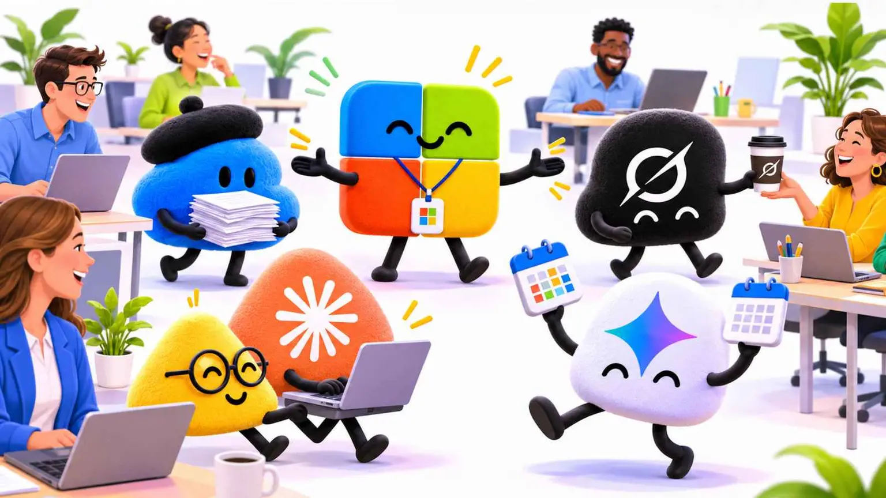



**收录说明**：UC Today「Microsoft Ignite 2026: Announcements and Analysis」专题的第 2 篇。直接下载，取正文；删去了作者头像、专题导航、文末评分与「Read next」推荐；题图下载到 images/。已翻译。

**内容摘要**：文章在 Ignite 次日比较 Microsoft Autopilot 与 OpenAI dots、Claude Duet、Tasks in Gemini、Grok Bot，认为买方的分界线是身份：Autopilot 有自己的 Microsoft Entra Agent ID 和指定的 manager，登录与操作以自己的名字记录。Autopilot 在 Frontier 开始推出，没有 GA 日期和公开价格，也未说明是否需要 Microsoft 365 Copilot 许可或使用 Copilot Credits。对手方面，OpenAI 的 dots 自 11 月 18 日起默认对 ChatGPT workspace 开放（除非管理员关闭）；Grok Bot 已面向团队开放；Claude Duet 是仅限美国、需候补的研究预览，Team 与 Enterprise 计划尚未包含；Tasks in Gemini 于 11 月 17 日免费，但帮助页称工作或学校账号暂不可用。文章指出各家都缺乏客户证据，只有 Anthropic 点名了小企业客户，并建议企业检查 dots 设置、向微软索要价格与 GA 日期。

**保留理由**：第三方视角的同期横向比较，把 Autopilot 的企业身份模型放到 dots、Duet、Gemini Tasks、Grok Bot 的上市状态和准入条件旁对照，并给出 Autopilot 尚无价格和 GA 日期的明确说法。已收资料多为单品报道，缺少这种跨产品的时间点快照。

---

Microsoft 的 Autopilot 带着自己的 Entra ID、一个具名的经理和一条审计轨迹登场。OpenAI 的 dots、Anthropic 的 Claude Duet、Google 的 Tasks in Gemini 和 Grok Bot 也都在承诺常驻帮助。对买家而言，身份是分界线，而对手们跑得更快。

个人 AI 应用——Grokbot、Duet、Autopilot、Dots、Gemini Tasks

每个智能体厂商都在讲同一套话：常驻、记得你、在做傻事之前先确认。所以当 Microsoft 昨天在 Ignite 上发布 Autopilot 时，真正的问题不是它能不能干活，而是它干活时谁签字。

Microsoft 摆出了桌上最有意思的答案。它的对手们大多回答：你签。

## 一个有自己工牌的智能体

Satya Nadella 把 Autopilot 推介为[「一个自主智能体，在 7×24 小时中，在你和团队协作的所有地方持续推进你的工作」](https://blogs.microsoft.com/blog/2026/11/17/ignite-2026-building-the-frontier-ecosystem/)。它生活在你的租户里，盯着 Teams 频道，跟进电子邮件，运行周期性工作，无需等待提示就能管理一个项目。同事可以在 Teams 频道或群聊中 @ 你的 Autopilot，正如我们在[首日综述](https://uctoday.com/microsoft-ignite-2026-day-1-agents-teams-roundup)中所述。

要紧的是底层的管道。Microsoft 的 [Copilot 博客](https://www.microsoft.com/en-us/copilot/blog/2026/11/17/copilot-at-microsoft-ignite-expanding-whats-possible-with-intelligence-built-for-work/)说得很直白：「每个 Autopilot 都有自己的 Microsoft Entra Agent ID 和一个具名的经理。IT 可以限定它的访问范围，并随时封禁它。它的登录和操作都以自己的名字记录在案。」在此之上是 [Agent 365](https://uctoday.com/microsoft-ignite-2026-day-2-voice-agents-teams-copilot-workspaces)，负责监督与成本。

当凌晨 2 点出了岔子，CIO 不想听到「用户干的」。他们要一个独立的身份、一个人类所有者和一份日志。

## 其他人在 Teams 里也都有张桌子

对雷德蒙德来说，尴尬的地方在这里。身处 Teams 曾经是护城河。现在不是了。

OpenAI 说你可以[在 Slack 和 Teams 里给你的 dot 发消息](https://openai.com/index/introducing-dots/)。Grok Bot 的 Team Bots 可以在 Teams 频道中被 @，也可以加进聊天，其文档指出[「Microsoft Teams 管理员仍须在 Teams 管理中心批准每个 Bot」](https://docs.x.ai/grok-bot/microsoft-teams)。Claude Duet 和 Tasks in Gemini 完全跳过 Teams，活在自己的应用里。

所以，出现在你的频道里不再让任何人显得特别。真正区分彼此的是：智能体到达时知道什么，以及它向谁负责。

## 公平的较量

挑战者们有很强的理由，其中大部分关乎时间。

Autopilot 正在「开始向 Frontier 的客户推出」，那是 Microsoft 的早期访问计划。没有 GA 日期，也没有公布价格。Microsoft 没有说它是否需要 Microsoft 365 Copilot 许可，或是否消耗 Copilot Credits。这是未知数，我不猜。

OpenAI 已经进入企业。其[帮助中心](https://help.openai.com/en/articles/20001554-managing-dots-in-chatgpt-workspaces)说，从 11 月 18 日也就是今天起，「除非你的管理员选择退出，dots 默认可用」。管理员这一层是真实存在的，细到可以暂停或删除任何一个 dot。OpenAI 对缺口也很坦率，指出移除一名成员「不会自动删除他们的 dot」。而且，虽然发布文章提到 Teams，那个管理员页面只列了 Slack 一项权限，所以 Teams 里的 dots 如何治理并不清楚。

Grok Bot 也是真正的竞争者。它现在已面向团队提供，支持通过 Cursor 的单点登录，在企业版上还有 SCIM、网络允许列表、审计日志以及 [ISO 27001 和 42001 认证](https://docs.x.ai/grok-bot/security)。Bot 代表提出请求的人行动，并在有风险的操作前等待批准。我找不到的是每个 Bot 拥有独立的目录身份，像 Autopilot 得到的那种。

## 与此同时，在个人账户上

还有 IT 看不到的那些东西。

Claude Duet 是仅限美国、需要排队的研究预览，Anthropic 说[「Team 和 Enterprise 计划暂不包含」](https://claude.com/product/claude-duet)。它对审批的处理确实周到。它在发送、支付、签署或删除前向你展示操作并等待，而且[「有些事即使你批准也不能做，比如交易证券或在账户间转移资金」](https://claude.com/resources/articles/claude-duet)。

Google 的 [Tasks in Gemini 于 11 月 17 日免费](https://blog.google/innovation-and-ai/products/gemini-app/tasks-in-gemini-free-new-features/)开放给六个国家的「数亿人」。Google 的[帮助页](https://support.google.com/gemini/answer/17094507)说：「目前，如果你使用工作或学校 Google 账户登录，此功能不可用。」同一页面仍把 Google AI Pro 或 Ultra 订阅列为要求，这与免费发布对不上。Google 尚未调和这两者。

两者都瞄准专业人士和小企业。可以理解。但想想那张桌子。一名被告知要等 Frontier 的员工。一个能读他们 Gmail 和日历的免费智能体。一个管理员永远看不到的个人账户。这不是假设的影子 AI 风险。这就是一个星期三。

## 给我看看客户

目前谁都没有多少证据。Microsoft 给出一个场景，Autopilot 端到端跑一次供应商审查。OpenAI 给出例子。Grok Bot 的厂商引用内部使用。Anthropic 是唯一点名客户的，而且都是小企业，包括一位约有 110 名员工的南佛罗里达餐馆老板。

我听过足够多的智能体简报，知道演示总是成功的。部署才是故事，而还没有人讲过它。

Clippy 教会了这个行业：人们会拒绝一个唠叨的助手。这一代不唠叨。它只是继续干活，这让关闭开关和审计轨迹更加重要。

## 判决

Microsoft 造出了你的安全团队会设计的那个智能体。它的对手们造出了你的员工今天就能用的那个智能体。如果你在运行 Microsoft 365，就把 Autopilot 的身份模型当作其他所有人都应达到的基准，但不要把一次 Frontier 推出误当成一个你能买到的产品。

所以这个星期，检查你的 ChatGPT Enterprise dots 设置，向 Microsoft 追问价格和 GA 日期，并查清你的人已经在个人账户上运行了哪些智能体。

## 我的预测：2027 是个人 AI 之年

我认为事情会落到这里。企业在 2027 年最大的挑战从现在就开始了。Bot 正在变得可行动。它们接管任务，并常规、持续地运行它们。这对企业和科技领袖来说，是要理解和控制的大量事情，同时还要把良好的治理、安全与合规留在流程中。

透过客户体验（CX）的镜头看，事情会更大。企业即将收到大量来自 bot 而非人的沟通。Bot 将代其所有者下单、登记投诉、预订会议、预约和活动。联络中心需要为[派智能体来而不是打电话的客户](https://cxtoday.com/both-sides-of-the-call-are-going-agentic-microsoft-wants-the-middle)做好准备。

超生产率也有机会。曾经吃掉数小时的行政工作将会缩水。所以现在是考虑四天工作周的时候，或者至少重新想想你的人每天究竟在做什么。他们口袋里会多出时间，而他们需要以智能体化的方式工作。2027 年，智能体化的劳动力战略将至关重要。

我整周都在 Ignite，敬请期待更多内容，包括[对 Microsoft 领导人的采访与评论](https://uctoday.com/microsoft-ignite-roundup-agents-got-names-the-dial-tone-got-skipped)以及社区。
