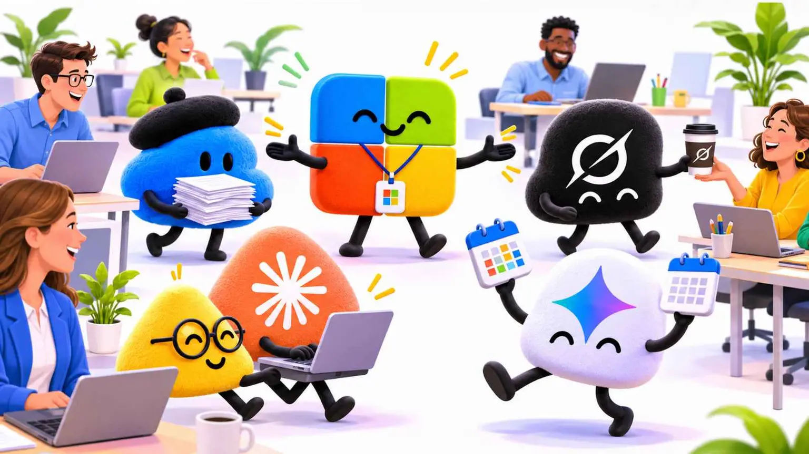

来源：https://uctoday.com/microsoft-ignite-2026-autopilot-vs-dots-duet-grok-bot-gemini
取文：2026-11-28，直接下载

Microsoft's Autopilot arrives with its own Entra ID, a named manager and an audit trail. OpenAI's dots, Anthropic's Claude Duet, Google's Tasks in Gemini and Grok Bot all promise always-on help too. For buyers, identity is the dividing line, and the rivals are moving faster.

Personal AI Apps - Grokbot, Duet, Autopilot, Dots, Gemini Tasks

Every agent vendor makes the same pitch: always on, remembers you, checks before doing anything silly. So when Microsoft unveiled Autopilot at Ignite yesterday, the real question wasn't whether it can do the work. It was who signs for it when it does.

Microsoft has the most interesting answer on the table. Its rivals mostly answer: you do.

## An Agent With Its Own ID Badge

Satya Nadella pitched Autopilot as ["an autonomous agent that keeps moving your work forward 24×7 in all the places where you and your team collaborate."](https://blogs.microsoft.com/blog/2026/11/17/ignite-2026-building-the-frontier-ecosystem/) It lives in your tenant, watches Teams channels, follows up on email, runs recurring work and manages a project without waiting for a prompt. Colleagues can @mention your Autopilot in a Teams channel or group chat, as we covered in our [day one round-up](https://uctoday.com/microsoft-ignite-2026-day-1-agents-teams-roundup).

The plumbing is what matters. Microsoft's [Copilot blog](https://www.microsoft.com/en-us/copilot/blog/2026/11/17/copilot-at-microsoft-ignite-expanding-whats-possible-with-intelligence-built-for-work/) puts it plainly: "Each Autopilot has its own Microsoft Entra Agent ID and a named manager. IT can scope its access and block it anytime. Its sign-ins and actions are logged under its own name." [Agent 365](https://uctoday.com/microsoft-ignite-2026-day-2-voice-agents-teams-copilot-workspaces) sits on top for oversight and cost.

When something goes sideways at 2 a.m., a CIO doesn't want "the user did it." They want a separate identity, a human owner and a log.

## Everyone Else Has a Desk in Teams Too

Here's the awkward bit for Redmond. Being in Teams used to be the moat. Not anymore.

OpenAI says you can [message your dot "in Slack and Teams."](https://openai.com/index/introducing-dots/) Grok Bot's Team Bots can be mentioned in Teams channels and added to chats, and its docs note that ["A Microsoft Teams admin still approves each Bot in the Teams admin center."](https://docs.x.ai/grok-bot/microsoft-teams) Claude Duet and Tasks in Gemini skip Teams altogether and live in their own apps.

So showing up in your channel no longer sets anyone apart. What the agent knows when it gets there, and who it answers to, does.

## The Fair Fight

The challengers have a strong case, and most of it is about time.

Autopilot is "starting to rollout to customers in Frontier," Microsoft's early-access program. There's no GA date and no published price. Microsoft hasn't said whether it needs a Microsoft 365 Copilot license or draws on Copilot Credits. That's unknown, and I won't guess.

OpenAI is already inside enterprises. Its [help center](https://help.openai.com/en/articles/20001554-managing-dots-in-chatgpt-workspaces) says that starting November 18, which is today, "dots become available by default unless your admin opts out." The admin layer is real, down to pausing or deleting any dot. OpenAI is also candid about the gaps, noting that removing a member "does not automatically delete their dot." And while the launch post mentions Teams, that admin page lists only a Slack permission, so it isn't clear how dots in Teams are governed.

Grok Bot is a real contender too. It's available for teams now, with single sign-on through Cursor and, on Enterprise, SCIM, network allowlists, audit logs and [ISO 27001 and 42001 certification](https://docs.x.ai/grok-bot/security). Bots act for the person who asked and wait for approval before risky actions. What I couldn't find is a separate directory identity for each Bot, like the one Autopilot gets.

## Meanwhile, on Personal Accounts

Then there's the stuff IT can't see.

Claude Duet is a US-only research preview on a waitlist, and Anthropic says ["Team and Enterprise plans are not included yet."](https://claude.com/product/claude-duet) Its approach to approvals is genuinely thoughtful. It shows you the action and waits before sending, paying, signing or deleting, and ["A few things are off-limits even with your approval, like trading securities or moving money between accounts."](https://claude.com/resources/articles/claude-duet)

Google's [Tasks in Gemini went free on November 17](https://blog.google/innovation-and-ai/products/gemini-app/tasks-in-gemini-free-new-features/) for "hundreds of millions of people" across six countries. Google's [help page](https://support.google.com/gemini/answer/17094507) says, "For now, this feature isn't available if you sign in with a work or school Google Account." That same page still lists a Google AI Pro or Ultra subscription as a requirement, which doesn't square with a free launch. Google hasn't reconciled the two yet.

Both target professionals and small businesses. Fair enough. But picture the desk. An employee who's been told to wait for Frontier. A free agent that can read their Gmail and calendar. A personal account their admin will never see. That's not a hypothetical shadow-AI risk. It's a Wednesday.

## Show Me the Customers

Nobody has much proof yet. Microsoft offers a scenario, Autopilot running a supplier review end to end. OpenAI offers examples. Grok Bot's maker cites internal use. Anthropic is the only one naming customers, and they're small businesses, including a South Florida restaurant owner with about 110 employees.

I've sat through enough agent briefings to know the demo always works. The deployment is the story, and nobody has told it yet.

Clippy taught this industry that people reject an assistant that nags. This generation doesn't nag. It just gets on with it, which makes the off switch and the audit trail matter more.

## The Verdict

Microsoft has built the agent your security team would design. Its rivals have built the agent your employees can use today. If you run Microsoft 365, treat Autopilot's identity model as the benchmark everyone else should meet, but don't mistake a Frontier rollout for a product you can buy.

So this week, check your ChatGPT Enterprise dots setting, press Microsoft for a price and a GA date, and find out which agents your people are already running on personal accounts.

## My Prediction: 2027 Is the Year of Personal AI

Here's where I think this lands. Enterprises' biggest challenge in 2027 starts now. Bots are becoming actionable. They take ownership of tasks and run them routinely and persistently. That's a lot for businesses and technology leaders to get their heads around and keep under control, with good governance, security and compliance in the loop.

Look through the CX lens and it gets bigger. Businesses are about to get a lot more communication from bots, not people. Bots will place orders, log complaints, and book meetings, appointments and activities on their owners' behalf. Contact centers need to be ready for [customers who send an agent instead of calling](https://cxtoday.com/both-sides-of-the-call-are-going-agentic-microsoft-wants-the-middle).

There's an opportunity for hyperproductivity too. Administrative work that once ate hours will shrink. So now is the time to consider a four-day work week, or at least rethink what your people actually do each day. They'll have time back in their pockets, and they'll need to work agentically. In 2027, an agentic workforce strategy will be crucial.

I'm at Ignite all week, so stay tuned for more, including [interviews and comments from Microsoft leaders](https://uctoday.com/microsoft-ignite-roundup-agents-got-names-the-dial-tone-got-skipped) and the community.
