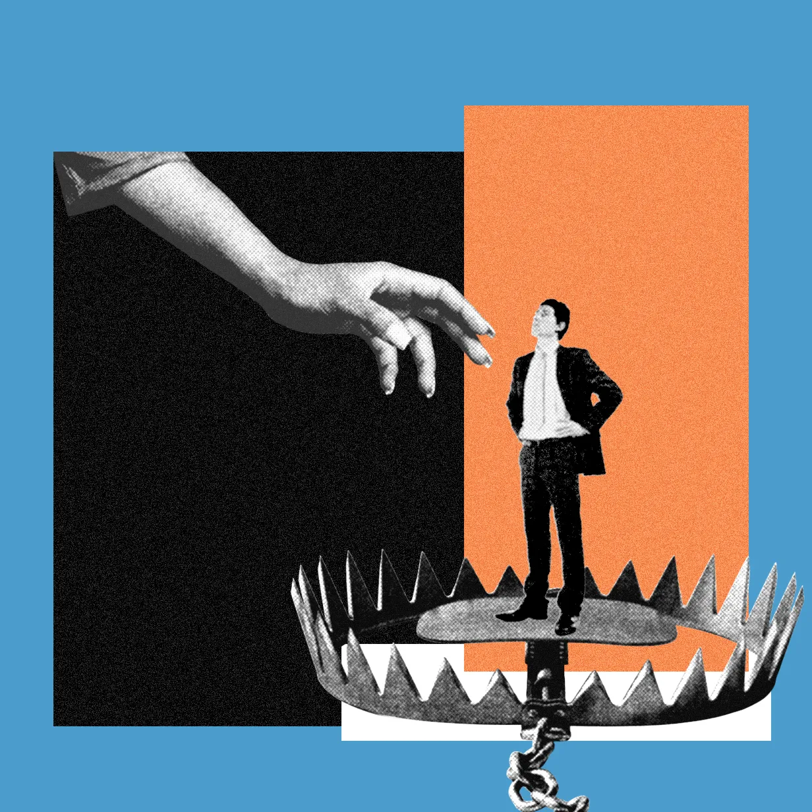



**收录说明**：WIRED「Model Behavior」通讯的一期，依据原站存档，只收正文与图注。URL 中的标题是「I finally found…」，页面标题为「I Think I Found…」。原文存于本目录的 original.md，网站上不显示，已翻译。

**内容摘要**：作者离开 WIRED 全职岗位后先用过 Claude Cowork，然后开始用在湾区走红的邀请制智能体 Instinct，它通过 iMessage 和 WhatsApp 交流，连接邮件、日历和消息应用。作者认为 Instinct「做对了形态」：没有输入框，只有 iMessage、WhatsApp 和几个提示。实测中，它按威尼斯出差行程订好了餐厅（包括用 WhatsApp 联系小店）；在纽约与迈阿密行程冲突时，它发现阿拉斯加航空把航班提前了 90 分钟，据此全额退票，省下约 550 美元；还提醒作者一封朋友的烧烤邀请是钓鱼邮件。失误是它在作者明确说「只有能退款才取消」的情况下取消了一份严重延误的 DoorDash 订单，损失 64 美元。文章也提到断开邮箱后数据仍被保留、条款允许用部分对话训练模型等风险，Instinct 未回应置评请求。

**保留理由**：一位长期报道 AI 的记者的使用记录，既有替用户争取退款这样的长期跟进，也有违背指令的失误。

---

Instinct 帮我省下 550 美元，订好了餐厅，还提醒我注意一场钓鱼骗局。它也浪费了 64 美元，而且可能是个安全噩梦。

图片合成：WIRED Staff；Getty Images

我离开 WIRED 的全职工作后做的第一件事之一，就是让 [Claude Cowork](https://www.wired.com/story/anthropic-claude-cowork-agent/) 访问我的邮件和日历。报道[人工智能（artificial intelligence）](https://www.wired.com/tag/artificial-intelligence/)多年之后，我很好奇这项技术能为我做些什么。我原本把 Cowork 想象成一个能力超强的数字助理，却发现它更像是和一个普通聊天机器人互动，只不过[多了些工具](https://www.wired.com/story/why-normal-people-arent-using-ai-agents/)，这让我有些失望。我想让它做什么？我完全不知道。

后来，Instinct 在湾区开始火了起来。这是一款邀请制的 AI 智能体，通过 iMessage 和 WhatsApp 与用户交流。它会连接你的邮件、日历和消息应用。可以把它看作面向普通人的 [OpenClaw](https://www.wired.com/story/malevolent-ai-agent-openclaw-clawdbot/)。据 The Information [报道](https://www.theinformation.com/articles/ai-agent-startup-instinct-talks-10-billion-valuation)，这家公司于 2 月推出非公开测试版，正在洽谈在已筹集的 3.5 亿美元之外再融资 10 亿美元，使其估值达到 100 亿美元。

Instinct 走进聚光灯之际，Meta 正因 Muse 而经历自己意想不到的人气暴涨——Muse 是这家科技巨头本月早些时候推出的一款 AI 助理。截至撰写本文时，据[第三方估算](https://www.wired.com/story/metas-muse-is-better-at-surveilling-than-helping-me/)，Muse 是 Apple App Store 上最受欢迎的免费应用，下载量超过 90 万次。X 上的评论者群体似乎对它真心感到兴奋，尽管据 [Ars Technica](https://www.wired.com/story/metas-muse-ai-agent-zero-day/) 报道，它发布时带有一个严重的安全漏洞，这个漏洞「会让攻击者在受害者的 Mac 上做『任何』他们想做的事」。我不会把自己的大量个人信息交给 Meta，但如果 Muse 能让我保持登录 Bloomberg，或者帮我退订 Hot Yoga São Paulo——它从 2017 年起每周给我发一次邮件——那我会重新考虑。

## 智能体煽动者

把 AI 智能体用于一切事情的人，和[从未尝试过](https://www.wired.com/story/why-normal-people-arent-using-ai-agents/)智能体的人之间的鸿沟，从未如此之大。这在一定程度上解释了为什么科技公司的 CEO 们大多被[数据中心的反弹](https://www.wired.com/story/how-data-centers-broke-american-politics/)打了个[措手不及](https://www.wired.com/story/silicon-valley-doesnt-get-why-you-hate-ai/)。如果你认为智能体能将大多数人繁琐的行政杂务自动化，并大幅提升他们的生产力，那么建设数据中心所伴随的成本和干扰或许看起来是可以接受的取舍。但如果你只是把聊天机器人当作一种花哨的 Google 来用，这笔交易可能就没那么有吸引力了。

正如[技术记者 Jasmine Sun](https://jasmi.news/p/claude-code)所写，最根本的问题在于「大多数人的问题并不是软件形状的，而且大多数时候即使它们是，人们也不会注意到。」AI 智能体和聊天机器人一样，仍然需要用户提供大量输入和指示。如果你知道自己想要什么——[作业辅导](https://nymag.com/intelligencer/article/openai-chatgpt-ai-cheating-education-college-students-school.html)、一个[虚拟女友](https://www.wired.com/story/couples-retreat-with-3-ai-chatbots-and-humans-who-love-them-replika-nomi-chatgpt/)——这些工具会很乐意提供。但如果你不知道，那么，[欢迎来到永久的底层阶级](https://www.nytimes.com/2026/04/30/opinion/ai-labor-work-force-silicon-valley.html)。

我很想避免这样的命运。我也许算不上[有能动性的（agentic）](https://www.wired.com/story/silicon-valley-agentic-individuals-future-of-work/)，但我愿意认为自己是以行动为导向的。我肯定能在生活中找到一个软件形状的问题。我之前用过 Claude 生成几张自由职业发票，大概省了我 10 分钟。这不错，但算不上改变生活。我决定试试 Instinct。

如果你和 AI 研究者谈起 Instinct，你会经常听到「形态（form factor）」这个词。Instinct 把形态做对了——没有开放的输入框，只有 iMessage、WhatsApp 和几个有用的提示。这一点有多重要，怎么强调都不为过。你不必自己琢磨如何让聊天体验更有用，而是在和一个智能体发消息，它会主动建议能为你做什么，然后真的去做。而且和这个领域其他智能体不同，它不会发太多消息。我试过一个叫 Lindy 的竞争产品一周，它每天早上都给我发消息，还未经我同意就闯进 Zoom 会议，于是我把它删了。

第一个项目，我把去意大利威尼斯出差的行程给了 Instinct。我让它根据我会出现的地点预订餐厅，包括通过 WhatsApp 联系那些藏在巷子里的小店。成功了！餐厅预订似乎是许多对智能体好奇的人的入门毒品，我也不例外。（值得一提的是，虽然 Muse 也能替人打电话到餐厅订位，但据 [404 Media 的报道](https://www.404media.co/meta-tests-muse-ai-agent-calls-that-are-actually-made-by-humans-in-a-call-center/)，其中一些电话实际上是由呼叫中心的人类打出的。）

接下来，我给 Instinct 一个更复杂的任务。我已经和姐姐订好了 11 月去纽约的行程，这时 WIRED 让我去参加 [WIRED World Fair](https://www.wired.com/wiredworldfair/)，而活动前一天在迈阿密举行。不幸的是，我订的是特价票（saver fare），意味着不能改签，而且如果我错过第一段行程，整个行程就会自动取消。

Instinct 能取消我的行程并拿到退款吗？出乎我意料，它可以。这个智能体发现阿拉斯加航空把我的航班提前了 90 分钟——这件事我完全没注意到——而这让我有资格获得全额退款。它取消了我的机票，为我省下约 550 美元，并重新预订了我回旧金山的单程票。我不知道你们怎么想，但我开始[感受到 AGI 了](https://www.reddit.com/r/singularity/comments/1jai6th/im_feeling_the_agi/)。

## 不自然的直觉

说到这里，我必须停下来承认使用 Instinct 的风险。风险有很多。有人[报告](https://x.com/clairevo/status/2090929592853037078)说，当他们试图断开智能体与邮箱的连接时，发现它无论如何都保留了一份收件箱副本。一位[风险投资人](https://x.com/jbahrdestefano/status/2096676801204404604)说，这个机器人在尝试预订时大约每小时请求其 API 200 次，导致他被 Resy 封禁。另一位科技投资人[说](https://x.com/anothercohen/status/2091251836917350512)，在判断出 Instinct 极其容易被钓鱼之后，他删除了这个应用。

Instinct 的[服务条款](https://instinct.com/terms)相当宽泛，允许公司至少使用你的部分对话来训练其 AI 模型。我也遇到过一次恼人（虽然不算大）的纰漏：有一天，Instinct 取消了一份严重延误的 DoorDash 订单，害我损失了 64 美元。（我明确告诉过它，只有能退款时才取消。）这让我注意到 Instinct 另一件非常非常擅长的事：拼命道歉，却不主动为自己的错误买单。

Instinct 公司——与旗下旗舰 AI 智能体同名——没有回应 WIRED 的置评请求。

Instinct 感觉像是一个有点混乱的个人助理，而我从来没有过真正的人类助理，所以我打算继续用它。上周它告诉我「不要打开」一封朋友邀请我参加后院烧烤的邮件——结果那是一起钓鱼骗局。智能体是安全噩梦。我明白！但我很忙。我是个妈妈。如今一切感觉都像安全噩梦。目前，我愿意冒这个险。

---

*本文是 [**Model Behavior 通讯**](https://www.wired.com/newsletter?sourceCode=editarticle) 的一期。往期通讯可在[**这里**](https://www.wired.com/tag/model-behavior/)阅读*
