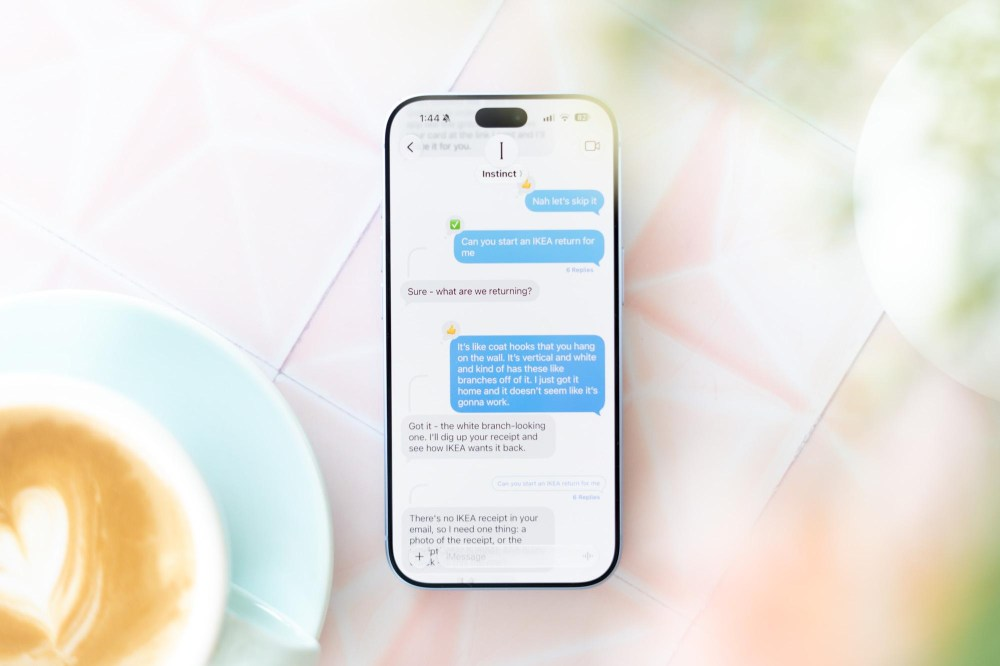
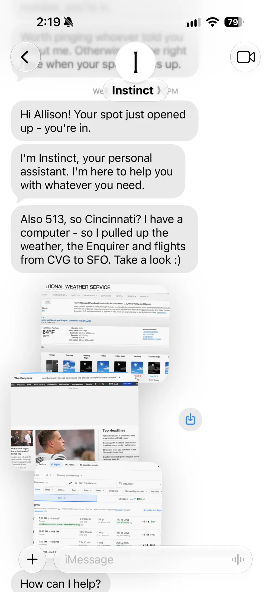
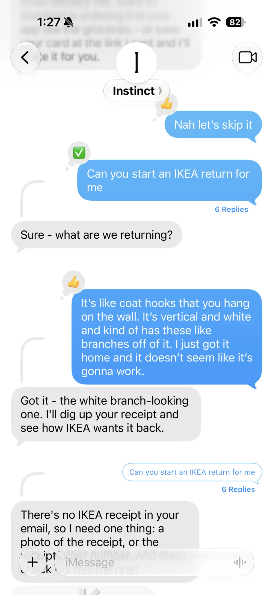



**收录说明**：依据 The Verge 原站直接下载；副标题以斜体保留，题图与两张截图（图集）下载到 images/，图集的「1/2」页码、文中的「Related」推荐链接、重复正文句子的拉引语、作者与话题关注按钮未收入，站内相对链接改为绝对地址。原文存于本目录的 original.md，网站上不显示，已翻译。

**内容摘要**：Allison Johnson 用 Instinct 处理了几周的实际事务，认为它在她的测试中不输 Muse 和 Dots。Instinct 通过 iMessage、WhatsApp 或邮件交互，没有 App；登录网站时用户在「secure vault」里填资料，可以连接 Google Workspace、Slack、Notion；目前需要现有用户邀请或候补名单批准，作者几小时就获批。实测中它一开始把作者的辛辛那提区号当成所在地，找游泳课时漏掉了社区中心的先修课要求，但给眼科诊所发邮件约诊、办理 Ikea 退货都完成得不错，还会主动提示相关信息。Shinn 说「Instinct is free for invite-only users」，并会尽量保持低价；Techsponential 的 Avi Greengart、IDC 的 Greg Ireland 认为将来可能靠商家合作或广告收费，文章指出 Dots 目前只对付费订阅者开放，Muse 免费。

**保留理由**：已收资料中第一篇把 Instinct 和 Muse、Dots 放在一起的一手实测，有具体任务的成败；还有创始人对免费期的表态和分析师对收费方式的看法。

---

*Instinct 是一款令人印象深刻的助手，但来自 OpenAI 和 Meta 的压力已经正式到来。*

*Instinct 的智能体始终只隔一条短信。*

在那些[可爱小家伙](https://www.theverge.com/column/999999/optimizer-meta-muse-ai-cute)出现之前，先有 Instinct。

8 月，这家初创公司用一套不同寻常的打法把它的 AI 智能体推向市场：仅限邀请、不做营销，连网站都几乎没有。然而 Instinct 迅速成为 AI 界最受关注的东西，凭借直截了当的、基于短信的界面，以及处理[预约车管所](https://x.com/pitdesi/status/2090579987778937159?lang=en)、[发送跟进邮件](https://x.com/srcasm/status/2091211911920542200)这类杂事的能力[赢得赞誉](https://www.wired.com/story/i-finally-found-an-ai-agent-worth-the-risk/)。

接着 Muse 出现了，不久之后是 Dots。基本相同的产品，来自两家实力强得多的公司。

大型科技公司突然入场，让这家初创公司借热度发布的声势能否保持领先显得可疑。但在我自己的测试中，Instinct 与另外两个智能体相比并不逊色，处理线上任务的表现差不多达到了机器人所能达到的水平。而 Instinct 的创始人 Noah Shinn 对日益激烈的竞争并不担心。

「AI 助手就是我们全部所知，」Shinn 在邮件中告诉我。OpenAI 和 Meta 为各类客户构建 AI 产品，而 Shinn 认为 Instinct 的专注让它与众不同。「我们一直只专注于打造一个真正懂日常生活的个人助理。」

Shinn 曾是 Sierra 的早期员工——那是另一家估值很高、有着[深厚硅谷渊源](https://www.cnbc.com/2025/09/04/bret-taylor-sierra-ai-startup-salesforce-openai.html)的初创公司——之后他出来单干，创办了 Instinct。这次低调的发布迅速升温，获得测试者的赞誉和投资者的巨大信任票。公司在 9 月下旬[估值达到 100 亿美元](https://techcrunch.com/2026/09/28/viral-ai-agent-instinct-raises-1b-series-c-at-a-10b-valuation/)，而且是在 Muse 发布之后。它没有 App，也（暂时）没有包月订阅费。你需要现有用户邀请，或候补名单批准。我只等了几个小时就获批了。

Instinct 的 AI 助手能做许多我让 Muse 替我做的事，某种程度上也包括 OpenAI 的 Dots。那些生活琐事，比如报名游泳课、确认预约，在一个有一个学龄前孩子、两个全职工作的成年人的家庭里，以惊人的频率堆积起来。它们是为消费者打造的更友好的版本，类似于软件开发者在过去一年里一直在用的 Codex 和 OpenClaw 这类智能体。

你和它们聊天很像与聊天机器人对话，但它们还能使用一台虚拟机，并能接入你的个人邮箱和日历。Muse 的可爱小熊吉祥物和 Dots 的拟人化团块，明显是在争取更广泛的消费群体，而 Instinct 感觉截然不同。

与 Instinct 智能体的对话通过文字进行——经由 iMessage、WhatsApp 或邮件。没有可爱小家伙。不假装它坐在笔记本电脑前敲键盘。只有简短的回复、偶尔的表情回应，以及远多于言谈的行动。它的有效程度已经达到我认为我们目前对 AI 智能体所能合理期待的水平，但机器人要在人类世界里把事情办成，其局限同样真实。

如果你想让 Instinct 登录某个网站，你会收到一个链接，在「安全保险库（secure vault）」里填写信息；你还可以把它连接到不同的服务，包括你的 Google Workspace、Slack 和 Notion。除此之外，界面就是你的短信。这有点天才，也意味着凡是你能收发短信的地方，Instinct 都在，比如 CarPlay 或你的手表上。它就安静地在旁边，这要么很理想，要么很瘆人，取决于你怎么看 AI 智能体。我觉得两者都有一点。

Shinn 说，缺少传统 App 界面是他认为 Instinct 区别于大玩家的关键部分。「AI 平台擅长回答问题、响应提示词，而 Instinct 无缝融入人们的生活，把对话转化为行动，」他说。「就像你会给个人助理发短信或邮件一样，你也可以对 Instinct 这么做。」

Instinct 一开始没让我印象深刻。几条介绍性的消息之后，它把我的辛辛那提区号当成邀请，给我发来一个《Enquirer》网站的链接，还有一组 CVG 到 SFO 的航班搜索结果。多谢了？我告诉它我已不住在辛辛那提。「哈，」它说。「记下了——从现在起我会记住。」但在过去几周里持续给它喂实在的任务之后，它让我印象深刻的次数多于不深刻，尽管我并不觉得自己离某种生产力极乐更近了一些。

我给 Instinct 派了一个有点含糊的任务：帮我儿子找游泳课——这件事我想了好几年，却总是拖延。我让它找适合他这个年龄的课程；它带回了一份可行的结果清单。我提议附近的社区中心，它就转向那里。我打开浏览器跟着核对它的建议。它给出的时间和日期都对得上——一个很低的门槛通过了。但它漏掉了一条关键信息：该中心对报名学龄前课程的孩子有先修课要求。我碰巧注意到了这个细节，这也凸显了 AI 智能体面临的一个挑战：它们擅长处理干净的数据，但互联网是人造的，数据常常很糟。有时关键信息就藏在一个弹窗里。

Instinct 还妥善处理了其他几件事，比如给我眼科医生的诊所发邮件预约，以及为启动一次 Ikea 退货填写电子表格。除了替我填一些表单，它在处理含糊指令方面出奇地好。我让它搜索我过去的 Ikea 购买记录，它从我说的「它是竖着的、白色的，好像有些像枝条一样伸出来的东西」中弄明白了我指哪件产品。（给在家做记录的人：是 [Tjusig](https://go.skimresources.com/?id=87443X1797501&xs=1&url=https%3A%2F%2Fwww.ikea.com%2Fus%2Fen%2Fp%2Ftjusig-hanger-white-60291708%2F)。）

有几次它让我意外：它给出了我并未明确要求的相关信息。我在请求给眼科医生发邮件时先说明我记不清诊所的确切名称。Instinct 根据我的描述缩小了范围，后来在对话中它提到我有一封 2024 年来自该医生的确认邮件，好让我放心它发邮件的地方是对的。另外，Instinct 在替我处理另一件杂事时，还指出了我日历上的一个潜在冲突。像一台又大又花哨的自动填充机那样填表是一回事，AI 智能体正迅速证明它们相当擅长这个。但正确识别相关信息并主动提请我注意，感觉是朝向真正「帮忙」迈出的一步。

正确识别相关信息并主动提请我注意，感觉是朝向真正「帮忙」迈出的一步

未来这些都要付费。被问及 Instinct 是否会一直免费时，Shinn 回答说「Instinct 对仅限邀请的用户免费。我们的意图是尽量保持可负担。」[Techsponential](https://www.techsponential.com/) 的分析师 Avi Greengart 指出，像 Instinct 这样由风投支持的初创公司，目前的首要目标是增长。「商业模式就是尽可能快地增长，做出值得付费的东西，」他说，并指出像 Instinct 这样的公司可能着眼于从客户群获得收入，和/或被更大的公司收购。

OpenAI 的 Dots 目前只对付费订阅者开放，而 Meta 的 Muse 免费使用。「如果你不为它付费，那么你寻求的商品和服务可能正在做交易，以换取接触你的智能体的机会，」Greengart 推测。他承认目前的经济账有点奇怪，因为智能体眼下主要由早期采用者使用，但他认为那句老话仍然成立。「如果你不直接付费，那你就在间接付费，」他说。

按 IDC 高级总监 Greg Ireland 的说法，这可能意味着未来会有更多广告。「这些智能体如此偏重交易、商业或购物，这让广告成了自然的搭配，」他说。事实上，Instinct [已经尝试过向用户推送「推荐产品」](https://techcrunch.com/2026/09/30/instincts-new-product-recommendations-are-giving-some-users-the-ick/)。公司有充足的动机让这种广告对消费者不那么反感，但 Ireland 认为广告无论如何都会发挥作用。「消费市场里所有路最终都通向广告，」他说。
