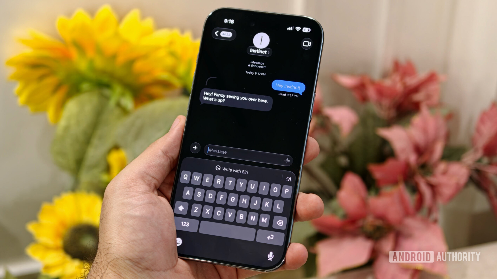
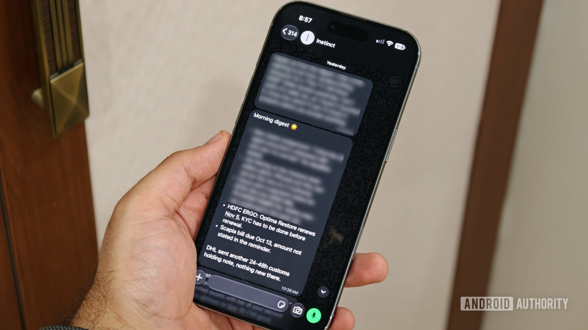
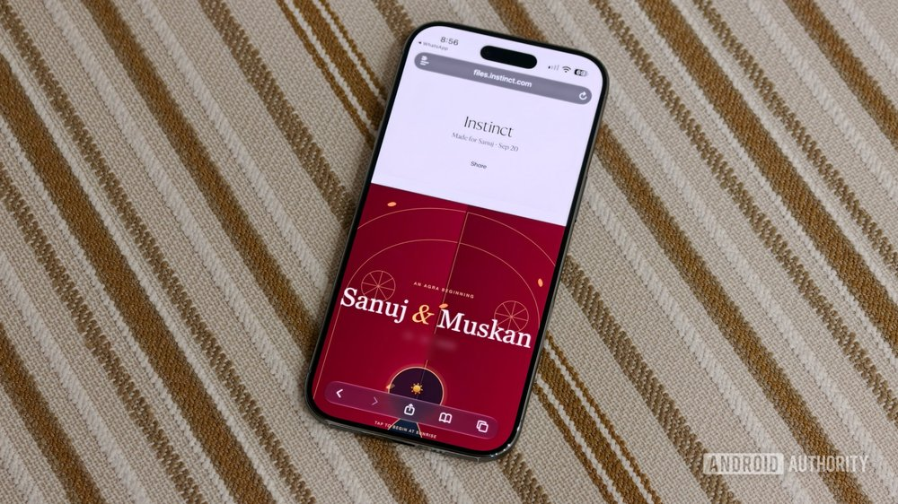
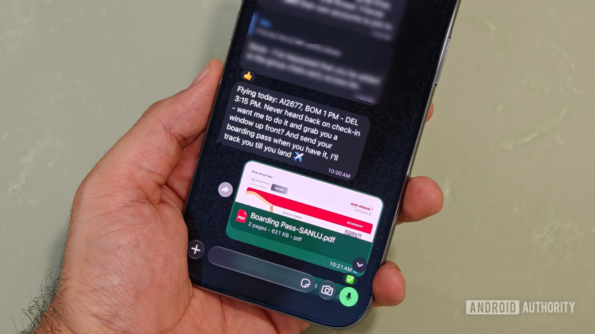
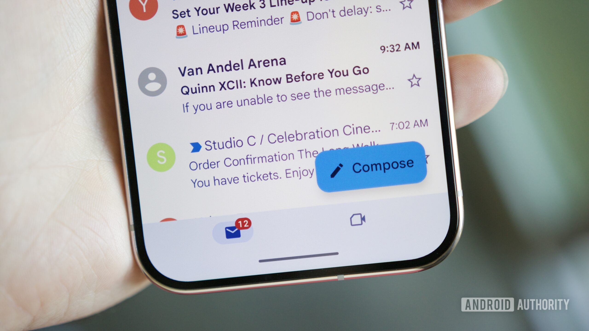
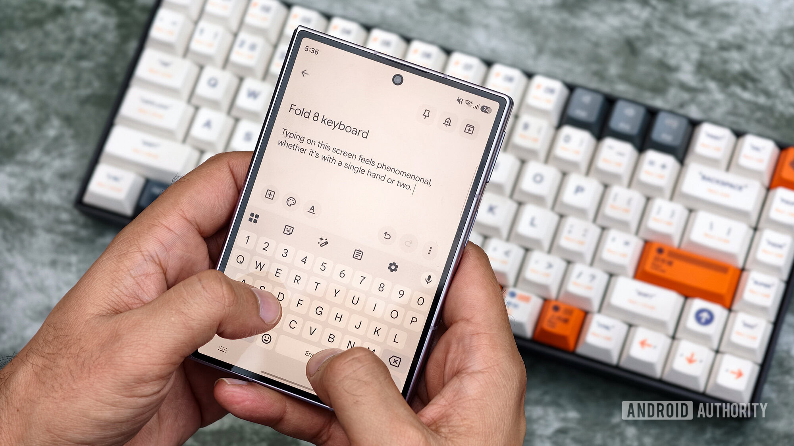
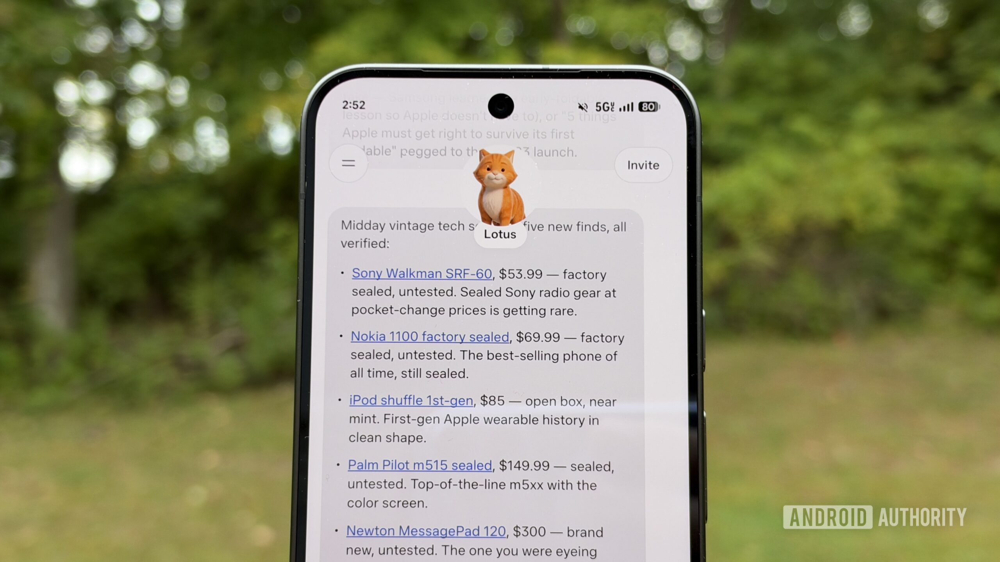



**收录说明**：依据 Android Authority 原站存档；页首的联盟链接声明、「Add Android Authority on Google」按钮、文中的读者投票和页尾的标签与评论区未收入。署名取自页面结构化数据（页面上的作者栏抽取时为空）。原文存于本目录的 original.md，网站上不显示，已翻译。

**内容摘要**：作者把 Instinct 接入 WhatsApp 和 Gmail，用了一个月：每天早上收到重要邮件摘要，让它处理拖延已久的杂事，做网页版互动婚礼请柬，比较保险报价，筛选单身派对的酒店和 Airbnb。作者觉得它不像传统 AI 工具，会用表情回应。担忧方面：断开 Gmail 并不会自动删除已存储的邮件和信息，要另行删除；测试中作者通过 Instinct 起草给一家公司公关的回复，还没确认最终文本，它就把邮件发了出去；此后作者要求它敏感操作前一律先问，它照做了，但作者不满的是必须自己提出这个要求。结论是已离不开它，但仍不完全放心它掌握的信息量。

**保留理由**：较长时间的个人使用记录，再次印证了越权发送和断开后数据保留两个问题，并记录了用户自行设定确认规则的做法。

---

Instinct AI 非常出色，但有几个重要的前提。

2026 年 10 月 17 日 — 美东时间上午 5:00

Sanuj Bhatia / Android Authority

在 AI 这件事上，我们已经到了一个相当有意思的节点。很长一段时间里，我使用 AI 工具主要是提问，或者写邮件、总结冗长的 PDF。但 AI 智能体（AI agent）正在开始改变这一点。

如果你不熟悉 AI 聊天机器人（chatbot）和 AI 智能体之间的区别，其实很简单。聊天机器人大多只给你答案，或者帮你弄清楚该怎么做；而 AI 智能体可以真正替你把那些事做掉。例如，你不必再让 AI 起草一封邮件，而是可以让智能体找到相关信息、写好邮件，并代表你把它发出去。

而这只是 AI 智能体能做的事情中的一个例子。过去一个月左右，我一直在用 Instinct——它是最近备受关注的 AI 智能体之一。我想，我从未对一款 AI 产品像对 Instinct 这样既兴奋又有点不安。

## 我终于理解了 AI 智能体的热度

Sanuj Bhatia / Android Authority

尽管我一向喜欢尝试新技术，但很长一段时间里我一直在回避 AI 智能体。并不是我不理解它们的用途，而是我的生活里已经有太多 AI，我开始有点厌倦了。但我最终还是妥协了，上个月注册了 Instinct，它为我打开了一个全新的世界，让我看到一些我原以为 AI 帮不上忙的事情。

使用 AI 智能体确实有它的好处。Instinct 最好的地方大概是，你可以直接通过自己已经在用的消息应用访问它。例如，我把 Instinct 接入了 WhatsApp——一个我几乎每天都会用的应用。所以每当需要帮忙时，我可以直接给 Instinct 发消息，就像请朋友或助理帮我处理一样。

过去一个月里，它帮我处理了不少本来会占用我时间的事，或者更准确地说，是那些我本来会一直拖着的事。例如，我让 Instinct 追踪机票价格，一旦降价就通知我。不仅如此，我还让它联系航空公司，追回此前航班遗漏的里程，并代表我联系客服。

「这类事情通常我得坐下来花时间自己做，但现在我可以直接交给 Instinct。」

而这还只是冰山一角。我甚至用 Instinct 帮忙做了我的婚礼请柬。我想要一个基于浏览器、可互动的婚礼请柬，而我联系过的供应商都做不出来，至少在我设想的预算内做不出来。但 Instinct 没费多少事就帮我做了一个。

同样，它还帮我从不同供应商那里获取了保险报价，为即将到来的单身派对筛选了酒店和 Airbnb，还有更多。我也让它处理过一些相当复杂的任务，它完成其中大多数的效果让我惊讶。

Sanuj Bhatia / Android Authority

我还把 Instinct 接入了我的 Gmail 账户，所以每天早上，它都会给我一份重要邮件和开始工作前需要处理的事项清单。这样，我在手动翻遍整个收件箱之前，就已经很清楚哪些事需要我关注。

但 Instinct 最有趣的地方也许是，它并不真的像是在和一个传统 AI 工具互动。它回复时会用表情符号，会对消息做出反应，甚至写东西的方式都出奇地像人。有几次我几乎忘了自己是在和一个 AI 智能体说话，而不是一个真人。当然，我知道那些消息背后是 AI，但这种体验比我习惯的其他 AI 工具自然得多。

## Instinct 让我不安的地方

Sanuj Bhatia / Android Authority

尽管 Instinct 很有用，但使用 AI 智能体仍有一些方面让我相当不安。你上面可能已经注意到的第一个方面，是我给了它访问我 Gmail 账户的权限。

对于一个重视隐私的人来说，这是件大事。我实质上允许一个 AI 智能体读取我的邮件、了解我收件箱里的情况，甚至在需要时帮我回复别人。

问题是，那些重要邮件本来就有很多我根本没来得及处理。我的婚礼即将到来，工作之外还有很多事情同时发生，我一直很难跟上所有事。Instinct 确实帮我补上了这个缺口，让我可以直接通过 WhatsApp 处理邮件，而不必不断打开 Gmail。

但便利是有代价的。Instinct 现在可以访问我一些最私人的信息，而一旦出了问题会怎样，这种担忧始终存在。

Joe Maring / Android Authority

更让我担心的是，从 Instinct 断开 Gmail 账户并不会自动删除这个 AI 智能体已经存储的邮件和其他信息。根据[多篇报道](https://x.com/clairevo/status/2090929592853037078)，你需要通过它的仪表板手动请求删除这些数据。这一点让我不太舒服。

测试期间还有一次事件，让我意识到在授予 AI 智能体代表你执行任务的权限时，你需要多么小心。我当时通过 Instinct 起草一封给某公司公关代表的邮件回复。我还在琢磨该怎么说，但在我明确批准最终文本之前，Instinct 就径直把邮件发了出去。

幸运的是，这次没有发生什么特别糟糕的事。但它让我意识到，这类事情多么容易出问题。理想情况下，AI 智能体在做敏感操作之前应该请求确认，尤其是涉及发送邮件、分享个人信息，或者采取你难以撤销的行动时。

此后我已经指示 Instinct，在执行这类任务前必须始终征得我的许可，它在之后的使用中也遵守了这一指示。但让我不安的，是我一开始就必须明确提出这个要求。

而且这不只是 Instinct 特有的问题。我们已经看到有报道称，AI 智能体采取了用户并不想要的操作。最近[一起涉及 Meta 的 Muse AI 智能体的事件](https://www.androidauthority.com/meta-muse-ai-privacy-issues-3715963/)据称是，它在 Facebook Marketplace 上与买家议价，并在卖家意识到发生什么之前泄露了卖家的家庭住址。

## 我上瘾了，而这正是我担心的地方

Tushar Mehta / Android Authority

这就是为什么我对 Instinct 的处境有点奇怪。一方面，它已经变得如此有用，我几乎把它变成了日常工作流程的一部分。每天早上，我开始工作前都会收到一份 Gmail 摘要；一天之中，Instinct 会标记重要邮件，并询问某事是否需要我关注。

我也开始在很多更小的任务上依赖它，那些事本来会被我拖延或者干脆忘掉。但另一方面，还有整个隐私和数据访问的问题。我对自己给了它多少信息，以及它有可能代表我采取行动这件事，仍然不完全放心。

「我已经太习惯有 Instinct 在身边，实在不太想放弃它。至少现在不想。」

而这正是这件事棘手的地方。我能理解为什么人们会为 AI 智能体如此兴奋。我明白这些工具能节省多少时间。但我也亲身经历了，为什么让 AI 访问你的个人信息和账户不是可以轻率对待的事。

## 那么，你应该开始使用 AI 智能体吗？

Stephen Radochia / Android Authority

回到更大的问题——你到底该不该使用 AI 智能体，我认为答案比简单的「是」或「否」要复杂一些。

我从没想过自己会依赖 AI 智能体来处理日常任务，但 Instinct 确实改变了我的想法。在我甚至没有意识到需要帮助的场景里，它被证明很有用。但与此同时，也有一些时刻，它能访问的数据量以及它能代表我做的事，确实让我望而却步。

最终，我认为判断 AI 智能体是否适合你的唯一方法，就是自己试一个，最好别立刻给它访问你所有个人账户的权限。从几项基本任务开始，看看它是否真的为你节省了时间。更重要的是，考虑你是否对它需要的权限和你分享给它的信息感到自在。

然后，如果便利对你来说超过了那些担忧，我完全可以理解你为什么想继续用一个。但如果你不放心让 AI 智能体访问你的邮件、消息或其他个人信息，我不认为你现在错过了什么绝对必需的东西。

如果你想知道该试哪个 AI 智能体，可选的有不少。Meta 最近推出了 Muse，ChatGPT 也刚刚上线了[自己的智能体](https://www.androidauthority.com/openai-dots-chatgpt-always-on-ai-agents-3717020/)，[名为 Dots](https://www.androidauthority.com/openai-dots-chatgpt-always-on-ai-agents-3717020/)。你也可以试试 Instinct，它可以通过 WhatsApp、iMessage 以及自己的应用使用。Instinct 目前采用邀请制，不过你可以[用我的邀请链接注册](https://app.instinct.com/invite?t=sanuj-share-2026&preview=imessage)。
