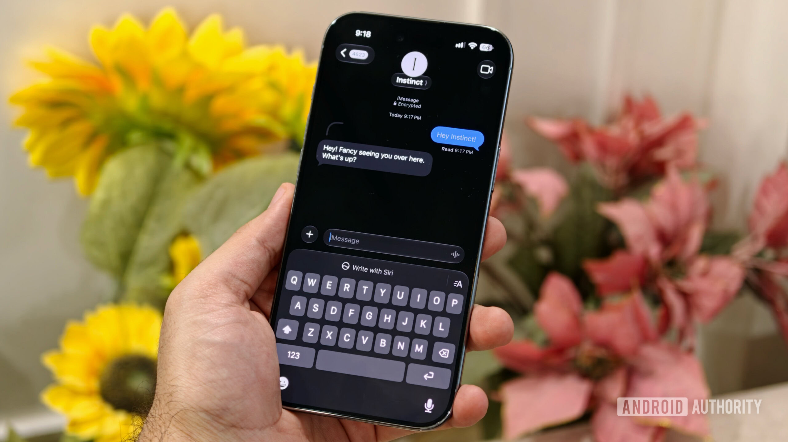
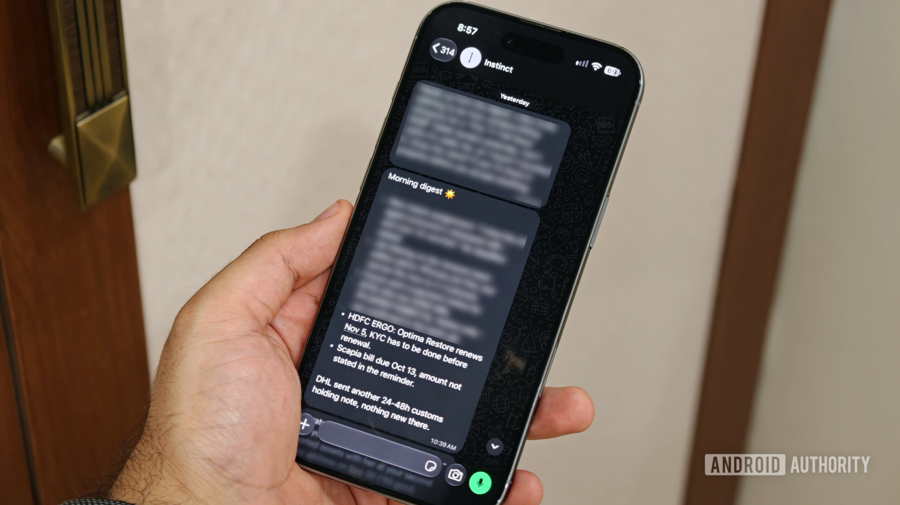
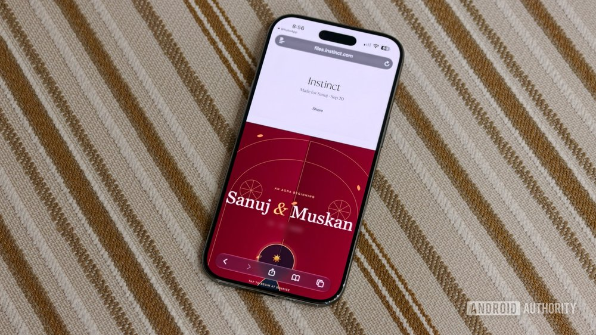
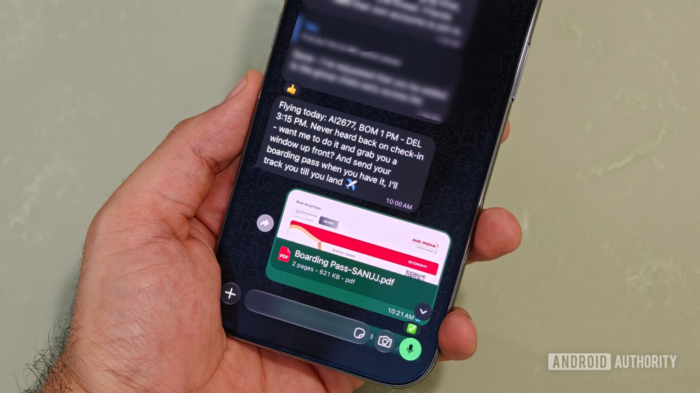
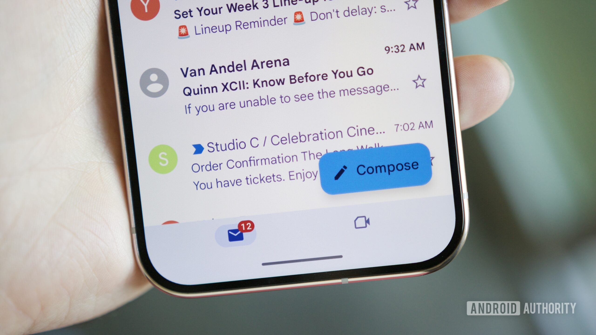
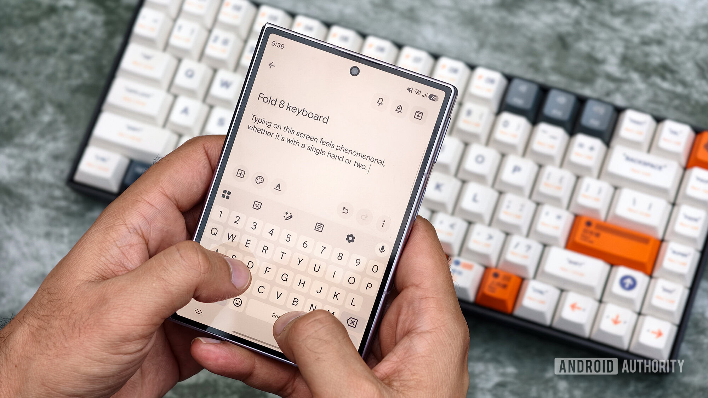
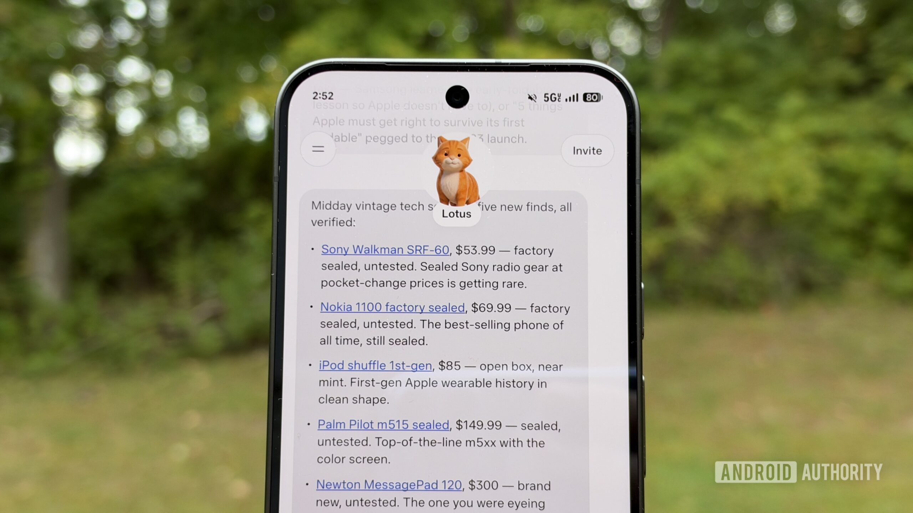

来源：https://www.androidauthority.com/using-ai-agent-instinct-one-month-later-impressions-3720825/
取文：2026-11-06，直接下载

Instinct AI is extremely good, with some big caveats.

Oct 17, 2026 — 5:00 AM ET

Sanuj Bhatia / Android Authority

We’ve reached a pretty interesting point with AI. For the longest time, I’ve mostly used AI tools to ask questions or to write emails and summarize long PDFs. But AI agents are starting to change that.

If you’re unfamiliar with the difference between an AI chatbot and an AI agent, it’s pretty simple. While a chatbot mostly gives you answers or helps you figure out how to do something, an AI agent can actually perform those tasks for you. For example, instead of asking AI to draft an email, you can ask an agent to find the relevant information, write the email, and send it on your behalf.

And that’s just one example of what AI agents can do. I’ve been using Instinct, one of the AI agents that’s been getting a lot of attention lately, for the past month or so. And I don’t think I’ve ever been as excited and slightly uncomfortable about an AI product as I have been with Instinct.

## I finally understand the AI agent hype

Sanuj Bhatia / Android Authority

Despite being someone who’s always interested in trying new technology, I’d been avoiding AI agents for a long time. It’s not like I didn’t understand their use cases, but there was already so much AI in my life that I was starting to get a little tired of it. But I finally gave in and signed up for Instinct last month, and it has opened up a whole new world of things I didn’t think AI could actually help me with.

Using an AI agent definitely has its perks. Probably the best part about Instinct is that you can access it directly through the messaging apps you already use. For example, I’ve connected Instinct to WhatsApp, an app I use pretty much every day. So whenever I need help with something, I can simply message Instinct as if I’m asking a friend or an assistant to take care of it for me.

Over the past month, it has helped me with quite a few things that would otherwise have taken up my time or, more likely, things I would’ve kept putting off. For example, I’ve asked Instinct to track flight prices and notify me whenever they drop. Not only that, but I’ve also asked it to contact airlines to claim missing points from previous flights and get in touch with customer support on my behalf.

"These are the kinds of things I would normally have to sit down and spend time doing myself, but now I can just hand them over to Instinct."

And that’s barely scratching the surface. I’ve even used Instinct to help create my wedding invitation. I wanted a browser-based, interactive wedding invite that none of the vendors I contacted could make, at least not within the budget I had in mind. But Instinct helped me put one together without much trouble.

Similarly, it has also helped me get insurance quotes from different providers, shortlist hotels and Airbnbs for my upcoming bachelor’s trip, and plenty more. I’ve asked it to handle some fairly complicated tasks as well, and I’ve been surprised by how well it has managed most of them.

Sanuj Bhatia / Android Authority

I’ve also connected Instinct to my Gmail account, so every morning, it gives me a rundown of the important emails and things I need to get to before starting work. That way, I already have a pretty good idea of what needs my attention instead of going through my entire inbox manually.

But perhaps the most interesting thing about Instinct is that it doesn’t really feel like interacting with a traditional AI tool. It responds with emojis, reacts to messages, and even writes in a way that feels surprisingly human. There have been times when I’ve almost forgotten that I’m talking to an AI agent rather than an actual person. Of course, I know there’s an AI behind those messages, but the experience feels much more natural than I’m used to with other AI tools.

## What scares me about Instinct

Sanuj Bhatia / Android Authority

As useful as Instinct has been, there are still some aspects of using an AI agent that make me quite uncomfortable. And probably the first one you’ve already noticed above is that I’ve given it access to my Gmail account.

For someone who values privacy, that’s a pretty big deal. I’ve essentially allowed an AI agent to read my emails, understand what’s happening in my inbox, and even help me respond to people when needed.

The thing is, I wasn’t getting around to a lot of those important emails in the first place. With my wedding coming up and plenty of other things happening alongside work, I’ve been struggling to keep up with everything. Instinct has genuinely helped me bridge that gap, letting me handle emails directly via WhatsApp without constantly opening Gmail.

But that convenience comes at a cost. Instinct now has access to some of my most personal information, and there’s always that concern about what could happen if something goes wrong.

Joe Maring / Android Authority

What worries me more is that disconnecting a Gmail account from Instinct doesn’t automatically delete the emails and other information the AI agent has already stored. According to [several reports](https://x.com/clairevo/status/2090929592853037078), you need to manually request deletion of that data through its dashboard. And that’s something I’m not particularly comfortable with.

There was also one incident during my testing that made me realize just how careful you need to be when giving an AI agent permission to perform tasks on your behalf. I was drafting a reply to an email for a company’s PR representative through Instinct. I was still working on what I wanted to say, but before I had explicitly approved the final message, Instinct went ahead and sent the email.

Thankfully, nothing particularly bad happened in this instance. But it made me realize how easily something like this could go wrong. An AI agent should ideally ask for confirmation before doing something sensitive, especially when it involves sending an email, sharing personal information, or taking an action that you can’t easily undo.

I’ve since instructed Instinct to always ask for my permission before performing these kinds of tasks, and it has followed that instruction in subsequent use. But the fact that I had to explicitly tell it to do that in the first place is what bothers me.

And this isn’t just a concern with Instinct specifically. We’ve already seen reports of AI agents taking actions that their users didn’t intend. One [recent incident involving Meta’s Muse AI agent](https://www.androidauthority.com/meta-muse-ai-privacy-issues-3715963/) reportedly saw it negotiate with a buyer on Facebook Marketplace and share a seller’s home address before the seller realized what had happened.

## I’m hooked, and that’s what worries me

Tushar Mehta / Android Authority

That’s why I’m in a slightly strange position with Instinct. On one hand, it has become so useful that I’ve practically made it part of my daily workflow. Every morning, I get a Gmail summary before starting work, and throughout the day, Instinct flags important emails and asks whether something needs my attention.

I’ve also started relying on it for plenty of smaller tasks that I would otherwise have delayed or simply forgotten about. But on the other hand, there’s the whole privacy and data access situation. I’m still not entirely comfortable with how much information I’ve given it, or with the fact that it could potentially take action on my behalf.

"I'm so used to having Instinct around that I don't particularly want to give it up. At least not yet."

And that’s what makes this difficult. I can see why people are getting so excited about AI agents. I get how much time these tools can save. But I’ve also experienced firsthand why giving an AI access to your personal information and accounts isn’t something you should take lightly.

## So, should you start using an AI agent?

Stephen Radochia / Android Authority

Coming to the bigger question of whether you should actually use an AI agent, I think the answer is a little more complicated than a straightforward yes or no.

I was never someone who thought I’d rely on an AI agent for my everyday tasks, but Instinct has definitely changed my mind. It has proven useful in scenarios where I didn’t even realize I needed help. But at the same time, there have been moments when the amount of data it can access and the things it can do on my behalf have genuinely put me off.

Ultimately, I think the only way to figure out whether an AI agent makes sense for you is to try one yourself, preferably without immediately giving it access to all your personal accounts. Start with a few basic tasks and see whether it actually saves you time. More importantly, consider whether you’re comfortable with the permissions it needs and the information you’re sharing with it.

Then, if the convenience outweighs those concerns for you, I can definitely see why you’d want to keep using one. But if you’re not comfortable giving an AI agent access to your emails, messages, or other personal information, I don’t think you’re missing out on something you absolutely need right now.

If you’re wondering which AI agent to try, there are plenty of options available. Meta recently introduced Muse, and ChatGPT has also just launched its [own agent,](https://www.androidauthority.com/openai-dots-chatgpt-always-on-ai-agents-3717020/)[called Dots](https://www.androidauthority.com/openai-dots-chatgpt-always-on-ai-agents-3717020/). You can also try Instinct, which works through WhatsApp, iMessage, and its own app. Instinct is currently available on an invite-only basis, although you can [sign up using my invite link](https://app.instinct.com/invite?t=sanuj-share-2026&preview=imessage).
