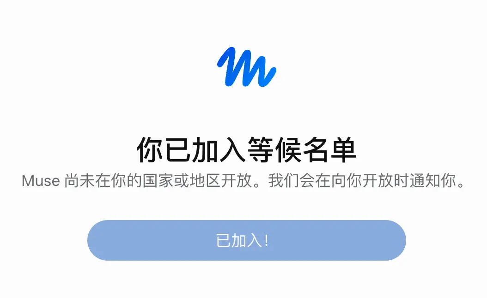
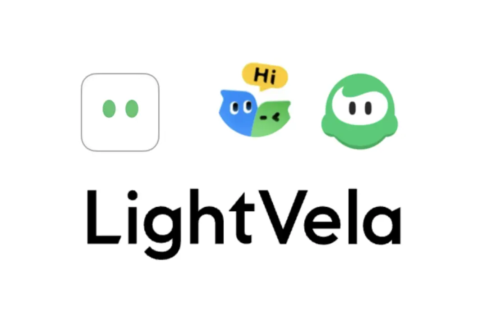
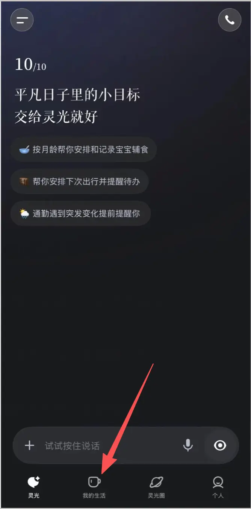
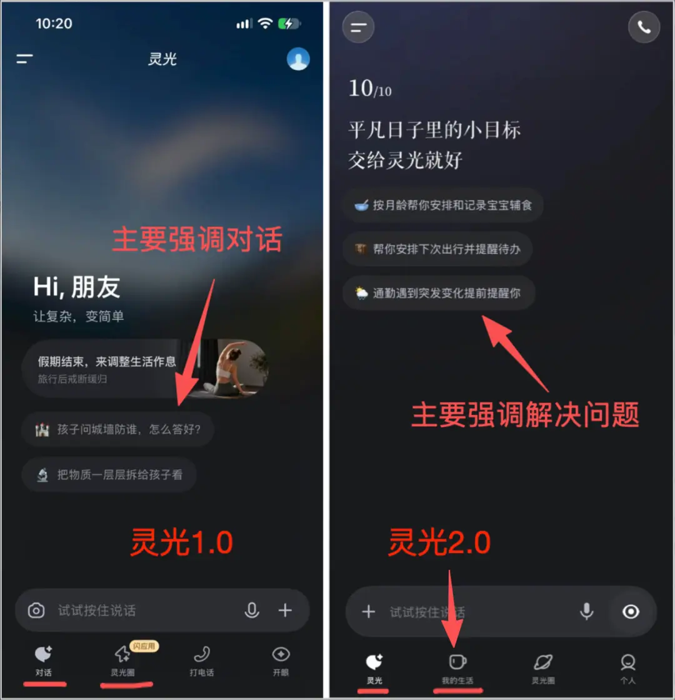
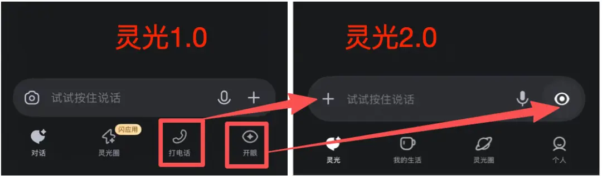
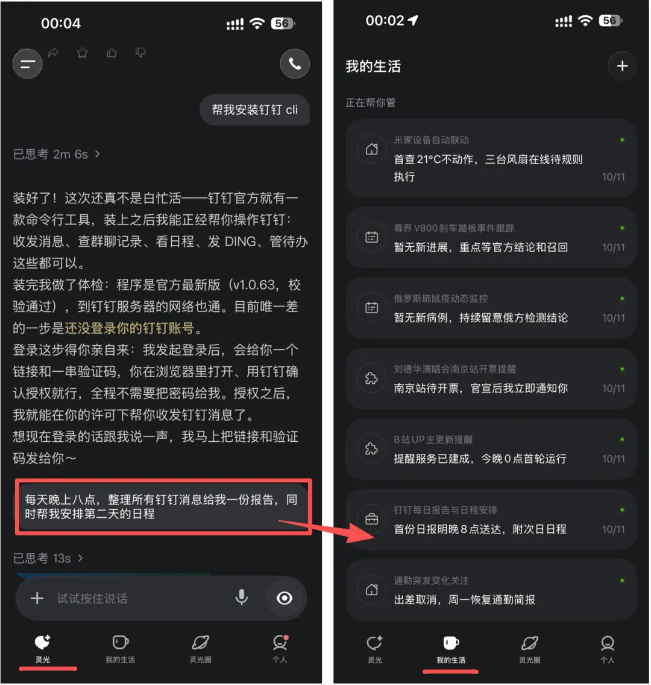
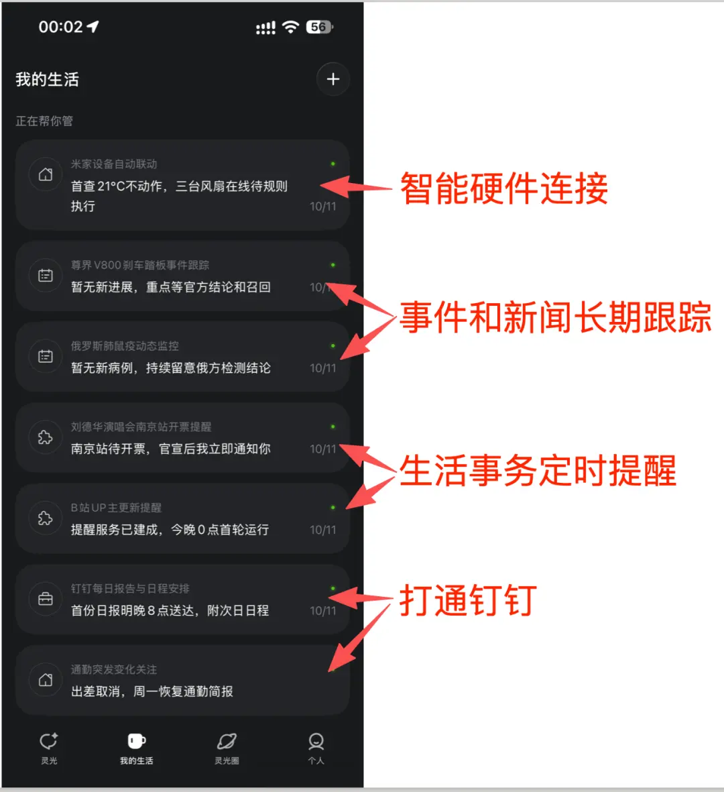
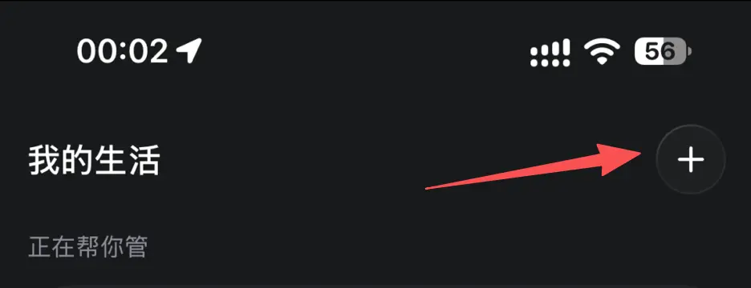
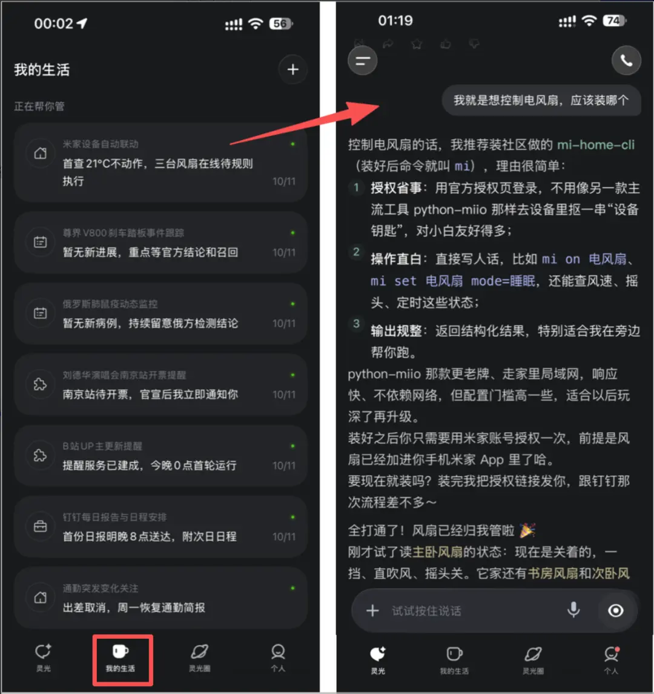



**收录说明**：作者「三哥」（微信公众号「产品笔记」）在人人都是产品经理发表，文末的平台版权声明与题图说明未收入。文中「我的生活」的测评示例，作者注明来自博主小互AI，不是作者本人的操作。

**内容摘要**：文章先列出国内 Personal Agent 的状况（Cue 面向海外、腾讯 LightVela 是云端 Hermes Agent、字节小豆在内测、Today 是创业产品），称灵光 2.0 是国内大厂第一个内测并邀请部分用户公测的 Personal Agent，而且是重构原有灵光 App 而非新产品。对比 1.0，2.0 有六处界面调整：首页 tab「对话」改为「灵光」，引导问题从回答型变为生活目标型，Slogan 从「让复杂，变简单」改为「平凡日子里的小目标，交个灵光就好」，新增「我的生活」tab，灵光圈后移且不再标闪应用，去掉打电话和开眼 tab、增加个人中心。「我的生活」里每个事项生成一张事务卡片长期跟进，连接应用、安装 CLI、MCP、Skill 都通过对话完成。

**保留理由**：逐项记录了 1.0 到 2.0 的界面与定位变化，是产品形态演变的时间线证据；当时同类国内产品的状况也可供参考。

---

> Meta 的 Muse、xAI 的 Grok Bot、OpenAI 的 Dots 把 Personal Agent 战场推到海外，但申请门槛高、主要连接海外邮箱与支付。灵光 2.0 把生活事务做成卡片并接入智能家居，成为国内第一个大厂级 Personal Agent。

**国外的 Personal AI Agent 打得火热。**

Meta 的 Muse，一骑绝尘。

xAI 的 Grok Bot，OpenAI 的 Dots，创业公司的 Instinct ，你来我回。

这些产品，体验起来费劲，申请、开通、使用。

都要配置好网络，还不一定申请得上。

就算折腾半天，申请上了，也是主要连接海外邮箱、电商、IM、健康、支付等服务。

国内的微信、飞书、购物、支付、生活服务等，都接不上。

用起来体感太差，解决不了正式问题。

**而国内的 Personal AI Agent，属于聊得火热。**

真正成型的、公测的产品还很少。

Manus 的 Cue ，虽然提供中文版本，主要针对海外用户。

图形化 Personal Agent 产品 Eazo，虽也有中文版，重心也是海外用户，并且以 App 为中心的 Personal Agent，属于另一个细分方向。

腾讯 LightVela，是一个云端 Hermes Agent，严格来说不属于原生的Personal Agent 。

豆包Muse小豆，只存在于媒体的稿子里，还在内测中。

国内真正意义上的 Personal Agent产品，是 Today，属于创业公司创业团队的产品。

**现在，蚂蚁集团的 Personal Agent 产品来了。**

**这属于国内大厂第一个内测并邀请部分用户公测的 Personal Agent 产品形态。**

但这次，蚂蚁集团的 Personal Agent 不是一个新产品。

**而是把灵光 APP 重构了，做了 2.0 版本大升级，直接升级成了 Personal Agent。**

**自己把生活板块，放到了一级入口。**

## 1、1.0 和 2.0 对比

对比下，你就知道，这是首页效果。

**灵光 1.0 大版本，定位于全模态通用AI助手，类似豆包、元宝等。**

主要强调灵光的对话能力，应用生成能力，开眼的图像识别翻译能力等。

**灵光 2.0 大版本，开始定位于个人 AI 助手，类似 Muse。**

这个定位，我们从进入灵光2.0 首页，和 tab 上，就能看得出来。

相比 1.0，2.0 有这个几个大调整：

**1）将首页 tab 的文案「对话」，改成了「灵光」**

不想让用户觉得，灵光只能对话，在弱化对话能力。

**2）首页 tab 的引导问题，从回答型，变成了生活目标型**

也就是，你只要说出问题和目标，灵光来帮你解决。

它要做你的生活助手，直接解决你的问题，直达你的目标。

**3）产品 Slogan 变化**

以前是，让复杂，变简单。

现在是，平凡日子里的小目标，交个灵光就好。

这也体现了定位的变化。

**4）增加了「我的生活」 tab**

这是这次灵光 2.0 升级的重头戏。

直接将 Personal Agent 的能力，通过 一个 tab 放了出来。

就是要解决你生活问题，做你的生活AI 助手。

**5）灵光圈保留，后移到第 3 个 tab，不再有「闪应用」的提示标签**

还是能在灵光圈中玩应用，和创建应用，但是权重降低了。

**6）去掉了打电话tab、开眼 tab，增加「个人」中心。**

打电话，其实是和 AI 语音实时聊天，收到了灵光 tab 输入框的更多里。

开眼tab，放入了灵光 tab 的输入框后面，

**这升级，直接奔着 Personal Agent 应用去了。**

## 2、「我的生活」的能力

你可以在对话框中，输入想要灵光帮你做的事。

（以下的测评示例，来源于博主小互AI，表示感谢）

**每一个事项，都会在「我的生活」生成一个事务卡片，或者叫轻应用。**

这个任务，会长期跟进你安排的事务。

灵光不像国外的 Personal Agent 产品，有复杂的配置。

它还是通过对话框，通过沟通的方式，帮你解决问题。

如果要连接应用，安装 cli、mcp、skil 等，你对话框中告诉它。

它去执行，你只需要按照提示，做相应的配置。

**在我的生活 tab 的任务清单中，可以看到，它可以帮你管多种事情。**

可以帮你连接家里的硬件，操控智能家居。

可以跟进你感兴趣的事情，长期跟踪。

可以提醒你开票抢票，可以提醒你播主更新。

关键是，打通了钉钉服务，可帮你汇总报告和安排日程。

通过顶部的连接+入口，可建执行更多的个人任务。

我的生活下，已生成的生活事务，都可以点击进去，进一步和它沟通。

Personal Agent 核心是三个特征是：

1. 知道你是谁，这是身份。
2. 记得你做过什么，这是长期记忆。
3. 能主动行动，替你去行动，这是云端不间断、自主规划、跨工具执行。

**这些能力，目前灵光都具备，但它不是以显性的方式呈出来。**

而是在任务执行过程中体现。

因为对于普通用户来说，他不会关心你这些特征，只关心是不是帮我完成了任务。

从这个点来说。

**灵光是把简单留给用户，复杂的脏活累活留到后台。**

有必要时，才让你前端操作。

## 3 这次蚂蚁快人一步

**现在国内 Personal Agent 产品。**

**还处于早期阶段。**

真正严格意义上的 Muse 产品，除了 Today，找不到其他。

**但是大厂都在发力。**

字节的小豆，目前正在内测中。

腾讯的元宝助手，正在研发中。

微信小微，最具潜力，还没有这方面的动作。

蚂蚁灵光 2.0，虽然也还在内测，但是从内测放出的截图和邀测用户的测评中。

可以看到，它不同字节和腾讯的选择新起一个产品。

**而是选择了一条更加直接和高效的路子。**

**直接在现有产品上动大刀，直接把已有的灵光通用 AI 助手 ，升级为个人 AI 助手。**

这得益于灵光内部，早已在为 Personal Agent 调整做准备。

这时间，可追溯至今年 4 、5 月份，并不是 Muse 火起来后，才临时起意。

这次大厂 Personal Agent 产品之争。

蚂蚁走到了前面。

**但是能否获得先发优势。**

**还是要看是否能安全、有效的满足用户生活中需求，解决中零散、费时费劲的问题。**

**做到让用户省心。**

就像现在 AI 办公 Agent 一样，很多人已经离不开了。
