

**收录说明**：用户提供链接。原文在微信公众号，用浏览器的客户端标识直接下载页面，从 `#js_content` 抽取正文，图片地址取自 `data-src`。文末点赞关注引导与署名行未收入。

**内容摘要**：作者实测灵光 2.0（定位「能管事的个人AI助理」）。连接支付宝后，作者让灵光按月份和消费类别整理最近 3 个月的消费记录并生成占比图，再设置每天晚上 9 点半告诉自己当天开销，当天累计超过 50 元即提醒，房租等大额支出每月总结一次。点外卖时灵光给出「17元的最稳妥，28.8元的能吃得更饱」的建议，并记得此前设置的预算。作者提到退出 App 后任务仍会执行，因为每个用户有专属的云端运行环境；让灵光领取积分的结果「有点尴尬」。

**保留理由**：记录了连接支付宝后的账单整理、每日开销提醒、外卖预算记忆等具体任务及结果，包括一次未成功的操作。

---

这段时间，Personal Agent实在是太火了。

Meta的Muse，xAI的Grok Bot，OpenAI的dots。。。

但很尴尬的是，这些产品虽然一个比一个牛逼，但终究还是海外的，主要围绕海外用户的使用习惯和服务生态展开。

所以我一直挺好奇，什么时候国内才能出现一个真正接地气，用起来还不烧心的Personal Agent？

上周，灵光2.0就来了。

这是去年灵光这个产品上线以来，时隔一年的大版本升级，定位是能管事的个人AI助理。

上手折腾了几天后，我发现这玩意儿真有点东西～

在这先简单聊聊，Personal Agent和我们之前接触过的那些AI Agent，到底有什么不同？

现在的Agent已经很能干了，能够按照指令执行任务、调用工具、定时提醒等等。

**但Personal Agent想做的，是把这些能力真正用到一个人的长期生活里。**

记住你之前交代过什么，知道事情进行到了哪一步，还能结合你的习惯和需求持续跟进。碰上什么变化，也能主动发现、及时提醒，必要时帮你重新调整安排。

而灵光这次的升级，就有点Personal Agent的意思了。

能够让你省心、放心、用起来不烧心。

连接应用

下载安装后，打开App，界面长这样：

首页除了对话框，还会推荐一些可以直接交给灵光管理的日常任务，比如工作日午餐、作息调整、读书计划等等。

我比较感兴趣的，是右上角的这个小玩意：

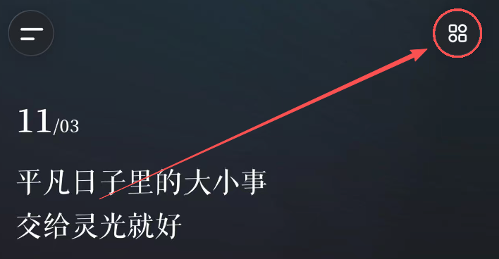

点进去后，可以看到是连接服务，并且还挺丰富，分成了应用服务和系统服务两类。

应用服务里，有支付宝、QQ邮箱、钉钉、飞书、百度网盘等等我们平时常用的App。

系统服务这边，则是包括了日历、提醒事项、闹钟和健康等等手机自带的功能。

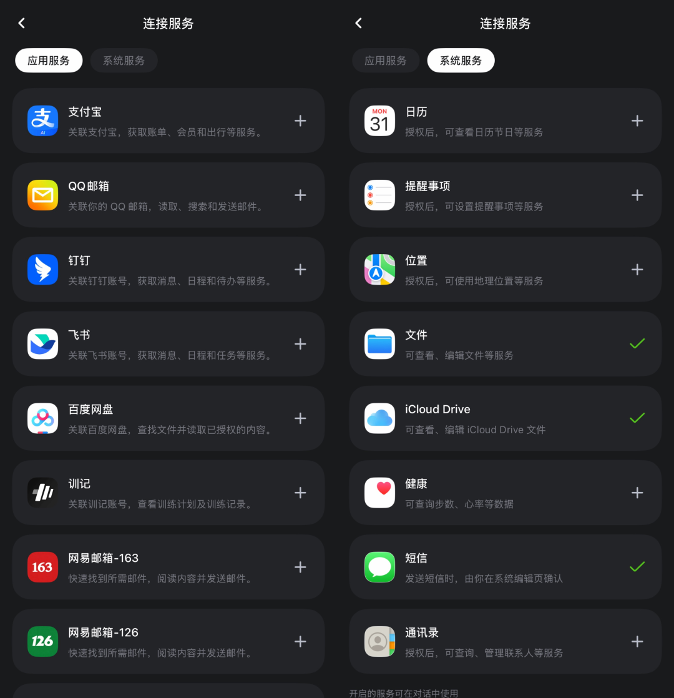

我决定先尝试一下支付宝。

点击右边的加号。

再点击授权，就OK了。

个人财物助手

连接之后，我顺口问了一嘴，能干的事情还不少。

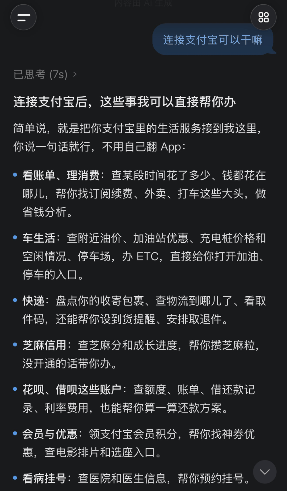

这段时间也正好在北京实习，租房、吃饭、通勤，哪哪都要花钱。

每天感觉自己也没买什么，月底一看账单，钱却没少花...

所以我决定先让灵光帮我捋捋，我的钱到底到底都去哪了？？？

Prompt：帮我查看最近3个月的支付宝消费记录，按月份和消费类别整理，看看我每个月花了多少钱，哪些地方支出最多，有没有一些不必要的消费。最近我在实习，需要租房、吃饭和通勤，这些必要开销要单独考虑。最后帮我做一份省钱建议，最好能具体到每个月可以节省多少。

你别说，灵光还真给我分析得挺细。

除了把各类消费整理出来，还生成了一张消费占比图，一眼就能看出钱主要花在了哪里。

尤其是房租，在整个消费占比相当的高...

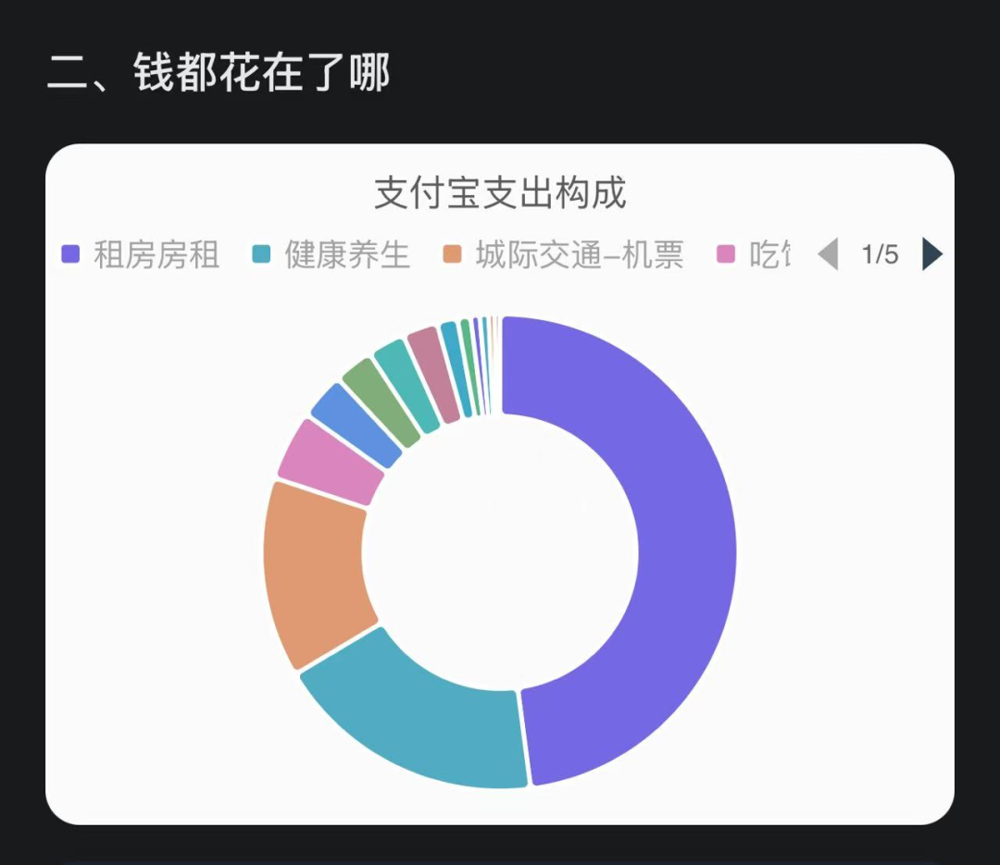

它还根据具体的消费记录，帮我算了算哪些地方有省钱空间。

比如打车和外卖。

还有其他一些涉及隐私的部分我就不一一列出来啦～

反正这么一通分析下来，确实有一些自己可以稍微省省的地方。

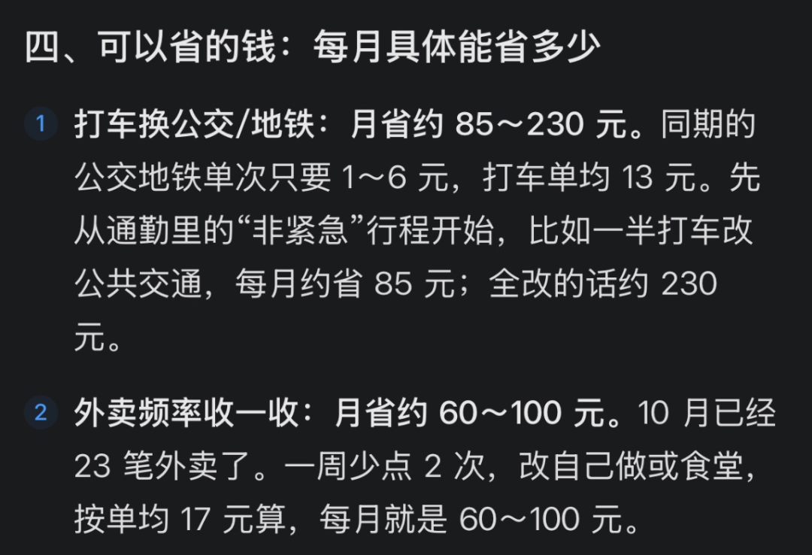

长线任务

不过，分析归分析，知道归知道，但真到了花钱的时候，还是很容易忘得一干二净...

所以我又让灵光再帮我安排一个长线任务。

让它按照这次分析出来的问题，每天九点半主动帮我复盘开销，看看钱都花在了哪里。

平时吃饭、通勤这些日常消费，只要当天累计超过50元，就及时提醒我一下。

至于房租、还款这些固定或特殊支出，就单独统计，每个月再统一给我做一次总结。

Prompt：结合刚才的分析，以后帮我盯着点日常开销，每天晚上9点半告诉我今天花了多少钱、钱都花在哪了。平时吃饭、交通这种日常消费如果加起来超过50块，就及时提醒我一下。房租、还款这些大额支出单独算，每个月再帮我总结一次就行。

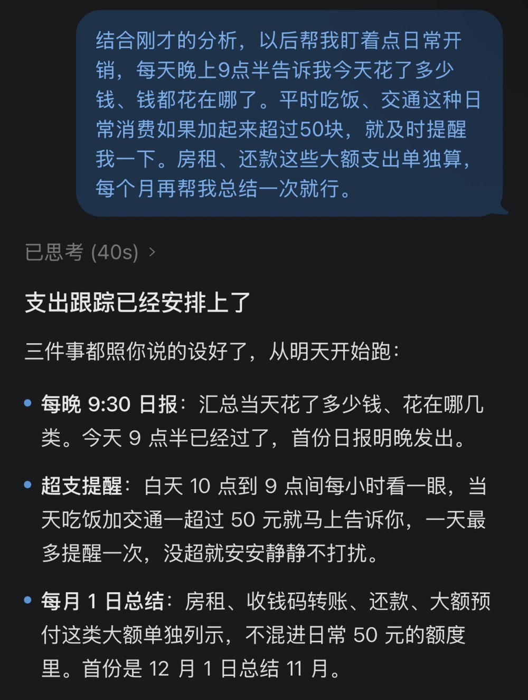

到点了，也确实能够提醒我。

顺便点个夜宵吧

写到晚上，有点饿了，想点份夜宵，就顺手问了灵光一句：帮我看看附近有什么好吃的外卖？

回答之余，他居然还真记得我之前设置的消费预算！

甚至还贴心地告诉我，17元的最稳妥，28.8元的能吃得更饱，但已经比较接近预算上限了。

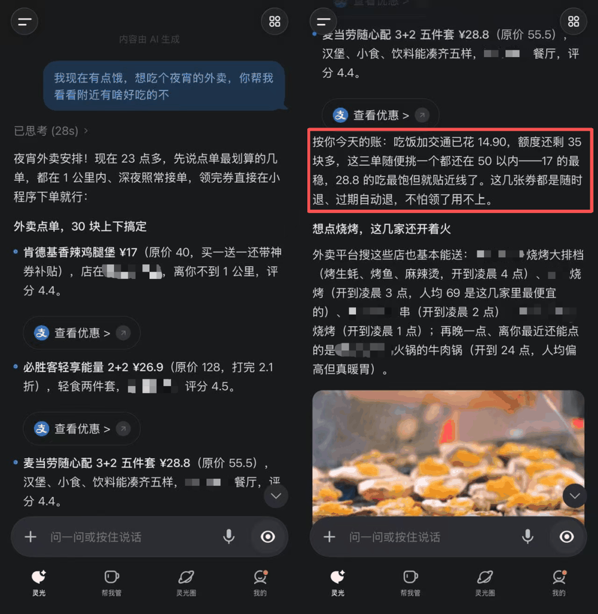

而且，前面交给他的任务，即使退出App，它也能继续执行。

因为他背后有一套独立云主机机制。

每个用户都有一个专属的云端运行环境，负责持续跟进任务，到了设定的时间再主动提醒你。

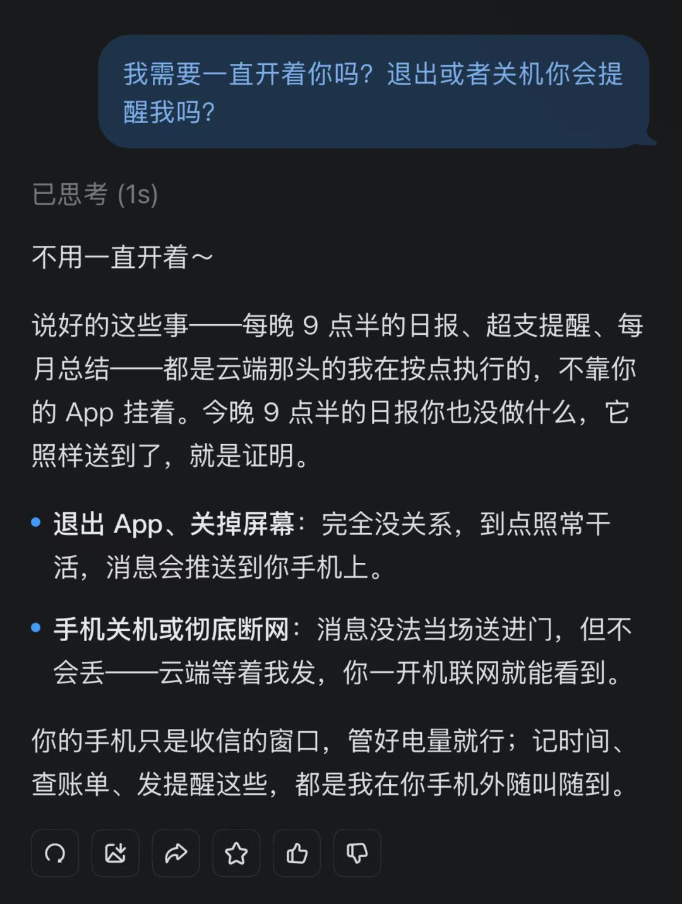

不过，省钱这事，光靠少花还不够。

能薅的羊毛也不能放过！

我还问了问他有什么羊毛可以薅。

发现有些积分可以领。

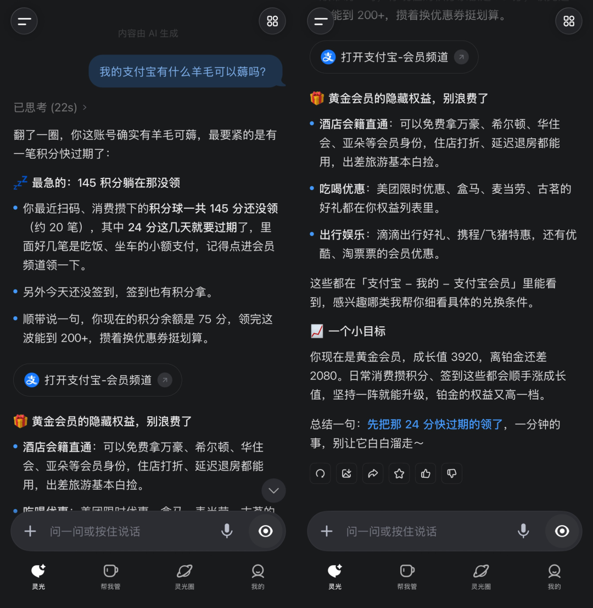

本来想着干脆让它顺手帮我领了算了。

结果有点尴尬...

这点确实有些鸡肋。

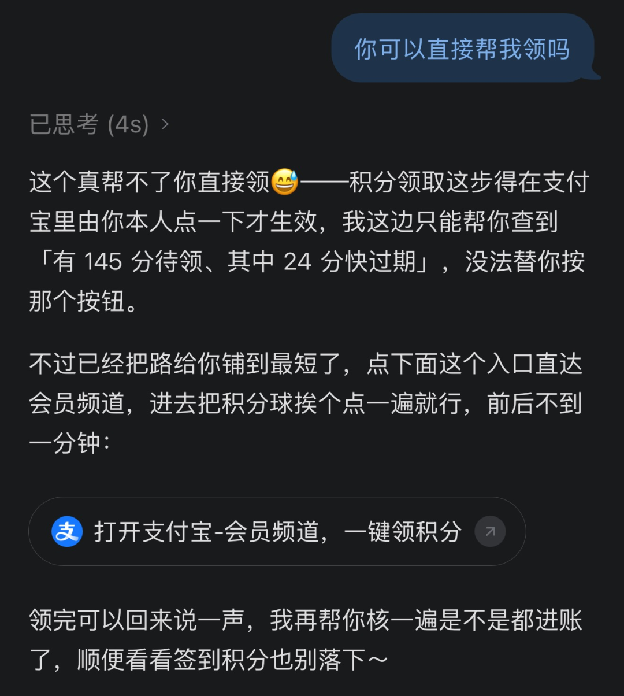

只能说，灵光目前在帮你盯着、替你操心这方面已经有点意思了。

但真要把事情办完，还是受限于各个平台的操作权限，这一点确实没得办法～

当然，灵光2.0能做的事情，远远不止省钱。

比如最近很火的大水大觉薄肌理论。

喝大水、睡大觉、练薄肌～

像我这种白天实习、晚上还经常瞎忙其他事情的人，作息就挺不规律的，有时候忙起来连喝水都忘了。

这就可以让灵光来帮我。

告诉它自己的作息、训练目标，再连接手机日历、提醒事项，就可以让它帮忙安排训练和补水提醒。

Prompt：最近想试试大水大觉薄肌计划，但我白天要实习，晚上有时候还得加班，作息不太规律。你帮我结合手机日历安排一下每天的喝水、睡觉和健身时间吧，喝水量按我的身体情况合理设置，每周练3次就行。平时主动提醒我，如果哪天加班或者临时有事，也记得帮我调整后面的计划，别让我三天打鱼两天晒网。

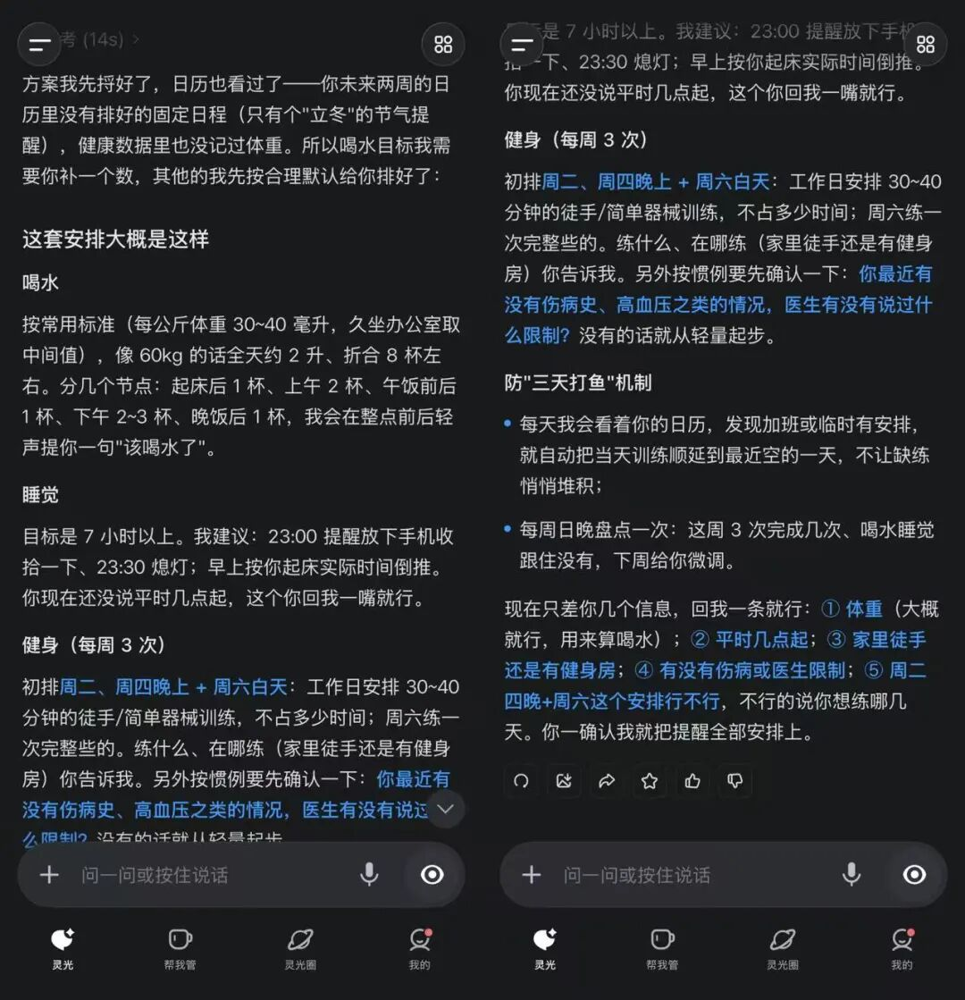

甚至哪天临时加班、没时间锻炼了，也可以让它结合新的日程调整后面的计划。

写在最后

写到这里，我突然想起，去年灵光1.0刚发布的时候，我也写过一篇实测。

当时，我用它做了一个记账应用。

结果到了今年，曾经自己搓出来的记账App，好像都快用不上了……

这也让我对灵光的发展有了一个挺直观的感受。

总的来说，我觉得，Personal Agent很有可能真的会改变我们以后使用互联网的方式。

过去我们习惯了有什么需求，就打开对应的App，自己找功能、查信息、做决定。

可如果以后这些事情都能直接交代给AI，很多App可能就没必要天天亲自打开了。

但我觉得，Personal Agent真正要解决的，还有一个挺重要的问题：信任。

尤其是在国内这么复杂的App生态里，谁能把服务连接、执行能力和权限安全这些问题处理好，谁才更有机会让普通人真正用起来。

说到底，只有把规矩立住了，用起来才能不烧心。

灵光2.0至少已经朝这个方向迈出了一步。

至于未来的Personal Agent究竟能发展到什么程度，我还挺期待的。

好了，今天的分享就到这里，在此感谢你的浏览。
