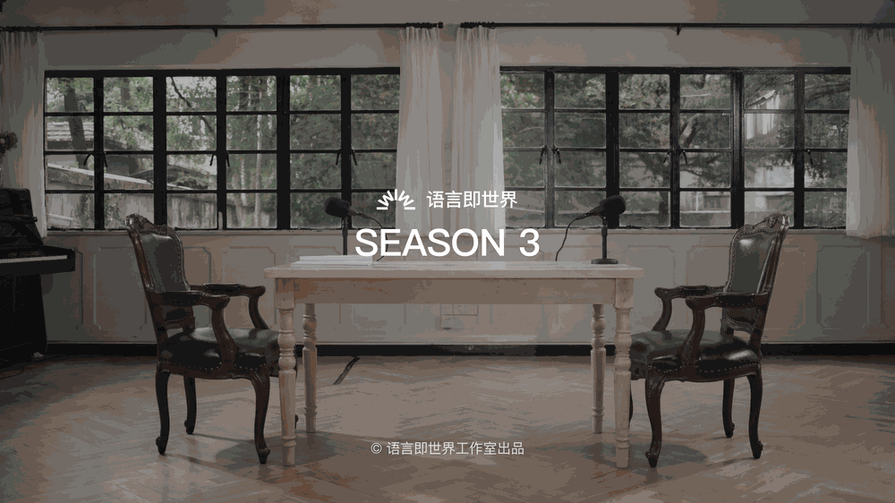



**收录说明**：张小珺主持的访谈播客。按 tracking.md 的「音视频资料」规则，只收小宇宙节目页上的文字：从页面内嵌数据（`__NEXT_DATA__` 的 `shownotes`）转换为 Markdown，收导语、封面与时间轴；文末的收听平台链接、工作室公众号、免责声明与联系邮箱未收。完整访谈没有公开文字稿。

**内容摘要**：本期嘉宾是蚂蚁灵光负责人蔡伟，话题是 Personal Agent。导语称 Muse 之后，Grok Bot、Instinct、OpenAI Dots、Town、Today、Cue 等产品在过去三个月密集涌现，蚂蚁灵光也推出了 2.0 版本；节目讨论 Personal Agent 为何此刻集中爆发、用户需求是否真实、它会不会成为下一个入口，并推演今年春晚会不会成为 Personal Agent 补贴大战的舞台。时间轴分 AI 产品史、PA 集中出现的根源、重构服务业、秉赋不足和目标、产品设计与格局推演、「市场是打出来的」、需求真伪、终极想象八段。

**保留理由**：灵光负责人蔡伟在 2.0 发布后的第一次长访谈（约 164 分钟），节目页记下了访谈时间和话题结构；完整内容没有文字稿，以后如出现官方文字版再补。

---

今天的嘉宾是蚂蚁灵光负责人蔡伟。我们一起聊了聊正在成为中美AI共同焦点的Personal Agent。

Muse掀起热潮之后，Personal Agent在过去三个月迅速成为AI行业的新赛场。Grok Bot、Instinct、OpenAI Dots、Town、Today、Cue等产品密集涌现，蚂蚁灵光也推出了2.0版本。一场围绕Personal Agent的竞争，正在加速展开。

**这集节目，我们试图深入讨论：Personal Agent为什么在此刻集中爆发？模型能力与产品形态正在发生怎样的变化？用户需求究竟是真实存在，还是行业的一场集体想象？它会成为AI时代下一个真正的入口吗？**

同时，我们也大胆做了一些推演：今年春晚，会不会成为Personal Agent补贴大战的第一个大舞台？

**OUTLINE:**

00:01:24 AI产品史

00:20:49 PA集中出现的根源

00:41:57 重构服务业

01:04:40 秉赋、不⾜和⽬标

01:28:21 产品设计、未来技术与格局推演

02:08:42 “市场是打出来的”

02:23:21 需求真伪

02:32:03 终极想象
