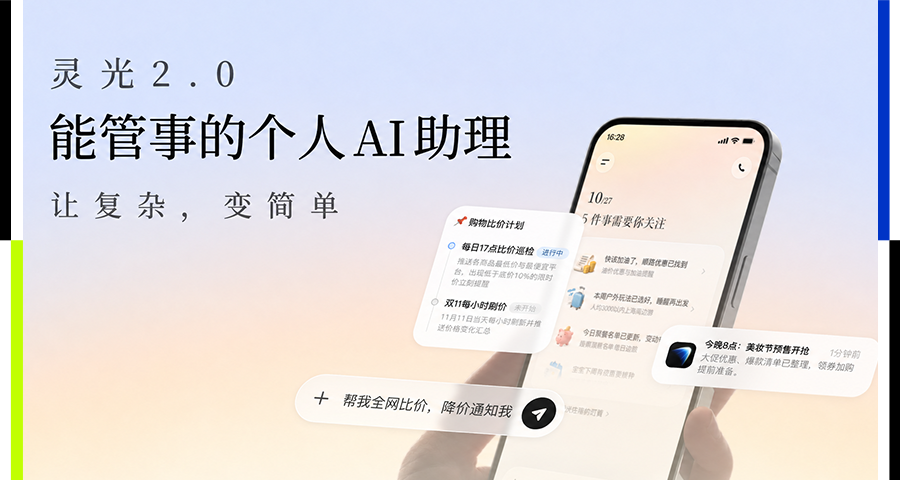
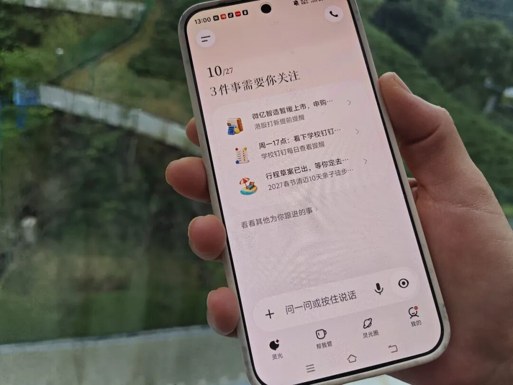
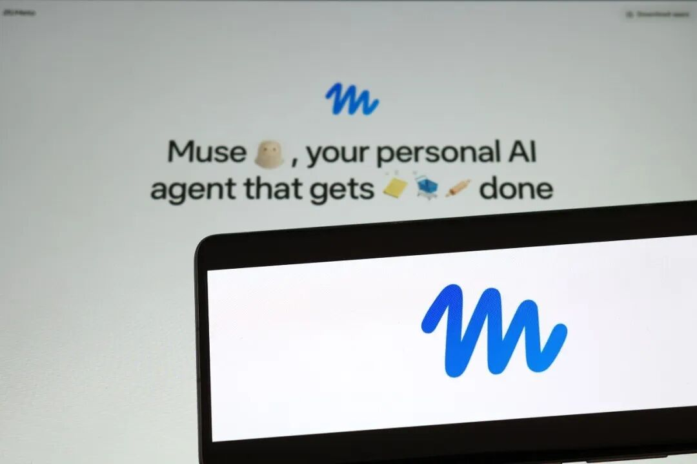
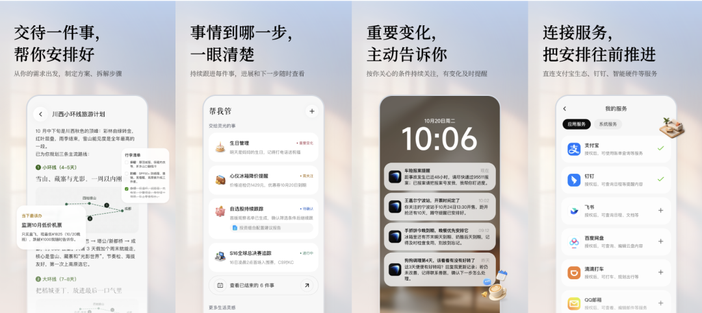
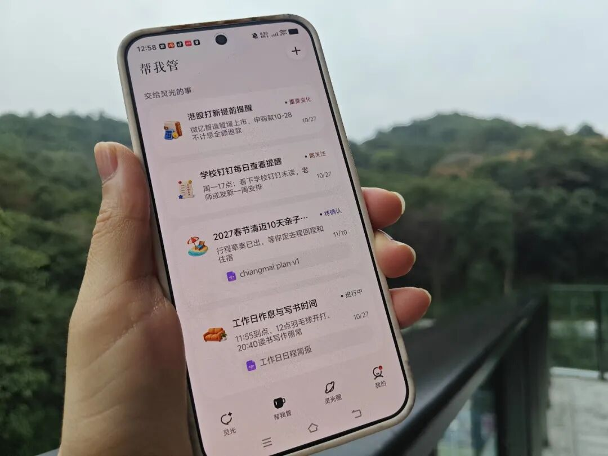
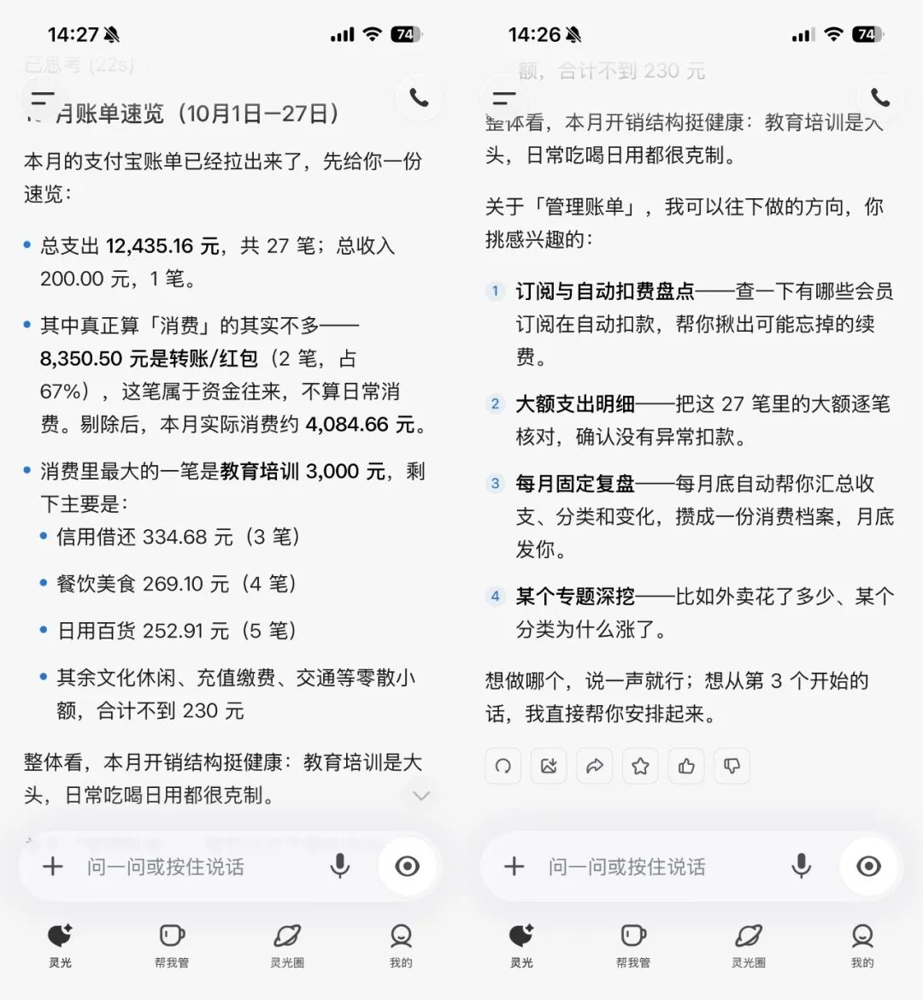



**收录说明**：用户提供链接。原文在微信公众号，用浏览器的客户端标识直接下载页面，从 `#js_content` 抽取正文，图片地址取自 `data-src`。作者署名取自页面正文中的作者标注。本文之前按「评论文、没有实测」判断不收，用户 2026-11-06 要求收录。文末「THE END」图、36氪推广图与二维码未收入。

**内容摘要**：文章以 10 月 27 日蚂蚁发布灵光 2.0 为切入，与 Meta 的 Muse 对照：Muse「更强调围绕目标自主执行」，灵光把重点放在「管事」上，连接支付宝、钉钉、飞书等服务。作者把灵光 2.0 的能力概括为「记得住、能推进、会跟进、会调整」，并举出家庭出游、冰箱「降到2000元以内再提醒我」、班级群春游通知整理等例子。文中提到支付宝今年 5 月披露 AI 支付已支持 95% 的通用智能体框架、累计完成 3 亿笔智能体支付，并介绍阿福、阿宝与灵光在蚂蚁 AI 布局中的分工。

**保留理由**：评论文，没有实测；用户要求收录。提供了对灵光 2.0 能力的拆解示例，以及灵光在蚂蚁 AI 产品与支付布局中的位置。

---

Personal Agent的不同解法。

文丨王熠

双11来了，对购物老手来说，下单前往往还有一长串准备工作。

先列清单，跨平台比价，计算优惠券和满减，再定好付尾款的闹钟。好不容易买完，过两天发现价格又降了，还得查保价规则、找订单、申请退差价。

足够丰富的商品和发达的互联网服务便利了人们的生活，也让人陷入到眼花缭乱的筛选和执行中。这在AI时代有什么解法吗？

今年9月，Meta推出Muse，上线三周就达到了500万的下载量。这类Personal Agent展示了一种新可能：用户交代目标，AI在对话结束后继续工作，有变化或需要确认时再联系用户。

10月27日，蚂蚁发布灵光2.0，定位为“能管事的个人AI助理”，抢下了国内大厂Personal Agent的第一棒。它想接手的正是那些需要一直惦记的事：记住用户的交代，持续关注变化，在关键节点及时提醒，并帮用户把事情一步步往前推进。

为何Personal Agent在此时集中出现？

从Muse到灵光，

Personal Agent的不同解法

从Muse到灵光，Personal Agent正在探索一种新的用户关系：用户交代一件事，AI替自己一直惦记着。

这一变化的出现，有着技术上的基础。随着模型执行长任务的能力提升，AI开始有条件在用户离开对话后继续工作。与此同时，长期记忆、云端运行、任务调度、浏览器操作和工具连接能力逐渐成熟，让AI能够记住目标、关注变化，并在不同时间节点采取行动。个人生活和事务管理，因此成为新的试验场。

相较于办公、编程等Agent主要面向知识工作者或程序员，Personal Agent触及的是更广泛的用户需求：购物比价、机票和酒店盯价、账单与自动续费管理、家庭出游安排、班级群和工作群信息整理，乃至宠物照护、车辆年检和疫苗提醒。

这些生活小事有一个共同点：事情本身未必复杂，却需要长期记住，相关信息还会不断变化。用户需要的，是有人替自己持续盯着，有变化及时提醒，需要处理时再往前推进。

当AI能围绕用户目标搜索、比较并持续跟进，用户的选择便从“打开哪个App找服务”，转向“把事情交给哪个AI”。平台和商家的竞争也会随之变化：服务能否被Agent发现、调用，并完成交易与履约。Personal Agent因此有机会成为新的服务入口，成为全球巨头布局的重点。

但如何接手这些日常事务，Muse与灵光选择了不同的切入点：

Muse更强调围绕目标自主执行。在其官方介绍的场景中，AI可以处理网页、邮箱和在线服务，帮助用户发送邮件、预订旅行、填写表单，也可以在用户关闭应用后继续推进长期目标。涉及发送邮件或购买等敏感动作时，Muse会要求用户批准。

这一路径与海外的互联网服务环境有关。在海外，邮箱是人们管理日常事务的信息中枢，承载着订单、账单、预约和行程等信息；网站与在线平台则是获取服务、完成交易的重要入口。Agent通过浏览器和连接器，可以获取这些信息、接入相关服务，持续推进任务。

灵光2.0则代表了另一种路径，它没有把定位放在“什么都替用户做”，而是把重点放在“管事”上：从中国用户的消费、出行、家庭和工作等日常需求出发，让AI记住事情、持续跟进，并连接支付宝、钉钉、飞书等用户熟悉的服务，把那些需要反复操心的事长期管起来。

理解灵光的这一路径，可以从三个方面来看。

从数字服务环境看，中国用户的消费、出行、工作和家庭事务，往往分布在不同App、小程序和平台上。跨平台的信息仍需自己整理，长期的事项仍需自己惦记。Personal Agent的机会，就在于接过这些持续操心的工作。

从服务连接路径看，灵光2.0依托支付宝的服务生态和蚂蚁的支付、信任基础，并通过工具连接接入钉钉、飞书、邮箱、米家等服务。这让它有机会围绕用户的一件事，连接分散的信息与服务，并将后续的整理、提醒和跟进串联起来。

从产品体验看，国内很多服务已经足够方便，更值得期待的是把单次操作的便利，延伸为整件事情的省心。“办事”更像一次性任务：用户下指令，AI完成动作；“管事”则意味着任务完成之后：AI仍然记得这件事，持续留意变化，在需要时提醒用户、推进下一步。

灵光2.0，从一次办事到持续管事

把单次操作的方便，变成长期托付的省心，正是灵光升级的主线。灵光2.0的能力提升可以概括为四项：记得住、能推进、会跟进、会调整。这些能力的价值，需要放到具体的生活中去理解。

首先是把事情记住。比如安排家庭出游，用户交代“带着老人、不赶早班机、酒店离地铁近”，这些条件就要贯穿后续安排。几天后再聊机票和酒店，灵光仍能接着之前的要求往下推进，不用用户每次从头解释。

随后是持续关注变化。比如购物清单里有一台冰箱，用户交代“降到2000元以内再提醒我”，之后就不用每天打开App查价格。灵光持续跟进，符合条件时再来提醒。用户放下手机，事情也没有被放下。

再往后，是把变化转成可处理的事项。比如老师在班级群里发了一长串春游通知，灵光可以提取成几件清楚的待办：“周三前交回执，周五带水壶和雨衣。”用户不用反复翻找聊天记录，就知道接下来要做什么、什么时候做。

遇到新情况，还要根据已有目标调整安排。比如周末带家人出游，天气预报突然有雨，就需要考虑把室外活动换成室内项目，重新安排出行时间。灵光可以帮助梳理调整方案，涉及退订、改签等决定，再由用户确认。持续管事，也包括计划赶不上变化时，帮用户想好下一步。

这正是灵光2.0给到的Personal Agent的“中国解法”：它没有把自己包装成“全能办事助手”，而是先从记忆、整理、监测、提醒和跟进做起，将持续管事的技术能力，与中国成熟的数字服务生态连接起来，让用户熟悉的生活服务，多一层更持续的照应。

从普及移动支付、推动民生服务数字化，再到探索AI帮人管事，蚂蚁延续着同一条路径：将最前沿的技术，应用于最日常的生活。

蚂蚁加码Personal AI

让服务生态活起来

Personal Agent要成为新的服务入口，除了模型能力，还需要跨过两道门。

第一道是服务的门。Agent要管事，就得进入用户日常使用的App和服务，但国内的高频应用对Agent的接入普遍设有壁垒。能接入什么、办理到哪一步，取决于服务开放程度和授权规则。

另一道是信任的门。当AI开始读取账单、长期跟进事务，甚至参与支付，用户需要清楚：它能看到什么、能做什么，哪些操作需要确认，出了问题如何追溯。用户愿不愿意托付，需要靠清晰的权限和可靠的执行逐步建立。

蚂蚁在这两方面的积累，为灵光2.0的探索提供了基础。依托支付宝的服务生态，灵光可以连接账单、会员、出行等服务，并通过工具接入钉钉、飞书、邮箱、米家等应用；蚂蚁22年来在支付安全、身份认证和授权管理等方面的积累，则为AI在用户授权范围内办事提供支撑。

这也是灵光2.0作为技术探索窗口的意义：既验证长期记忆、任务调度和工具连接等能力，也观察用户愿意把哪些事交给AI、交到什么程度。技术能持续运行，用户愿意持续托付，个人智能体才能真正进入日常生活。

灵光是蚂蚁加码Personal AI的重要一步，但背后更值得关注的，是其背后蚂蚁近年来从支付基础设施到AI应用生态的系统布局。

在AI支付层面，支付宝已推出AI付、AI收、AI钱包与Token Pay等全栈产品，为智能体完成交易提供支撑。今年5月，支付宝披露，AI支付已支持95%的通用智能体框架，累计完成3亿笔智能体支付。其中，AI钱包支持用户在支付前、支付中管理智能体任务，并在支付后查询账单，让用户能够掌握AI替自己花钱的过程。

在AI应用层面，蚂蚁则通过阿福、阿宝与灵光，从不同场景探索Personal AI。阿福聚焦健康咨询与健康管理，阿宝依托支付宝连接消费、出行、办事等日常服务，灵光则更侧重前沿产品与技术探索，尝试接手需要持续关注和跟进的长期事务。

值得一提的是，灵光与阿宝还有进一步协同的空间。灵光先行探索的产品形态与技术能力，经过验证后，有望应用于阿宝，借助支付宝的高频场景与服务生态触达更多用户，让前沿探索逐步走向大众应用。

此外，蚂蚁也在将AI能力延伸至行业场景。如蚂蚁数科打造“智能体超级工厂”，通过Agentar等平台帮助行业伙伴开发和应用智能体。

简单地说，只有AI支付、AI应用与生态更好的协同运转，灵光才能把事“管”得更好；而灵光这样的Personal AI持续进化，也有望进一步激活蚂蚁多年积累的数字服务生态，催生新的服务需求，打开更大的想象空间。

也许，下一次双11，人可以早点睡，AI继续盯价格；班级群刷到99+，也不用临睡前才发现“明天要带一个空纸箱”。

对用户来说，Personal AI的价值，或许就是少一点临时抓瞎，那些总在脑子里环绕的“别忘了”可以慢慢交出去，事情有灵光帮你惦记，服务总在需要时出现，生活也可以少一点手忙脚乱。

而对蚂蚁来说，AI时代的新入口，也许就藏在无数让人省心的小事里。
