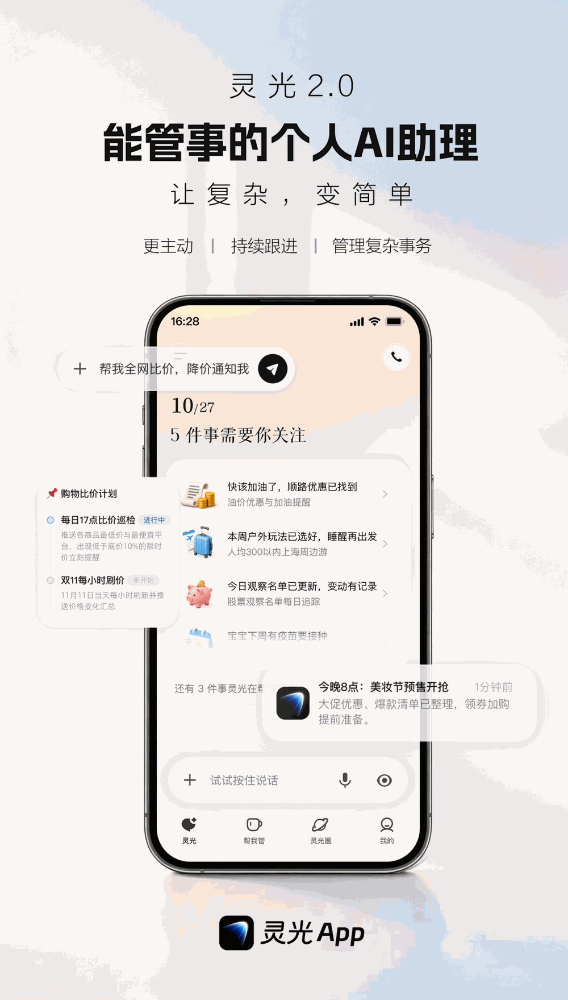
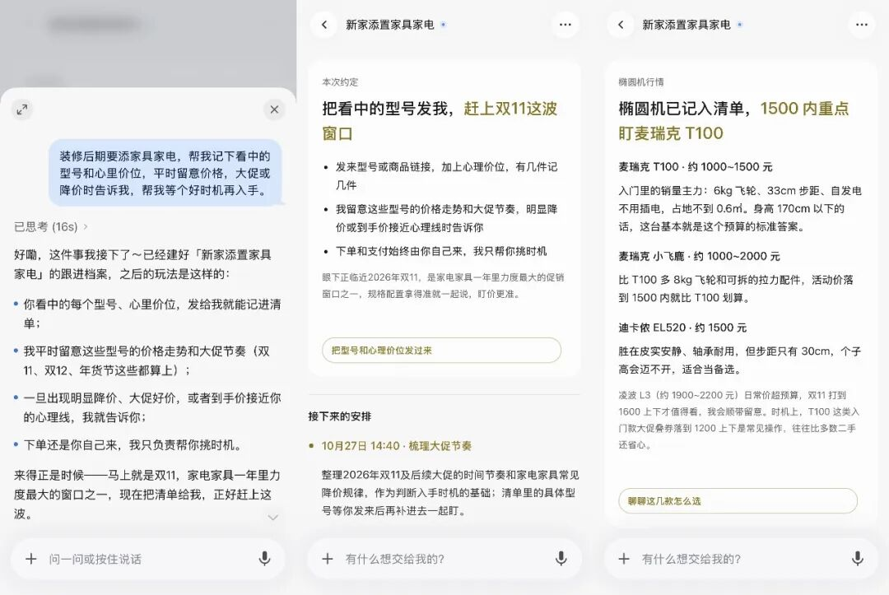
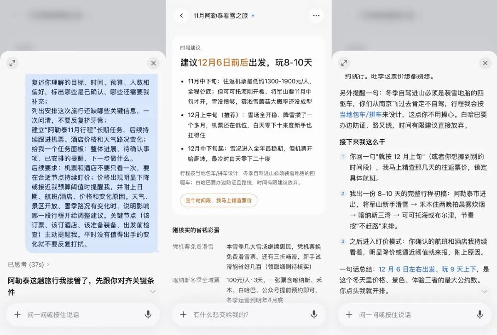
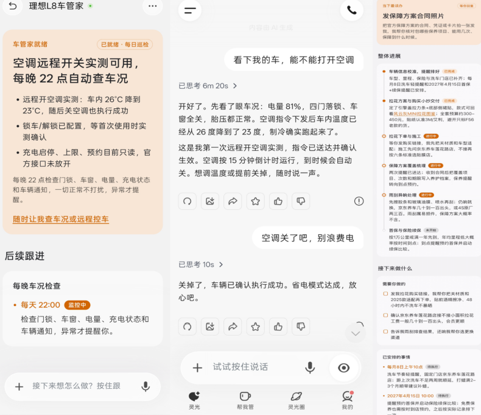
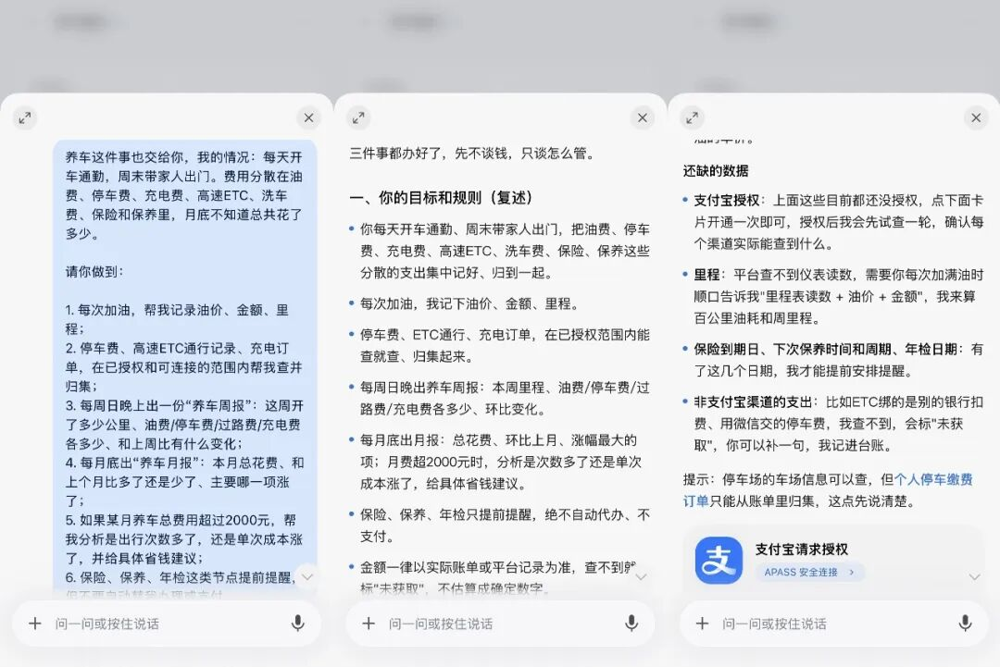
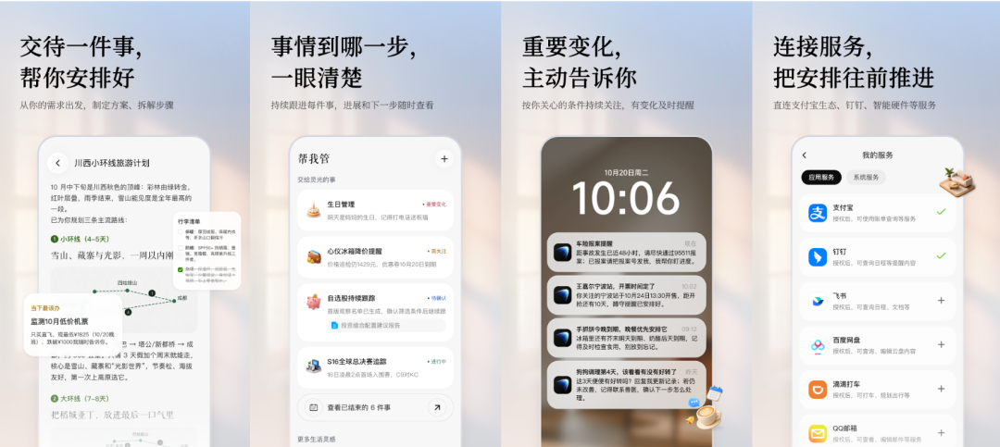
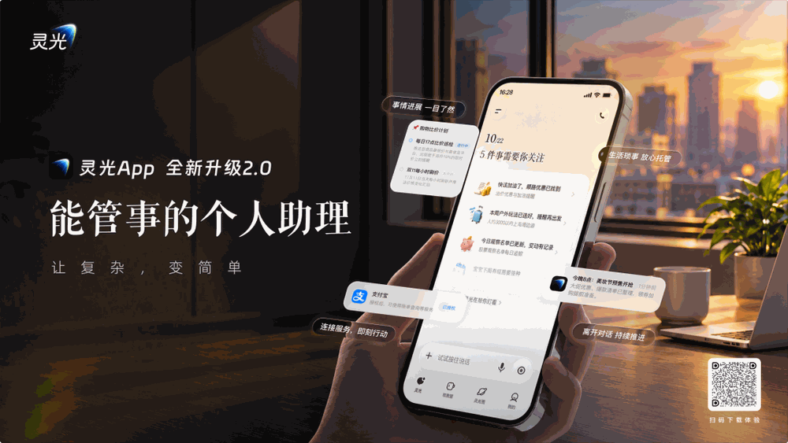



**收录说明**：用户提供链接。原文在微信公众号，用浏览器的客户端标识直接下载页面，从 `#js_content` 抽取正文，图片地址取自 `data-src`。文末关注与星标引导未收入。用户怀疑与已收资料重复，经核对正文与已收资料没有重复段落。

**内容摘要**：新眸的文章，从「办事」与「管事」的区别分析蚂蚁灵光2.0。文章称 Muse 上线10天登顶美国区 AppStore 免费榜，一个多月下载量突破千万。灵光2.0 于10月27日发布，依托一台24小时运行的独立云主机，提供跨会话记忆、长程任务调度和工具连接三层能力，并连接支付宝账单、会员、出行及钉钉、飞书、邮箱、米家等服务。文中举例，即使酒店已经订好，灵光也会在降价时提醒改订；米家授权后可让风扇自动开启；接入理想汽车后可远程读取电量、门锁、车窗和胎压状态。文章认为，灵光的中国解法是用生态授权解决“可执行”，用开放连接解决“可扩展”。

**保留理由**：以「办事」到「管事」的概念区分切入，给出记忆、长程调度与工具连接三层能力，以及米家和理想汽车等设备接入的具体场景，并对比了海外与国内生态的授权与准入差异。

---

当AI帮你“管事”：灵光2.0与Personal Agent的下一程

新眸原创·作者 | 鹿尧

2026年下半年，Personal Agent的竞赛有了统一的方向感。

Meta的Muse上线10天登顶美国区AppStore免费榜，一个多月下载量突破千万；Google、OpenAI也亮出了GeminiSpark和Dots，后者被《连线》定义为“always-onAIagents”。

a16z在前段时间给出了一个更底层的判断：最有用的Agent会变得越来越不可见，它会在你开口之前就已经把事情做掉了。a16z将“主动性”视为Personal Agent真正的护城河，而行业正在经历的，正是一条从Chatbot走向always-on agent的迁移路径。

与此同时，热度之下，两个关键话题逐渐浮出水面。

一方面，AI从完成一次任务，走向持续记忆、跟进和推进，需要可靠的技术满足。

另一方面，AI要落到生活，必须够得着真实的服务，这是个生态问题。

Muse的云端环境可以跨应用操作，OpenAI、Google智能体依托各自账号与应用纵深，但它们的共同前提是服务以相对开放的接口和授权体系存在。而国内的生活服务更多集中于超级生态内部，外部Agent跨平台执行任务，更要经历“通行证”考验。

针对这些问题，10月27日，蚂蚁发布的灵光2.0，提供了一个值得深入研究的样本——这是国内第一个大厂级Personal Agent形态的正式落地，他们把已有的AI助手升级为“能管事的个人AI助理”。

简单来说，灵光2.0既回答了“AI如何持续管事”，有长期记忆、能持续运行；也回答了“AI能管哪些真实的事”，除了支付宝生态内功能，还能连接外部各类软件、智能硬件，管理半径从信息延伸到了服务与设备。

Muse之后，Personal Agent的竞争已经从“能不能做出来”，转向“能不能管下去、落得实”。灵光2.0给出的中国解法，正是在这两个问题上同时展开。

01

**灵光2.0，AI如何真正“管起事来”**

在AI行业，“管事”不算新词。不过以往更多指的是让AI办件事，“能办成”和“管得好”之间，其实差别不小。

简单来说，办事＝一次任务；管事＝有记忆、24小时离线也在办、主动调整。 这句话把Personal Agent的产品单位从“一次指令”换成了“一件跨时间的事”。

一次任务有明确起点和终点，比如查天气、写文案、订机票。但事务不一样，机票订完价格还在变；账单里躺着没人提醒的自动续费；班级群里的通知需要有人整理成待办；疫苗计划会因为一个日期调整而影响后续所有节点。

这些事情的特点是：时间跨度长、信息持续变化、需要反复记忆、最终不只是一个答案。 

相比灵光1.0版本的核心能力是“一句话生成闪应用”，灵光2.0的升级点在于，从“帮你做个人工具”延续到了“主动帮你把事情持续推进下去”。

“管事”就是围绕这类事情建立生命周期：识别需求、记住条件、拆解推进、持续监测、关键节点提醒、变化后调整、阶段性复盘。

从这里能够看出，前后两代，主线其实没有变——“让复杂变简单，让用户少操心”，闪应用把复杂的需求变简单，管事是把复杂的事务有人管。

而这个切换的技术底座，是一台24小时运行的独立云主机。云主机解决了“持续运行”的物理条件，但真正让“管事”变成一套机制的是三层能力：跨会话记忆、长程任务调度和工具连接。

跨会话记忆解决“不用每次从头解释”，历史进展被保留在事务上下文里。长程任务调度解决“事情不会一次结束”，灵光会把目标理解、条件补齐、步骤拆解，组织成可以持续推进的任务；用户离开，任务不会立刻中断。

工具连接能力解决“管事要能对接真实世界”。内置支付宝账单、会员、出行，以及钉钉、飞书、邮箱、米家等服务；开放环境可调用MCP、CLI；还有独立电脑和浏览器，可通过网页操作完成任务；用户也能自行添加公开MCP。

少操心到什么程度，我们放进具体场景里看。

比如，双十一的购物清单太长，你可以交给灵光来实时跟进比价；钉钉家校群里的老师通知太多，你可以让灵光提取待办并跟进；

近期打算旅行，可以让灵光监测票务变化，即使已经订好酒店，灵光也会在降价时提醒改订，车辆年检、宠物疫苗、家人生意这些周期性节点，到时间也都会主动出现。

值得一提的是，智能设备的接入让“管事”的落点，从信息和线上事务延伸到了物理世界。

拿米家来说，授权之后，灵光可以让风扇自动开启，也会在家电耗材快到期时提醒。

接入理想汽车后，灵光能远程读取电量、门锁、车窗和胎压状态，指令下发后操控车内的空调等设备。

类似的场景还有很多，但它们不是散点功能，而是同一套“事务生命周期”在不同领域的复用。相比做“万能助理”，灵光更想做“值得被管的事”，它的能力是把记忆、运行、连接、提醒、调整组合成一个事务闭环。

从产品视角来看，灵光2.0把AI介入任务的起点前移了：过去用户先发现问题、提出需求，AI再执行；现在在获得授权后，灵光可以结合已接入的信息与服务，主动识别潜在需求，发起分析、监测和跟进，并在需要用户关注的节点主动汇报、提醒决策。

需要注意的是，它的主动性是有边界的。管事需要“在授权范围内”、“关键节点提醒”、“支付和重要决定先确认”，这个分寸很重要。Personal Agent最容易犯的错，是把“主动”做成打扰，或者把“替你办事”做成“替你做主”。

灵光目前的产品设计试图在两者之间找平衡：主动性服务于事务推进，而不是替代用户意志。

02

**为什么说灵光2.0是Personal Agent的中国新解法**

把灵光2.0放进中外对比里，我觉得最值得看的并不是“更主动”，而是它把Personal Agent的产品对象从“任务”换成了“事务”。 

这款产品的意义，实际上远不止“中国版Muse”那么简单——Muse更像把“办事”做到交易闭环的执行代理，Today更强调长期关系与陪伴，灵光则试图在“办事”和“陪伴”之间切出一块更中国化的落点：替用户管理那些跨时间、会变化、需要反复记忆、最终不只是一个答案的事。 

从行业来看，海外Personal Agent面对的是高度分散的服务生态：购物、支付、出行、身份分属不同公司，Agent想完成跨应用任务，往往必须自己做集成，用云端虚拟机、浏览器自动化去“补路”，集成成本很高。

但用户授权后相对容易拿到邮箱、日历、账单等数据，创业公司也有机会在“理解用户”这一环与大厂站在相近起点。不过代价也很明显，平台准入仍握在别人手里，以Muse为例，Agent随时可能被电商平台限制访问。

灵光2.0带来的路径不太一样。

国内生活服务高度集中，微信、支付宝、淘宝等超级生态同时拥有身份、关系链、支付和服务。对Agent来说，基础设施更“现成”，但核心约束从“集成”变成“授权与准入”。

拿前段时间豆包手机助手来说，就曾被包括微信、淘宝在内的155款应用拒绝接入。外部Agent能不能代表用户操作某个服务，往往比技术上能不能做更关键。 

从这个角度，背靠支付宝生态的灵光不需要从零修路，它更像在已有道路上做一个事务调度层：

对内，支付宝生态提供高频、真实、可结算的生活服务起点；向外，MCP/CLI和云主机让它能向钉钉、飞书、邮箱、米家、12306、车机等外部服务延伸。

这个组合，可以说是灵光2.0作为Personal Agent的中国新解法核心：不是单点能力更强，而是用生态授权解决“可执行”，用开放连接解决“可扩展”。

最终，根据中国服务生态、用户的生活场景和信任习惯，重新组织出Personal Agent的产品形态。

03

**为什么是蚂蚁有机会做好这件事**

Personal Agent的竞争，本质上是信任与生态的竞争。

AI能不能管事，看技术；用户敢不敢让它管事，看信任。从“能管事”到“敢让AI管事”，中间隔着这道坎。而蚂蚁手里握着的，恰好是别人没有的四样东西：支付、生活服务、商家网络与信任机制。

同样是Agent，先厘清关系。阿宝和灵光都属于蚂蚁，支付宝是两者共同的生态支撑——积累二十多年的数字服务网络、商家资源与小程序体系，作为两者拓展服务能力的地基，回答了“AI能管哪些真实的事”。

这四样积累，每一样都在为灵光铺路。

支付，让AI办的事能走到最后一步，做事做到交易，交易要能闭环，支付宝AI付的agent支付笔数破了3亿笔，覆盖超95%的通用智能体场景；

生活服务与商家网络，让AI有真事可管，水电煤、医保、出行、理财、本地生活，碰一下在线下铺了超3000万个触点，这些事用户早就习惯在支付宝里办；

信任机制，让用户敢把事交出去，支付宝22年来在支付安全、身份认证和授权管理等方面的积累，则为AI在用户授权范围内办事提供支撑。

支付打通交易，服务供给场景，信任降低门槛——生态越深，AI能持续跟进的事就越多。

在这个地基上，蚂蚁内部的分工也清楚。灵光更侧重前沿产品形态与技术能力的探索——长期记忆、持续运行、任务调度、工具连接，回答AI如何持续管事。而验证过的能力，有望进一步应用到阿宝，借支付宝的高频场景与服务生态触达更多用户。

一个在前沿试水，一个在大众铺开，这就是蚂蚁想走通的那条路：从前沿探索到大众应用。

左手生态优势，右手技术优势，这是蚂蚁探索Personal Agent的新思路：生态为技术提供落地场景，技术让生态中的服务更容易被用户获得。

把这层解法放到更大的尺度看，想象空间才真正打开。

当AI能长期理解用户、持续承接需求——AI真管事的那一天，灵光有机会成为连接个人生活与万千服务的新入口。过去，用户要在各个App之间找服务；将来，服务可能顺着AI对用户的了解自己找上来。

而灵光2.0的意义同样在于，它把Personal Agent的竞争拉回到了一个更务实的问题上：在一个服务已经足够密集、生活已经高度数字化的市场里，AI能不能在一段真实的时间里，稳定地替人管理具体的事。

这些生活里真正消耗注意力的东西，才是用户愿意建立长期托管关系的起点。这时候，Personal Agent，将从一个只在需要时打开的抽屉，变成了个人生活与万千服务之间的一种持续在场的连接。

本文系新眸原创，申请转载授权、商务合作请联系微信：ycj841642330，添加好友请备注公司和职位。

**— END —**
