

**收录说明**：依据凤凰网科技的转载页存档；新浪财经头条也有同文（记入 altUrls），但新浪页面丢失了原文的加粗与小标题，凤凰网的版本保留了这些格式。超过 600 KB 的图片已缩小。

**内容摘要**：作者用灵光 2.0 做了几件持续性的事：让它盯明年 2 月租约到期前北京北六环外的租房房源，灵光先给出计划、经多轮补充后按计划定期汇报；授权支付宝后做收支盘点和每日开支统计，超过 50 元时提醒；双 11 买衣服时推荐商品并持续盯价，另外盯 Switch 游戏价格。文章认为 2.0 形式上是「中国版」Muse，内容上是「中国化」Muse：Muse 依靠邮箱等通道获取订单和行程，国内则要接入支付宝账单、会员、出行和钉钉、飞书、米家等服务，并提供独立电脑和浏览器。授权方面写到连接钉钉要用户明确授权，通过 APASS 连接。

**保留理由**：另一篇发布次日的媒体实测，长期盯租房房源、预算提醒等任务说明了「盯梢」类任务的实际用法；对比 Muse 与国内生态的差别，可供分析使用。

---

**灵光新版本上线，迈进Personal Agent。**

**作者 |** 毕伟豪

**编辑 |** 漠影

近几月，Muse的出现，带火了Personal Agent，也让整个行业开始**持续思考Personal Agent这一产品形态**。

但Muse的成功，显然不是引入形式就能复制的，依托长期记忆和云端虚拟机，让Agent能够进行持续的事务管理，这套打法思路非常清楚，但想要真正实现，显然**还有很多“形式”之外的“内容”**。

10月27日，蚂蚁集团发布了灵光2.0版本，将产品定位从强调对话和应用生成的AI助手，进一步推到**“能管事的个人助理”**。

灵光2.0版本从形式上看，**是“中国版”Muse**，但从内容上，**更像是“中国化”的Muse**。

因为蚂蚁集团并不是简单提供了持续执行能力，灵光2.0将这项管事能力**与支付宝、钉钉、飞书、米家等平台**的各项功能进行了适配，试图让Personal Agent**与中国用户实际使用的服务网络**深度融合。

智东西也对灵光2.0进行了深度体验，切身感受了一下这份持续管理个人事务的能力。

**01****.**

**实测灵光2.0：**

**租房、比价、收支盘点**

对灵光2.0的体验，我没有特意去思考用什么提示词、或者测试哪些任务，就是**随着个人日常使用慢慢感受**，也因此，所有的提示词都是普通用户的视角。

新版本灵光的页面和之前有了很大变化，重点是页面中间的这些需要灵光管理的事务，以及下面一个“要我管”的功能区域，**任务完成和变动后会有消息弹窗提示**。

用户只需要点击左下角灵光，就可以通过对话来将任务交给它了。

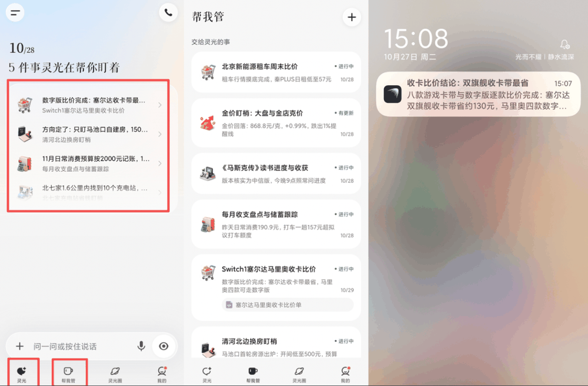

拿到灵光2.0的第一时间，我最先想到的，是让它帮我找找房子，**找房子的任务往往持续数月**，任务型Agent无法满足长时间线作战的需求，正是检验灵光2.0的最佳场景。

我输入了一段提示词，希望能在明年2月份房租到期的时候，找到一个合适的新房子，提示词如下：

我想在明年2月份换房子，帮我盯一下北京市北六环外的房源，离清河近一些的，小区或者自建房都可以，价格在1500到2200之间。

最开始的提示词并不完善，灵光根据需求给出了一版方案，但也提示我缺少很多信息。通过多轮对话交互，灵光帮我敲定了一份租房计划。

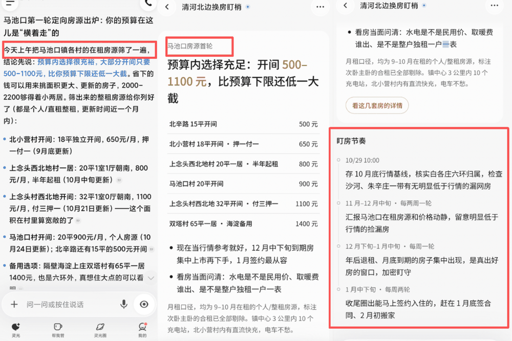

这份计划的重点，**是“盯梢”**。灵光2.0会按照既定的时间安排进行搜集和汇报，然后给出房源信息，**不断追踪任务进展**，直到完成。

随后，我让灵光来帮忙记账，授予支付宝权限后，输入了我的收入和各项开支，让它每个月给我盘点一下能存多少钱，如何优化开支情况。

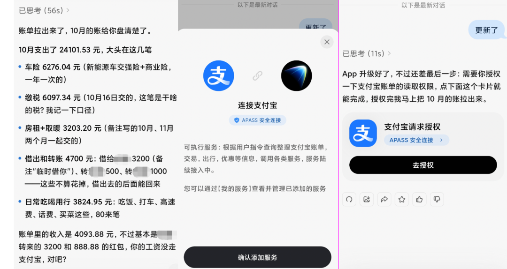

灵光2.0很快就构建好了盘点任务，并通过我授权的支付宝信息，对我**日常的支出和收入**进行了非常细化的统计，能看到，保险支出、高速费、房租、取暖费等等都一一列举了。

对于日常使用支付宝较多的用户，这个记账助手还是非常好用的。

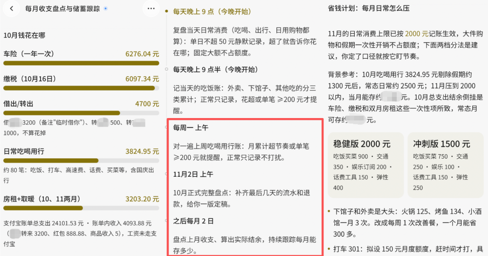

双十一购物，也是**一个持续性的任务**。灵光2.0可以结合购物平台信息，进行商品比价和购置规划。

比如我输入了买衣服的需求，让灵光帮我推荐，提示词如下：

双十一我想买些衣服，秋冬的卫衣、短款羽绒服、工装裤、板鞋这些吧，帮我比比价格，计算下优惠的购物方案，然后有变化随时调整和通知我。

灵光立刻给出了方案，还在下面提示我**补充预算、平台****等信息**。

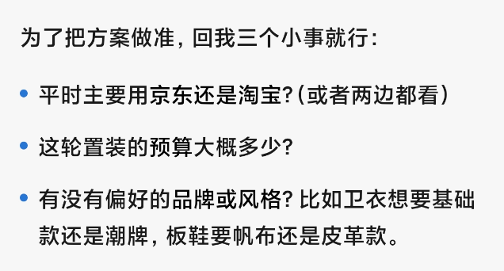

现在灵光正在帮我盯着平台上的商品价格，它还会关注各类服饰的直播专场，**有低价潮出现时会提醒我**。

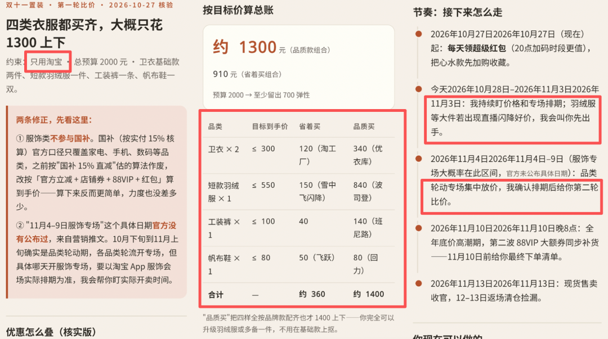

除此之外，灵光2.0还在帮我盯着Switch游戏的价格，比如塞尔达、马里奥系列的卡带以及数字版。这些东西的价格变动非常快，因此**需要灵光2.0能在低价出现的时候及时提醒我**。

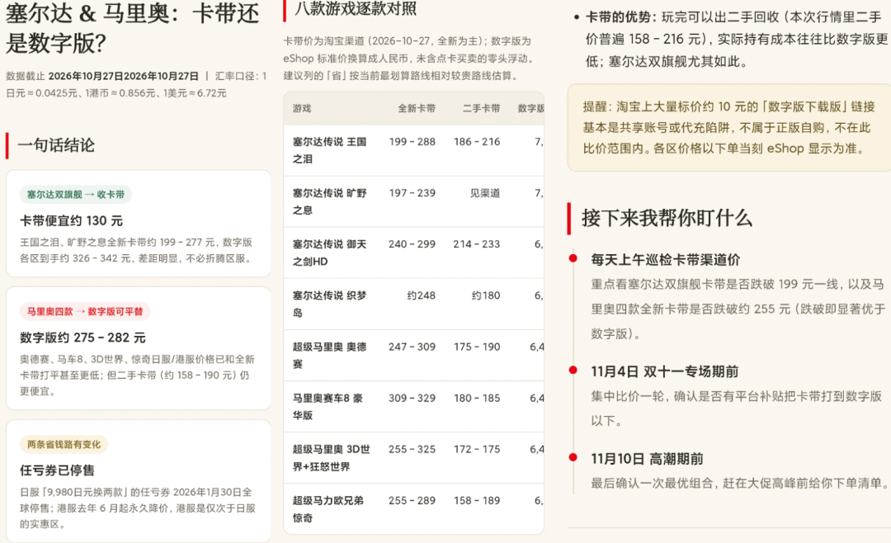

我还让灵光2.0帮我**统计每天的消费开支**，并在超过50元时提醒哪里花超了。

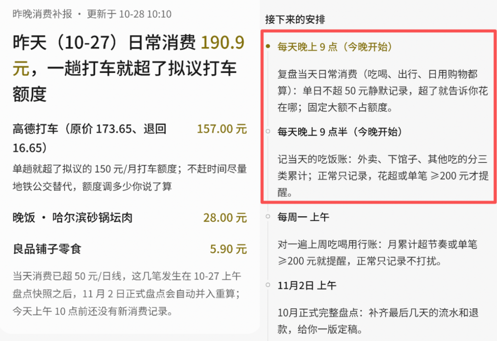

从这些测试中可以看出，灵光2.0不仅在持续管理个人事务上具备不俗的能力，更是**将这份能力与一些生活中常用的服务深度融合**。

最重要的是，这些任务是跑在云端的，可持续，**不会因为关掉应用就停止**。同时，云端独立主机也为任务执行提供了干净的环境。

Personal Agent，也在大厂的生态下，展现出了**中国本土化**的样子。

**02****.**

**Muse之外，灵光探路**

**中国式Personal Agent**

对话式AI解决单次提问，Agent面向复杂任务处理。两者还有一个共同点：事情交给AI之后，**用户仍然要自己跟进来完成任务**。

Personal Agent要做的，是接手这些后续工作，让Agent记住目标、保留任务进程，在出现新信息时继续推进，并在关键节点提醒用户。

这些要求落到灵光2.0的产品上，是这几项能力的组合：**跨会话记忆、长程任务调度、独立云主机以及相关的工具连接**。

记忆负责保留任务背景，调度负责推动任务继续进行，工具负责获取新信息、调用外部服务，独立云主机则保障用户退出对话后的持续运行。

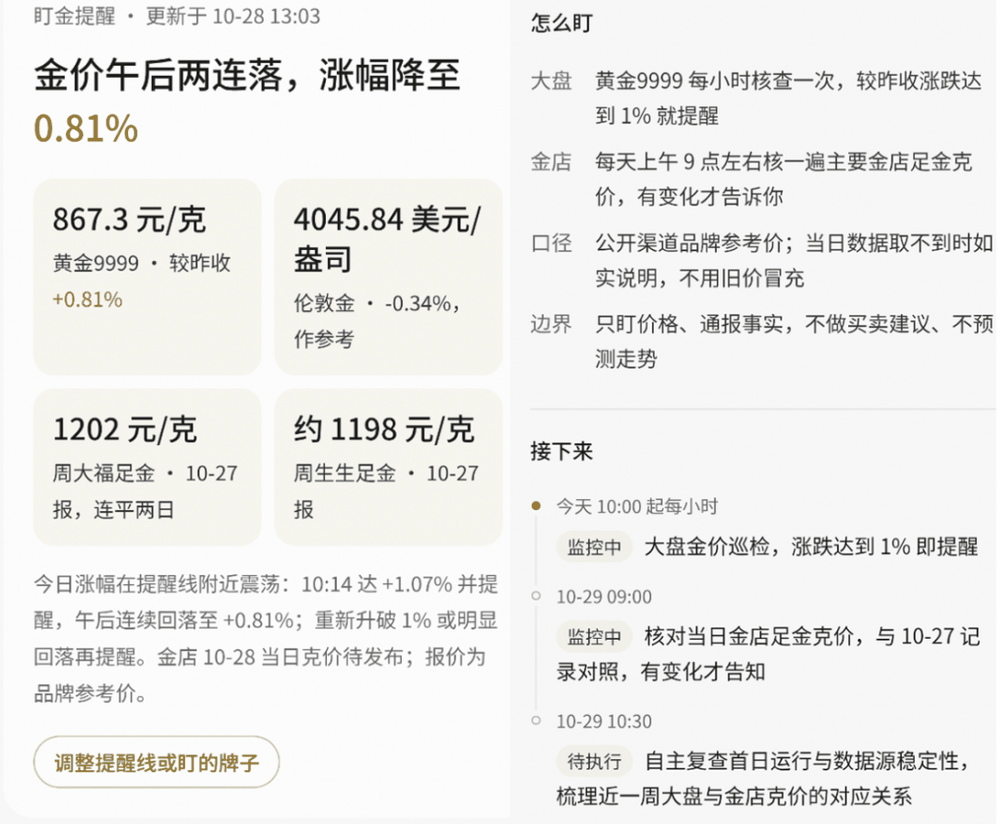

▲灵光2.0盯金价，每小时监控大盘并实时更新

但机制以外，**服务生态是完成任务的核心支撑**，Muse爆火让行业看到Personal Agent的潜力，但产品形态可借鉴，**落地所依赖的服务环境却不能简单照搬**。

Muse于今年9月8日上线后，在美国提供iOS、Android和网页端服务，其公开的商业合作伙伴包括Stripe、Shopify、Expedia等，覆盖**支付、电商、旅行预订和零售**等场景。

对海外用户而言，订单、行程和消费信息**往往通过邮箱、网站获取**，后续操作也能借助浏览器完成。Agent通过连接邮箱、操作网页，就有机会将分散的信息串联起来，持续推进任务。

但这套思路落到中国市场，**会有一些水土不服**。中国用户的日常需求散落在各大APP上，订票、消费、支付、办公，**各自有成熟的App和服务体系**，信息和操作入口未必相通。

即使Agent能够理解需求、规划步骤，如果无法顺畅获取这些信息、调用相应服务，**任务仍可能卡在应用之间**，需要用户自己接手。

因此，Personal Agent进入中国市场，关键不只是复现持续记忆和自主执行的产品形态，**还要找到连接本土服务生态的方式**。这也是灵光2.0将支付宝、钉钉、飞书等服务纳入工具体系，尝试让AI从单次执行走向持续管事的原因。

具体而言，灵光2.0接入**支付宝账单、会员、出行**等服务，车生活一侧覆盖**停车、加油和充电**，同时支持**QQ邮箱、滴滴、钉钉、飞书、百度网盘、米家**等平台，开发者还可以通过MCP、CLI等方式扩展灵光的能力。

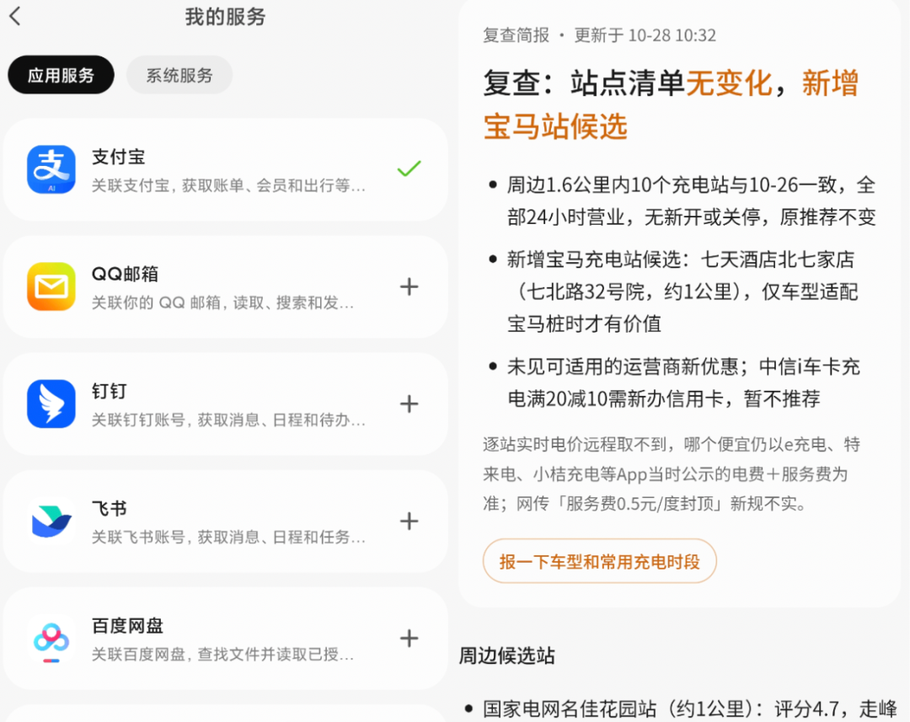

▲灵光2.0接入各大应用、查找汽车充电站

此外，产品还提供独立电脑和浏览器，同样可以**通过网页操作处理任务**；其开放能力也可延伸至理想、蔚来、小鹏、华为汽车、运动手环、体脂秤和12306等设备与服务。

这些连接不只是增加了可调用的工具数量，更决定了Agent能够接触哪些信息、推进哪些环节，也决定了“持续管事”能在多大程度上进入中国用户的日常生活。

**03****.**

**服务生态与信任机制**

**让Personal Agent落地生根**

从灵光1.0到2.0，产品重心也**从内容创作延伸到了事务管理**。

2025年11月上线的灵光1.0，**主推全模态交互、灵光闪应用和灵光开眼**，上线6天下载量突破200万。其中，灵光闪应用可通过一句话在约30秒内生成可交互、可编辑、可分享的小应用，灵光开眼则侧重多模态识别与理解。彼时，灵光**主要探索如何降低AI使用和应用生成的门槛**。

2.0的灵光开始**尝试接手那些无法一次完成、需要持续跟进的事务**，试图让AI记住目标、持续推进任务，并根据变化及时跟进。

而当AI能长期接触个人信息、调用外部工具、处理涉及资金和重要事务的操作，**权限边界与执行可信度就不可回避**。蚂蚁在支付安全和风险控制方面的积累，为可信智能体的探索提供了基础。

支付宝2004年独立运营，至今22年，支付安全、身份认证、授权管理这套能力，是**在处理资金类业务的过程里**一点点磨炼出来的。

在授权方面，灵光2.0在接入其他应用时要用户明确授权，用户可以**随时查看、调整或撤销授权**，智能体的动作被限制在授权范围内。

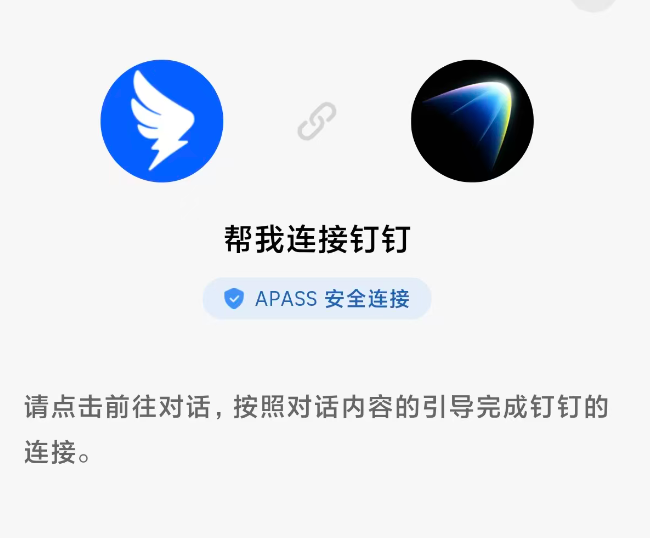

▲连接钉钉需要明确授权，通过APASS连接

信任之外，**蚂蚁还有一张深入日常生活的服务网络**。二十余年间，支付宝连接起超10亿用户、8000万商家，上万项服务覆盖消费、出行、缴费与政务民生。这些积累，**为AI承接个人事务提供了具体的去处**。

灵光2.0的探索，让这张网络有了新的想象空间。持续记忆与任务跟进，**若能与成熟的商家和生活服务衔接**，用户的一次托付，就有机会从计划走向预约、下单与办理。

作为蚂蚁集团探索Personal Agent的前沿应用，灵光若能**验证持续记忆、任务调度与可信执行等能力**，并将其复用于更多高频场景，未来就有望依托蚂蚁的服务生态与支付基础设施，触达更多用户。

**04****.**

**结语：Personal Agent竞争升温**

**蚂蚁持续探索本土路线**

Muse让行业加深了对Personal Agent的想象，灵光2.0则尝试回答另一个问题：**这种产品形态怎么与中国用户的实际生活连接**。

而要“中国化”，就需要**深度结合本土应用、工具、服务生态**，同时建立**可信基础设施**。

对蚂蚁而言，灵光2.0是一次前沿产品探索，也为支付宝生态中的服务能力如何与个人智能体结合提供了**新的实践方向**。

Personal Agent尚无定式。率先出发，可以争取先机；能否走得更远，终究要看**产品能否经得起真实生活的检验**。灵光2.0，正是蚂蚁集团沿着这条路线展开的一次深度求解。
