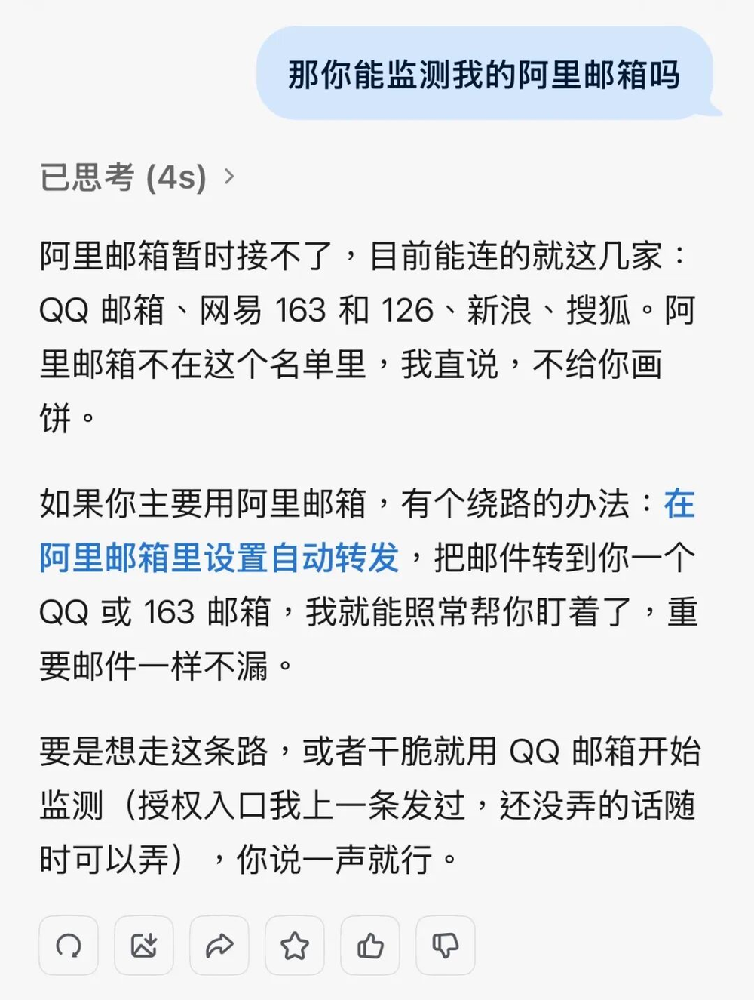
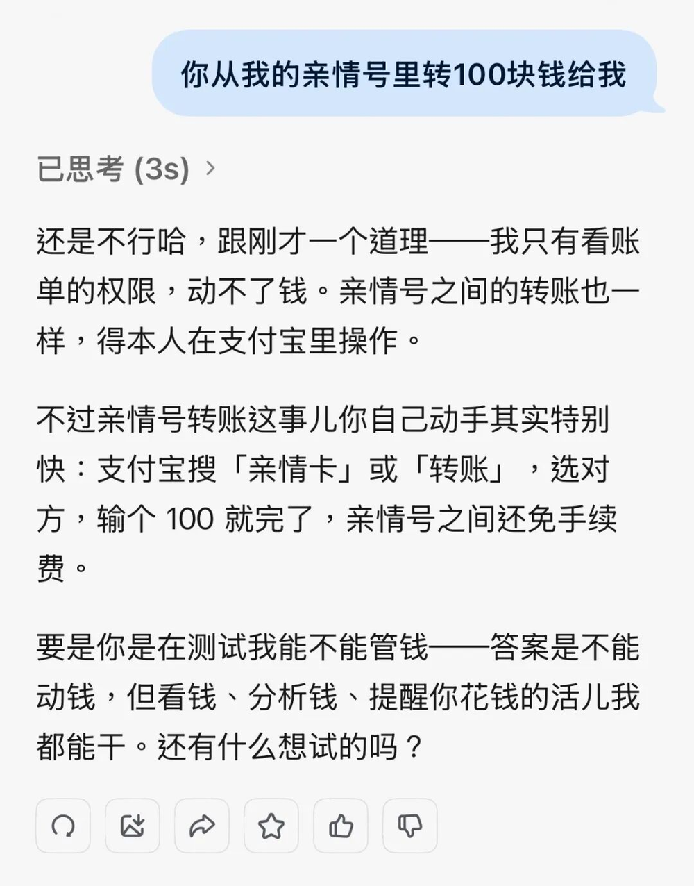
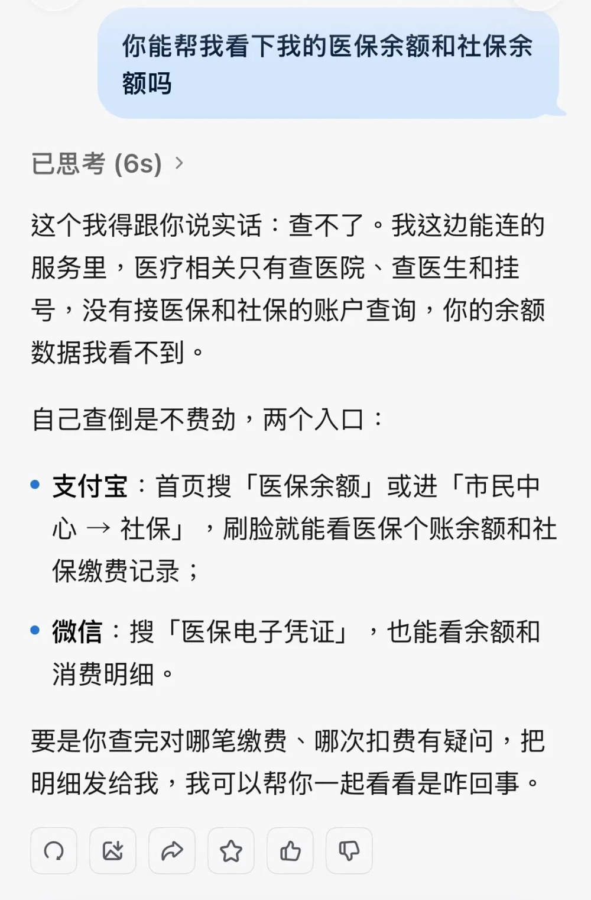
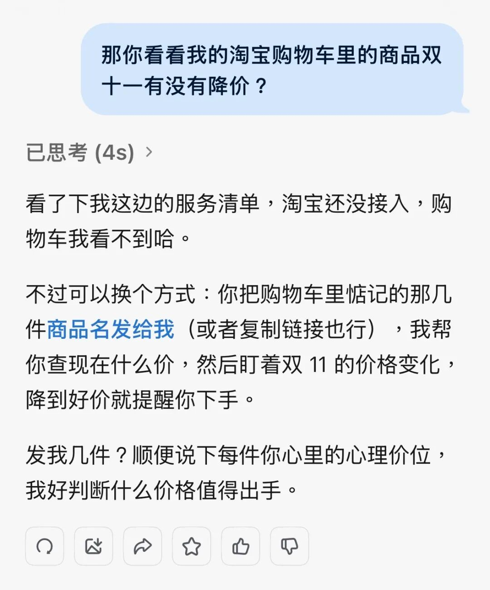
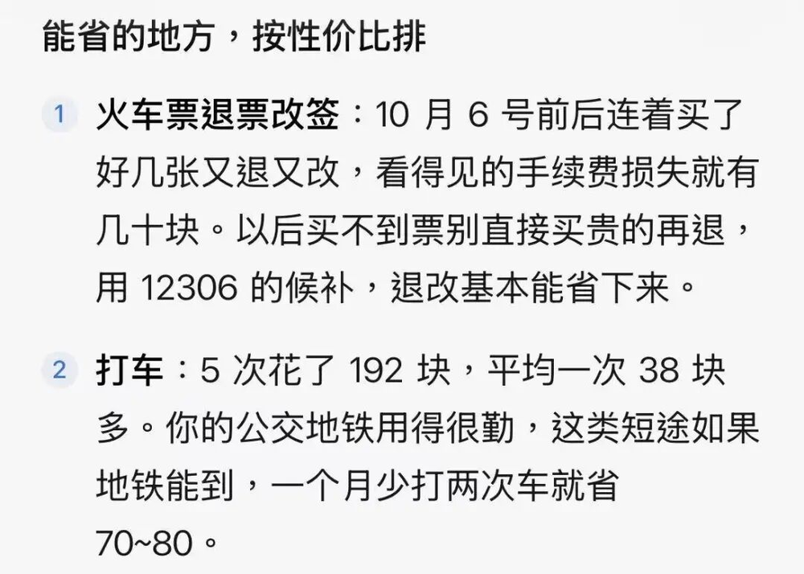
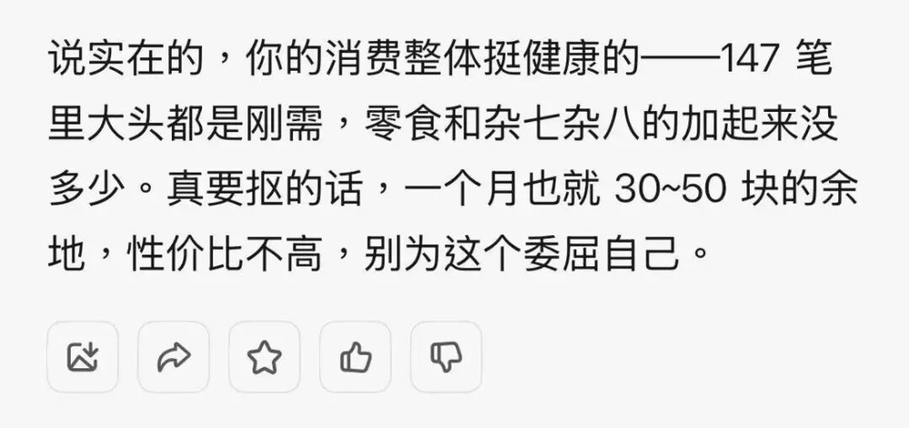
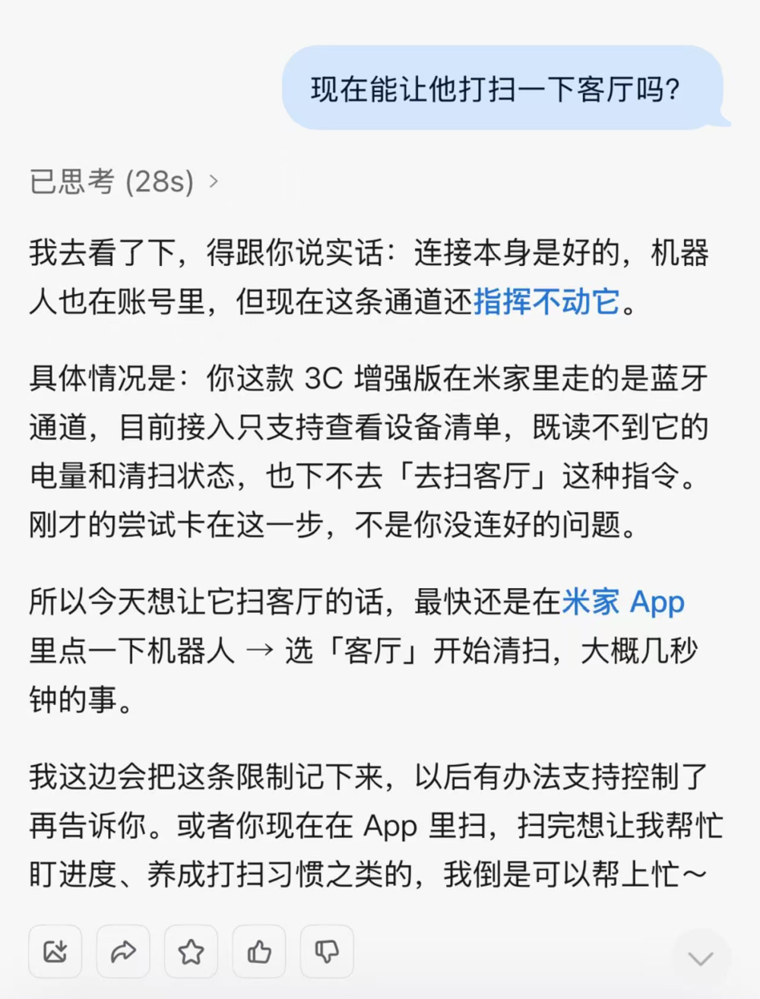



**收录说明**：原文在微信公众号，依据虎嗅的转载存档，虎嗅页首的「本文来自微信公众号」一行未收入。超过 600 KB 的图片已缩小。

**内容摘要**：作者测了几类围绕蚂蚁与阿里生态的任务：灵光支持 QQ、网易 163 和 126、新浪、搜狐等邮箱，暂时接不了阿里邮箱；不能从亲情号转账、不能查医保余额，淘宝也没有直接接入，比价要另想办法。比较顺畅的是支付宝账单分析：调取近三个月账单后，灵光建议在打车和火车退改上省钱，作者说明打车是工作需要、改签在所难免后，它重新分析了一遍。钉钉的绑定有门槛，连上后能帮忙盯重要消息；米家能看到扫拖机器人，却不能让它打扫客厅。文章认为灵光「已经有管事的意图，却还没有完全获得办事的工具」，并引用 Muse 上线 40 天在美国获得 1020 万次下载等数据讨论个人助理是否是真需求。

**保留理由**：集中记录了灵光 2.0 做不到的事（阿里邮箱、转账、医保、淘宝、扫地机器人），是官方宣传之外的能力边界证据。

---

有扣分项不假，好歹真下了考场。

国庆期间，各大厂沸沸扬扬追逐Muse的热点。假期一结束，下场者稀疏。最后只有灵光交出了答卷。

从这个角度，灵光算是个难得的老实人。

## 接不了阿里邮箱

国庆期间被炒上天的Muse，终于迎来了国产版。

昨天，蚂蚁灵光升级到2.0，把原本类豆包的多模态通用AI助手，进一步推向了眼下最火的Personal Agent，也就是个人AI助理。

相比1.0，灵光2.0最大的变化是从“能聊”走向“能办事”。它开始连接邮箱、钉钉、智能设备，能定时汇总群消息、盯商品降价、分析支付宝账单，还开放了MCP、CLI等工具调用。一句话，它想从一个通用对话助手，变成住在你手机里的个人助理。

单论助手本体，灵光2.0的基本盘是扎实的，多模态对话、复杂任务拆解、日常问答、创作视频与图片都在线，长对话的记忆力也没什么可挑剔。但这类本事，豆包、千问早已够用。真正决定它价值的，是那些更复杂的事，它办不办得成。

AI故事计划访谈过几位Muse的上班族用户。一个比较有意思的反馈是：很多看起来很酷的Agent功能，用过几次之后就吃灰了，使用频率最高的，反而是整理邮件和购物这些最普通的事情。

所以这次灵光2.0的测评，先从邮件开始。

我给它的任务很简单：帮我监测阿里邮箱。

有意思的事情出现了。灵光告诉我，目前支持连接QQ邮箱、网易163和126、新浪、搜狐等邮箱，但暂时还接不了阿里邮箱。

图｜让灵光监测阿里邮箱

这件事有点出乎意料。如果要在国内找一个适合做Personal Agent的入口，支付宝其实有很强的想象空间。

一个真正的个人AI助理，最终需要理解的更多是一个人的消费、支付、财务以及各种生活服务信息。

支付宝本身就处在大量个人生活场景的交汇点，同时，支付业务长期积累的安全能力，也是它做个人Agent时的天然加分项。灵光背靠支付宝，是有可能做通的。因为它能顺着支付宝最擅长的支付场景，理解一个人的钱流。

如果蚂蚁和阿里生态也能够互通，邮箱、电商、支付、本地生活等信息也有机会被串起来，Personal Agent能够理解的个人，也会完整得多。

但从这个测试来看，这种想象目前还没有完全落地。灵光已经开始向个人AI助理迈进，但蚂蚁和阿里生态之间的那堵墙，还没有被拆掉。

接着，我们又测试了几个围绕支付宝生态展开的场景。

首先是最直接的支付。我让灵光从我的亲情号里给我转账100元。它告诉我，目前没有执行转账的权限，并贴心地建议：“直接打开支付宝操作会更方便。”

图｜让灵光从我的亲情号转一百元

既然不能花钱，那看看钱总可以吧。于是我又让它查询医保余额，得到的答案依然是否定的：这部分账户信息尚未接入，灵光甚至告诉我，这类信息“自己查也不费劲”。

还真是诚实到让人有点没法发火。

图｜让灵光查询医保余额

支付宝这条路暂时走不通，我们转向了淘宝。灵光的产品介绍中，一个颇有吸引力的功能是帮用户比价、盯降价。所以我让它检查自己的淘宝购物车，看看双十一期间里面的商品到底有没有便宜。

结果，淘宝也没有直接接入。如果想让灵光比价，需要把商品名称或者链接，一件一件发给它，再由它查询价格。

## 强项是支付宝账单和钉钉

真正比较顺畅的，是支付宝账单。

我让灵光调取近三个月的支付宝账单，看看哪些钱其实可以省下来。它很快找出了两笔金额较高的打车订单，建议以后换乘地铁；同时认为火车票购买和退改上也存在一些节省空间。

图｜灵光建议打车和火车退改花费可以节省

当我进一步告诉它，打车是工作需要，火车行程因为国庆出行需要好几个班次同时抢票，改签在所难免，不存在替代方案后，灵光重新分析了一遍。

最终得出了一个颇有人情味的结论：我的消费习惯已经比较健康，真要继续抠，一个月大概也就省下30到50元，性价比不高，没必要委屈自己。

看来这个功能不太适合穷人使用。玩笑归玩笑，这背后其实还有一个更现实的问题：一个人的消费并不只发生在支付宝。微信支付、银行卡以及其他渠道的开支，目前并没有进入这份分析。

图｜灵光劝我别委屈自己

再往外走，情况开始有所不同。

宣传中的钉钉确实能够打通，只是绑定过程存在门槛。除了个人需要绑定钉钉账号，还涉及公司侧权限，需要找管理员通过钉钉开放平台开通「CLI数据访问」权限。

真正连接完成之后，体验反而是这轮测试里比较顺畅的。可以定时获取指定群的信息，也可以在灵光里查询文档、日程、审批流程和考勤记录。到了这里，Personal Agent才开始有了一点替我打理事情的感觉。

图｜灵光帮我盯着钉钉里的重要信息

最后，我们又就管理家庭智能设备进行了测评。

灵光能接入的设备以米家生态链产品为主，台灯、空调、空气净化器、摄像头，乃至小米汽车。连接汽车后，可以远程调节车内温度、开关车窗。石头扫地机器人也在支持列表里。

我们尝试绑定了小米扫拖机器人后，灵光确实能够看到设备状态，包括它正在做什么、还有多少电、上一次什么时候打扫等。

但当我说“帮我打扫一下客厅”时，它停住了。因为这款扫拖机器人属于3C增强版，在米家里走的是蓝牙通道，接入后只支持查看设备清单，还无法通过灵光直接下发“去扫客厅”这样的控制指令。

最后它给我的解决方案依然是：最快的方法，还是打开米家App自己操作。

图｜让灵光指挥扫地机器人

测到这里，灵光2.0现阶段的边界其实已经非常清楚：它已经能够把一些散落在不同App里的信息搬到同一个对话框里，却还没有真正把这些App变成自己的工具。

这也是Personal Agent走向真的能替你办事最关键的一步。

## 第一下考场的老实人

Muse的一炮而红，某种程度上延续了年初“龙虾”热潮带来的想象。AI终于不只是陪你聊天，而是开始替你干活。

它把Personal Agent包装成一个普通人也能理解的产品，主打的正是那些没人爱干、但每天都会碰到的数字杂活。

市场迅速给出了反馈，上线40天，Muse在美国获得1020万次下载，全球下载量达到1090万，成为极少数能在首发40天突破千万美国下载量的App之一。

只是，这份成绩并不全来自产品本身，Meta利用旗下庞大的应用生态为其导流，同时大手笔投放广告，10月甚至把39%的广告支出投向了Muse。

Personal Agent最诱人的地方，恰恰也是它最矛盾的地方。AI想真正替你办事，就必须进入邮箱、日历、账号乃至各种生活服务。用户省下的几十次点击和时间，都是用自己的信息数据换取的。

另一方面，“每个人是否真的需要一个AI助理”成了问题的争议点。朱啸虎最近再次公开质疑Personal Agent，认为它缺乏足够真实、高频的需求，大部分人原本就没有个人助理，很多Agent最终只能落到旅游规划等低频场景。

他认为在消费市场，帮助用户“节省时间”的生意，未必比帮助用户“消磨时间”更有吸引力。

Muse的后续数据让这个问题变得更有意思。它在美国40天拿下1020万次下载，10月16日日活却只有250万，转化率不足四分之一。

虽然现在还很难简单断言Personal Agent是伪需求，但国内到底需不需要再单独做一个Personal Agent这个问题确实值得再讨论。

很多所谓个人助理的能力，完全可能逐渐长进现有的通用AI助手里。相比再造一个入口，真正的竞争力更多地在于谁能够拿到用户授权，在足够多的真实服务之间把事情串起来。

在中国的超级App生态里，很多助手型的功能，其实在国民度比较高的对话助手豆包和千问里也能实现。因此决定一个Personal Agent能走多远的，仍然在于其能拆掉多少堵生态墙。

如果国内真的需要一个Personal Agent，支付宝可能是少数几个有机会把它做顺的入口。

个人助理最终需要理解的重点在于，钱花到哪里、服务在哪里、接下来有什么事情需要处理。

背靠支付宝生态的灵光2.0，原本是一条很值得期待的路线。支付宝的长处恰恰在钱上，花在哪、收多少、还有什么待处理，灵光顺着这些，天然能理解一个人的钱流。

遗憾的是，从我们的实际测试来看，灵光已经有管事的意图，却还没有完全获得办事的工具。公司内部和不同平台之间的数据、权限与服务边界仍然存在。

缺憾归缺憾，好歹真下了考场。

国庆期间，Muse的讨论沸沸扬扬，各大厂摩拳擦掌，仿佛分分钟就要端出国产版。假期一结束，下场者稀疏。最后只有灵光交出了答卷。

灵光是个难得的老实人。
