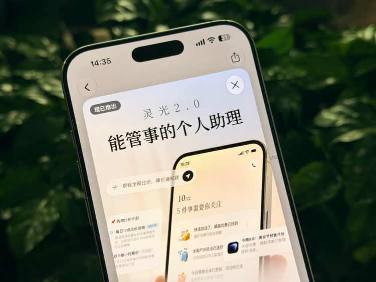



**收录说明**：用户提供链接。原文在微信公众号，用浏览器的客户端标识直接下载页面，从 `#js_content` 抽取正文，图片地址取自 `data-src`。文末点赞在看引导、大会广告与商务联系方式未收入。

**内容摘要**：白鲸技术栈的文章，探讨中国版 Personal Agent 为何可能从超级 App 中长出来，并以蚂蚁灵光2.0（10月27日发布）为样本。文章称在北美已有超过1000万人创建自己的 Muse，约四分之一每天使用，购物是它的第一大场景。作者实测了两项长期任务：持续半个月、预算5000元的双十一宠物囤货比价盯盘，以及每周日20:00生成养车周报、每月最后一天20:00生成养车月报的家庭用车成本记账。实测中灵光暂时不能直接登录ETC和充电App拉取订单，仍需用户提供截图或金额；文章同时指出灵光2.0现阶段对C端免费。

**保留理由**：对长期任务（双十一比价盯盘、养车成本记账）的一手实测，记录了数据缺口、后台问题和排期等具体边界，并分析了支付宝生态对中国版 Personal Agent 的意义。

---

探索中国版个人智能体的新形态。

作者*｜*Yoky  
微信*｜*yokyliu617

Personal Agent在海外已经不再只是一个概念。

在北美已有超过1000万人创建自己的Muse，约四分之一每天使用；购物是它的第一大场景，相关订单的平均金额超过200美元。至少从这些数字看，让AI持续参与个人生活、替用户推进任务，已经是一种成立的产品需求。

但同样的产品形态到了中国，却一直没有真正普及。这件事一度让我们很困惑：中国拥有更发达的移动互联网和更丰富的生活服务，为什么反而没有长出一个被广泛使用的Personal Agent？

问题可能不在AI，而在它要进入的是两套完全不同的互联网。海外的信息源开放但分散，订单、账单、预约和通知大量留在邮箱与网站中；一个Agent接入邮箱、日历和浏览器，就有机会把这些碎片重新串起来。中国的信息和服务看上去更集中，却被分隔在电商App、支付工具、出行平台和一个个小程序里。对Agent来说，前者需要整理碎片，后者首先要穿过服务孤岛。

这也意味着，中国版Personal Agent很难直接复制Muse。它需要的不只是模型、记忆和浏览器，还要有进入本地服务的接口，以及足够完整的个人上下文。换句话说，它更可能从一个拥有支付、消费和生活服务生态的超级App中长出来。

10月27日发布的灵光2.0，恰好提供了一个可以观察这条路径的样本。它一边连接支付宝里的账单、会员、出行和商家服务，一边把任务延伸到钉钉、飞书、邮箱、米家及更多开放工具；用户退出对话后，任务仍可继续运行，价格、预算或计划发生变化时，AI再主动跟进、提醒和调整。

在超级APP的生态下，重构Personal Agent，或许是中国版Muse的新路径之一。

**01**

**实测灵光2.0：长期跟踪才能真管事**

判断Personal Agent能力的一个标准，是它的长期任务执行能力，这挑战的不仅是对于个人的理解，还包括了记忆能力，执行能力，数据能力等等。

在双十一期间，我们尝试给灵光一个持续半个月的购物任务：为双十一宠物囤货规划，给定5000元固定预算，家中同时饲养猫、狗，需要结合过往消费习惯，完成为期半个月、持续到双十一收官的比价盯盘方案，目标锁定低价直播间、找准最佳下单节点。

←左右滑动查看更多→

接到需求后，灵光没有简单罗列商品清单，而是先复盘历史消费记录，识别用户过往的购买偏好：常购MAG化毛膏、猫狗罐头、猫砂，熟悉淘宝渠道与88VIP权益，是多宠家庭，消费有稳定节奏。

在此基础上，它先输出整体策略判断，区分不同品类的采购节奏：猫粮猫砂这类标品不追前期预热，优先等到11月10日晚全年底价场入手；零食、驱虫等小件，遇到合适价格可以提前锁单。

随后它完成预算拆解，把5000元额度清晰分配到猫粮猫砂、罐头冻干、狗粮、营养品驱虫、宠物装备、机动备用金六大板块，额度一目了然。同时自动生成了一份跨时段的盯盘时间表，标注从10月28日核对基线价，到品类周比价、大促爆发日、底价专场，直至11月13日大促收官的全周期动作，明确每个阶段要做的核查、比价、提示工作。

它还设置了灵活的交互机制：用户刷到商品截图、链接，随时发给它，就能实时判断是否属于好价；也支持随时调整清单、修改预算。整套方案把模糊的“蹲低价买宠物用品”需求，变成可落地、按天执行的盯盘计划，兼顾预算约束、品类特性和大促时间节奏，体现了持续任务规划、长周期记忆、动态响应调整的能力，适合复杂的长线消费决策场景。

第二个任务，我们让灵光长期管理一辆家庭用车的全部成本。油费、停车费、ETC、充电、洗车、保险和保养散落在不同账单里，用户真正缺的不是某一次费用查询，而是一套持续数月的账本：每次发生支出就归档，每周汇总里程和分项费用，每月再比较环比；一旦总费用超过2000元，还要继续判断究竟是出行次数增加，还是单次成本变高。

灵光先把任务拆成两层。平时，加油需要记录金额、油价和里程表读数，停车、充电和ETC则接收订单金额或截图；每周日20:00生成“养车周报”，汇总里程、油费、停车费、过路费和充电费；每月最后一天20:00生成“养车月报”，计算总支出、环比变化和涨幅最大的项目。超过2000元时，它会进一步拆解出行频次和单次成本，并给出省钱建议。

←左右滑动查看更多→

这次实测也暴露出边界：灵光暂时不能直接登录ETC和充电App拉取订单，仍需要用户提供截图或金额；记账服务首次发布还碰到后台问题，支出会先存入项目档案，功能补齐后再迁入账本。周行驶公里数也不能凭空得出，需要至少两次带里程表读数的加油记录后才能推算。

但任务没有停在一次对话里。灵光把记账范围、待办状态和数据缺口写进“养车成本记账”项目，并在“我的生活”中持续保留：当前等待第一笔支出入账，每周日和每月末的报告均已排期。真正要继续验证的，是在几周甚至几个月后，它能否记住每一笔分散支出，按时主动交付报告，并在费用异常时给出可信的归因，而不是等用户重新解释一遍。

**02**

**中国版Personal Agent**

**为什么会从超级App里长出来？**

通过实测灵光2.0，我们发现Personal Agent之所以先在海外成立，不只因为模型能力，也因为互联网相对开放。

订单、账单和预约散落在邮箱与网站里，信息分散但机器可读，流程冗长但浏览器可操作。Muse接入邮箱、日历和网页，就能盯机票、等退货、追账单；它补的是开放互联网没有整合好的那一层。

中国恰好相反。叫车、缴费、订票早已被App做得足够顺滑，用户不需要AI代点几下。真正费脑的是跨平台判断：哪里更便宜、优惠如何组合、会员该不该续、酒店降价后能否重订。信息却分散在订单、账单、小程序和会员体系里。海外Agent整理碎片，中国Agent先要穿过孤岛；它节省的不是点击，而是查信息、记规则和盯进度的注意力。

**灵光2.0与Muse的差异，未必来自Agent框架，而来自它站在支付宝里。**最大不同是个人上下文，以构建Personal的部分：经用户授权，账单、会员和出行记录能让AI看见真实消费，比临时描述更接近生活。但账单不等于一个人，替家人付款、报销和线下消费都可能造成误判。数据越靠近生活，授权和校正越重要。

而服务网络则是Agent执行能力和边界的体现。支付宝连接消费者、商家、小程序和支付能力；灵光还尝试接入钉钉、飞书、邮箱、米家，并通过浏览器、MCP和CLI扩展。加上云端持续运行，它同时获得上下文、时间和接口：能理解用户状态、长期跟进，也有机会把判断交给真实服务。少一项，就只是聊天机器人、点屏工具或提醒器。

另一方面，Personal Agent会持续消耗模型和工具成本，海外产品普遍依赖订阅或额度。如果用户每月先付一笔不低的费用，盯一次降价、整理一回账单，都要先算能否挣回订阅费。灵光2.0现阶段对C端免费，意义不只是降低门槛，而是让普通人先把长任务交给AI，再判断它是否值得付费。

但免费会把问题推向利益一致：如果未来靠佣金、分发或广告变现，Agent代表用户还是平台？导购会促成交易，个人Agent则应在消费破坏预算时建议“别买”。能否站在用户一边，比自动下单更接近Personal Agent的定义。

灵光2.0提供的是路线，不是答案。它仍需证明三件事：连接是否稳定覆盖足够多的高频服务，而非工具列表很长；授权是否让普通用户看得懂、随时撤回；页面变化、优惠失效和接口中断时，能否发现错误，并在付款、退订和发送信息前重新确认。

中国版Muse最后比拼的，可能不是谁替用户点得更多，而是谁能以更低的使用成本，在不越界、不急着促成交易的前提下，把割裂的服务重新组织成一件真正完成的事。接下来要看的，是实测里的授权、比较、提醒和失败，能不能支撑起这套定义。
