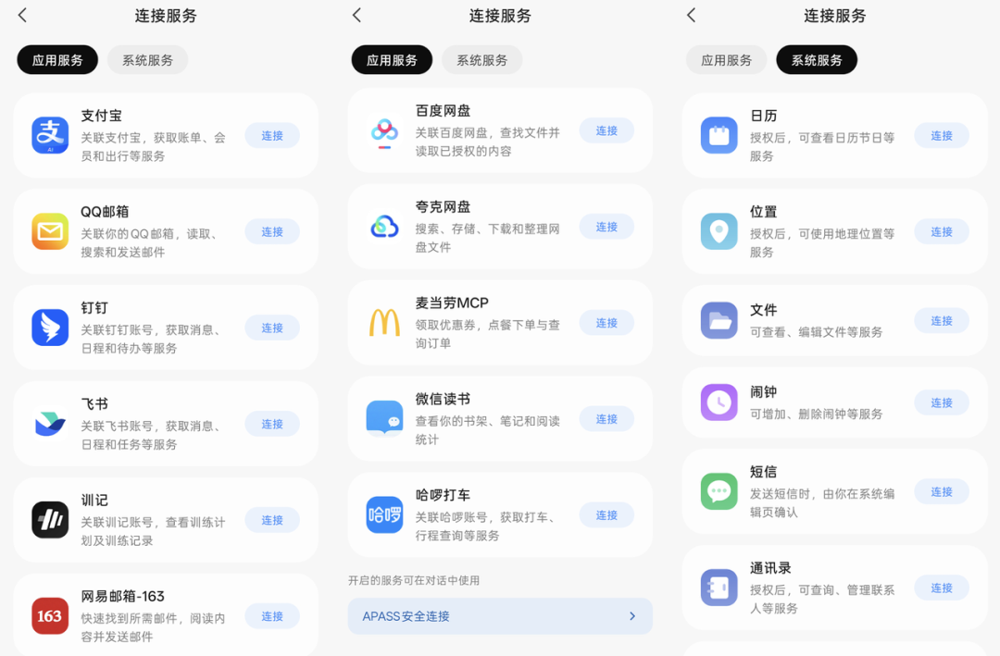



**收录说明**：用户提供链接。原文在微信公众号，用浏览器的客户端标识直接下载页面，从 `#js_content` 抽取正文，图片地址取自 `data-src`。文末分隔线后的作者名片与「找我爆料」二维码属于推广，未收入。

**内容摘要**：11月5日，蚂蚁集团旗下AI助手灵光公布运营数据：自10月27日灵光2.0上线，一周内帮助用户管理超116万项事务，执行超360万次任务，用户量突破2000万。11月4日灵光完成新一轮升级，新增哈啰打车、麦当劳、微信读书等连接器，外部连接器总数达到40项；此前已接入支付宝、飞书、钉钉、米家等服务。文章把灵光的路线概括为「平台底子+跨生态连接」，并与千问Go、字节「小豆」、腾讯LightVela等对照。文中引用中金研报：2030年中国Personal Agent市场规模超5100亿元，其中交易抽佣约3918亿元，占比近77%；文章认为抽佣规模、任务成功率、用户留存还有待给出可以被验证的答案。

**保留理由**：现有资料没有的 2.0 上线一周运营数据（事务数、任务数、用户量、请求分类占比）和 11 月 4 日的连接器更新，并附灵光「连接服务」页截图。

---

文丨胡镤心

11月5日，蚂蚁集团旗下AI助手灵光公布了一份运营数据：自10月27日灵光2.0上线，一周内帮助用户管理超116万项事务，执行超360万次任务，目前用户量已突破2000万。

昨天（11月4日），灵光刚刚完成新一轮升级，新增哈啰打车、麦当劳、微信读书等连接器，将开放生态打通的外部连接器总数推高至40项。在此之前，灵光已接入支付宝、飞书、钉钉、米家等服务，覆盖从账单管理到智能家居的场景。

灵光2.0交出的这组数据，正是这场骤然升温的军备竞赛中，第一批落地的实战推演。

**01**

**个人Agent如何跨生态突围**

在个人Agent赛道，前有阿里推出“千问Go”，字节被曝将代号“Spell”的项目整合为独立产品“小豆”，腾讯的LightVela也在云端、桌面和微信生态三条线上卡位；后有Today AI、Manus等创业公司加班加点，凭借灵活身段在垂直场景或海外市场寻找缝隙。

个人Agent试图解决具体且长程的用户诉求：机票订完后24小时盯价、识别闲置的自动续费订阅、持续整理班级群里的老师通知。从“办一次事”到“盯一件事的全过程”，任务的时间跨度被拉长，对跨服务调用的依赖随之加深。

从用户请求的分类来看，财务与消费场景占23.83%，健康与习惯占21.46%。消费者开始愿意把繁琐的账单梳理、支出结构分析、运动数据查询和饮食计划调整，交给一个不会遗忘的AI来托管。

但所有Personal Agent玩家，都不可避免地撞上了同一堵墙：中国用户的生活服务高度集中在超级App里，跨App执行任务需要获得服务方的许可。豆包手机助手此前推出自动化操作方案后，微信、淘宝、支付宝、美团等App出现在拒绝AI代操作的名单中。

在生态循环之外，“连接器”成为大厂和创业公司能拿出的最现实的解法。

连接器是一套标准化的接口协议（如MCP），让AI模型能够以合规、受控的方式访问外部工具和数据。以灵光为例，连接器负责打通系统，技能（Skill）赋予执行方法，工作伙伴提供角色分工。三者串联，才能实现从需求到成果的全流程自动化。

可以看出，在AI助手的牌桌上，干活的路径开始出现分化：平台型助手有流量入口和商业资源，获客和履约占优，阿里和字节在自有生态内做闭环，控制力最强；独立助手擅长跨生态整合，也受限于App开放权限，只能出海或聚焦单一场景。

灵光走的是“平台底子+跨生态连接”的中间路线，一边背靠支付宝生态拿到核心交易能力，一边用40项连接器向外扩容，去覆盖那些高频、琐碎的第三方生活服务。

**02**

**个人Agent商业模式将是“交易抽佣”？**

无论是做自有闭环还是走跨生态连接，本质上都是在抢占下一个消费级入口。但入口的广度，必须转化为交易深度才能兑现。

AI助手的连接器模式，真实的商业含金量究竟如何？中金公司在近期的一份研报中，用一套估值框架给Personal Agent算了一笔细账。经测算，基准情形下Personal Agent人均月消耗约3.6亿Token、硬件成本约23美元/月，当前部分套餐的订阅费可能覆盖不了硬件成本，更大的收入空间来自交易抽佣和广告。

中金预测2030年中国Personal Agent市场规模超5100亿元，其中订阅收入约838亿元、交易抽佣约3918亿元、广告约386亿元——抽佣占比高达近77%，这意味着投行眼中的Personal Agent，本质上是一个交易分发的入口，而不是一个卖订阅的软件。

这个账单间接给了Personal Agent一个判断标准：如果Personal Agent的商业模式主要靠抽佣，那么连接器必须是能产生交易和高频调用的“活连接”，而不是只挂在列表里、用户从不打开的“展示性接入”。

40项连接器里，支付宝账单、打车、外卖属于高频且能产生交易动作的场景，播客订阅、RSS阅读器则更偏信息消费，商业价值的分层是客观存在的。

灵光宣称一周管理了116万项事务，证明用户愿意交出部分控制权，让AI去代管那些枯燥的琐事。值得追问的是：这些任务的成功率是多少？需要人工接管的比例是多少？

长程任务的完成率，才是决定性要素。灵光的运营数据证明它拿到了参与这场竞争的入场券，但市场关注的估值锚点——抽佣规模、任务成功率、用户留存——还有待给出可以被验证的答案。
