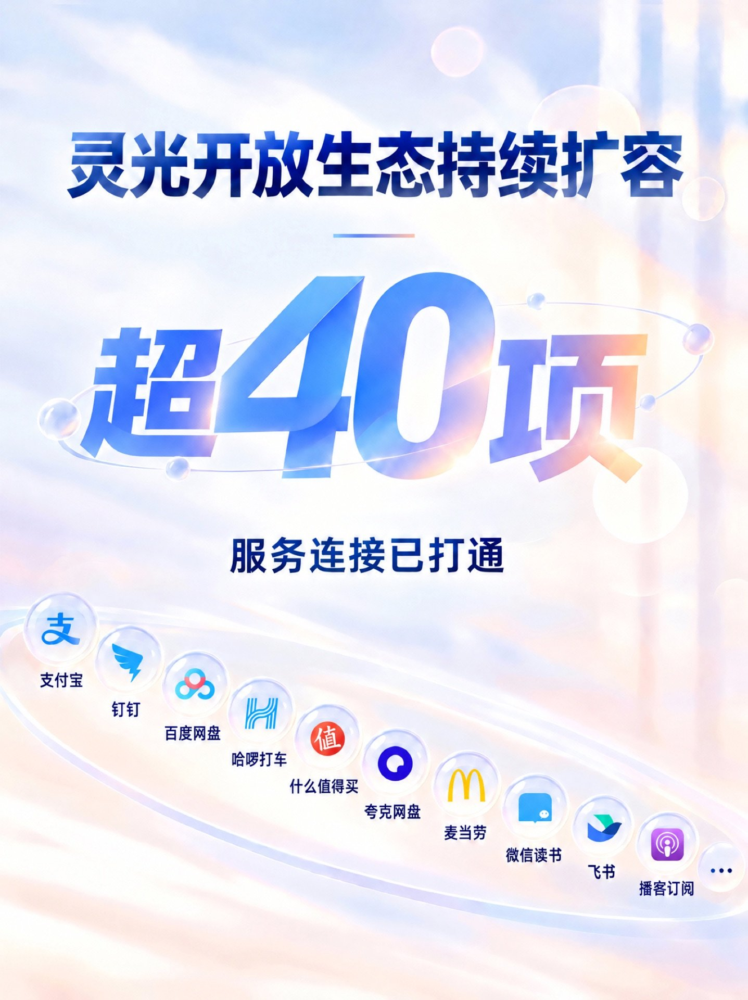



**收录说明**：雷峰网作者 Nemo 刊发的灵光官方消息（灵光的官方原文在公众号，检索不到）。直接下载，正文从「导语」一行起，到文末「雷峰网(公众号：雷峰网)」署名前止；页面的相关文章、热门搜索与账号提示未收入。

**内容摘要**：11月10日，灵光接入消费内容平台「什么值得买」，可以自主对比商品优劣、监控好价，降价时主动推送。文章称此前灵光已接入支付宝、钉钉、飞书、米家、微信读书、哈啰打车等40个连接器服务。示例是用户输入「双11准备买一个扫地机器人，帮我看看哪款扫地机器人更值得买？」，灵光完成对比，用户暂不购买时持续监控价格。

**保留理由**：记下什么值得买接入的日期、官方示例，以及此时连接器数为40个。

---

导语：11月10日，蚂蚁集团个人AI助理灵光接入消费内容平台什么值得买，可自主完成商品优劣对比与好价监控，并在降价时主动推送。此前灵光已接入40个连接器服务。

从商品推荐到价格追踪，个人AI助理进一步深入日常消费场景。

11月10日消息，蚂蚁集团旗下个人AI助理灵光接入消费内容平台「什么值得买」，将商品信息、消费决策支持等服务进一步纳入灵光。

此次接入是灵光持续扩展开放服务生态的又一动作。此前，灵光已陆续接入支付宝、钉钉、飞书、米家、微信读书、哈啰打车等40个连接器服务，能力覆盖工作、出行、家庭管理和日常生活等多个场景。

「什么值得买」长期积累了商品信息、消费内容和优惠信息等资源。对于灵光而言，接入专业消费信息服务，有助于提升AI在具体消费场景中的信息获取和服务能力；对于什么值得买而言，个人AI助理也提供了一个新的用户需求入口。此次连接「什么值得买」后，灵光将更加精准的实现持续关注商品价格变化，管理好用户“买什么、什么时候买更划算”这类日常事务。

对于消费者而言，购物的一大难题并不是下单，而是如何在海量商品、复杂促销和不断变化的价格中作出判断。以购买一台扫地机器人为例：

过去，用户通常需要在多个平台之间比较型号、配置、价格和促销活动。如果暂时不买，还需要反复查看商品是否降价、优惠如何叠加，费时费力。

现在，用户在灵光App输入“双11准备买一个扫地机器人，帮我看看哪款扫地机器人更值得买？”借助与什么值得买的服务连接，灵光会自主完成扫地机器人的优劣对比和好价监控，若用户暂时不买，灵光则会持续监控扫地机器人的价格优惠，并及时推送给用户。

这种变化也意味着，AI在消费场景中的作用正从一次性的信息查询，向持续性的消费决策辅助延伸。

对于个人AI助理而言，模型能力决定了它能否理解用户需求，而外部服务生态则决定了它能否真正参与用户生活。随着专业消费服务接入，个人AI助理的竞争正在从单纯的模型交互能力，延伸到真实服务供给和跨平台事务管理能力。用户未来可能不再需要为每一个消费需求反复打开不同App，而是将需求交给AI，由AI持续跟进，并在合适的时间提供决策支持。

据了解，10月27日，蚂蚁集团推出灵光2.0，将产品定位升级为“能管事的个人AI助理”。与传统问答式AI不同，灵光2.0能够在获得用户授权后，持续跟进相关事务，并在重要节点主动提醒用户。
