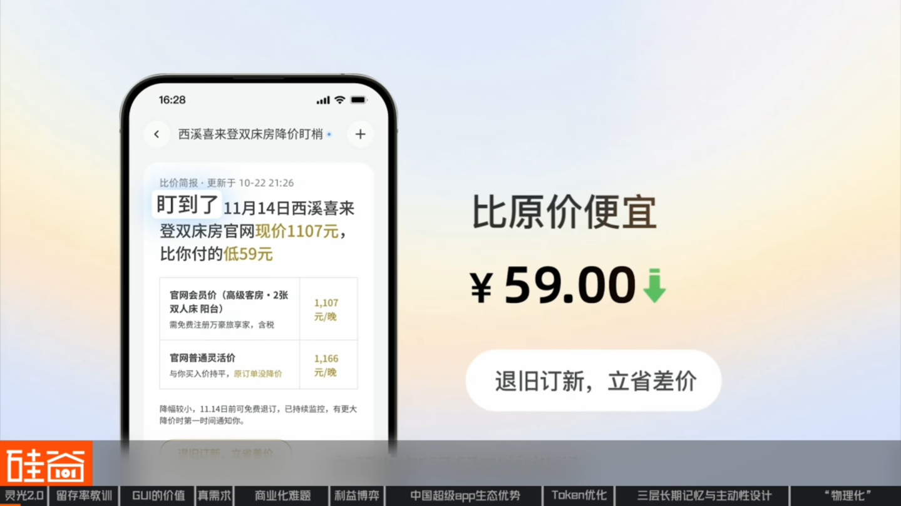
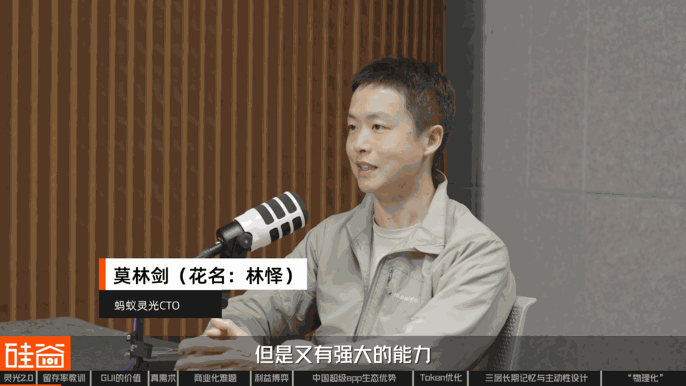
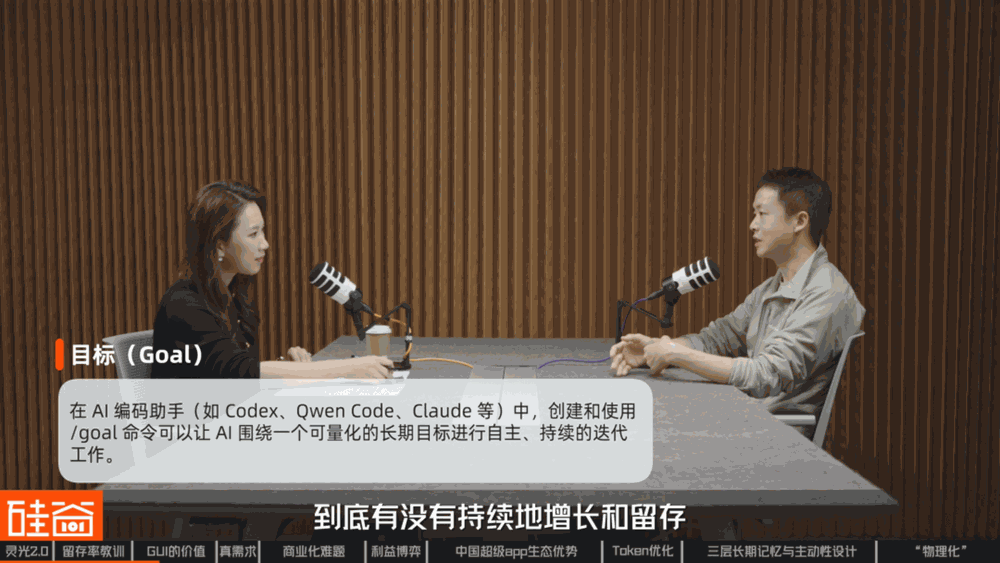
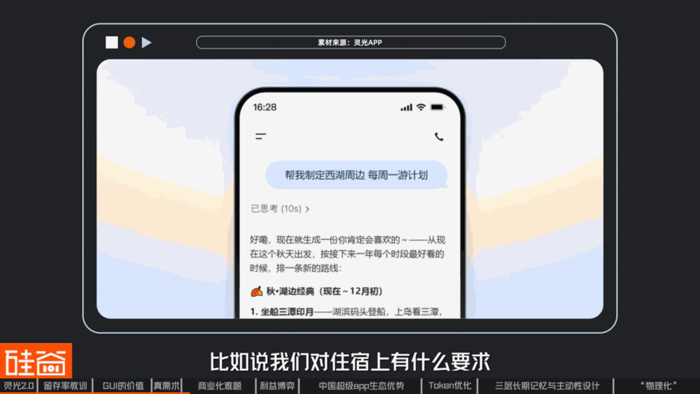
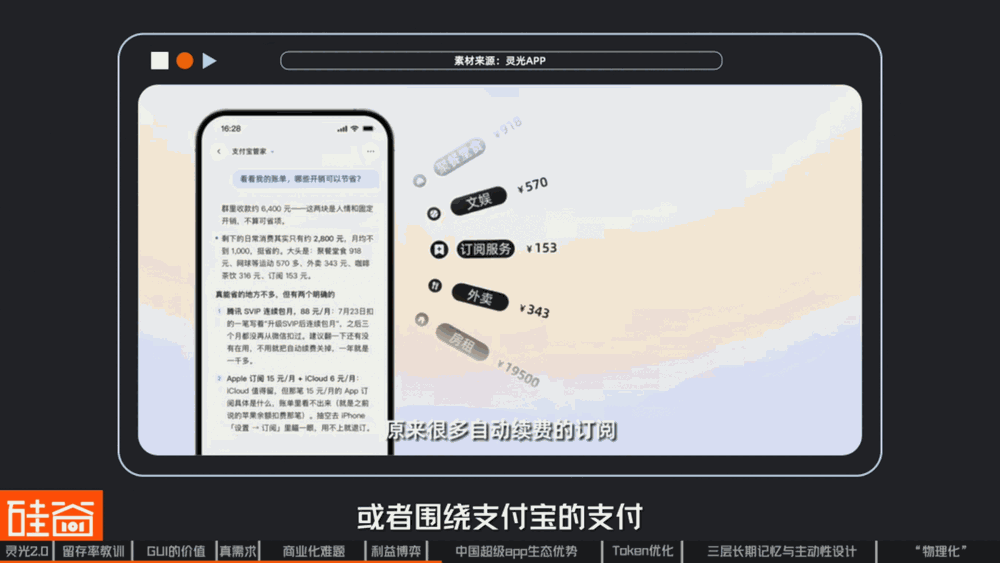
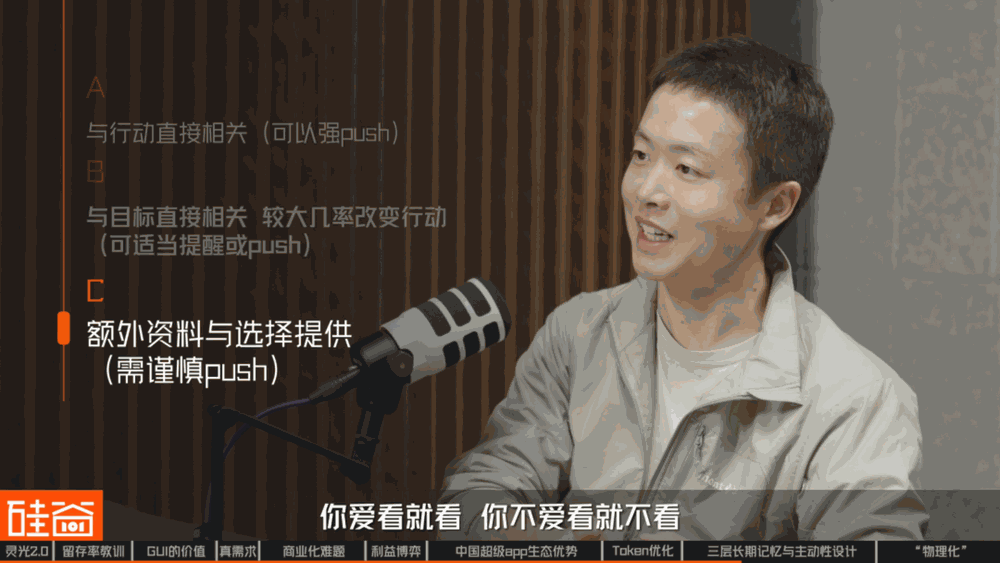
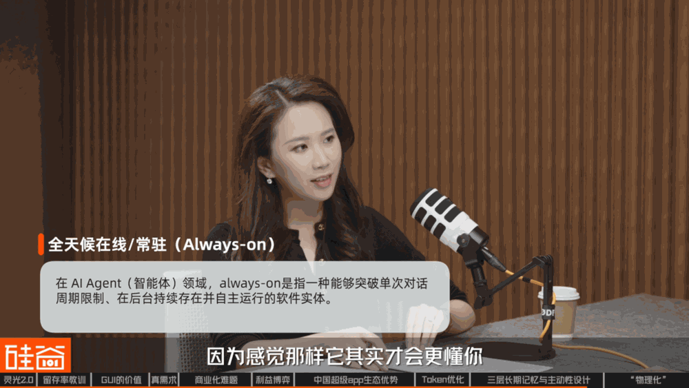
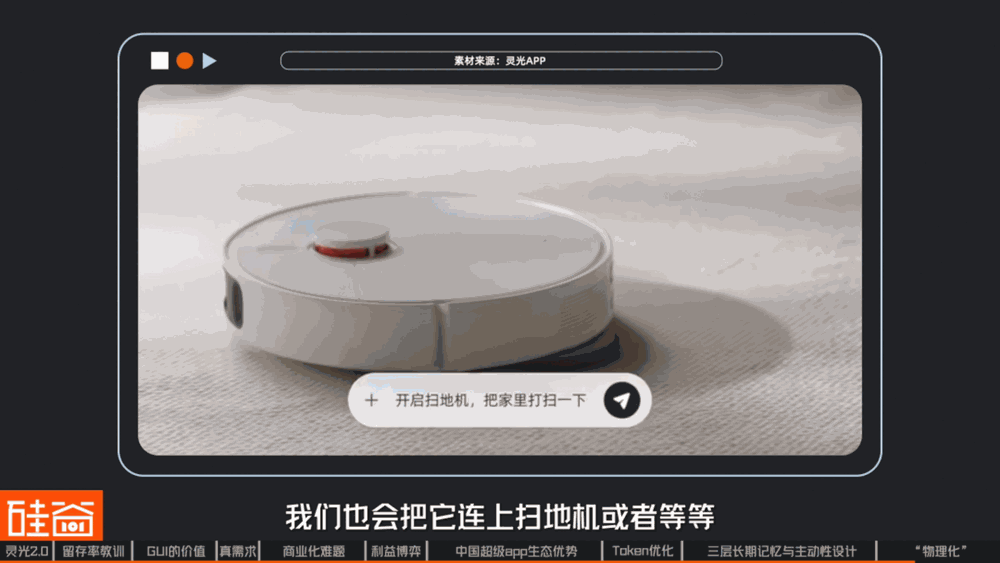



**收录说明**：《硅谷101》主持人陈茜对灵光 CTO 莫林剑（花名林怿）的访谈文字版，刊于钛媒体的硅谷101账号；直接下载后抽取正文，图片下载到本地。

**内容摘要**：硅谷101 访谈灵光 CTO 莫林剑（林怿）。他说 1.0 发现创造应用不是高频需求，2.0 转向帮用户完成目标，大约六七月开始酝酿；1.0 三日留存20%出头。技术方面，用 harness 兜底模型的概率性，开放服务用 MCP，涉及业务逻辑的查询用 A2A；安全上与 APASS 合作隔离账号密码，指令和动作分级，支付现阶段由用户确认，目前偏信息查询；成本上称 100B 模型得分可能高于过去的 1T 模型，后台任务可削峰填谷。他还把记忆分为长期偏好、事实、临时性三类，把主动提醒分三层、现在主要做第一层；商业化倾向会员费和抽佣，认为广告与 PA 难兼容；个人案例包括账单里发现退款额是消费额的五倍、连接佳明手表和体脂秤做半马训练。

**保留理由**：技术负责人的一手访谈，产品转向时间线、留存数字、MCP 与 A2A 的取舍、安全分级、记忆三分法和成本判断，都是已收资料里没有的。

---

> 文 | 硅谷101

2026下半年，全球科技巨头正在开启一场新的AI入口争夺战。

硅谷的Grok Bot、Muse、OpenAI Dots、Anthropic Duet，再到创业公司Instinct，Personal Assistant（个人助理）形态的AI产品纷纷出炉。

AI在企业端爆发之后，个人消费端是更大的市场，这也是所有巨头都纷纷加入的下一个战场。而在中国，PA类的产品之战也开始了，但中国市场和硅谷的生态会很不一样。

中国有着巨头们的Super app生态，这意味着，生态内的agent打通支付、办公、出行等环节会更加容易。但在AI产品竞争更强的大陆市场，这类产品如何商业化，也是重要的挑战。

我们与刚发布灵光2.0的蚂蚁灵光CTO莫林剑（花名：林怿）聊了聊，他对Agent产品进化的思考。

一年前，灵光1.0主打的是一句话生成闪应用，让没有编程能力的普通人，也能创造自己的工具，这是一个很有想象力的方向。但上线之后，团队也逐渐发现：用户能够创造一个应用，并不意味着这个应用真的解决了问题，创造本身也未必是一个高频需求。

所以到了2.0，灵光试图把产品的重心，从帮助用户创造工具，转向帮助用户真正完成目标。不只是回答一次问题，而是能够记住你的需求，持续跟踪任务，在合适的时候主动提醒，甚至在获得授权的情况下替你做事。

但与此同时，这场个人AI助手之战，也带来了很多值得讨论的问题。用户真的愿意为一个AI私人助理付费吗？如果AI可以替我们完成购物，原本依赖流量和广告的平台怎么办？当AI掌握了越来越多的个人信息，我们又该如何建立信任、确保它不会做错事？

这篇文章，我们聊聊个人AI助手之战背后的产品升级、技术进展、商业利益平衡，看看让普通人能用到的高频高价值AI产品，如何能来到我们身边。

陈茜：林怿，欢迎做客《硅谷101》。我知道你们刚发布了灵光2.0，距离灵光1.0的发布已经过去一年了，为什么选择在这个节点发布2.0？

**林怿：**2.0我们已经酝酿很久了。1.0给大家印象最深的可能是做闪应用，但我们一直在想，怎样帮助用户更好地把事情办好。无论问答还是应用，解决的往往只是某一方面的问题，而像旅行这类任务是会跨时间周期的。

我们大概从今年六七月份开始酝酿相关工作，在这个时间点发布，对我们来说是自然的结果。刚好业界也有很多类似的产品出现。

**陈茜：**所以灵光2.0的受众还是比较to C一点，希望帮助大众办事、解决问题，这是不是有点对标Muse？

**林怿：**我们并不是看到Muse之后才开始做，坦白说，那也来不及。我们是很早就开始做这件事了，它确实面向个人消费者，而且我们非常希望它是普通人能用的产品。

我可以讲一下自己的经历，我很早就用Codex这类工具管理生活、处理办公事务。比如给我的孩子去做错题的纠正，我会把孩子的错题拍进去，让它分析哪里错了，再针对性地出一道新题。如果又做错，就继续这个过程，有点像人工进行RL（强化学习）。但这个过程对普通人来说还是复杂，我妻子也用不起来，更难想象我妈妈或其他老年人能用起来。

**陈茜：**没办法只用一句自然语言来完成？

**林怿：**一句话搞不定，你得理解它背后的逻辑。

**陈茜：**因为它本来就是给开发者用的。

**林怿：**对，但我觉得类似的能力是可以泛化的。比如拿我妈妈来举例，她血压高，需要管理自己的血压，她现在就是每天拿一个小本子记录血压。

但记录只是第一步，更关键的是分析趋势，可能还需要建议：血压高了，应该做什么。这些事情适合用Codex或类似的agent来管理，但她根本用不起来。

我们看到了这么强大的能力，我妈妈却用不了。她需要这种能力吗？肯定需要。**我们希望把强大的能力做成普通人也能使用的产品。**

**陈茜：**这是不是也受到了今年年初“小龙虾”OpenClaw，以及后来Hermes兴起的启发？当时普通人同样用不起来，很多人很焦虑，即使装上了“小龙虾”，也不知道怎么用。

**林怿：**对，更多是一种启发。这种交互方式对我们很有参考意义，但我们的主线没有变过，都是希望帮助用户更好地完成一件事。

我们希望从查信息、做应用这些手段，走向直接围绕用户的目标展开交互。**用户把目标和约束说清楚，我们在过程中主动帮他完成。**这是产品自然升级的结果，过程中也吸收了这些产品的启发。

**陈茜：**要做一个所有人都能用起来的agent产品，过去一年有哪些技术进展，让今天的agent能力成为可能？

**林怿：****技术上首先肯定是模型能力。**去年大家可能还集中在编程、数学推理上，现在长程任务执行能力有了很大进步，这是条件之一。

**第二是harness（智能体运行框架）这一层。**它未必包含多么高深的技术，但对agent落地非常关键。

模型有自己的局限性，即使能力越来越强，有些问题仍然无法跨越。比如，它现在仍是概率模型，不能保证百分之百正确，包括新鲜事物在内的很多事情必须由工程手段兜底。因为模型训练至少以月为周期，新鲜事物也需要通过外围的记忆等机制补充。

此外，生态的发展、MCP（模型上下文协议）等，也都在推动这件事向前发展。成本同样关键，否则支撑不起它完成这么多事情。

**陈茜：**这些都很重要，我们稍后展开。先回顾一下灵光1.0的诞生：从1.0研发到2.0，你们从市场反馈中获得了哪些经验？

**林怿：**我们的产品不是在已有业务上做加法，而是希望贴近技术前沿做事。比如判断半年或一年后技术可能向哪里发展，再围绕这些能力构建产品。

去年开始做的时候，一个很大的趋势是编程能力的进步。它能不能帮助我们实现“帮人完成事情”的目标？一个很自然的方向就是帮人写程序、做应用。用一句话就能生成应用，门槛足够低，普通人也能用起来。

**陈茜：**我提一个有挑战性的问题。我们看到数据说，灵光1.0推出后，三日留存率当时在20%出头，不如chatbot（聊天机器人）。这给你们带来了什么思考，又如何影响2.0的产品设计？

**林怿：**一方面要看这些数字，另一方面还是要看内核：真正有用、被反复使用的应用，是不是在增长？

坦白说，制作闪应用并不是高频需求，很多人更倾向于直接使用。这也是我们后来做灵光圈的原因，不是每个人都有那么多主意，想自己制作应用。一个比较大的反思是，应该关注产品最终给用户带来了多少价值。**做出应用不代表产生了价值，真正用起来、解决了用户的问题，才有价值。**

到了2.0，我们会延续这种价值判断的方式，不会只看数字、只看有多少人创建，因为中间有太多其他因素干扰。核心还是看它有没有帮助用户真正完成事情，提供增量价值。

**陈茜：**我看到Muse现在的留存率可能也在20%出头。这个数字比你的预期高还是低？

**林怿：**如果是我，会想看那些已经创建目标、深度使用产品的人，有没有持续增长和留存。

整体数据会受其他因素影响，这和我们当时的闪应用有点像。产品爆火，必然会带来大量用户。如果每个人来了都能留下，当然最理想，但现实中会有很多干扰。

所以我更想看，有三到五个真正关心的目标的这批用户，是否持续增长、持续留存。我们上线后，也可能从这个角度看自己的情况。

**陈茜：**我看它最近用户应该超过1000万了，增长很快，但新增用户的速度在下降。这是必然的吗？

**林怿：**可能会遇到这种情况，也可能和能力的进化有关。对我们来说，有一点是共同的：还是应该回到最核心的用户价值。

**陈茜：**灵光1.0当时推出了1亿元的闪应用激励计划。你觉得花得值吗？如果值，2.0会推出相应的计划吗？如果不值，有什么经验教训？

**林怿：**对1.0来说，激励在培养习惯上肯定有价值，让更多人了解它、做出自己的第一个应用，有市场教育的意义，这一点比较明确。

第二，我们激励的不只是创建本身，也包括把产品做好。所以当时计划和灵光圈强绑定，结合得很紧。做出来是第一步，之后希望大家做出好东西，分享出去，得到认可，让更多人基于成果继续修改。

但真正做出精品，门槛仍然比较高，综合能力还有进步空间。大家能做出简单的、随手解决身边问题的应用，已经是好的。

**陈茜：**你觉得通用agent现在还需要市场教育吗？比如Meta也在用激励方式，通过邀请码给邀请双方免费的token额度，用补贴实现社交裂变。但ChatGPT当时没有采用这种推广方式。为什么chatbot当时不需要，agent现在却需要？是市场教育不够，还是能力还不足以让很多人自发使用？

**林怿：**我觉得可能有多方面因素。Meta肯定有争夺市场的考虑，和ChatGPT当年的时点不一样，那时ChatGPT独树一帜。

**陈茜：**当时没有竞争。

**林怿：**对，情况不一样。Meta面临激烈竞争，用裂变方式营销无可厚非，这和市场环境有关。

另一方面，用户已经养成使用chatbot的习惯。使用personal agent（个人智能体），要告诉它自己的目标，而不只是提出一个问题。不是问“南疆天气怎么样”，而是说“我要去南疆玩，你帮我安排”。这个习惯需要培养，让用户知道可以这样使用。虽然需要转变，但我觉得后者更符合人性，用户只要说出目的就可以了。

**陈茜：**改变用户习惯并不容易。互联网和移动互联网时代，大家习惯打开应用，通过点击操作完成一件事。现在要变成用自然语言告诉PA（个人智能体）想做什么，再由它自动完成。这样的交互范式变化，会带来十倍的效率提升或便利吗？

**林怿：**我认为不会是取代，两者应该更好地融合才对。

**陈茜：**你觉得原来的范式不会消失？

**林怿：**不会，而且这两者都会更好。比如GUI（图形用户界面）这种操作方式，有很大的天然优势。一方面，很多人已经被教育了。另一方面，它封装了操作步骤。比如一件复杂的事情，第一步勾选目的地，第二步再选其他条件，用户一看就懂，界面把最佳流程封装在里面了。

如果是纯对话，用户能一句话把所有信息说完整，当然很好。但太自由的话，用户未必知道下一步该表达什么。所以我觉得GUI这个方式是很好的封装，**因为对于重复性流程，点击可能比说话更方便，点一下就完成了。**

所以我觉得不会消失，这两者一定会更好地融合。我们在这方面也有很多探索，在做1.0时，就采用了GUI与对话结合的方式，希望用最合适的方式和用户交互，以信息效率最高的方式呈现结果。有时一图胜千言，有时一个交互动画比很多文字更有用。2.0也是一样的。

**陈茜：**自然语言不一定是最高效的沟通方式，而且很多东西没法用语言表达。

**林怿：**对，比如让我描述这个空间是什么样的，一句话怎么说？

**陈茜：**可能得写一篇800字的文章。

**林怿：**拍张照片反而最好。所以一定会有多种输入方式，包括多模态、非结构化的输入，而输出应该是结构化的。

**陈茜：**通用agent带来最多价值的是什么？以灵光2.0为例，你们看到用户觉得最有价值的场景有哪些？

**林怿：**我们接入了支付宝生态的一些能力。有位朋友让它分析账单，看看哪些是冤枉钱、哪里能省钱。结果发现，他退款的金额比消费金额高五倍。比如买了六件衣服，退掉五件，留下一件。它分析说他是冲动型消费者，他说戳中他了。

我也分析过自己的账单，它的建议是，我的电信套餐太奢侈。我看了一下，确实用不着那么高的额度，就把套餐降了一档，也算省钱了。虽然例子很小，但我觉得有价值。

还有暑假带家人去新疆旅行，做旅程的规划，我体感也非常好。我把目标、行程和约束条件，比如住宿要求告诉它，它就会全程帮我们盯着。最关键的是，它不只在出发前给一份旅行规划，行程中的体验更好。它会根据情况变化，告诉我下一步如何调整。比如南疆的景色很受天气影响，天气不好，景色就看不到，它会据此帮你调整行程。

**陈茜：**根据每天的实时变化，给出新的建议。

**林怿：**对。比如有一段时间吃坏了肚子，身体不舒服，它会建议重新调整行程。它会在行程中，根据我们关心的条件和外部变化，更新整体安排。不是昨天没完成，就简单地塞到明天，而是根据整个行程的目标重新规划，这个过程很省心。

**陈茜：**很有意思。我发现在硅谷，Muse一些热门场景也是帮大家省钱。

**林怿：**我看到很多是购物相关的。

**陈茜：**对。我也分享两个例子：一个是在Facebook的二手交易市场Marketplace上帮大家卖东西。另一个是让Muse去邮箱里找一些需要认领的小额退款或支票。邮件太多，用户很容易忽略，但它能帮忙找出来，让大家觉得确实省回了不少钱。

**林怿：**这些事情，人如果肯花时间，其实都能做，比如一笔笔查账单。但很多时候要么忘了，要么嫌麻烦，PA（个人智能体）可以替你做。

**陈茜：**你觉得agent到底能够做什么，以及它的高价值场景在什么样的地方？更有价值的是agent帮你省钱、省时间，还是帮你花钱、花时间？

**林怿：**我觉得不矛盾，这两件事现在都能做，而且做得还不错。

比如生产力和办公软件，白领最常用的Office三件套，做PPT、做Excel、写Word，就是第一批起来的场景。Claude Code、WorkBuddy这些产品也偏办公，之后才扩展到个人生活场景。

这两个场景不矛盾，都可以做好，但会涉及成本和性价比。现在推理成本仍然很高，办公场景相对更容易收回成本。

**陈茜：**面向企业用户，商业价值可能更高一些。

**林怿：**但纯办公场景的市场肯定没有生活场景大。基础技术在进步，成本也在下降，这也是产品能够成立的前提之一。省时间有很明确的价值，把省出来的时间更好地用来生活，不是很好吗？

**陈茜：**哪些让agent办事场景会比较高频？真正高频、可复现，才会有更高的价值和用户黏性。

**林怿：**办公肯定高频，生活中也有不少。我们每天心里可能都牵挂着一些事情，比如孩子相关的，小的时候要打疫苗，大一点要管学习。

**陈茜：**检查错题。

**林怿：**对。还有理财、管钱，怎么省钱、赚钱，以及出去玩，场景很多。

而且很多事情不是一轮对话就能解决的，背后隐含着目标。让我帮孩子管作业，是为了让他学得更好。要达成这个目标，中间有很多事可以做。

**陈茜：**它会成为每个人的私人秘书，让工作变得更简单？

**林怿：**有这种感觉。经过磨合，它越了解我，就越能替我处理那些繁琐的事情。**但真正需要我决策的事，还是应该告诉我。不需要打扰我的时候，它应该主动完成，这个边界感必须有。**

**陈茜：**用户会为这样的私人秘书付费吗？

**林怿：**要看它创造了什么增量价值。比如，它如果真能让我的孩子提高10分，我为什么不付费？我已经为教育花了那么多钱。所以还是看它创造了什么，我觉得付费需求肯定存在。

**陈茜：**有一种商业判断，是产品找到了用户的“痛点”还是“痒点”。痒点是可有可无，有了更好，但用户会比较价格和免费竞品。痛点则是大家确实愿意付费。现在agent帮大家提效、处理生活事务，是痛点还是痒点？

**林怿：**这和能力进展、具体场景都有关系。刚才说的教育，绝对是痛点，但仍要看我们能提供多少增量价值。并不是有了它就能解决所有问题，这肯定做不到。但它确实能大幅提升一些环节的效率，比无效刷题好很多。

有些场景，说是痒点也可以。比如我们经常用它总结钉钉消息，原来要一个群一个群翻，现在它每天自动给你总结，效率提高很多。你说是不是非它不可，也不能这么说，但它确实让我有时间去做别的事。

**陈茜：**商业化方面，硅谷最近的讨论也很热烈。Instinct已经说不会向用户收费，现在烧的是风险投资的钱。以后会用广告，还是按帮用户省下的钱抽取一定比例佣金，都还不确定。

大公司可能有另一套逻辑。比如Muse未必需要直接替Meta赚钱，也可能最终改善它的广告系统，通过广告效率提升带来收益。Grok Bot可能面向企业用户，按token或其他方式收费。

你觉得国内的商业与产品竞争、用户付费习惯，会和国际市场不同吗？

**林怿：**坦白说，不好判断，但很多底层逻辑应该类似，无非是向个人消费者收费，还是向企业收费。

现在大家还没有走到PA（个人智能体）商业化非常成功的阶段，企业市场已经有很多成功案例，但个人市场可能还没有。

收费模式上，我个人倾向于会员费，以及前面说的抽佣。广告模式和PA是否兼容，我觉得可能有难度。PA和chatbot或其他工具不太一样，工具仍然偏平台、流量逻辑，而PA像一个很亲密的伙伴。如果夹杂着商业利益和你交互，我觉得很难。

**陈茜：**早上起来先给你播报两个广告，体验可能就完全毁掉了。

**林怿：****PA（个人智能体）必须取得用户的信任，夹杂商业利益会让这件事变得困难。**也许会有创新，但我觉得挺难。

**陈茜：**那它怎么商业化？难道就不能商业化？

**林怿：**那也不是这个意思，我说的是广告模式。会员费、抽佣都可以尝试，我们在合适的时候可能也会尝试，但不一定现在就做。

核心仍然是有没有带来增量价值。先把蛋糕做大，至于大家怎么分，那是下一步的事情。如果它真的解决了痛点，让用户生活得更好，创造了额外利益，就一定能获得自己应有的部分。

**陈茜：**我问这个问题，是因为最近看到一些投资人认为，PA在中国不是小玩家的游戏，而是大玩家的游戏。

国内产品竞争非常激烈，大公司有资源，可能各方面的交互也做得更好，所以小玩家的机会不多，也不容易从一开始就实现商业化。

**林怿：**是。现在可能也不是立刻实施商业化的最佳阶段。应该考虑，但不一定要激进地推进。

创业者还有一个难点，和PA的能力边界有关。模型现在的行动能力、长程规划能力都很强，关键是你给它什么环境。在一个虚拟世界，或者说一个受控的环境里，它就只能做那些事情。如果只给它一台虚拟机，它能做的事情就限于这个虚拟世界。但如果连接上真实服务和真实世界，它能做的事情就更多。**不是模型能力不行，而是环境限制了它。**大平台过去积累的生态能力，在这方面会有很大帮助。

**陈茜：**这也是我接下来想问的重点：agent的能力边界和接入权限。灵光2.0设计时，会参考蚂蚁或阿里的整体生态，再决定产品形态，或明星案例吗？

**林怿：**肯定要考虑。前面第一个账单的例子，确实要依托支付宝这样的生态才能做。

各家产品在大概念上可能有相似之处，但依托自身生态发展出的，给客户提供的核心价值，可能不一样。比如围绕账单、支付，就能衍生很多与省钱相关的服务。

**陈茜：**蚂蚁和阿里的生态，还给灵光带来了什么优势？交付是一个非常高频发生的事情，出行也是。

**林怿：**对，第二个问题是，服务提供方在这场变化中持什么态度、处于什么位置。如果有自己的平台，调用自身能力，就不存在同样的问题。

**陈茜：**比如我们看到亚马逊把Muse挡在门外。你觉得动机、其中的冲突是什么？亚马逊作为平台方、还有用户，以及agent提供方Meta，三者存在什么冲突？

**林怿：**最大的原因可能还是商业利益，亚马逊的商业模式很依赖流量和广告。

按照PA（个人智能体）的逻辑，用户可能不需要访问平台就能直接完成交易，那这部分价值肯定会受到很大冲击，所以会有利益博弈。

**陈茜：**灵光和阿里，比如淘宝之间，就没有这种冲突了吗？

**林怿：**也不是。它不会直接取代平台，很长时间内，两种用户习惯肯定还是并存。以后完全以agent为入口、不再访问平台，我觉得不太会这样。但大家在一个大生态里，协作确实比对外部方便很多，尤其是在蚂蚁内部。

**陈茜：**有没有一种方式，能让三者利益一致？

**林怿：**我觉得博弈会持续很长时间，但核心还是看这种方式有没有创造增量。**没有增量，就是零和博弈，有了增量，利益协调才有新的空间。**

比如买咖啡，对一部分人是必需的，对我来说不是。我开车时原本不可能去买，但如果想喝时说一句话，就能让它帮我买，这样的场景是存在的。这不只是能力问题，还与支付、信任等一系列事情有关，业界应该一起挖掘。

**陈茜：**灵光2.0的接口怎么设计？现在能接入哪些？

**林怿：**花借的账单，还有很多外部开放的服务，比如邮箱、钉钉、飞书。接口有各种形式，商家开放MCP（模型上下文协议），就按这个协议接入，有些则采用A2A（智能体间通信协议）的方式。

**陈茜：**这两种协议现在发展到什么阶段了？

**林怿：**协议本身可能不是瓶颈，它们已经成为一些事实标准。无状态查询或比较简单的查询，用接口就可以。但有些查询背后带着业务逻辑，比如对接内部信贷业务，如果只是问“我的花呗账单是多少”，一句话、一个接口就可以。有时用户问的是“为什么我的额度这么低”、“怎么提高额度”，背后有业务逻辑，最好由信贷业务的agent回答，因为外部未必能准确掌握，这时采用A2A（智能体间通信协议）可能更合适。

**陈茜：**所以MCP和A2A并非哪一种绝对更好，而是看情况。如果对方不给权限，Browser Use（浏览器操作）是不是唯一解法？

**林怿：**Browser Use（浏览器操作）也未必能解决问题，要看不给权限的原因。比如亚马逊明确不允许你进入，你硬要通过Browser Use进去，就变成对抗，不会有很好的结果。

有一种情况是，对方愿意开放，但受条件限制。比如小商家可能没有技术能力，或没有额外费用开发接口，这时Browser Use可能是好的方式，因为它本来就愿意开放。但如果对方就是不让你用，那不只是技术问题。Browser Use当然有技术难度，但更大的问题可能在技术之外。

**陈茜：**如果这个冲突双方无法协调达成一致，会成为agent发展的瓶颈？

**林怿：**会。

**陈茜：**所以瓶颈不只是技术本身，各方还要先协调好利益。

**林怿：**对，很多复杂问题不纯粹是技术问题。

**陈茜：**你看到的行业趋势是什么？大家越来越趋于一致、开始合作，还是仍然处于对抗阶段？

**林怿：**很复杂，普遍都在尝试，不好说未来一定怎样。还是以亚马逊为例，各方态度不同，有各自的利益。

但有些事情我觉得一定会发生，**用户不会一步走到“以后只和agent交互”，但agent一定会成为一个默认选项。**

**陈茜：**一旦尝试后觉得好用，就很难回去了。我们有个同事前两个月卖家具，原来要自己在Facebook的Marketplace上拍照、上传、写说明，现在Muse可以直接帮他卖，介入的时间和精力都少很多。习惯这种方式后，就不会再想自己操作。

**林怿：**是的，这个习惯变化的趋势比较明确。但在这个趋势下，不同商家和品牌的态度会不一样。

高毛利的商家可能更愿意拥抱，比如有些品牌利润比较厚，不一定害怕比价，反而担心agent替它乱说话，因为回答方式不可控，可能影响品牌形象。与其让别人替我说，不如我自己主动接入。

另一方面，agent天然会比价，而价格体系可能很复杂，不同渠道定价不一样。有些商家会很担心，尤其是利润薄的商家。

**陈茜：**它会剥掉一部分中间套利空间。

**林怿：**对，所以小商家可能更难。但又不能不拥抱，否则流量迁移后，用户可能就看不到它了，这些问题比较难解。

**陈茜：**你刚才提到大平台的利益冲突，比如亚马逊拒绝Muse访问，也是因为原有商业模式和广告收入。广告商付费获得排名，agent进入后，这部分可能被颠覆？

**林怿：**对，是的。

**陈茜：**那唯一的方法就是，它可能需要改变商业模式。

**林怿：**我觉得它自己一定会尝试做类似的事情。美国生态有很多标准化的部分，整体比较开放。

国内基本是一些超级生态，从支付到购物形成闭环，而且有好几个这样的闭环。国外亚马逊可能是比较典型的代表，其他部分相对分散，整体更开放。

**陈茜：**国内的agent有没有可能更早落地，因为超级应用里已经有这些生态？

**林怿：**有足够的场景和空间，我觉得也许有可能。

**陈茜：**再聊聊安全性。AI总会有幻觉，agent可能犯错，做出意想不到的事。你们在安全方面是怎么设计的？

**林怿：**我觉得这是生死攸关的事情，甚至会影响整个行业的发展。前面说，PA（个人智能体）会成为用户的默认习惯之一，但有些条件可能让这个趋势发生变化。比如真的发生大规模恶性事件，用户失去信任，这件事肯定会往回退。所以它至关重要，我们做了一系列工作，而且必须持续做。

一方面，蚂蚁在安全方面有很深的积累。比如，我们与内部安全团队的APASS平台合作，做一些安全保护，**用户的账号、密码会与agent隔离。**

另一方面，针对可能做错的事，要给指令和执行动作分级，不同等级触发不同权限。比如支付，现阶段最简单的方式是都由用户确认。我们也在探索其他方式，蚂蚁集团整体在做“AI付”：满足一定额度、场景等条件时，可以帮用户自动付款，这需要体系化配合。

现在我们仍然更偏向信息查询，还没有大规模执行支付等有风险的动作。在基础设施完善之前，这方面确实要特别小心。

**陈茜：**现在最终决定权还在人手里，比如要不要付款，仍然需要人来决定。到什么条件下，才能让机器开始付款？一些小额支付，是不是可以让机器自动付？

**林怿：**刚才说的“AI付”，可能就是非常关键的基础设施。明确满足哪些条件、哪些场景可以代付，这就是基础设施要解决的问题。

**陈茜：**支付宝应该有很多经验。

**林怿：**有不少积累。但规模化去做，依然要特别小心。同时我们也有一定信心，因为蚂蚁集团在这方面有积累。

**陈茜：**之前提到，过去一年的技术优化让token消耗成本降低，这也是一个重要进展。具体有哪些技术，提高了token使用效率？

**林怿：**最大的动力肯定是模型技术进展。在一些关键榜单上，现在100B的模型，得分可能比过去1T的模型还高。这种进步很大，而且仍在持续。模型能干活、能做事，同时消耗大幅下降，我觉得这是最大的动力。

还有产品形态的变化，比如在Muse和灵光这类PA（个人智能体）里，很多任务都在后台执行。后台任务可调度，就意味着不必挤在高峰期，可以削峰填谷，在更合适的时间执行，更高效地使用硬件推理资源。这些变化都可能降低成本。

**陈茜：**背后调用的都是最大模型吗？还是小模型也能完成一些任务？

**林怿：**不少事情小模型就能完成，并不是都要用最大的模型。

**陈茜：**所以底层有大模型、小模型，根据任务调度不同模型？

**林怿：**对，理论上可以这样做。但我们在这方面还有不少优化空间，并不是现在已经做得很好。

**陈茜：**接下来的优化空间主要在调度上吗？

**林怿：**我觉得主要还是模型，调度可以同步优化。模型会持续进步，我们在百灵上已经看到很大进展。比如AA等公开榜单，同样尺寸的模型和此前的分数相比，几个月时间就能进步很快。

**陈茜：**现在模型进展确实很快，接下来有了RSI（递归自我改进），可能还会更快。你期待哪些现在AI做不到的场景，在未来半年或一年，随着模型进步变得可行？

**林怿：**有一点我非常期待，但现在还比较难：让PA（个人智能体）越用越好。

**陈茜：**越来越懂你？

**林怿：**不只是懂你，而是越来越好。

**陈茜：**你怎么定义“好”？

**林怿：**“懂你”更多体现在记忆上，也就是更了解你，可以通过上下文来解决。

但“好”不只体现在记忆上，还可能体现在执行路径上。比如帮你买机票，知道你的喜好，是更懂你。但搜索路径和执行路径也有优化空间。假设它查了十个平台或十家航司，能不能保存其中最好的经验，下次更高效地完成？这既关系到成本和效率，也关系到效果。

复杂的长程任务不能保证每次成功，有时搜索失败，有时超时。积累经验后，成功率可能也会提升。类似概念很早就有，Hermes上也有自动总结skills（技能）的做法。但不能随意实施，因为可能产生副作用。

**陈茜：**什么副作用？

**林怿：**比如总结过度。

**陈茜：**什么叫总结过度？

**林怿：**比如我说“今天不吃辣”，它就总结成“这个人永远不吃辣”。这个边界很难把握。

**陈茜：**错误地给你归类，没有正确识别意图。

**林怿：**对。一条执行路径这次成功了，以后就一定最好吗？也不一定。

**陈茜：**而且我也可能变，今天不想吃辣，明天又想吃了。

**林怿：**对，喜好是一方面，执行能力又是一方面。

不是说现在完全做不到。在“懂你”这件事上，记忆能发挥很多作用。**但要全自动地优化用户的执行轨迹，并把优化沉淀成系统能力，让它越用越好，还有很多条件需要处理。**

这个闭环不只涉及记忆，还涉及skills（技能）、模型。模型应该吸收哪些经验，不应该吸收哪些？很多东西在概念上能跑通，但在真实运行中保持持续变好，仍然很难，噪声非常大。

**陈茜：**你觉得未来几个月会慢慢实现？

**林怿：**我们希望如此，但不一定未来几个月就能马上解决。我觉得它会持续进步，让用户感到越用越好。

**陈茜：**刚才提到的长期记忆、长上下文的问题，现在已经解决了吗？

**林怿：**肯定不能说解决了，刚才那个例子也不容易。我觉得记忆大体可以分三类。

**第一类是长期偏好，相对稳定。**比如喜欢住某个品牌的酒店，或者长期习惯。

**第二类是事实，是真实发生的事。**比如旅行时，今天去了三个地方，第四个地方没有去，这是事实。

**第三类是临时性的事情**，比如“今天不吃辣”。

这三者需要区分。什么时候该归到哪一类？临时性的事情，什么时候可以上升为长期偏好？都需要分别处理。

PA（个人智能体）相比chatbot，在这方面有一定优势，有些信息可以更好地用于记忆处理。拿灵光来说，它会持续帮你管好某一件事情，中间有很多交互和过程，就能比较好地沉淀事实层的记忆，也就是真正发生过什么。

在chatbot里，我查了某个品牌的汽车，并不能说明我一定要买它，我只是查了一下。但如果我设定了一个目标：“我要攒钱买某款车”，这是用户明确设定的事实，也能帮助理解之后的相关查询。

把临时、一次性的对话放到持续的thread（任务线程）中，对记忆处理会有帮助。可以从真实发生的事情中提取长期偏好，或据此调整给用户的回答，相比一次性对话，更有依据。

**陈茜：**这涉及另一个层面：AI的主动性和被动性。Chatbot是被动响应的，PA（个人智能体）则可以主动，有时甚至会催你。

**林怿：**对，这个度要把握。

**陈茜：**它会提醒你，今天、明天分别要完成什么，才能达成长远目标。它可以积极一些，但这个尺度该怎么设计？

**林怿：**这是个很好的问题，我们也在探索。我觉得可以把信息分成三层。

**第一类，和行动目标直接相关、在主路径上的事情。**比如旅行时，“再不起床，就看不到日出了”。这时提醒是应该的，否则错过了就是它失职。这类事情必须做好。

**第二类，有一定概率，或较大概率改变用户行动的信息**，我认为也应该适当地交付给用户。比如它知道你很爱喝咖啡，目的地附近有家评价很好的咖啡店，而且你以前表现过愿意为一杯咖啡改变行程。它不在主线上，却很可能改变你的行动，这种信息也应该告诉你。

**第三类，目的地的介绍之类的。**这类信息更像秘书把一份材料放在旁边，你想看就看，不想看也可以。

因此，需要对信息分层，交互方式也可能不同。第一类应该强提醒，第二类也许在对话里提醒，或在专门的位置呈现。第三类可以放在额外的位置供用户查看，但至少不应该主动推送提醒。灵光现在还是偏保守，没有那么主动地干扰用户。

**陈茜：**以后是不是可以提供不同模式？比如我想要一个积极主动的助手，提醒我别太懒，每天多做些事。

**林怿：**对，这里面也有个性化。

**陈茜：**可以是不同性格、不同个性的PA（个人智能体）。

**林怿：**对，而且人的性格会影响信息分层。同一家好咖啡店，如果你很爱喝咖啡，对你可能属于第二类，对我可能就不是。要看它会对你产生多大影响。

**陈茜：**这也是你最开始说的增量价值。如果不知道有这家店，我不会去消费。知道了，又想去尝试，就带来了增量。

还有一些是“我不知道自己不知道”的事。如果PA（个人智能体）告诉我，这个东西存在，要不要考虑一下，它就在认知、信息和选择上提供了增量，最后也可能带来消费增量。

**林怿：**对，有可能。我们现在主要在做第一类，尝试向第二类探索。

**陈茜：**我觉得很有价值。我用过一个朋友创业做的应用，它的agent会把新认识的人和已有的人脉联系起来。

比如我要见一个人，它会告诉我对方的背景、怎么介绍自己，也大概知道我们聊过什么、我最近在哪里。有次我到北京，它主动告诉我，某个人最近可能也在北京，建议见一面。或者它知道我马上要去机场，中间还有两个小时空档，就建议利用这段时间见人。这对我的人脉和社交网络很有帮助。

**林怿：**是的，能带来很好的惊喜感。前面说的第二类，我们一定应该做。

**陈茜：**所以未来真正有价值的机会，可能在第二类？

**林怿：**我觉得第二、第三类都有价值，但要判断：用户知道这个信息后，有多大概率改变行动？

改变的概率不大，可能就属于第三类，知道最好，不知道也无所谓。第二类则有较大可能影响行动，也就是你说的增量和惊喜。

**陈茜：**做好第二类，需要什么前提？

**林怿：****首先肯定得了解用户，因为同一个信息，可能改变一个人的行动，却不改变另一个人的。**无论叫记忆，还是“懂这个人”，这都是前提。

第二，要有足够的信息。我首先得知道那里有一家咖啡店，而且评价不错。知道这些之后，有很多技术手段可以做。

**陈茜：**现在大部分agent还停留在第一类？

**林怿：**我觉得不能这么说。第一类肯定是大部分agent必须做的，不做就很难称为agent。但不同产品的策略不一样，有些非常主动，甚至让你觉得啰嗦。

**陈茜：**催得太多，甚至命令我去见人。

**林怿：**对，它可能把一部分第三类信息当成了第一类或第二类。不同产品的选择不一样，我们现在整体可能太保守了，应该更主动地探索增量价值。

**陈茜：**现在灵光主要在做第一类，以后会往第二类发展？

**林怿：**对，现在是第一类，加上少量第二类，我们希望探索更多。

**陈茜：**还有没有内测灵光2.0时，比较有意思的真实案例？

**林怿：**我现在对它有深度依赖，确实把生活中的一些事情托付给它了。

**陈茜：**深度依赖，是指每天会打开很多次？

**林怿：**对，使用时长也比较高。还是以新疆旅行为例，我可能会用一两个小时。

以前如果不是刻意测试，每天可能只交互几次或十几次，不会用那么久。但把它当成PA（个人智能体），而不只是信息查询工具时，我会有很多话想告诉它。比如身体不舒服、行程发生变化，它就会帮我规划。更重要的是，它越了解我，就越能提供更好的帮助。

所以每天结束后，我的孩子也很愿意告诉它，今天喜欢什么、不喜欢什么，主动写一次旅行日记。这些信息可以帮助下一次旅行规划，让它更了解我们。**看到价值，才会愿意花时间。**如果交互更有意思，孩子也更愿意做，使用时长自然就增加了。

还有运动，因为我喜欢跑步，比如想跑半马，一方面它可以制定训练计划，安排今天跑多少公里、明天做力量训练。另一方面是连接器。现在可以连上佳明手表、体脂秤，还有力量训练应用。这些数据每天定时回传，我不用告诉它今天跑了多久，它就能总结好，再安排第二天的计划，很省心。

有时我打开它，会反馈今天太累、跑不动。还有时会打开查看当天安排，以前要主动查询“今天应该做什么”，现在它会推送给我，按课表跑就可以。

**把真正关心的目标交给它，当作PA（个人智能体）使用，这才是深度使用。**它也会犯错，告诉它哪里错了，它会改。这样用下来，我觉得黏性很高。

**陈茜：**越用越懂你。

**林怿：**对，价值也会越高。但我们也要解决，怎样让用户更好地使用它。它不像对话那么直接，问一个问题就有答案，而是需要一个过程。

**陈茜：**PA（个人智能体）的最终形态，会有always-on（持续在线）的形态吗？感觉这样才能更懂你，但技术挑战也很多。

**林怿：**不一定要真正always-on（持续在线）。比如我们真的有一个助理，也不需要他24小时跟着你、盯着你。

**陈茜：**但好的助理如果24小时都在，会很好。

**林怿：**我觉得最需要的时候在就可以。比如健身，一天里最关键的就是几个时间点：告诉你训练计划，有结果后帮你分析，给出第二天的建议。有问题时，还能解释清楚。做到这些，在这件事情上就合格了。

再往前，就是多做一些第二类事情，比如提供更好的训练建议。**用户感受到始终在线，不代表后台必须一直运行。**它可以在合适的时候唤醒，把事情做好。

**陈茜：**如果要做到始终在线，背后需要什么技术里程碑？

**林怿：**还是那个观点，用户体感上的始终在线，和技术实现上的始终在线，是两回事。让PA（个人智能体）24小时不停运行，主要不在技术，而在成本，以及它到底创造了什么增量价值。

**陈茜：**仍然是成本和增量价值之间的平衡。

**林怿：**对。很多时候只是在空跑，没有增量，价值就没那么大。

**陈茜：**你看好agent手机吗？如果只是一个应用，总得点开手机、打开应用才能使用。端侧硬件可以更好地伴随用户、接收信息，形成始终在线的PA（个人智能体）。这会是最终形态吗？

**林怿：**我认为会往这方面发展。比如开车时，也会有想问几个问题、聊两句的需求。但打开手机、再打开应用，不是最好的选择。

如果有车机、眼镜等硬件入口，PA就可以无处不在。我觉得这是一个趋势，因为需求存在。我自己开车时，有时也想掏出手机问几个问题，但又有点危险。

**陈茜：**对，我也会。因为我开特斯拉，在使用FSD时，有时会想拿手机做些事。但如果眼睛不看前方，车内摄像头就会判定违规。

**林怿：**所以需求存在，只是还没被很好地满足。我觉得它一定会通过耳机、车机等方式得到满足。

**陈茜：**畅想一下，灵光3.0会是什么样？

**林怿：**我不敢说3.0是什么样，但有几个方向比较明确，会持续推进。

**一个是无处不在的PA（个人智能体），随时能以最方便的方式调用，用最自然的方式交互。**现在很多还是语音、文字，也支持图片，实时多模态交互等都可以探索，但技术挑战很大。

**第二是连接更广泛的物理世界。**现在还是虚拟世界加上一些服务，这个范围一定会持续扩大。

**还有中间这一层，PA要能够非常可靠地完成任务。**评价PA，最核心的是它能否真正完成用户交付的任务，可靠性是最底层的要求。

**陈茜：**连接物理世界，具体指什么？

**林怿：**可以通过接口，比如连接智能家居、扫地机器人。很多家居设备已经提供这类接口，连接是很自然的事情，现在就具备条件。

**陈茜：**我觉得很需要。比如特斯拉可以提前设定车内温度。在美国，有时外面30多度，车里可能40多度，但我经常忘记提前开空调。如果agent知道我马上回车里，大概三分钟后到，提前连接好特斯拉应用，就能自动帮我调低温度。这是我愿意付费的功能。

**林怿：**它的好处是能接触到更广泛的信息。特斯拉应用本来也可以让你提前开空调。

**陈茜：**但它不是主动的，因为它不知道我什么时候回来。

**林怿：**对，这是关键，PA接触的信息更广。比如陪孩子上一个半小时的辅导班，不知道你们现在上不上，国内比较常见。

**陈茜：**孩子现在一岁半，还没开始上，以后可能会。

**林怿：**它知道辅导班时长是一个半小时，也可能知道我什么时候进停车场。至少在国内，智能无感停车的信息会推送到支付宝。

如果它知道停车时间、课程时长，也知道外面温度超过30度，这些事情可能不用你说，就能联动，在合适的时间提前打开空调。如果当天凉快，就不必开。具体提前多久，也和到达时间有关。这些理论上都可以设想，我觉得离我们不远。

**陈茜：**最后两个比较个人的问题。我和很多做agent的创业者聊，他们都很兴奋，觉得自己正在创造让人类生活更方便、快捷的产品。你有类似感受吗？有哪些时刻让你觉得，自己在做一个令人激动的产品？

**林怿：**有，而且感受很强。前面的一些例子都是，比如用它处理错题，我孩子的数学成绩确实提高了。

**陈茜：**真的？从多少分提高到多少分？

**林怿：**从80多分提高到90分。

**陈茜：**很不错。

**林怿：**对，真的挺好的，而且关键是省时间。原来靠刷题可能也能做到，但它是有针对性地帮助你。这是最早让我直观感到它有价值的事情。

还有旅行时，孩子主动说：“今天晚上我还没和它说旅行日记呢”，我也觉得有价值。

还有一个小瞬间，孩子想给我太太买礼物，问它买什么好。它知道我们国庆要去日本，先给了一些常规建议，后来又说：“你国庆要去日本，不如到现场给妈妈挑。”

那一刻，我觉得这个产品和以前不一样。它不是套用固定方式直接回答，而是真的知道你的行程，建议你去日本现场给妈妈挑手串。

**陈茜：**非常个性化。

**林怿：**这些瞬间让我觉得它有用，我甚至希望我妈妈也能用起来。如果有一天她告诉我，这个东西对她很有用，我会更有成就感。

**陈茜：**我觉得老年人会非常需要。之前和另一位采访对象聊天，他很担心全球老龄化。孩子们都在工作，生活压力也大，很多老年人需要陪伴，在就医、应对孤独、日常社交方面，都需要更多帮助，而现在的帮助还不够。

如果有一个产品，真的能帮老年人叫外卖、跟踪身体指标，或者提出生活中的小建议，我觉得会非常有意义。

**林怿：**是的。**我希望能帮助普通人更好地生活，把琐事交给灵光，让大家有更多时间去生活。**

**陈茜：**也希望我们的agent产品越做越好，帮助更多的人。非常感谢你的时间。

**林怿：**谢谢。

以上就是我们与林怿的对话。聊完这期我们会发现，当下一个非常明显的趋势是，AI正在变得越来越“主动”和“能做事儿”。 但是，要让个人AI助手真正来到我们生活，还有几个需要解决的门槛：

**第一道，是技术和信任的问题。**

**第二道，是生态和利益分配的问题。**

**第三道，是商业化。**

这几个关键问题的背后，其实是一个技术和商业化的逻辑打通：个人AI助手的终极竞争，可能不在于谁拥有最强的模型，而在于谁能获得用户的信任，接入足够多的真实服务，并且持续创造可以被衡量的价值。

但这三道坎，还需要公司和产品们一个一个去打通和解决。但我们相信，一旦解决，AI助手会开始非常自然地融入我们的生活，能真正把时间还给人。
