

**收录说明**：同题文章另见腾讯云开发者社区和知乎；腾讯云页面有反爬脚本、Wayback 没有快照，知乎返回登录验证，2026-11-05 未收。这次依据网易号「念洲」的页面收入，正文完整（6 节、25 张截图），最先发在哪个平台未能确认。网易页面的导航、相关推荐和评论区未收入；图片从网易图床的缩略地址还原为原图地址后下载。

**内容摘要**：作者在 Mac 桌面端用邀请码 MEETCUE 注册 Cue，看到 Agent 的云电脑是 4 个物理 CPU（8 个逻辑 CPU）、16G 内存、40G 硬盘的 Ubuntu 服务器，有 root 权限，远程桌面很卡。让 Agent 用自己的邮箱注册 Notion，前后约 16 分钟、手动介入 3 次（开通邮箱、授权 AgentMail、接管浏览器填验证码），验证码已经收到，但 Agent 填不进网页。让它收集 DeepSeek、Kimi、智谱近 30 天的更新整理成 Excel，约 5 分钟完成，中途关掉 App 结果仍在，全程未介入。拉调研员、核查员、编辑三个 Agent 建群做选题，不到 10 分钟拿到定稿，等待期间群里没有进度提示，编辑推荐后调研员又重发了一遍。作者记下 Pro「100 美金一个月」、现在限免、有每周重置的周额度，电话与二维码建 Agent 未实测；结论是「值得先试、但谈不上离不开」，授权范围和任务进度不够透明，网页操作和远程桌面偏慢。

**保留理由**：给出了云电脑配置（并与 Muse 的 2 CPU、8G、100G 对照）、邮箱注册 Notion 卡在填验证码、后台整理 Excel 关掉 App 后照样完成、三 Agent 群聊的耗时与无进度反馈等具体实测，已收的实测里没有这些细节。

---

随着 Grok Bot、Muse 的推出，AI 圈就掀起了一股永不掉线的个人 Agent 的狂潮。

在昨天发完 Muse 的测评之后，我本来就想等着今天凌晨 OpenAI 的同类产品，结果没想到一觉起来，出现了一个新的黑马：Cue

我们都是第一次听到这个名字，但它的出品公司想必大家都听过，就是 Manus。他们今天同时推出了两款产品，一个是 manus Studio，一个是 Cue。

这篇文章我们主要就来聊一聊 Cue。

01 Cue 是什么：Agent 的身份与资产

Cue 是什么？前面说了，像我们现在这样的，Codex 也好，Workbuddy 也好，其实已经是 Agent 了。但有个问题就是，一旦你离开了电脑，它就不能帮你干活了。

所以现在就流行一种永远在线的 Agent。你随时随地可以给你的这个 Agent 发消息，甚至打电话，让它帮你把机票、酒店给订了，把文案给做了等等。

想要用 Cue 的话，可以到它的官方网站 http://cue.im 上面去下载 APP。不过 iOS App Store 还没有上架，所以我这篇文章主要还是在 Mac 里面体验它的桌面端。

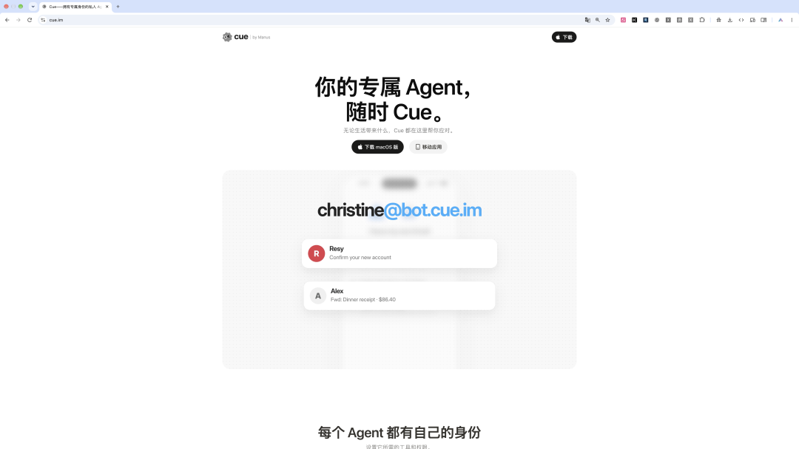

▲ 图：Cue 官网下载页面

登录它的时候，它会问你是老的 Manus 用户还是注册个新的。这里我注册一个新的，在注册的最后，需要填入邀请码。

目前 Cue 还没有完全开放，可以用 MEETCUE 这个邀请码。

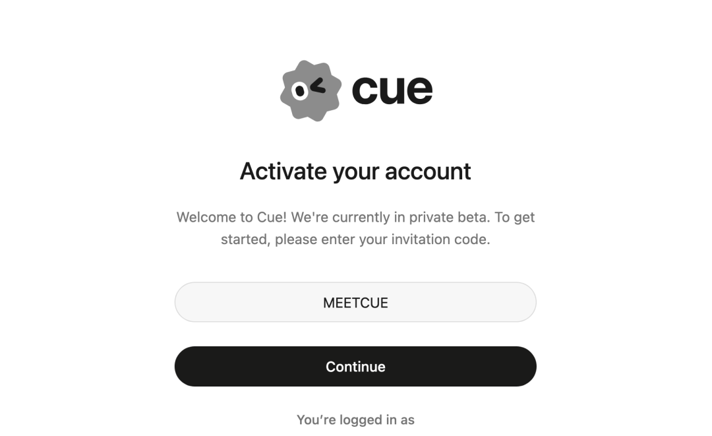

▲ 图：Cue 注册时的邀请码页面

然后就是一些账号名之类的设置，最后会出现一个比较关键的信息，邮箱和电话：

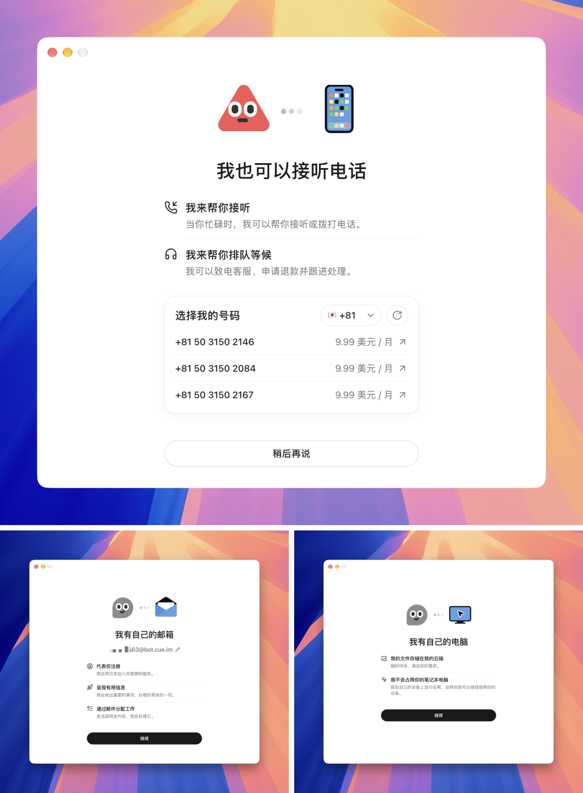

▲ 图：Cue 的邮箱、电话和电脑开通界面

第一次看到这个的人估计会很懵。

这是 cue 的一个很大的特点，他们把 cue 当做一个真正的“人”，所以它应该有名字、邮件地址、电话号码、钱包，甚至一台电脑。

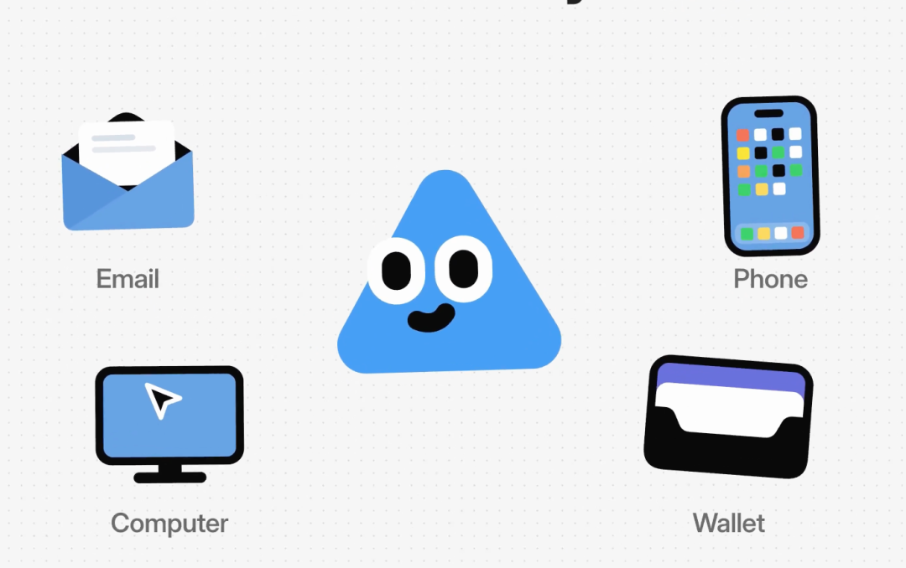

▲ 图：Cue 为 Agent 展示的邮箱、电话、电脑和钱包

不过这个电话号码，不是每个地区都开放，而且我看价格还不便宜，至于它做什么用，后面具体聊。

02 Cue 的工作台：Agent、功能区和云电脑

Cue 是到目前为止，我觉得最新奇的一个产品，我以为它又是一个 muse 或者 workbuddy 什么的，结果打开来是这样的。

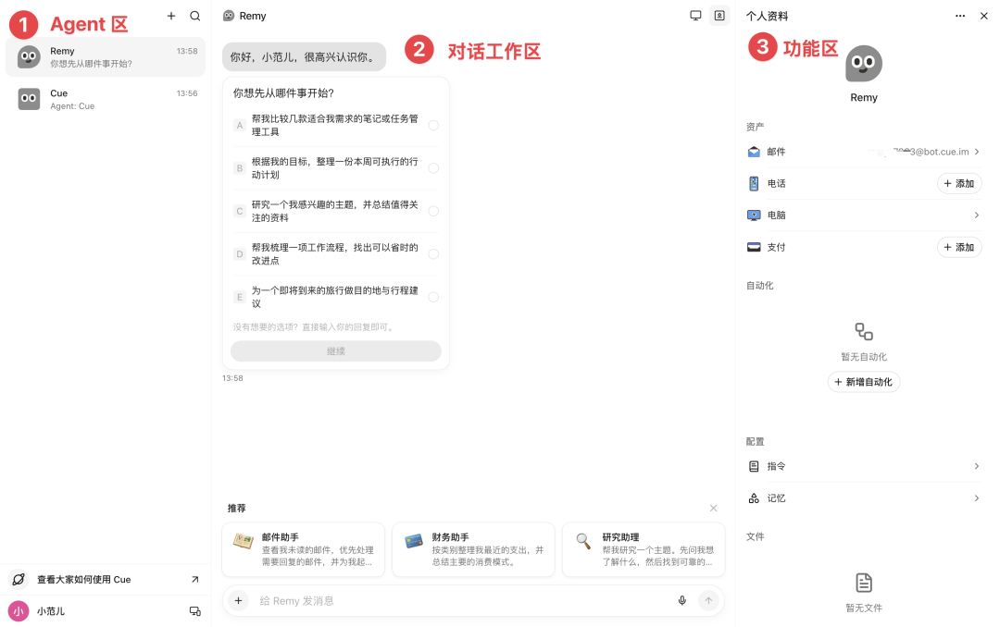

▲ 图：Cue 桌面端的工作区布局

可以说，除了一个对话框，其他都不一样。

这到底是啥？听我细细道来。

我把这个界面分为左中右三部分：

1）左侧：这里是 Agent 区域。我们早就习惯了各种 AI 工具，通常左边都是选聊天对话的。但这里不是，这里是一个个你自己创建的帮你完成各种任务的 Agent。比如选题的、写稿的、发稿的等。

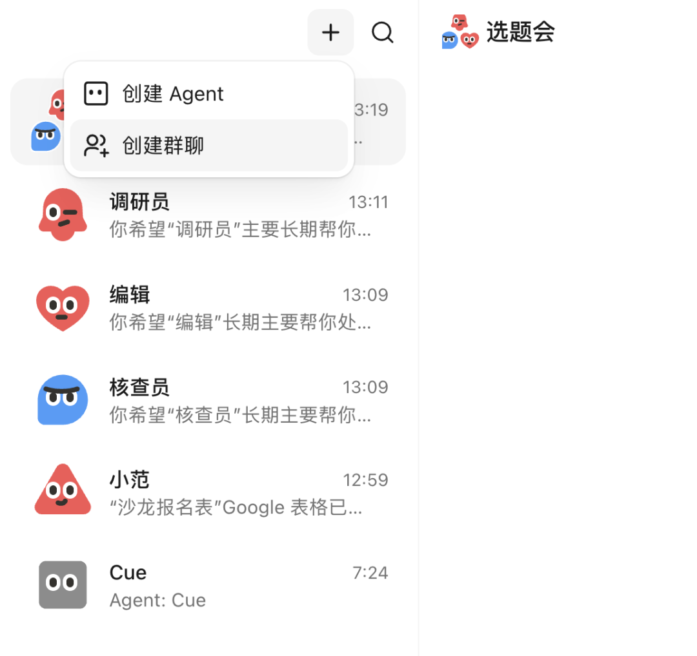

▲ 图：左侧显示已创建的 Agent

一个 cue 里面能创建多少个 Agent？我不知道，但应该有个上限。

有意思的是，每个 Agent 都是一个独立的个体，都有一套自己的：邮箱、电话。

但，电脑确实共用一台。

关于这个电脑的事情，一会详细说说。

2）中间：对话工作区，这没啥好说的，跟其他 AI 工具差不多。

3）右侧：这里是功能区，主要有两个功能，一个是 Agent 的设置，比如可以在这里设置它的邮箱、电话号码、进入它的电脑以及设置支付方式。（它可以去刷你的卡）

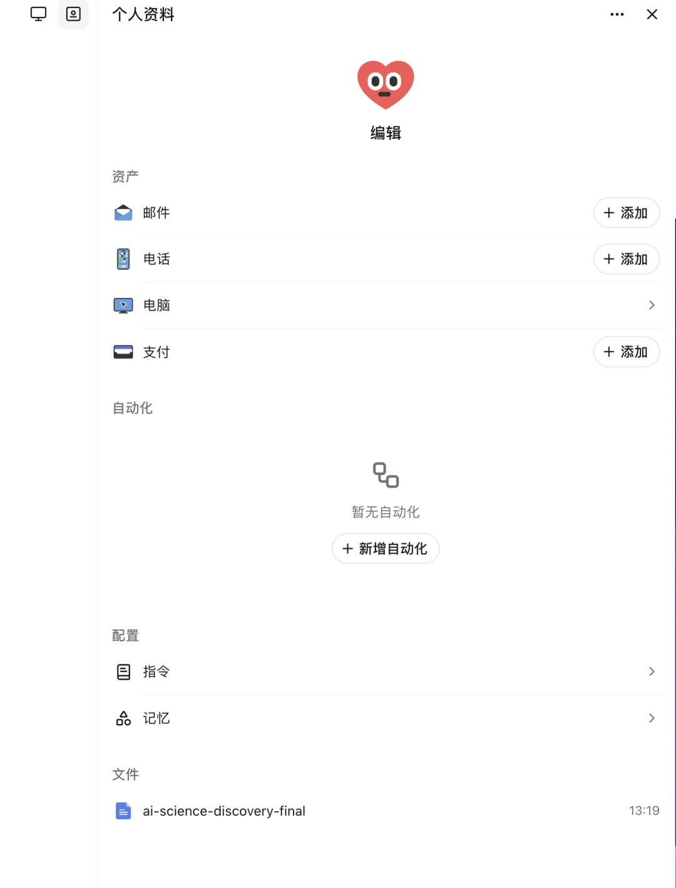

▲ 图：Agent 的设置入口

下面还有“自动化”，这个其实就是计划任务。

指令就是告诉这个 Agent 怎么工作，给它一些初始化的指令，有点类似于通用的 Agents.md 的意思。

有什么想让这个 Agent 记住的，可以放到这个“记忆”里面。

文件，就是这个 Agent 干活后的一些交付物，比如这里是一篇它刚帮我写好的文章，放在这里方便我查看。

这里还可以给你的 Agent 起名字，设置一个头像啥的。

当然，你也可以在这里直接把这个 Agent 删了。

功能区还有个按钮就是进入这台 Agent 的电脑，打开之后竟然可以直接远程桌面。

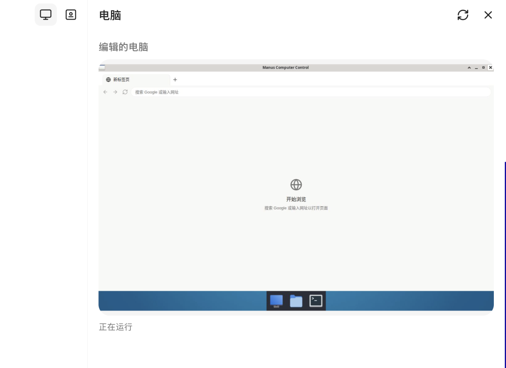

▲ 图：从功能区进入 Agent 的电脑

Meta 的 Muse 也提供电脑，但可以说看不见摸不着。而 Cue 这里竟然可以直接进去。

这个电脑默认可以看到一个浏览器已经打开了，另外我还可以访问它的文件夹。

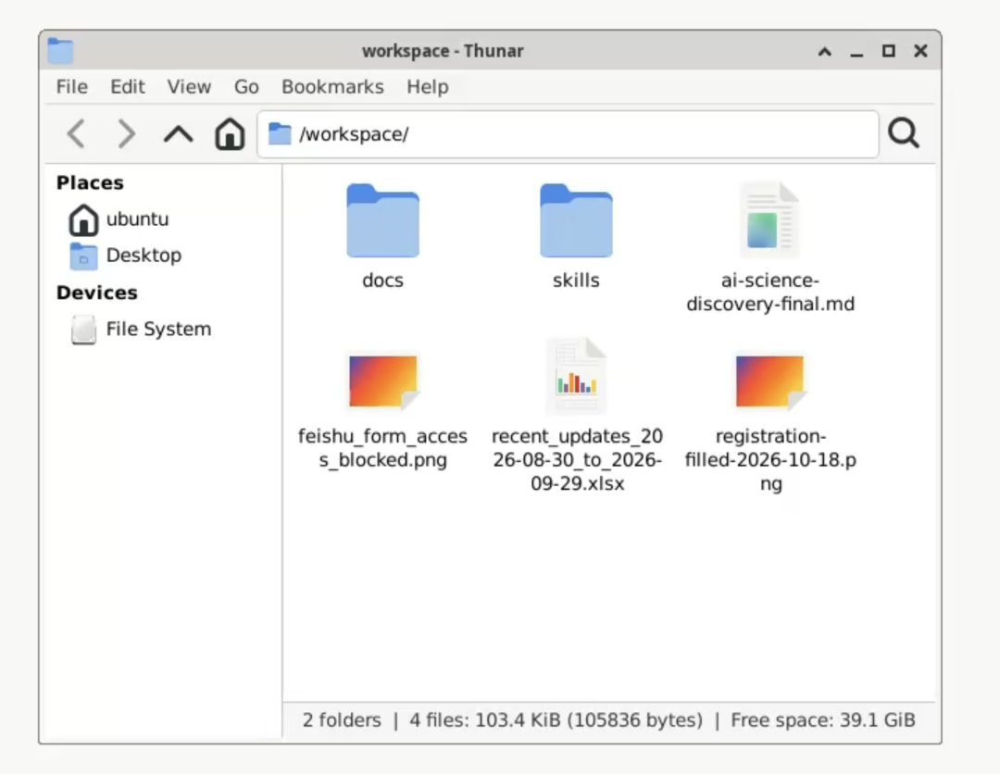

▲ 图：Cue 提供的云电脑桌面

可以看到，它提供给 Agent 的机器有 40GB 磁盘空间，装的是 Ubuntu 系统，它还能直接进终端，然后我们可以看到更多信息。

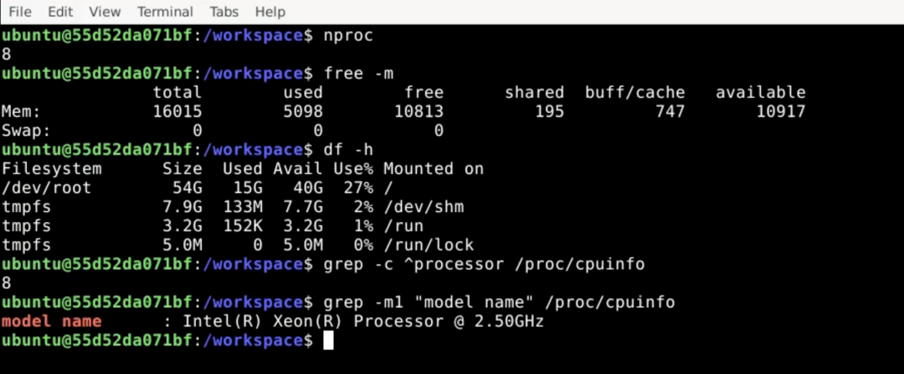

▲ 图：云电脑中的文件目录

所以它给我们提供的是 4 个物理 CPU（8 个逻辑 CPU）、16G 内存、40G 硬盘的一台 Intel Xeon 服务器，简单来说一台还不错的云主机。

这个配置比 Muse 高不少，那边只有 2 CPU、8G 内存，但硬盘有 100G。

更离谱的是，这玩意还提供了 root 权限，我特么直接能重启服务器：

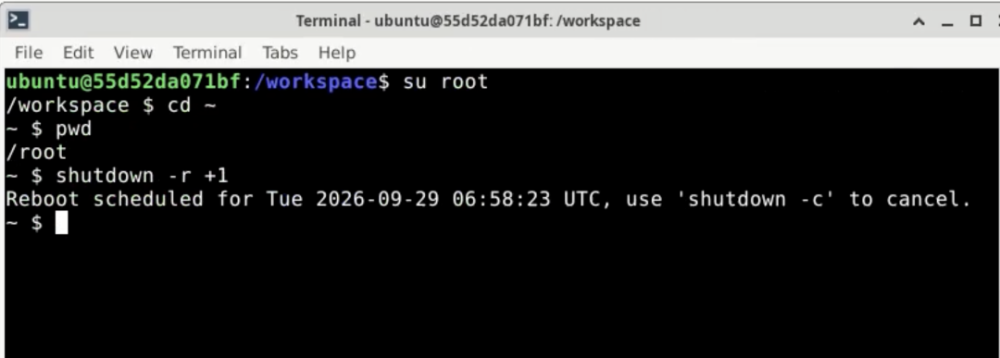

▲ 图：云电脑中的终端界面

有一说一，这个远程桌面真是卡的不行，这也不能怪它，服务器肯定是在国外的。

03 邮箱、Excel 和网页操作实测

说了这么多，它到底能干嘛？我先挑了两件很日常的事让它做。

第一件：让它用自己的邮箱，去注册账号。

这是 Cue 和其他 Agent 最不一样的地方。既然它有邮箱，注册网站、收验证码这类事，理论上应该自己就能搞定。我让小范（我建的那个 Agent）去注册几个账号，最后实际跑完的是 Notion。

一上来它就停了，说这个 Agent 还没有开通邮箱。原来新增 Agent 时邮箱不是默认开的，得在右侧的设置里手动开通（前面有介绍）。开完之后，它才继续往下走。

注册到一半，它又停了，弹出一张"连接器"卡片，写着 AgentMail："使用 AgentMail 管理电子邮件收件箱、邮件、会话和草稿"。要继续，还得用 Google 邮箱登录。

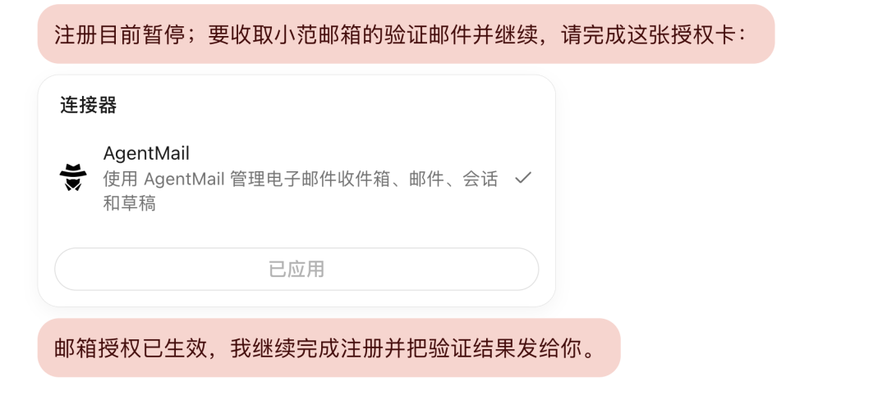

▲ 图：注册 Notion 时出现的 AgentMail 授权卡

我事先完全没听过 AgentMail。 查了一下，这是一家旧金山的创业公司，专门给 AI Agent 做邮箱接口，Y Combinator 出身，今年 3 月拿了 600 万美元种子轮。至于 Cue 自带的 @bot.cue.im 邮箱，底层是不是用的它，我没找到官方说法，不好下结论。

Google 登录到底给了它什么权限，我也没看到。

授权通过后，小范开始打开自己的电脑，用浏览器去注册 Notion。 走到"等验证码"这一步，卡了很久。然后它让我接管浏览器，自己去输验证码。

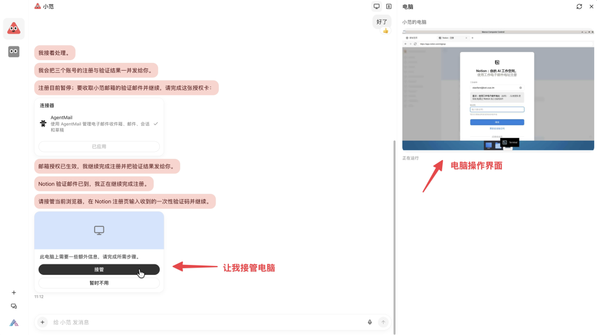

▲ 图：Cue 请求用户接管浏览器输入验证码

可验证码是发到小范邮箱的，不是我的邮箱，我根本不知道在哪，就让它自己来。它又弹了一次窗，还是让我输。

再问一遍，它给的理由是：页面的输入框不支持它来填，需要我接管。

折腾了半天，最后是我自己在它的浏览器里，把验证码填了进去。

有意思的是，验证码其实早就到了。

我去问它："收件箱里有什么邮件，按发件方列出来。"它"思考"了大概 1 分钟，回答说有 1 封，发件方 notify@updates.notion.com，主题 Your Notion signup code。

我对了一下侧边栏里的邮箱：11:09 到的，确实只有这 1 封，验证码在列表预览里就能看到。

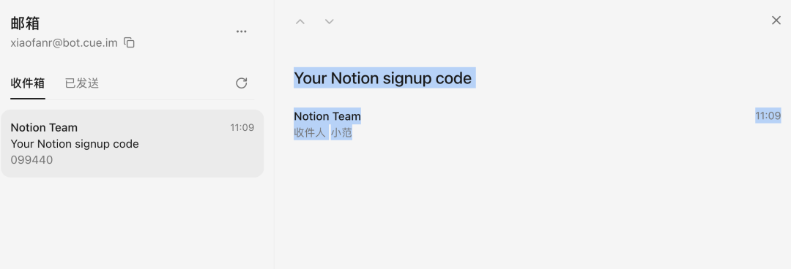

▲ 图：小范邮箱侧栏里的邮件

所以准确地说，它是"读到了，却填不进去"。收邮件这一步是通的，卡在把验证码输进网页。整件事前后大概 16 分钟，我手动介入了 3 次：开通邮箱、授权 AgentMail、接管浏览器填验证码。

还有个设计我没想明白。侧边栏的邮箱里，每封邮件只显示标题和摘要，点开之后正文是空白的。

想看全文，得让 Agent 帮我取出来。我问它"这封邮件的全部内容是什么"，它才把 Notion 那封介绍邮件的正文贴给我（英文，带一堆链接）。

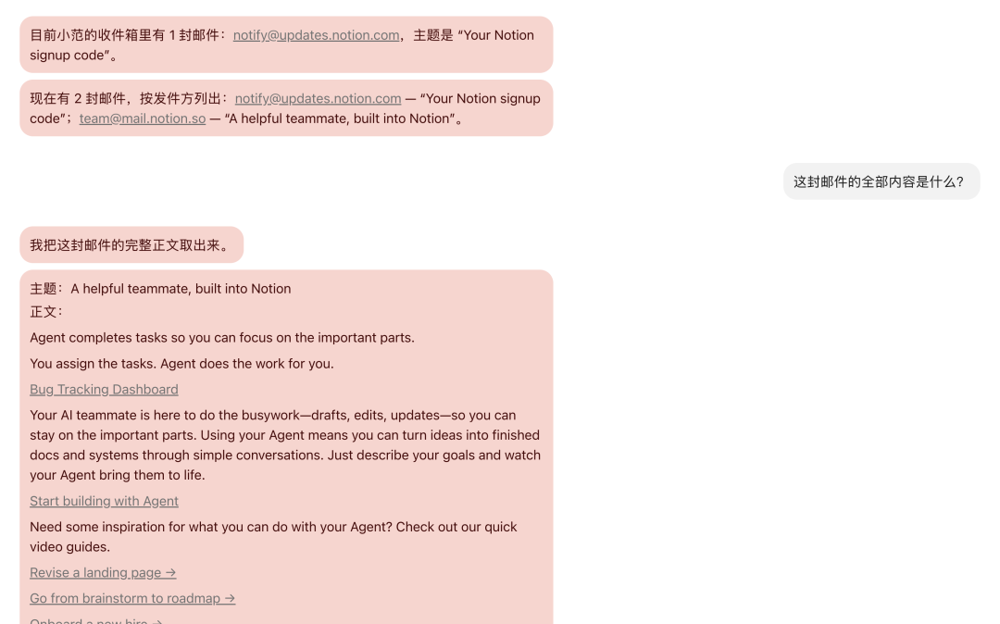

▲ 图：通过 Agent 取出的邮件全文

想核对 Agent 收到了什么，反而要通过 Agent 自己来讲，我觉得这个设计可能有问题。

第二件：让它在自己的电脑上收集资料、整理成 Excel，中途我还把软件关掉了。

我给它的任务大意是：去官网和官方博客，收集 DeepSeek、月之暗面 Kimi、智谱三家最近 30 天的产品或模型更新，每家不少于 2 条，注明日期和原文链接，整理成 Excel，每家一个工作表。

要求在它自己的电脑上做，关掉软件后也要继续做完。

大概 5 分钟内就做完了。中途我把整个 App 关掉，重新打开的时候，结果已经放在那里了。

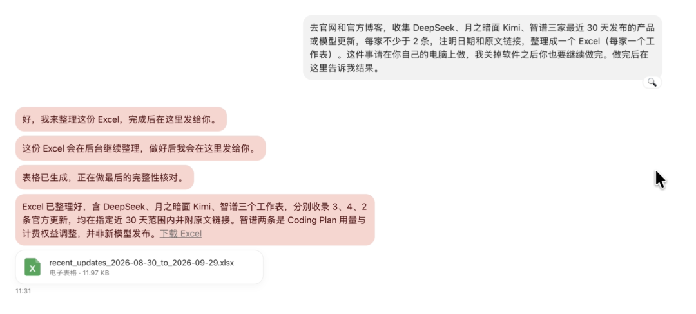

▲ 图：Agent 交付的 Excel 文件

Excel 能正常打开，三个工作表，每家一个，每家至少 2 条，链接都是有效的，对应的日期和内容也对得上。全程我没有介入。

这就体现出了 Always On Agent 真正好玩的地方，一直在线，随时为我们做「牛马」。

另外我盯着它的桌面看过，这次它并没有打开那台电脑去操作，桌面里看不到任何操作画面，应该是在后台处理的。

两件事放在一起看：需要在网页里点来点去的注册，用了大概 16 分钟，还要我接管；不需要网页操作的收集整理，大概 5 分钟，关掉软件也照样做完。

效果很明显，能靠后台工具解决的事，它又快又稳，真要去点网页，就容易慢、容易卡，操作电脑这事儿基本不可用。

不过这应该是网络问题造成的，而且就这两个案例，不能说这产品不行。

04 三个 Agent 拉群，不到 10 分钟交稿

Cue 里另一个我觉得最有意思的功能是群聊：可以把几个 Agent 拉进同一个群，让它们分工干活。

▲ 图：Cue 群聊中的 Agent 角色

我建了一个叫"选题会"的群，拉进三个 Agent：调研员、核查员、编辑。发给它们的任务是：

我在做一个中文 AI 公众号。今天要选一个选题：最近一周 AI 圈有什么值得写的事。调研员先找 5 个候选并说明理由；核查员逐个查证来源是否可靠，是不是已被大量报道；编辑最后推荐一个，并给出 3 个标题。你们自己商量分工，不要重复劳动，最后由编辑给我一个结论。

说是"自己商量分工"，其实每个人干什么，我已经在提示词里写好了，它们能商量的空间并不大。

任务发出去之后，三个 Agent 各回了一句，确认自己的职责。

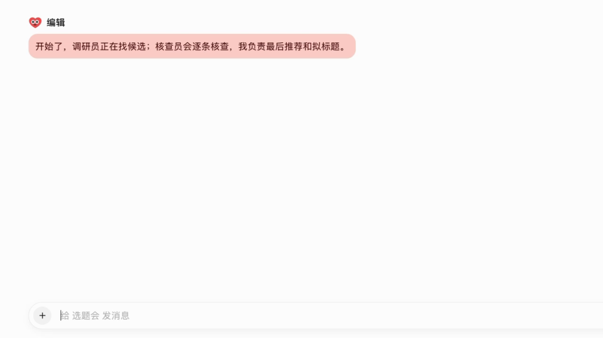

▲ 图：三个 Agent 确认各自职责

然后群里就安静了。。。

等半天我以为程序死了，我不知道它们到底有没有在干活，忍不住问了一句"开始行动了吗？？"，编辑回我：开始了，调研员正在找候选，核查员会逐条核查，最后由我推荐并拟标题。

之后又是好几分钟没有动静。

群里只有某个 Agent 开始写回复的时候，才会出现"正在回复"的提示。它们查资料的那段时间，界面上什么都看不到。

差不多 5 分钟后，调研员一次给出了 5 个候选，每条都带着来源链接。（不得不说，这种设计也有点优雅了，让我一脸懵逼，怎么说你给点进度反馈啊）

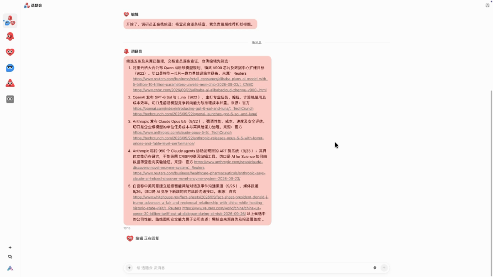

▲ 图：调研员给出的五个选题候选

编辑马上接话：收到候选，我等核查员核查完再推荐。

接着核查员逐条给出核查结论，编辑最后推荐了第 4 个：Anthropic 用约 950 个 Claude agents 发现了一个新的酶系统，并给了 3 个备选标题。

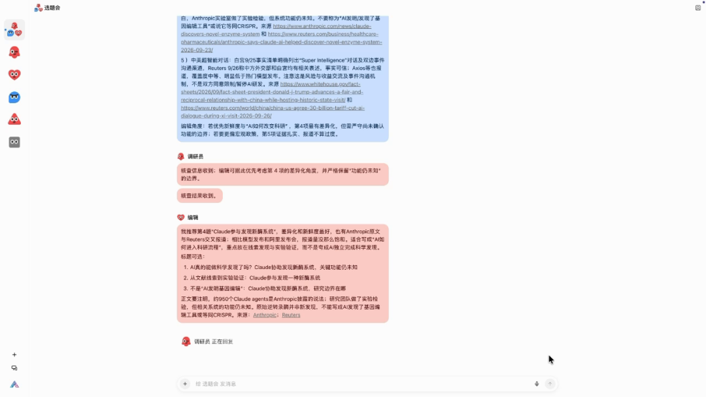

▲ 图：编辑给出的推荐和备选标题

这里有个细节我觉得挺有意思。

这个选题的边界是"功能仍未知"，不能写成 AI 发明了基因编辑工具。这句提醒在核查之后，一路传到了编辑的推荐理由里，最后连定稿的标题里都带着"关键功能仍未知"。

也就是说，上一环的结论，下一环是真的接住了。

接着我回了一句："选标题 1，开始写文章吧。"调研员写出初稿发到群里，编辑基于初稿定稿，最后给我一个文件。

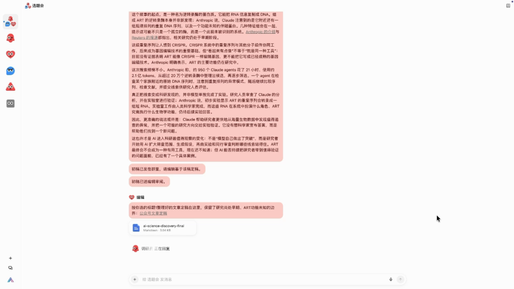

▲ 图：编辑交付的定稿文件

从我发出任务到拿到定稿文件，前后不到 10 分钟，中间我只回了一句话。每一环的衔接都很顺。

不过这次我没有细看文章的质量，提示词本身也很简单，测的主要是流程。

那 5 个候选和文章里的数字，我也没有逐条核对，真要拿来用，得自己再查一遍。

还有一个小毛病：编辑推荐完之后，调研员又把整套候选和推荐重发了一遍，内容是重复的。

下面是这次群聊的录屏。为了缩短等待，操作和消息按 2×、短等待按 5×、长时间没有新进展的部分按 20×加速。原片 9 分 26 秒，加速后约 2 分 39 秒。

▲ 视频：Cue 群聊实测录屏，操作与消息 2×、短等待 5×、长等待 20×

05 套餐、技能与二维码 Agent

Cue 不是免费的，不过现在限免。

从他们的套餐来看，我觉得还是很贵的。 Pro 的话得 100 美金一个月 ，不过如果它真的能干很多事情，而且经用的话，那我觉得还是可以试试的。但现在说实话，我们对它能力边界还没有那么了解。

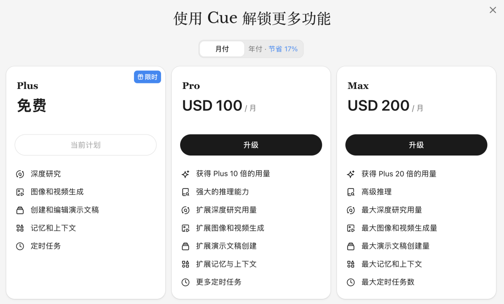

▲ 图：Cue 的套餐价格页面

它也像大多数的 Agent 的产品一样，会有一个周额度的概念，每周会重置一次。

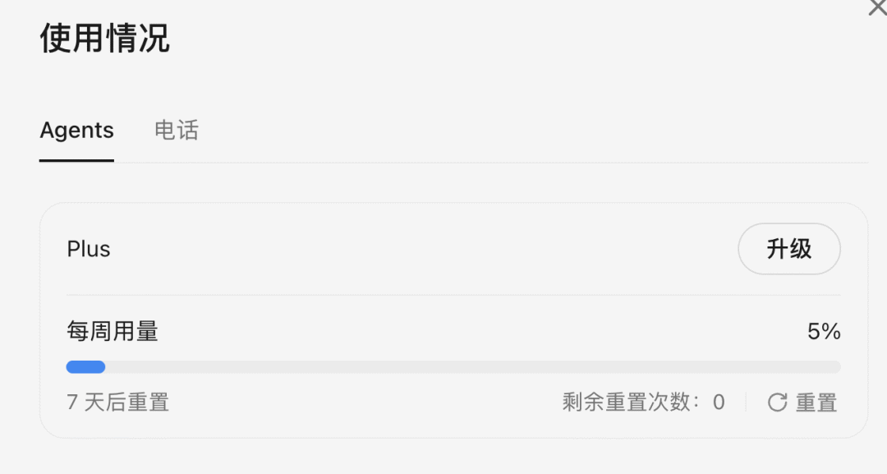

▲ 图：Cue 的每周额度页面

它的设置项其实没什么太多东西，目前来看这个产品做得还比较简单。这里面可以看到有技能有应用，技能也遵从业界标准，所以你可以在这里安装技能，也可以创建自己的技能。

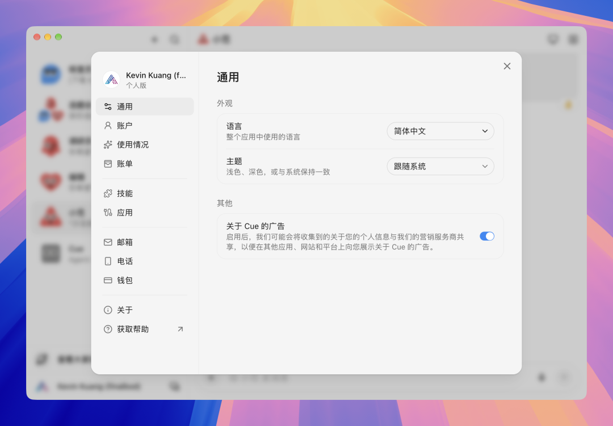

▲ 图：Cue 的技能列表

应用就是可以和外部的这些应用连接了，不管是你的邮箱还是网盘等等都可以。那这个是打通外部世界的一个标配。

而且在这些应用里面，它还可以单独对每个应用相关的权限做设置，这一点我觉得还是不错的。

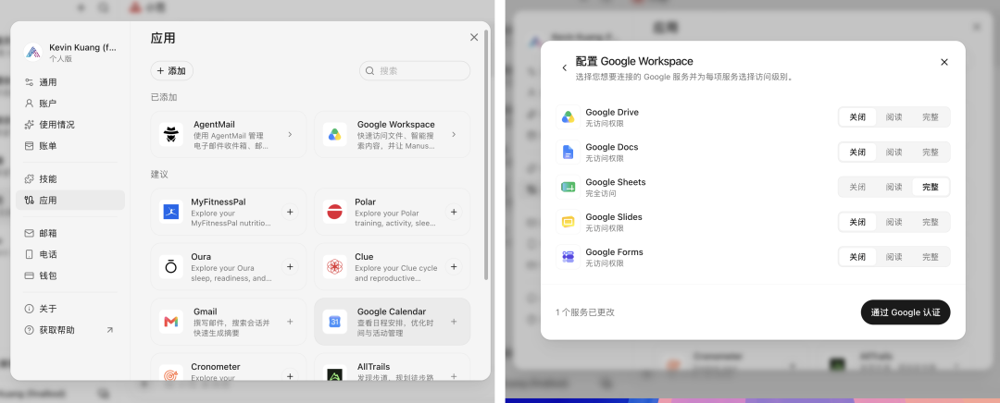

▲ 图：应用连接与 Google Workspace 权限设置

电话，因为仅限美国等区域，我没法测试，不过应该会很好玩。

官方视频里还演示了一个我觉得很有想象力的功能：扫二维码，直接变出一个 Agent。

视频里的场景是这样的：用手机对着一家点心店 Lucky Dumpling 的二维码一扫，屏幕上提示"正在从这个二维码创建 Agent"，几秒之后，一个叫 Lucky Dumpling 的 Agent 就出现在手机的 Agent 列表里，跟你自己建的那些放在一起。

▲ 视频：官方视频中的二维码创建 Agent 演示

接着你直接跟它说要什么，比如 2 份猪肉韭菜饺子、1 份辣味馄饨，晚上 7 点取。它会弹出一张授权卡，写着商家名称、预估金额 14.80 美元和绑定的信用卡尾号，你点"允许"，订单就下好了。

也就是说，商家不用做小程序，也不用做 App，一个二维码就是一个能对话、能下单的 Agent。视频里的口号是"Every QR code, an agent"，每个二维码都可以是一个 Agent。

不过这一段是官方视频里的演示，我这次没有测到：手机端我下载不了，支付也只支持美国，所以没法验证它在真实场景里好不好用。

06 Cue 值得试吗？

这次时间有限，我只测了邮箱注册、后台资料整理和 Agent 群聊几项基础功能。

Cue 可玩的地方不少，这篇先让大家有个初步感受和认识；后面我还会继续试一些更有意思、也更实用的玩法。

Manus 创始人在朋友圈谈 Cue 时，把它描述成一种有独立手机号、邮箱、支付和电脑的“东西”，也许可以称作“人”，还提到 Agent 和 bot 以后可能会一起组群。

这几句话点出了 Cue 的产品思路：给 Agent 配上一套身份和工位。

Muse 带热了 Personal Agent。阿里、腾讯、字节都在做或尝试做类似的产品。腾讯轻量云团队也已悄悄上线国产版 Muse——LightVela。

字节据说要在国庆前推出相关产品，团队为此已经开始疯狂加班，这只是一条小道消息。

几家最后能交出什么，还得看产品。以我目前体验过的 Muse 和 Cue 来看，Manus 2.0 的 Cue 完成度更高，也更值得继续玩下去。

目前 Cue 还是值得先试、但谈不上离不开的产品：授权范围和任务进度不够透明，网页操作和远程桌面也偏慢。

你最想看我接下来用 Cue 测什么？留言告诉我，我挑几件继续折腾。
