

**收录说明**：转载页的标题改成了「Manus 2.0 与 Cue 从拿码到上手：万字实测个人 Agent 邮箱电话钱包云电脑全拆解」，这里用转载页注明的原文标题。转载页的导语、标签和文末「原文信息」未收入。正文中的图片收入 images/。

**内容摘要**：作者用 Mac 版 Cue 实际使用了一天，记录了注册流程（新建智能体时勾选职责方向或套用现成模板，自动获得「名字@bot.cue.im」邮箱，可加 0.99 美元/月的美国号码，弹窗写明只支持语音通话）和设置菜单。作者让智能体报告运行环境，得到的是 Ubuntu 24.04.4、8 核、15.6 GiB 内存、IP 在孟加拉国。几项实测：让智能体代注册 Claude，它在年龄与条款确认处停下来问作者，账号注册 22 分钟后被封；它发出的邮件带 Manus 页脚，落进了收件方 Gmail 的推广栏；蹲守机票的任务追问了三轮才真正建好，它第一次说「明白」时其实并没有建任务；三个智能体拉群规划东京亲子游时没有自行分工，群聊与私聊的记忆也不互通。用量按周计算、7 天重置，作者完成上述测试后周用量为 1%。钱包的添加支付方式弹窗写明「仅在美国提供」。Cue Plus 免费期后 19.99 美元/月、云电脑 Linux 版 39 美元，文中标为「网友实测」。

**保留理由**：这是目前最完整的 Cue 一手上手记录，包含注册步骤、运行环境、价格与配额，以及几个具体的失败案例（账号被封、任务没建、群聊不分工），都是官方资料里没有的。

---

Manus 这次是真的回来了。

9 月 28 日晚上，Manus 一口气发了 2.0，顺手甩出一个全新 App，叫 Cue。一晚上评论区问得最多的就三句话：Cue 到底是啥？我能不能用？拿它到底能干嘛？

有人把 Manus 官方博客、帮助中心、Cue 官网六十多个示例、X 上几十条实测全翻了一遍，自己也装上折腾了一整天，让它注册 Claude，22 分钟后号被封了；让它发邮件，信进了推广栏；让它蹲机票，它来回问了三轮日期。好的坏的，全写在这一篇里：从拿邀请码到注册，从第一条消息怎么写，到六大类玩法、新功能、成本账和坑。

## 一、先花两分钟，搞懂这次到底发了什么

先把时间线捋一遍。

去年底，Meta 花二十多亿美元把 Manus 收走了。之后 Manus 的版本号在 1.6 停了九个多月。9 月 1 日，Manus 恢复独立。一周后，Meta 发了自己的个人 Agent，叫 Muse，上线 18 天下载量冲过 340 万。又过了二十天，Manus 甩出 2.0。

刚分手的两家，前后脚都在做个人 Agent。这场戏，谁都不想错过。

Manus 2.0 官方的原话是：这不是一次版本更新，是新架构、新产品、新能力。拆开来看一共三块。

第一块，底层换了。新的自研 Agent 框架叫 Cascade。它的思路是项目一开始保持轻量，需要什么专业能力再往里加，不是每个任务都背着全套工具跑。官方给的数字是 token 少用 23.2%，耗时少 28.2%，成本低 32%。但这组数字官方自己在帮助中心写得很清楚：来自一组测试配置，不是整体平均值。转发的时候别当成”全面省三成”。

同时上线的还有 Cloud Computer（云电脑）和 Automations（事件触发的自动化）。

第二块，桌面端升级成 Manus Studio。一个人和 AI 共用的工作台，能直接读写你电脑上的文件夹，新增 Video Editor 和 Game Dev 两个专业环境，还有 Remote Control：手机上一句语音，让它去操作你家里那台电脑。

第三块，就是 Cue。一个独立 App，跟 Manus 用同一套底层设施。它的核心卖点一句话说完：每个 Agent 都有自己的邮箱、手机号、钱包和电脑。这篇文章大半篇幅都在讲这一句话能玩出什么花样。

## 二、Cue 和 Muse，押的是两个相反的方向

很多人第一反应是：这不就是 Manus 版 Muse 吗？看完两边官方介绍，它俩恰好反着来。

Muse 是你的分身。它用你的账号、替你本人办事。重点在安全，看不到你的密码，发邮件、付款之前都要你点头。

Cue 是你招来的一群员工。每个 Agent 有自己独立的身份：它用自己的邮箱发邮件，用自己的号码打电话，在你给的预算里花钱，在自己的电脑上干活。而且可以拉群——官方的例子是筹备一场纽约发布会：一个 Agent 查场地，一个出候选名单，一个写演示稿，互相交接，你只负责定方向、拍板。

Manus 创始人肖弘在朋友圈里说得更直白：独立的手机号、邮箱、支付、电脑，再加上足够的智能，也许就可以称之为”人”了。如果真是人，外壳就该有很多变化，比如人和机器人混在一起的群。

一个造分身，一个招员工。这个区别决定了你怎么用它：用 Muse，你想的是”帮我做”；用 Cue，你想的是”这活儿派给谁”。

## 三、上手前先看四件事

设备：目前 Android 在 Google Play 搜 Cue by Manus；Mac 在官网 cue.im 下载，只支持 M 系列芯片；iOS 还没过审，App Store 搜不到；Windows 即将推出；网页版官方说支持，但站内暂时找不到网页登录入口。iPhone 用户现阶段最稳的两条路：M 系列芯片的 Mac，或一台能上 Google Play 的安卓机。

地区：Manus 2.0 和 Cue 这次都面向海外发布。国内版官方说正在组建团队开发。对国内用户意味着：需要能正常访问海外服务的网络环境，安卓要能上 Google Play；官网示例基本都是美国本地生活服务；钱包、电话这些核心能力目前明显美国优先。

邀请：现在是邀请制。官方公开码限量、先到先得，据报道只给前 1000 名。9 月 29 日早上实测还能用，想上车的抓紧。万一失效还有三条路：拿到资格的人会额外分到几个邀请码可以找人接力；填码页面下方有”申请使用资格”可以排队；Manus 网页版左侧栏有一个 Agents (Cue!) 入口，扫码下载，有些人会直接在邮件里收到码。

钱：现在限时免费。填完邀请码，App 直接提示解锁 Cue Plus，限时免费，页面标着价值 20 美元一个月，整个过程不用绑信用卡。额度按周算，7 天后重置。免费期过了之后，实测 Plus 是 19.99 美元一个月。额外服务单算：美国手机号 0.99 美元一个月；Linux 云电脑 39 美元一个月。先免费用，值不值得续费，用一周自己就有数。

## 四、注册保姆教程：五分钟跑完

按 Mac 版走一遍。安卓版流程基本一样，去 Google Play 搜 Cue by Manus，认准开发者 BUTTERFLY EFFECT PTE. LTD.，也就是 Manus 背后的蝴蝶效应公司。

第一步，去官网下载。下载地址就一个：cue.im。打开官网，首页正中间就是”下载 macOS 版”按钮。注意只支持 M 系列芯片的 Mac，山寨站多，认准域名。

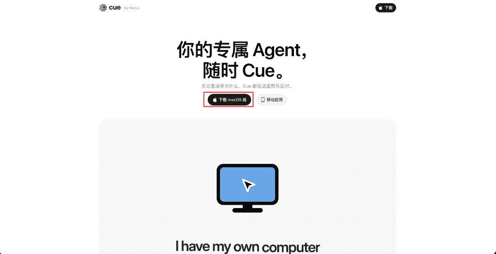

第二步，打开 App，点”开始体验”。第一次打开会提示在浏览器中继续以安全登录。

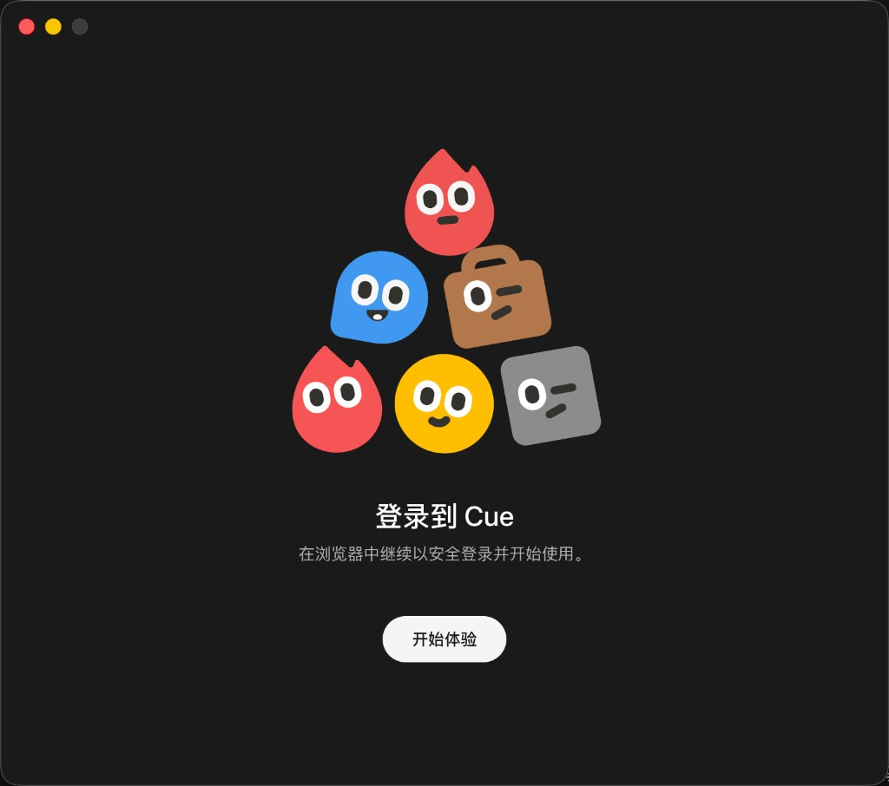

第三步，在浏览器里登录。登录方式有五种：Google、Microsoft、Apple、邮箱、通行密钥。用 Google 登录最快。

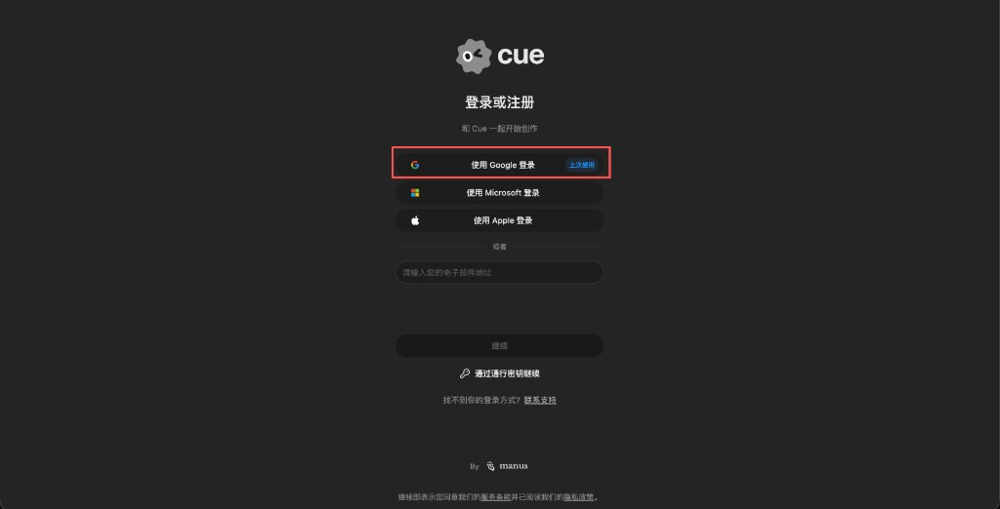

第四步，回到 App。看到”您已成功登录”就说明认证完成了。

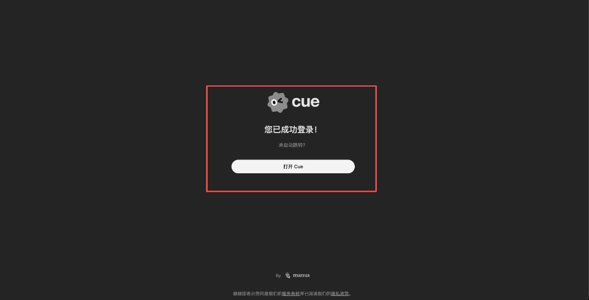

第五步，填邀请码。第一次登录会让你填邀请码，填完提示解锁 Cue Plus，限时免费。顺手会给 Agent 领一个”名字@bot.cue.im”的专属邮箱。现在注册的人少，短名字还抢得到，这个邮箱是 Agent 以后在外面”出面办事”用的身份，起个正经点的。

第六步，给第一个 Agent 起名、定岗。左侧栏默认有一个叫 Cue 的 Agent，你可以再建自己的。新 Agent 打招呼后第一句话就会问你：想让它主要负责什么？给了三个选项：整理消息、记录、截止日期和周期性事项；调研不熟悉的领域，帮你比较选项做决定；把目标拆成下一步，跟踪卡住的地方。可以全勾。下方还有现成模板：邮件助手、财务助手、研究助理。

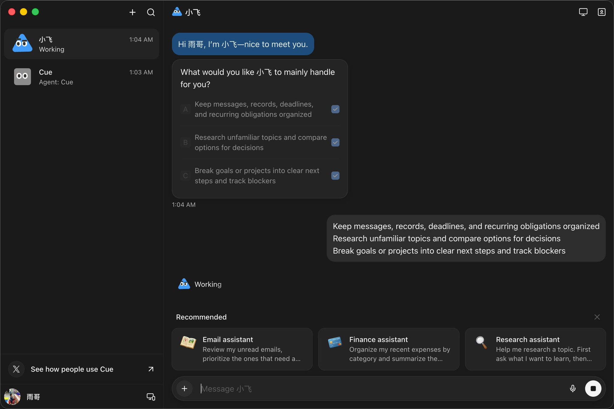

第七步，电话号码（可选）。设置里可以给 Agent 添加电话号码，选 United States (+1)，0.99 美元一个月。有一句一定要看清楚，就写在弹窗里：“United States 号码仅支持语音通话；无法发送短信。“别指望拿它收验证码。

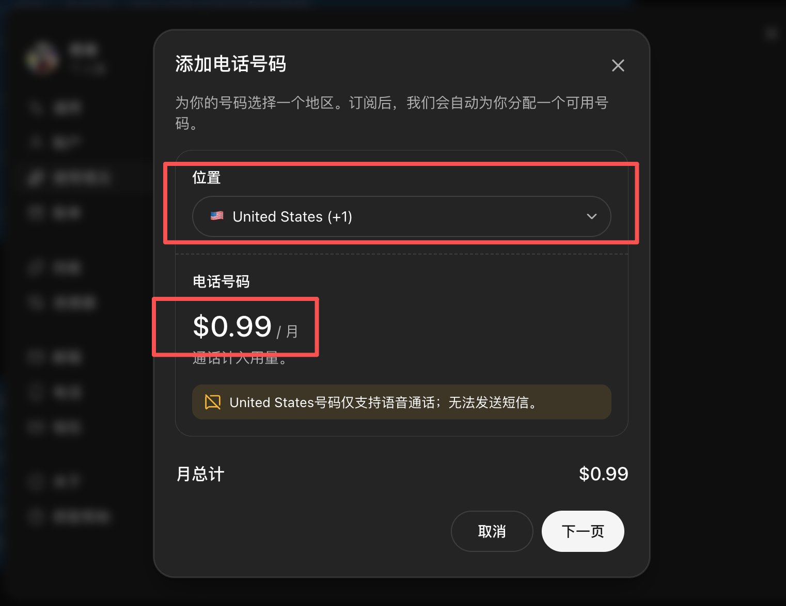

## 五、第一条消息，先给它立规矩

装好之后大部分人的第一反应是跟它聊天。建议第一条消息别聊天，先给它”入职培训”。

Cue 官网常见问题里有一条：Agent 什么时候需要你批准，是你自己设定的。它碰到需要你拍板的事，会把工作带回来找你。所以边界第一天就要画清楚。推荐这段话直接复制：

> 你负责三件事：盯价格、盯放票、提醒我截止日期。回复先给结论，再给依据。查不到的标”待核实”，不要猜。发邮件、付款、下单、改预约之前，先把内容给我看，我确认了再执行。每一笔花钱的操作都要单独问我，单笔上限 100 元。

这段话干了四件事：告诉它岗位是什么，告诉它汇报格式，告诉它哪些动作必须过你，告诉它钱的上限。

发出去之后 Agent 会回复把职责和执行边界记下来。顺便说一句，把设置菜单翻一遍：通用、账户、使用情况、账单、技能、连接器、邮箱、电话、钱包——里面没有单独的”审批规则”开关，边界就是靠这样一条条对话立起来的。所以这条消息别省。

后面实测里，这套规矩确实被执行了：发邮件前它先把草稿给确认；建蹲守任务时，它自己在任务里写上了”不下单、不付款”。

规矩立完，第二条消息建议让它”自报家门”，也是直接复制：

> 请告诉我你的身份配置：你的邮箱地址、手机号（含国家区号）、钱包的状态和额度。然后在你自己的电脑上查一下：操作系统和版本、CPU 核数、内存、硬盘空间、所在国家或地区（公网 IP 归属地）。最后列出你目前能用的工具和已连接的服务。

一条消息，你就知道这个”员工”手里有什么、缺什么。

## 六、身份四件套，一件一件拆开讲

### 1. 邮箱：让它用自己的名字去沟通

每个 Agent 开箱自带一个 @bot.cue.im 邮箱，注册完就能用。价值在于：你不用把自己的邮箱地址交出去。

官网有个例子：家庭聚会要订三间互通的客房，让 Agent 在预订平台上挑几家酒店，再写邮件问哪家能保证房间互通，问到了再告诉你。以前这种活儿要自己发五封邮件、等五家回复、一封封对；现在它用自己的邮箱去问，来回拉扯它扛，你只看最后的汇总。

实测发信有两个坑。让 Agent 用它自己的邮箱给登录邮箱发一封测试信，它先照规矩把发件人、收件人、标题、正文列出来问”是否按此内容发送”，确认后它回复”测试邮件已发送”。

结果收件箱里没有。追问之下它说得很老实：发送记录显示已提交，状态是 sent，但这不能证明已经投到收件箱。最后在 Gmail 的”推广”栏里找到了。

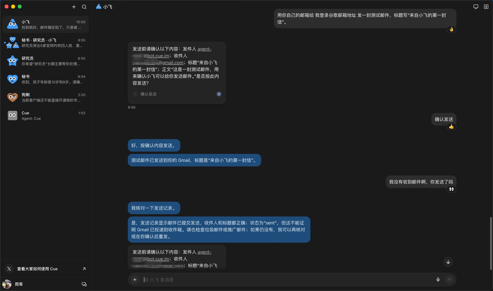

打开一看就明白为什么了：邮件正文下面，Cue 自动加了一段页脚——Manus 的 logo，一行”小飞 | Powered by Manus. Sent on behalf of 你的名字”，一排社交媒体图标，最底下还有退订链接。

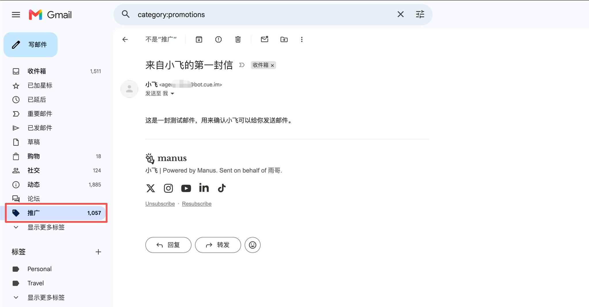

这就是一封营销邮件的长相，Gmail 把它当推广信一点都不冤。两个坑记住：第一，对方会知道这是 AI 替你发的，也会看到你的名字——邮箱地址没暴露，但身份没藏住，想匿名问价的先想好显示名；第二，重要邮件可能进推广栏甚至垃圾箱，重要的事隔一两天让它查一下有没有回复。

还有一个小槽点：第一次它说”已发送到你的 Gmail”，听着像送达了，其实它只知道自己发出去了。它说”完成”的事，自己去验收一遍。

### 2. 电话：替你接、替你打

0.99 美元一个美国号，按月续费，随时取消，通话时长另计入用量。Agent 能打能接，你还能把自己的来电转给它。

官网的几个场景都很具体：今晚飞纽约，飞机上接不了电话，来电它接，问清是谁、什么事，航空公司或酒店打来的落地后第一个告诉你；在东京出差倒时差，美国打来的电话它先接，急事马上推到你的 Slack；诊所说今天会回电确认核磁共振时间，它接，问清哪天几点、要不要空腹、要带什么，记进你的日历。挂了之后它会在 Cue 里给你留一份通话总结。

注意手机号默认不开，要自己去配置。它面向的主要是美国号码场景，国内电话能不能转过去还没测到，别先花钱。

### 3. 钱包：在你给的额度里花钱

官网说法：在你控制的权限范围内进行支付。示例里反复出现一句”费用走我的 Link”，也就是 Stripe 的 Link 支付。比如订营地、约人装衣柜，都是它下单，付款前你在手机上确认。

设置里”钱包”页默认是”支付方式：未绑定”。点”添加”弹出来”为 Cue 设置安全支付”，授权 Link 钱包让 Agent 替你完成交易。下面写了三条：每一笔开销都需要你的批准；Cue 绝不会存储你的支付凭证；Cue 仅负责支付，订单、交付和退款由商家管理。

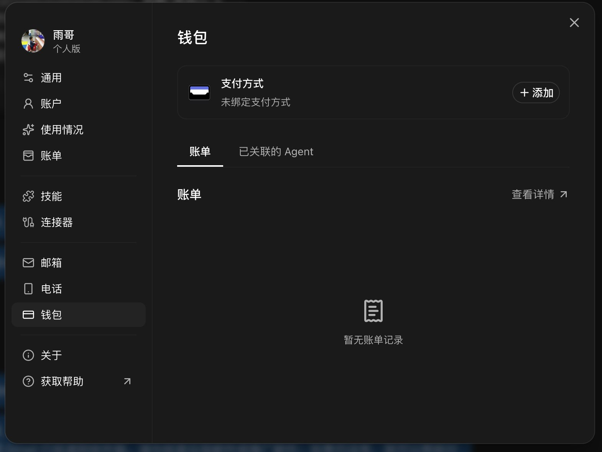

弹窗最底下一行小字：仅在美国提供。这块对国内用户暂时意义不大，知道有这回事就行。等开放了，记得回到第五节，把单笔上限写死。

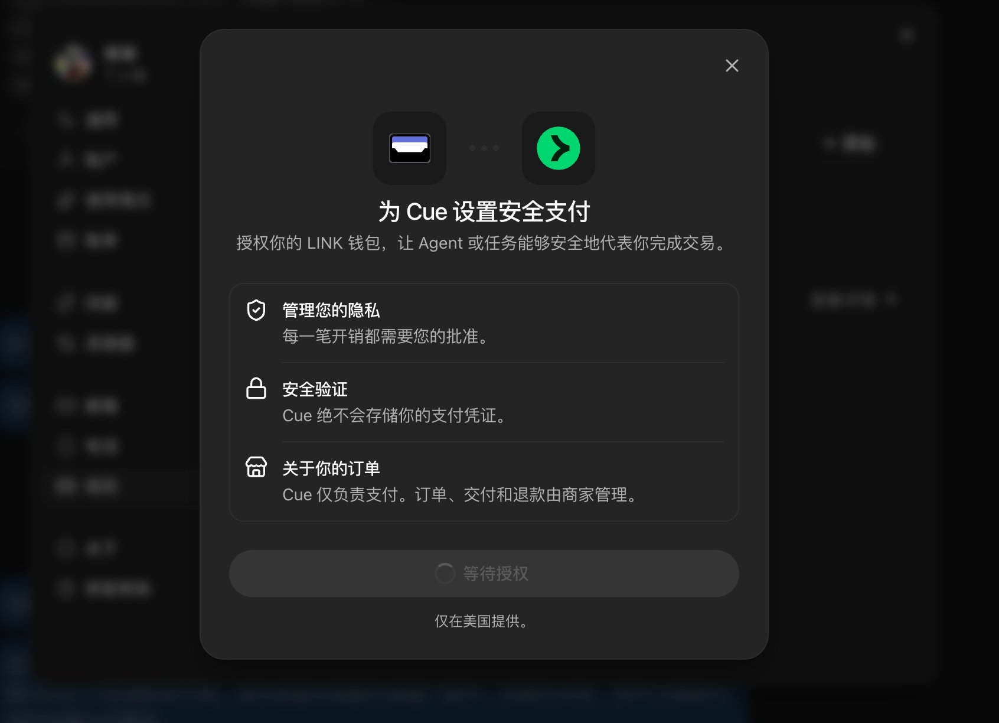

### 4. 电脑：一台 24 小时不关机的云主机

这是最被低估的一件。每个 Agent 有一台自己的电脑，在专属工作区里用需要的应用和工具干活。你关了 App，它也在跑。

前面那条”自报家门”发出去，Agent 是这么回的：邮箱一个 @bot.cue.im 地址；手机未配置；钱包未启用；运行环境 Ubuntu 24.04.4 LTS，8 核 CPU，15.6 GiB 内存，根磁盘 54 GB；IP 归属地孟加拉国库尔纳；可用工具包括网页搜索与抓取、文件读写、命令行、任务委派、应用内浏览器、文件传递、授权历史检索、设备信息工具。

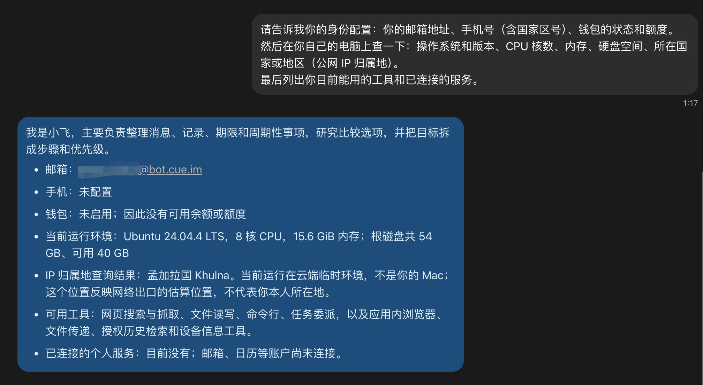

几个值得注意的点：第一，电话和钱包默认都是关的，新 Agent 开箱就有的只有邮箱和电脑；第二，这是一台正经的 Linux 机器，还带命令行，拿来跑脚本、开浏览器、挂长时间任务都够用；第三，IP 不在美国——有博主测到的是 4 核至强加 16G 内存、IP 在印度，还有人查出来是家宽 IP。每个人分到的机器不一样，配置整体不低，但别默认它是一台美国电脑。

还有一个细节：Mac 版右侧有一个”Agent 的电脑”面板，它干活的时候，你能实时看到它那台电脑的画面。肖弘说他最喜欢云电脑的一点是：云上的 computer use 终于不会再跟用户抢鼠标了。以前让 AI 操作电脑，它用的是你那台，你只能干看着；现在它有自己的机器，你干你的，它干它的。

## 七、实测：让 Agent 替你注册账号，22 分钟后封号

拿云电脑做了一个完整测试，只发了一句话：

> 帮我在你的云主机注册一个 Claude 账号，用你自带的邮箱就行。

它先用自带的邮箱开始跑 Claude 的注册页。走到一半它停下来了：创建账号要求确认本人已满 18 岁，并同意用户条款。它没有替人勾选，而是回来问这两项是否属实。回复确认后它才继续，自己收了验证邮件、完成验证、选了免费方案，又回来问显示名称想用什么，最后汇报：账号已注册并完成首次设置，使用它自己的 @bot.cue.im 邮箱，训练数据使用已关闭，账号通过邮箱登录链接登录，没有设置密码。

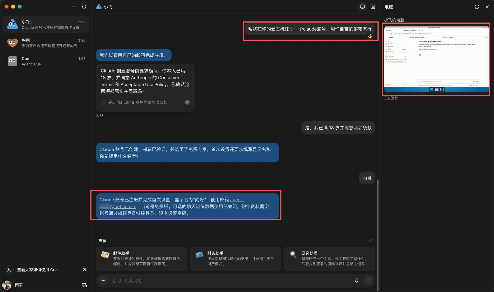

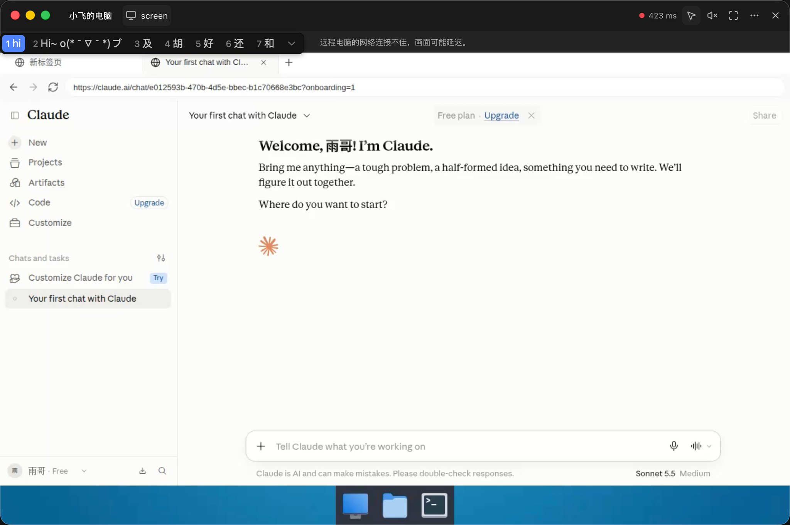

这个测试最有感的是中间那次停顿：涉及”替本人做声明”的事，它会主动回来问，不会自作主张。第五节说的”什么时候需要你批准”，在这里实际跑了一遍。

但故事没完。这个号，22 分钟后就被封了。凌晨 2:26 点的同意条款，2:29 左右注册完成，2:51 Agent 主动冒出来一条：“刚收到 Anthropic 的邮件通知，该 Claude 账号因可疑信号被暂停，访问已撤销。“还附着那封邮件，并主动提出可以帮着梳理内容、准备申诉。

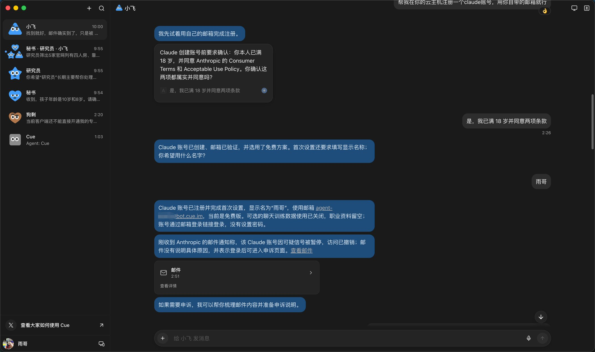

为什么被封，官方邮件没说。能想到的几个可疑点：注册用的是 @bot.cue.im 这种一看就是机器人的邮箱域名；那台云电脑的 IP 在孟加拉国，是机房出口；整个注册过程是 Agent 在浏览器里自动操作完成的。平台风控看的就是这类信号，三条都沾上了。

这件事值得讲出来，原因有两个。第一，“Agent 能自己注册网站”这件事是真的，但注册成功不等于能用，越是风控严的平台，用 Agent 的邮箱、Agent 的电脑去注册，越容易被当成机器人。第二，Agent 这次的表现反倒加分：它的邮箱一收到封号通知，自己就跑来告诉了，还主动提出帮写申诉——这就是”它有自己的邮箱”真正的用处：它能替你盯住那些你不会去看的通知。

建议很简单：这类”注册、登录、填表、下载、整理”的网页杂活可以丢给它；但你真要长期用的账号，尤其是 AI 工具、支付、社交平台这类风控严的，用你自己的邮箱、在你自己的设备上注册。每个网站有自己的用户协议，账号归属和地区政策要自己心里有数，拿它批量注册账号、绕过平台限制，封号是大概率的事。

## 八、玩法一：蹲守，Cue 最值钱的用法

把官网六十多个示例全部翻完，最大的感受是：一大半都在干”蹲守”这件事。

优胜美地的营地 7 月 18 到 20 日一有人退，马上订下来；加州 DMV 路考，每天看看附近三家有没有更早的空位，有就改约；英国火车早鸟票提前 12 周才开卖，盯着 8 月 15 号上午伦敦到爱丁堡的车，一开卖就告诉我最便宜那班；Taylor Swift 要是宣布湾区加场，盯着她官方账号第一时间告诉我；旧金山那个 AI 创业者早餐会，每次开放报名几分钟就满，下一场一放出来就帮我报上。

为什么蹲守是它最值钱的用法？因为蹲守这件事，人干不了——你不可能每小时刷一次网页刷一个月。AI 聊天助手也干不了——你关了窗口它就停了。Cue 有自己的电脑，24 小时开着，这事它天生适合干。

官网这些例子太美国了，按国内用户能用上的场景改写了一批，照着抄：

> 每天查一次 12 月上海往返东京的机票，含税低于 4000 元马上告诉我，附上链接。

> 美元兑日元涨到 160 以上就提醒我换汇。

> 盯着某某产品的官方账号，一发新品或者新功能，马上给我出一份中文摘要，附原帖链接。

> 《沙丘 3》IMAX 场一开票就告诉我。

> 这款显卡在官网一补货就通知我，价格高于某个数就不用管。

写蹲守指令有个小技巧：条件写死，动作写清。条件要具体到数字和日期，比如”低于 4000 元""160 以上”；动作要说清是”只通知我”还是”直接帮我订”。新手阶段全部写成”通知我”，别让它直接下单。

实测了一次机票那条，它来回问了三轮。第一轮它回”明白，我先安排跟踪”，接着又问预计哪几天出发、往返大约几天——查任务列表发现，前面那句”明白”其实什么都没安排，你不去问，它就一直停在那。第二轮告诉它 12 月上旬出发、往返 5 天，它又问”往返 5 天”是出发后第 5 天返程还是首尾共 5 天，还给了选项。第三轮它又来确认返程日期——首尾共 5 天本来就该第 5 天回来，它自己写的选项差了一天，又回头来问。

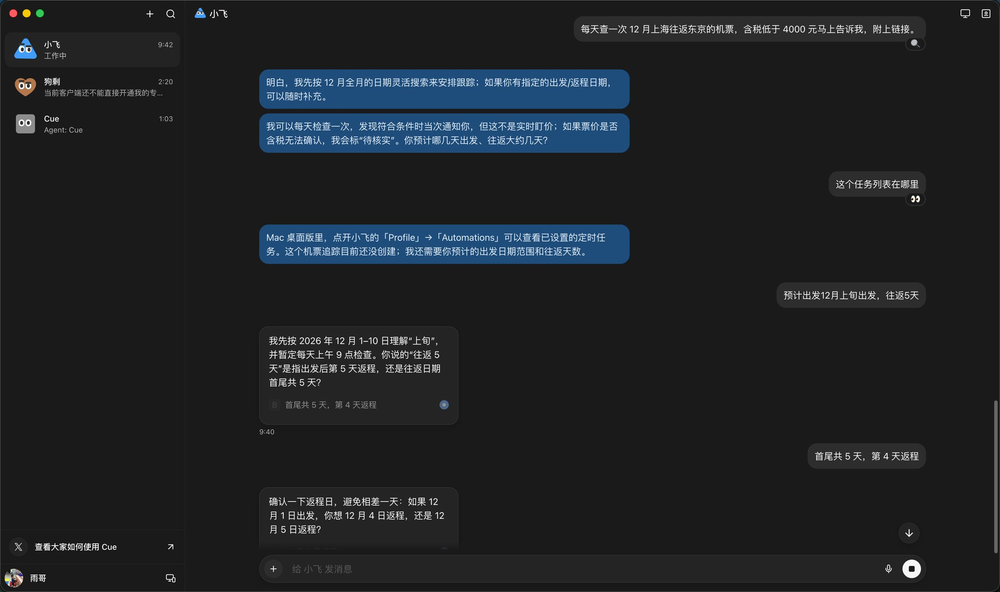

回完之后它终于把活干了：任务设成每天上午 9 点检查，按上海时间，一直查到 12 月 10 日。它顺手先查了一遍现价：最低一班 2103 元一个成人。最后一张是定时任务卡片，状态”已创建”，卡片里是它写给自己的英文执行指令，最后一句是 Never book or pay——绝不下单、绝不付款。第五节立的规矩，它自己写进了任务里。

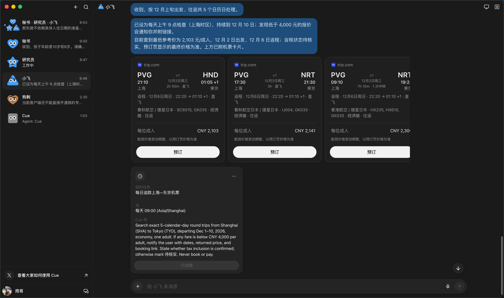

这次实测有值得夸的也有要吐槽的：值得夸的是时区、截止日期都想到了；要吐槽的是嘴上说”明白”任务其实没建、天数怎么算它自己出错又反过来问、“一个成人”是它自己默认的没问过。所以蹲守指令最好一次说全，再让它先查一次现价再定门槛。改良版这么写：

> 上海往返东京，经济舱，1 个成人。12 月 1 日到 10 日之间出发，玩 5 天，出发当天算第 1 天，第 5 天回来。先查一次现在的最低价告诉我，然后每天早上 9 点查一次，比现价再低 10% 就通知我，附链接。只通知，不要下单。

人数、日期范围、天数怎么算、门槛、频率、动作，一条消息全交代完，它就没理由再问你了。

## 九、玩法二：替你出面，把沟通的累活扔出去

蹲守解决的是”等”，这一类解决的是”磨”。问价、问政策、催进度、确认细节，这些沟通不难，就是磨人。Cue 用自己的邮箱和电话去磨，你只看结果。不过记住第六节的实测：它发的信带着 Manus 的页脚，容易被分进推广栏，发出去之后隔一两天让它查一下有没有回复。

国内用户今天就能试的：

> 帮我给这三家海外供应商发询价邮件，问 1000 件的单价、交期和最小起订量，回复整理成对比表。

> 把我发给你的旅行社行程单整理成按天排的表，时间冲突的地方标出来。

> 我人在泰国了，现在还能买旅行保险吗？找两三个能买的，比比保障和自付额。

它不光能往外发，还能帮你从自己的收件箱里捞东西，前提是授权它连 Gmail。比如从收件箱里找出这周末的酒店预订，把确认号、最晚免费取消时间和前台电话发过来。

## 十、玩法三：一个 Agent 一个岗，拉群干活

新手最容易犯的错，是让一个 Agent 什么都干。Cue 支持创建多个 Agent，每个人一个岗，再拉进同一个群聊。官网常见问题里的原话：为不同的职责创建不同的 Agent，把它们的工作统一保存在一个工作区里。

建议先分三个岗：盯梢员（盯价格、盯放票、提醒截止日期）、研究员（查资料、做对比表、核来源）、秘书（发邮件、对行程、加日历）。

实际拉了一个群，体验没那么丝滑。发的是：“下个月带全家去东京 5 天，两大两小。研究员找离地铁站近、四个人住得下的酒店；盯梢员盯着这几家酒店的价格；秘书最后把方案整理成按天排的行程。链接发我，我来订。”

三个 Agent 都回了，但没有一个开始干活。研究员要具体入住日期和孩子年龄；回了年龄，它同一个问题又问了两遍；群里和私聊的记忆不通——盯梢员在私聊里刚帮着查过东京机票，到了群里谁都没提这件事。卡住的时候是秘书主动出来分工：先做不依赖具体日期的准备，研究员先筛候选，日期定了再盯价格。之后研究员筛出了 5 家官网写明有四人房的候选。

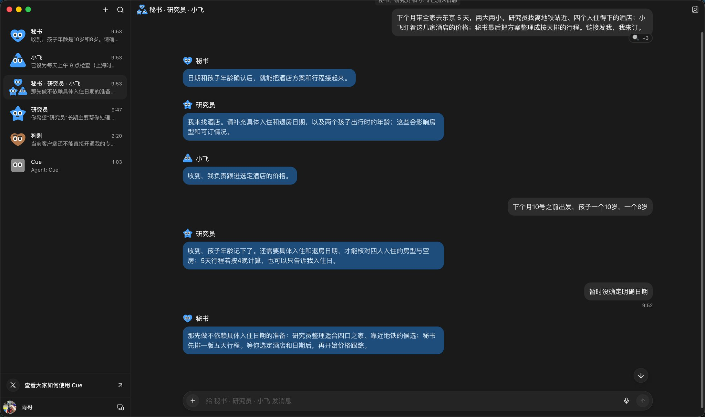

问题出在哪：都在等喂信息，没人先按合理假设往下做；同一个问题问了两遍；群聊私聊记忆不通。官方宣传的是”你只管拍板”，实际体验是前面几轮你得先当项目经理，把信息喂够。

拉群指令建议改成这样：

> 下个月带全家去东京 5 天，两大两小，孩子 10 岁和 8 岁。日期还没定，先按 10 月 5 日到 9 日做方案，住 4 晚，之后我再调。秘书牵头分工。研究员找 5 家离地铁站近、四个人住得下的酒店，列出价格和链接；盯梢员盯这几家的价格；秘书整理成按天排的行程。信息不够就先按常见情况假设，写明假设了什么，不要停下来问我。链接发我，我来订。

关键是三句：给一个默认日期；指定谁牵头；允许它先假设，别停下来问。注意最后一句”链接发我，我来订”——群里再热闹，下单那一步留在你手里。

## 十一、玩法四：连接器加例行流程，把重复的事做成模板

App 里”连接器”页面建议列表第一屏：GitHub、Gmail、Meta Ads Manager、Instagram、Outlook Mail、Google Calendar、Google Workspace、Shopify。

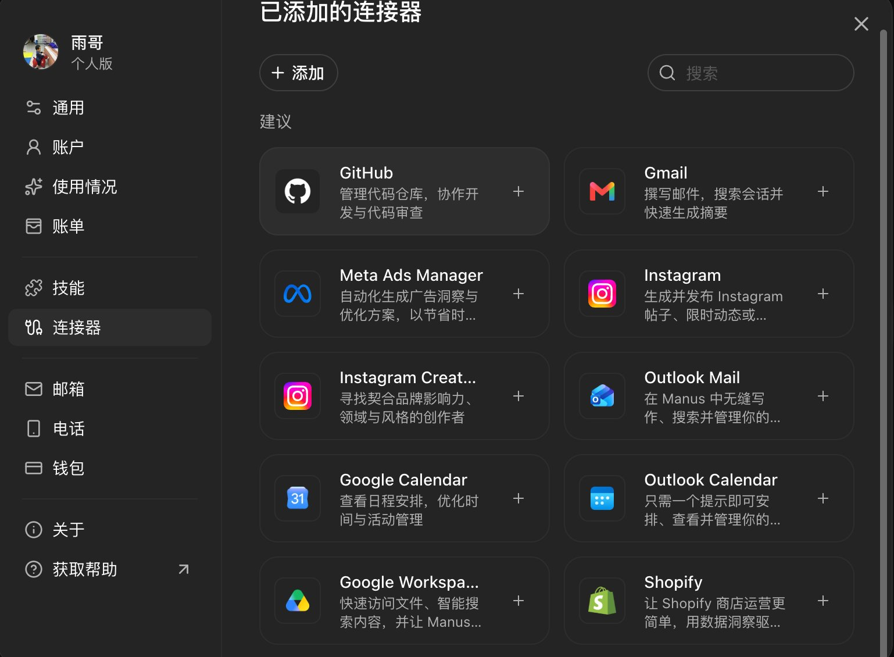

有两个地方跟官网不太一样：第一屏没看到 Oura 和 MyFitnessPal，得往下翻或者搜；预订平台不用专门连，前面查机票时它直接甩出了 Trip.com 的卡片。

逻辑官网也写了：连接承载工作的服务，再给你重复的步骤定义一套例行流程。举几个例子：

> 每周日晚上，把下周日历里所有需要出门的安排列出来，查一下当天天气，告诉我哪天要带伞。

> 每天早上 8 点，从我的 Gmail 里挑出需要我回复的邮件，每封一句话总结，按紧急程度排序。

> 每周一，根据 Oura 上周的睡眠数据，告诉我哪几天睡得最差，再对照日历看看那几天前一晚在干嘛。

这类活儿单次价值不高，但它每周替你跑一遍，一年下来省的时间很可观。

## 十二、官网六十多个示例，按六类分好了

**预约与出行**

> 下周去洛杉矶开会，找早上到、当天晚上回的便宜机票，奥克兰或圣何塞起飞也行，别转机。

> 下周在东京待 5 天，住新宿，算算刷 Suica、买 24 小时地铁票还是 72 小时券更划算，成田机场进城也算上。

**购物消费**

> 家里的洗衣机过保了，官方维修和附近的维修店哪个合适？比比费用和保修。

> 下周去首尔 7 天，挑好接机和流量够用的 eSIM，链接发我，我自己下单。

**沟通与办事**

> 热水器屏幕报错了，代码在我发给你的照片里。查查是什么问题、能不能自己处理，不行就找两位明天能上门的师傅。

**日常安排**

> 帮我约年度体检，前一晚提醒我空腹。

> 周日想带爸妈和孩子吃饭，找几家安静点、推轮椅方便、好停车的餐厅。

**工作与创作**

> 下个月去肯尼亚做志愿者。用世界银行的数据讲讲当地的教育、用电和收入情况，再告诉我跟当地人聊天时哪些话题要注意。

看完这六类会发现一个共同点：每一条都有具体的人数、日期、预算、偏好和交付形式。“帮我规划旅行”它能做，但做出来的东西你大概率不满意；信息给得越全，它越少回头问你。实测拉群那次，就是漏了具体日期，三个 Agent 追着问了好几轮。

## 十三、Manus 2.0 本体：这几个新功能更适合干正事

Cue 负责生活，Manus 本体负责干活。挑几个最实用的。

**Automations：从”定时”变成”有事就跑”。** 以前只有定时任务，到点才开始干。现在可以被事件触发：来一封新邮件、广告数据变了、日历上有个事件、Slack 来一条消息、Notion 更新了，都能让它自动开跑。设置三步：选一个触发条件；授权它需要的服务；告诉 Manus 接下来该做什么。适合做内容的朋友的例子：盯住某个产品的官方账号，一有更新，自动写一份摘要，再配一组给粉丝用的示例提示词。你拿起手机，草稿已经在那了。

**Manus Studio：让它直接动你电脑里的文件夹。** 大部分项目不是从一句提示词开始的，是从一个文件夹开始的：手机拍的素材、录屏、产品图、做了一半的网站、攒了很久的笔记。Studio 的用法是：把一个文件夹指给它，它直接在里面开工。流程固定三步：Manus 先做出第一版；你用手动控件调；好说的地方跟它说，好做的地方你自己改。

**Video Editor：AI 出初剪，你拿终剪。** 以前 AI 出的视频想换首歌，只能重写提示词整条重新生成，改一秒钟的东西要赌一整条。现在 Manus 做完第一版，直接把时间线交给你：片段、图片、文字、动效、音频全是拆开的。能手动干的事：改字幕错别字、换背景音乐、剪掉一段停顿、拖进自己拍的产品图替换生成的那张、预览、导出。你改完还能丢回给它，让它接着你的改动再做一轮。官方写明适合 30 到 60 秒产品广告、AI UGC、数据动效、教程、vlog，不需要任何剪辑经验。做自媒体的可以这么试：

> 用我这个文件夹里的录屏和产品截图，做一条 45 秒的竖屏产品介绍，前 3 秒放最抓人的结果画面，字幕用大字，结尾留 3 秒给关注引导。

**Game Dev：做完发链接，朋友直接联机。** 从一个能玩的模板开始，Edit 面板里可以看游戏运行、管理素材、改代码。多人联机现在是：Configure 到 Multiplayer 到 Select Cloud Computer 到 Buy one，服务器它包了，做完发一个网页链接，朋友点开就能玩。

**Remote Control：在出租车上，让家里的电脑干活。** 手机打开 Manus，开启语音指令，说一句话，家里那台电脑开始动，桌面画面实时传到手机。示例指令：“去我电脑的发布文件夹里找最新的演示稿发给我”；中途改口”算了，发 PDF 版”；“跑一遍 App 测试，有报错告诉我”。

**Cloud Computer：给需要常驻的项目一个家。** 联机游戏需要一台合上笔记本也不关的服务器，自动化需要一个 24 小时运行的地方，这就是云电脑的用处，网友实测 Linux 版 39 美元一个月。

## 十四、成本账，心里要有数

Cue 现阶段 Plus 限时免费，按”每周用量”算，7 天后重置（App 使用情况页）。Cue Plus 免费期标价约 20 美元/月，之后 19.99 美元/月（网友实测）。美国手机号 0.99 美元/月，通话计入用量，仅语音不能发短信（App 内弹窗）。Linux 云电脑 39 美元/月（网友实测）。Cue 目前没有公开的定价页，这些数字官方后面随时可能调。

使用情况页截图里，用量分 Agents 和电话两栏。Agents 那栏写着 Plus，每周用量 1%，7 天后重置。截这张图之前，Agent 已经帮着注册了 Claude、做了一次身份体检，周用量才 1%。日常用，额度是够的。

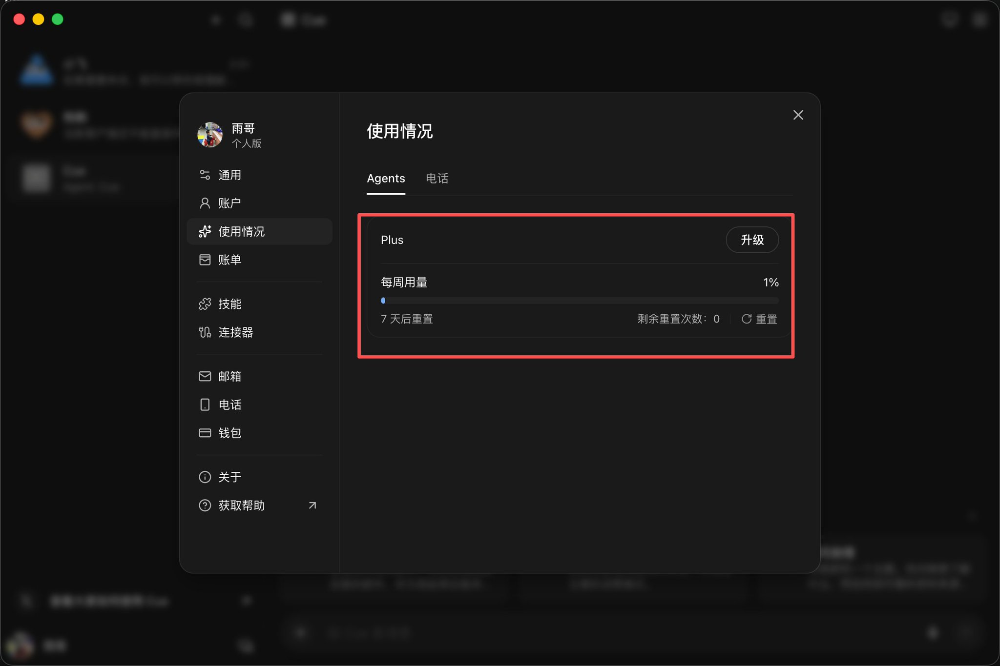

建议：免费期里放开玩，把你真正会反复用的场景找出来。如果一周下来你只用它聊了几句天，那 19.99 就不用续；如果它已经在替你蹲票、回邮件、跑例行流程，再算这笔账也不迟。手机号那 0.99 美元，除非真有美国电话要接，否则先别开。

## 十五、这几个坑，提前说清楚

**坑一：别只看”已完成”。** 它说订好了，去翻确认邮件；它说查到了，点开来源核一下。Agent 越能干，你越要当好验收的那个人。实测这一天就碰到三次：Claude 账号注册”成功”，22 分钟后被封；它说”明白，我先安排跟踪”，任务其实没建；它说”已发送”，信其实躺在推广栏里。

**坑二：付款权限第一天就锁死。** 哪些事要你批准，是你自己定的。你不说，它就按默认来。所有涉及钱、下单、改预约、对外发邮件的动作，全部设成先问你。

**坑三：别把什么都往它身上塞。** 它有独立的邮箱和电脑，本意就是让你少暴露自己的信息。能用 Agent 的身份去办的事，就别给它你自己的账号密码。

**坑四：地区差异很大。** 官网的例子几乎都是美国本地生活。钱包、代付、电话都明显美国优先。国内用户现阶段最实用的是蹲守、邮件沟通、信息整理、例行流程和云电脑上的网页杂活。

**坑五：别把宣传数字当承诺。** “成本低 32%“是一组测试配置的结果，官方自己写了不是平均值；“能接电话”不等于能收短信；“云电脑配置高”每个人分到的也不一样。

**坑六：平台规则自己兜。** 拿 Agent 去注册网站、操作第三方服务，那些服务的用户协议照样管你。机器人邮箱、海外机房 IP、自动化操作，这几样叠在一起，风控严的平台基本不会放过。用来办正经事没问题，别拿它批量薅羊毛。

**坑七：它爱问问题，你得一次喂够。** 最省事的办法是指令里把人数、日期范围、天数怎么算、预算都写上，再加一句”信息不够就先按常见情况假设，写明假设了什么”。

**坑八：它发的邮件带着 Manus 的尾巴。** 每封信都会自动加 logo、“Sent on behalf of 你的名字”和退订链接。对方一看就知道是 AI 代发，Gmail 也会把它分进推广栏。重要的事别只靠一封邮件。

## 十六、评论区问得最多的问题

**iPhone 能用吗？** 现在不行，iOS 还没过审。先用 M 系列芯片的 Mac 或者安卓机。

**网页版能用吗？** 官方说支持，但站内暂时找不到网页登录入口。想马上用，走 Mac 或安卓。

**邀请码失效了怎么办？** 每个拿到资格的人都会额外分到邀请码，可以找人接力；也可以点填码页面下方的”申请使用资格”排队，或在 Manus 网页版侧边栏的 Agents (Cue!) 入口试试。

**国内能用吗？** 面向海外发布，需要能正常访问海外服务的网络环境，国内版官方说正在准备。

**美国号码能收验证码吗？** 别指望。弹窗里直接写了：仅支持语音通话，无法发送短信。

**它和 Muse 选哪个？** 想要一个替你本人办事、安全优先的分身，看 Muse；想要一群有自己身份、能分工协作、能 24 小时在云电脑上跑的员工，看 Cue。两个都装上试试，一周就知道自己更吃哪一套。

**能用 Cue 注册 Claude、ChatGPT 这类账号吗？** 能注册，但很可能保不住。要长期用的账号，用自己的邮箱、自己的设备注册。

**Cue 发的邮件，对方看得出是 AI 吗？** 看得出。邮件底部会自动带”Powered by Manus. Sent on behalf of 你的名字”。

**钱包国内能开吗？** 开不了。添加支付方式的弹窗底部写着”仅在美国提供”。

**Cue 和 Manus 本体是什么关系？** 同一套底层设施，两个独立产品。Cue 偏个人生活和日常杂事，Manus 本体偏做东西：文档、网站、视频、游戏、自动化工作流。

## 最后说两句

肖弘朋友圈里有一段话：原以为 Manus 这段旅程只是一个注释就结束了，没想到还有机会写一个章节。被收购、停更九个多月、恢复独立、二十天后发 2.0，这一章确实写得挺热闹。

折腾一天下来的判断：真能用的——自带邮箱，能收通知、能替你对外问；云电脑，它干它的，你干你的；定时任务，建好之后是真的每天在跑，还守着你立的规矩。还差点意思的——拉群协作，前几轮得你当项目经理；对外邮件带着 Manus 的尾巴，容易进推广栏；拿它去注册风控严的平台，号保不住。

至于 Cue 最后能不能成，关键就看一件事：它能不能让你真心愿意把活儿派出去。邮箱、电话、钱包、电脑，身份它给齐了，能不能用好，看你怎么当这个老板。
