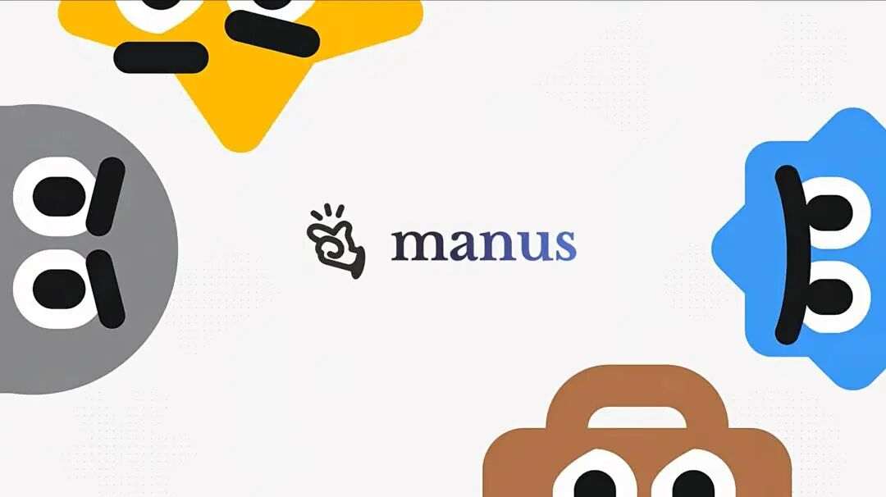
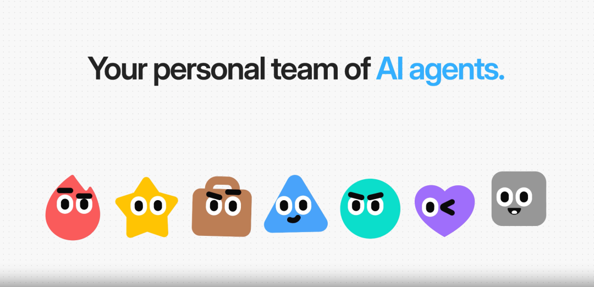
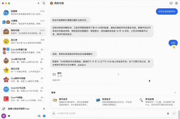
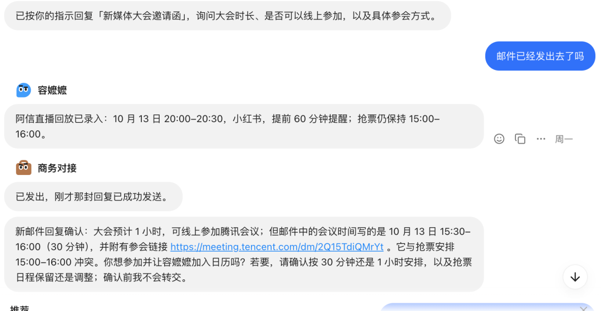
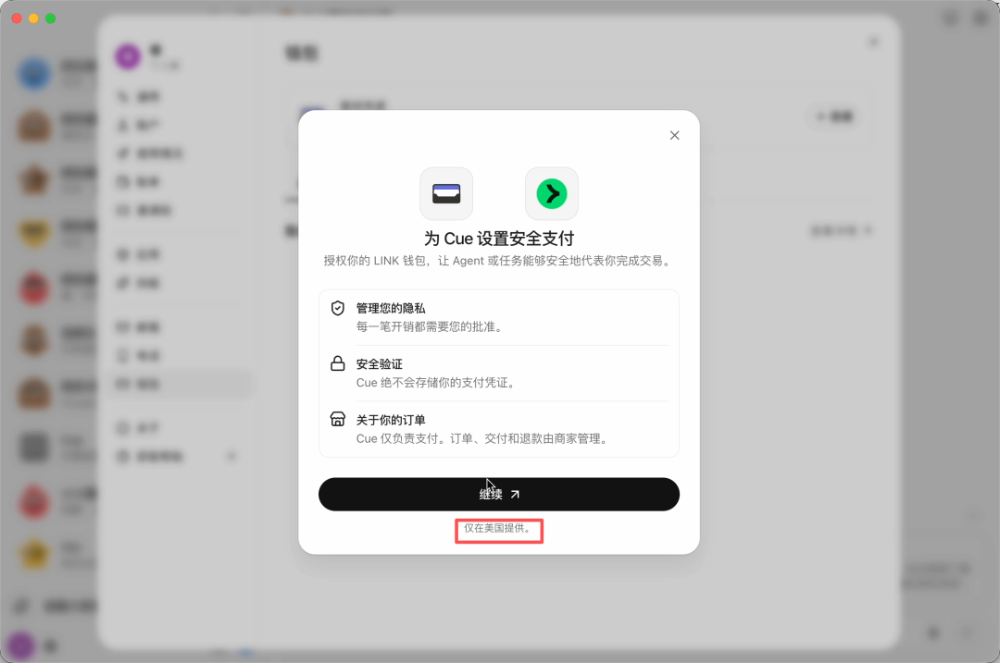
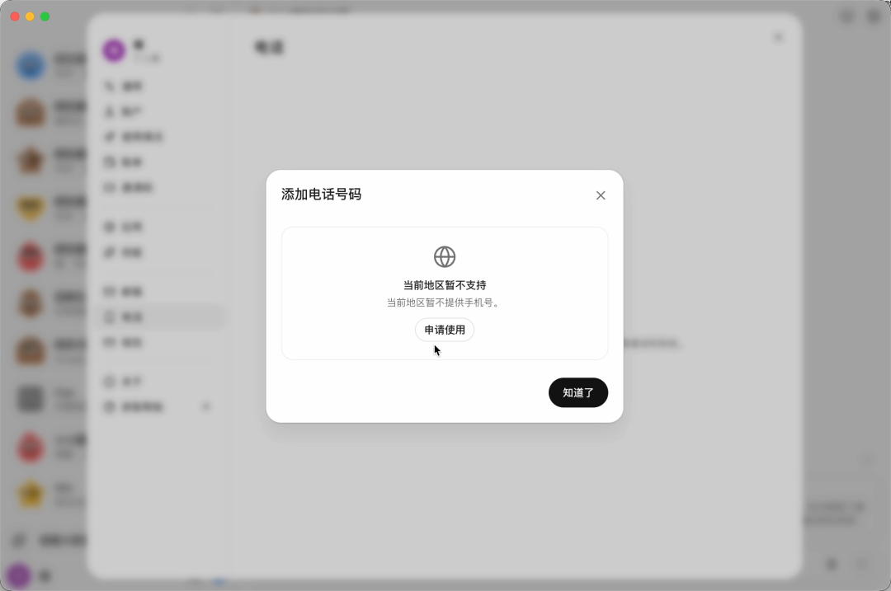
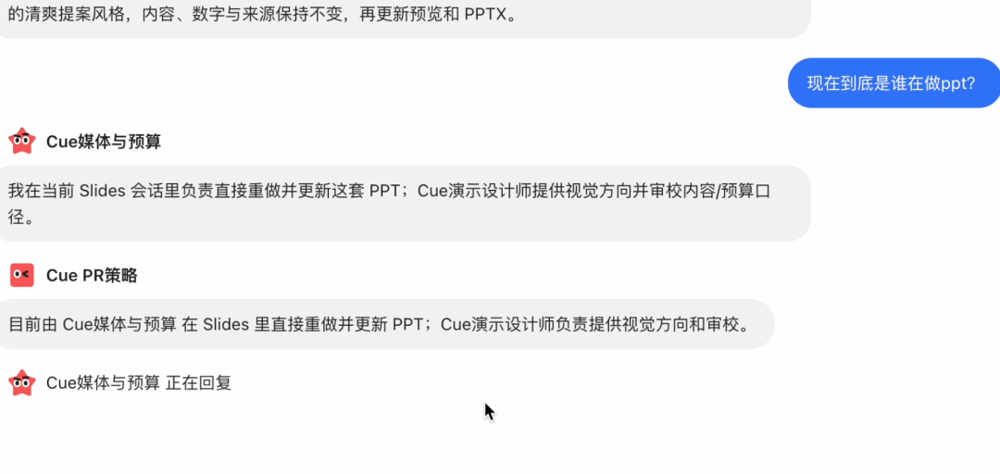
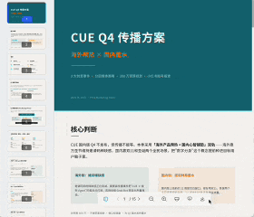
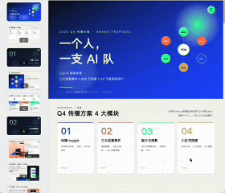
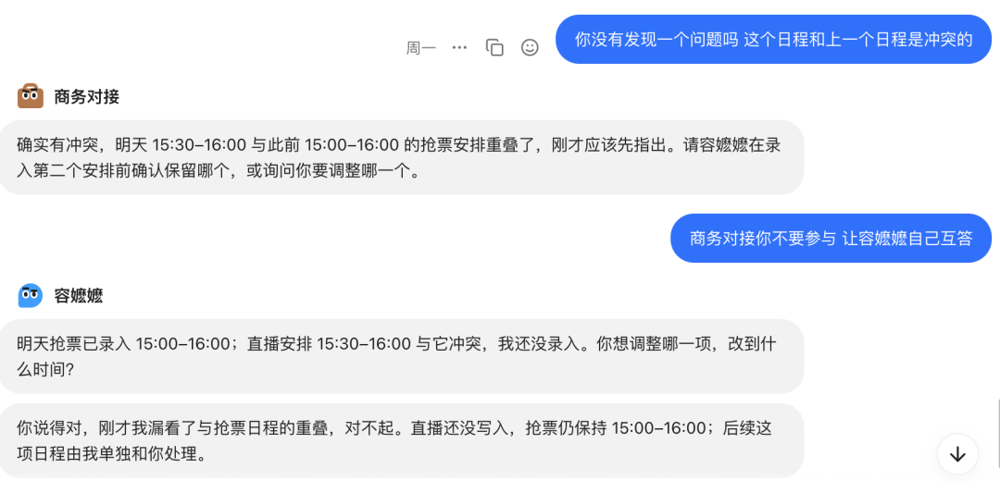



**收录说明**：检索时先看到虎嗅的授权转载（署名「奇点团队」），按公众号原文收入。文末的投稿热线、二维码、署名栏（编辑：木人，审校：张问心，制作：瑞总）、视频号引导和「往期推荐」属于推广，未收入。原文小标题是成对的粗体段落，照原样保留。文中 Manus 资本经过与国内竞争格局的部分一并收入。

**内容摘要**：作者团队开通 Cue Pro 会员，在国内的账号与网络环境下实测了一周；起初测的是 Manus 2.0，因积分消耗大改测 Cue，并提醒 Cue 会员与 Manus 2.0 不通用。邮件是最顺畅的一环：能提醒收信、总结要点，代回几封测试邮件基本不需要反复纠正；电话与钱包都要求绑定国际账号，流程中断，两条链路都没跑通。多 Agent 群聊回复混乱、私聊与群聊信息不同步，要配置海外应用接口并保持稳定网络；用同一条指令让 Cue、豆包和腾讯 WorkBuddy 各做一份「Q4传播方案」，Cue 的产出没有显著优于国内产品。日程管理上，预埋的冲突 Cue 没有主动发现，人工反复提醒后才学会分辨，能从邮件里提炼日程，但微信、QQ 等国内信息流接不进来。文章另写了 Manus 的出走与回归（据媒体报道完成超 5 亿美元融资、目标估值约 40 亿美元）和国内外厂商竞逐 Personal AI 的格局。

**保留理由**：已收实测里唯一一篇在国内网络与账号环境下用了一周的记录，写明了电话、钱包卡在国际账号，并用同一指令把 Cue 与豆包、WorkBuddy 对照，还测了日程冲突识别。

---

当AI开始替人行动，它究竟该以谁的身份办事？身份由谁授予，权限如何划定，出了差错又由谁负责？

**作者｜Rosa**

**编辑｜孟雯**

AI助理开始给自己配“身份证”了。

9月28日，Manus推出个人AI助理Cue：每个Agent都可以拥有独立邮箱、电话号码、数字钱包和专属电脑，即使用户退出登录，它也能继续工作。Cue想做的已经超出一个随叫随到的工具，它要以自己的身份，替人处理邮件、接打电话、安排日程，甚至在预算范围内付款。

这套设想把Personal AI推向一个更具体、也更难回避的问题：当AI开始替人行动，它究竟该以谁的身份办事？身份由谁授予，权限如何划定，出了差错又由谁负责？

我们开通Cue Pro会员实测了一周，邮件处理是目前最顺畅的一环，电话与支付被国际账号挡在门外，多Agent协作需要繁琐配置，日程管理又接不进国内用户常用的微信、QQ等信息流。

产品构想已经走到“替你办事”这一步，真实体验却仍被使用环境层层牵制，这种落差，或许也是理解当下Personal AI竞争的一个切面。

**“出走”一年半**

**Manus手握34亿重回牌桌**

Manus 过去一年多的经历，比它的产品迭代还要跌宕。

2025年3月，它顶着"全球首个通用 AI Agent"的名头爆火，几秒钟就能筛简历、分析股票、从零建一个网站。同年5月，总部搬去新加坡，产品不再对内地开放。12月，Meta 宣布以20亿美元收购它。今年4月，国家发改委要求撤销这笔交易；8月底，中资老股东从 Meta 手里回购股份，创始团队重新拿回控制权。

回到牌桌上的第一件事就是补充弹药。据媒体报道，Manus 母公司蝴蝶效应近日完成超 5 亿美元融资，博裕投资、IDG 资本领投，腾讯、红杉中国、真格基金继续加持，目标估值约 40 亿美元。

融资官宣当天，公司发布了17个北京岗位，覆盖产品、研发、运营和增长。创始人肖弘在社交媒体上透露，一天之内收到上千封简历。至于公司是否在为赴港上市做准备，目前仍是业内人士的判断，尚未得到官方确认。

资本为什么还愿意给它重注？对不少投资人来说，Manus与AI Coding Agent公司其实是“同类物种”，它们都试图把模型能力变成可以直接交付的工作成果。

而这条参照系的造富速度也确实很惊人，Anthropic的Claude Code上线半年，年化收入就冲到10亿美元，破了全球软件史纪录；Devin的开发商 Cognition 今年9月完成超20亿美元融资，估值480亿美元；Cursor去年底拿了 23 亿美元，今年8月更是被 SpaceX 以 600 亿美元整体收购。和这些数字放在一起看，Manus本轮融资的体量并不算“夸张”。

但牌桌也确实比它离开时拥挤多了，肖弘曾回忆，Manus刚做出来时，市场上还没有Codex，也没有Claude Cowork。如今，腾讯WorkBuddy，阿里千问办公，字节整合飞书推出豆包工作，DeepSeek和MiniMax也在细分场景中加码。任务执行能力正被模型厂商收入自家产品，独立Agent公司要建立入口，难度比一年多前高出许多。

Cue因此有了另一层意义，9月28日，Manus 2.0与个人AI助理Cue一同发布。Manus主要负责完成任务，交回报告、幻灯片或网站；Cue则将触角伸向个人生活，创建长期存在、有名字的Agent，即使用户退出登录，它也可以继续运行。

肖弘形容Cue是一个有独立手机号、邮箱、支付能力和电脑的“东西”，或许可以称之为“人”。他还用电脑作比喻：人们买电脑大多为了工作，如果它不能看视频、打游戏，也会少些乐趣。做视频、做联机游戏，正是他为Cue设想的早期场景。更广泛地说，Manus希望让Agent从临时接单的工具，走向能持续待命的个人助理。

这套设想能否真正进入用户生活？我们把测试重点放在Cue身上，看看它配备的“独立身份”，能否支撑起一个随时可用的Personal AI。

**Cue 一手实测**

**拿到了“身份证”，却没拿到国内生活的“通行证”**

先交代下测试边界，Cue面向海外用户发布，官方表示国内版本仍在筹备。以下结论来自我们当前的账号、网络和应用环境，呈现的是一款海外产品进入国内使用环境时遇到的限制，不能直接等同于它在目标市场的完整表现。

最初，我们测试的是Manus 2.0本身，但其积分消耗较大，免费额度很难支撑完整任务跑完。Cue同期发布后，我们转而开通了Pro会员，不过要提醒大家，Cue会员与Manus 2.0并不通用，即便属于同一家公司，两款产品的账号和会员体系也没有完全打通。

Cue的差异化可以用一句话概括：Your Personal Agents, With Their Own Identity，每个Agent配有四类资源：独立邮箱、电话号码、数字钱包，以及用于运行长任务的专属电脑。它的设计逻辑，是让Agent拥有一套可持续运行的身份与工作环境。

邮件处理，最接近承诺中的体验。四类资源中，邮箱是体验最完整的，Cue能及时提醒收信、总结邮件要点，并按要求组织回复。

我们让它代为回复几封测试邮件，从理解意图到组织措辞，基本不需要反复纠正。对日常高度依赖邮件沟通的用户来说，这种交代一次后就能放心交由它处理的体验，确实有价值。

接电话、代支付卡在国际账号，当我们尝试继续体验电话和钱包时，流程很快中断，两项功能都要求绑定国际账号，国内普通用户在测试环境下难以完成。官方尚未公布电话号码的可用国家范围，也没有确认钱包是否只面向美国等特定市场。

第三方测评曾提到，Cue提供的美国号码可能仅支持语音，钱包链路则与Stripe Link有关，但这些信息尚未得到官方完整说明，我们能确认的是在此次测试环境中，电话与支付两条链路都没能跑通。

这直接削弱了“身份四件套”的完整性。邮箱可以代收代回，Agent却暂时无法通过电话与支付延伸到更多现实事务。对于希望让AI长期处理生活任务的用户来说，最有辨识度的能力恰好也是最难触达的部分。

多Agent协作，流程搭起来了，交付没有跟上。Cue的另一个招牌是让多个Agent自主分工、在项目群里接力工作。实际体验中，群聊里的回复有些混乱，谁在回应谁、由谁收尾并不总是清楚；私聊与群聊之间的信息也没有完全对齐，用户单独交代的要求，不一定会被同步到整个任务里。要跑通协同流程，还需要配置海外应用接口，并保持稳定的网络连接，额外付出的配置与运维成本不低，产出提升却不明显。

我们还用同一条指令，让Cue、豆包和腾讯WorkBuddy分别完成一份“Q4传播方案”，结果Cue的产出并没有显著优于国内其他AI产品。

当然这个对照并非完全对等，Cue更强调Agent编排，豆包和WorkBuddy可以直接交付方案。但也正因如此，编排能力需要拿出额外价值。如果多个Agent忙碌协作之后，仍交不出比单体工具更好的成果，用户很难为协作本身买单。

上：cue 下：豆包

日程管理差一口“活人感”。简单的待办录入，豆包、飞书、WorkBuddy 乃至手机语音助手都能做，所以我们重点测了两件更考验“活人感”的事：能不能主动发现日程冲突，能不能主动获取信息、减少人工录入。

结果是喜忧参半。我们预先埋了冲突陷阱，Cue 没有主动发现，是在人工反复提醒后才学会分辨，唯一的正反馈在信息提炼：随手丢给它的图文，它都能提取出日程信息，且还能与邮件托管 Agent 协作，自主监管邮件、提炼日程，过程中还完成了回复和确认。

但这一亮点实现的前提是信息来自邮件，家长群里的作业通知、工作群里的临时安排、QQ里的班级消息、微信群里的物业公告，才是许多国内用户每天处理的信息流，但Cue目前都接不进去。

几项任务跑下来会发现要最大程度显化Personal AI的能力，需要落在用户已经使用的服务和信息网络里。

想代下单淘宝，千问背靠阿里，原生支持；想接管微信和办公流，腾讯系有天然优势；想做本地生活和服务调配，豆包也已经在打通闭环。

即便Agent本身的架构设计走得更远，如果进不了用户每天打开的应用，它也很难成为一个随时可用的助理。

**竞逐Personal AI**

**身份之外还要跨过生态与成本**

Cue在国内测试中碰到的墙，正是其他玩家试图借力、绕过或重新定义的地方。

10月13日，千问Go!上线体验申请页，采用限量申请方式。媒体实测显示，它已经可以调用阿里自家的服务接口处理具体事务，例如航班延误理赔和淘宝价保。灵光的“我的生活”在小范围内测，尝试通过后台运行管理生活账单、连接家居设备；腾讯Marvis则将自己定位为系统级AI管家。

海外市场也在同步升温。Meta发布的个人AI助理Muse，面向用户提供邮件、订餐、网购等代办能力，OpenAI的Sam Altman也展示了个人AI助理dots，主打独立云电脑、浏览器和应用连接能力。

从Meta、OpenAI到Manus，再到国内各AI产品，大家都在讲同一个故事：AI将逐渐接手订票、点餐、购物、整理日程等日常任务，个人助理也可能成为新的流量入口。但竞逐之前，还有个更底层的选择，即AI究竟该以什么身份替用户行动？

千问Go!选择借用用户的身份，它依托用户已有的账号与平台服务办事，能直接进入淘宝、支付宝、飞猪等生态，完成部分交易和售后任务。这样更容易触达真实需求，也减少了重新搭建身份系统的成本。

风险同样贴近用户：账号就是Agent的执行面，误操作可能直接影响用户的钱和订单。PPT做得不好可以重来，电话拨错、款项付错或订单误操作，补救成本要高得多。用户最终能授权到什么范围、哪些步骤需要确认、平台如何兜底，目前仍需要更清晰的规则。

Cue则选择给Agent发一张自己的身份证，独立邮箱、电话、钱包和电脑，试图把Agent的行动范围与用户的个人账号分开，令权限边界更清楚。但独立身份需要获得外部服务认可，也受可用地区和平台接口约束。Cue在我们的测试里碰到的障碍便是如此，它有自己的身份设计，却尚未获得进入国内常用服务的通行条件。

还有创业者主张，把AI做成用户自身的延伸。Ambi创始人、曾任Plaud合伙人兼中国区CEO的子皓在接受“42章经”采访时提出，给AI一个头像和名字的“人格化”路线未必最有效；与其让用户去找一个助手，不如让AI逐渐成为“非常了解你的分身”。这十分看重工作与生活上下文的积累。只是，足够了解一个人需要长期的信息沉淀，隐私边界、数据授权和跨应用连接也都要一并解决。

三种思路各有取舍，但都绕不开生态。国内用户的日常已经被微信、支付宝、淘宝等超级App深度组织起来。独立身份要获得平台认可，借用用户身份也需要平台开放接口。豆包手机调用微信遇阻、Meta的Muse购物功能遭到亚马逊封禁，都说明平台不会轻易放任AI代理改写既有的流量和交易关系。

对Personal AI来说，接入生态还只是基础条件。产品得足够省事，用户才可能愿意持续使用。子皓谈到，他希望人与AI能“同步在场”，用户无需在任务过程中不断补信息、反复操作。现实却是，Cue跑通一次多Agent协同，就需要配置海外应用接口并处理网络问题。对普通用户而言，使用前的准备成本可能已经超过任务本身的价值。

“主动服务”也面临类似难题。产品可以定时扫描信息、推测用户眼下的需求，但推理成本持续发生，推送内容又未必合时宜，甚至会形成打扰。

商业化是另一道现实考题。Manus 曾经是全球最快跑到 1 亿美元 ARR 的创业公司，正式上线只用了八个月。但 ARR 已经不再是这类公司的免死金牌，Agent 完成任务需要大量模型调用，用户愿意付的价格却不会无限涨，Token 成本比收入涨得快，这个生意就很难维系。

罗森布拉特证券曾给Muse算过一笔账：要么计算成本显著下降，要么用户每月通过它完成的购物金额平均超1000美元，Muse 才可能盈利，但这个数字远高于当前电商的平均水平。

这也解释了为什么眼下不少产品采取免费或限量体验：Marvis免费，Cue在early access期间免费，千问Go!限量开放。“帮用户省了钱”又是最容易传播的故事，理赔拿回70元、价保退回52元，都能让AI代办的价值迅速变得可见。

但用户愿意试一次，与愿意长期付费，是两回事。随着体验从免费走向收费，模型调用、服务维护和生态接入的成本都需要找到稳定的承担者。

而且哪怕是“同厂出品”，产品之间的会员体系也未必自然打通，就像实测Cue时发现它与Manus 2.0“会员不通用”。一位AI产品从业者向我们解释，AI卖的是能力而不是模型，每个业务团队都有自己的产品，共用一套会员体系，绩效怎么拆分都是问题。换言之，Personal AI还没形成稳定收入，产品之间便已经先要回答如何分配成本与收益。

**结语**

**从“能办事”走向“可托付”**

Cue是“美丽废物”吗？我们的答案更倾向于它是一个极具前瞻性、却因水土不服而受困的海外拓荒者。它在邮件场景里如鱼得水，也把独立身份、多Agent长期协作的产品方向推到台前。与此同时，电话和支付的地域限制、协作流程的额外成本，以及与国内应用生态的隔离，又说明它离持续进入用户日常还有距离。

Cue最值得关注的地方是它把Personal AI的一道底层难题摆到了桌面上，身份归谁，权限由谁授予，出了问题又由谁承担后果。给Agent一套独立身份，可以让行动边界更清楚，却无法自动换来各个平台的认可；借用用户已有的身份，能更快进入服务流程，也会把误操作的风险带到用户账户中。身份设计始终与信任、授权和责任相连。

这是一场融合了法律、商业博弈与生态信任的深水区试炼，模型可以靠融资购买，生态可以靠谈判重塑，唯独“用户究竟敢不敢把生活的后背交托给它”买不到。

AI应用疯长了一年，从红包狂欢到Personal Agent浪潮，从大模型到AI办公，高端科技正一次次向大众的日常生活发起深潜。谁能率先踩碎这道由生态与信任筑起的门槛，拿下Agent元年的最后一个大结果，我们且行且看。
