

**收录说明**：极果在凤凰网大风号发布的文章，页面没有作者署名（结构化数据的编辑字段为「于雷」）。原文 01 至 04 节写 Manus 2.0 本体的专业工具、远程操控、游戏开发与视频编辑，按产品 skill 的收录范围未收，只收导语和 05 至 07 节（专属邮箱与电话、拉群分工、从通用智能体到个人智能体），删节处在正文中注明。页面的导航、作者卡片、「本文来自大风号」声明与推荐阅读未收入。3 张 4–9 MB 的动图未下载，改为指向原图的链接。

**内容摘要**：导语称 Cue 已上线网页、桌面和安卓端，iOS 版在等待审核，目前凭邀请码注册，注册成功赠送一个月 Plus 套餐；官方表示这次更新面向海外市场，正在组建团队开发面向国内的产品。作者让 Cue 发一封邮件，扫码授权后它在自己的云电脑里继续操作，最后发送成功，但用了差不多十分钟。作者建了研究员、分析师、PPT 设计师三个 Agent 合作做「个人智能体行业分析」调研 PPT，结果是极简风格、每页有出处，但有些文字叠在一起，仍要人工逐页排版。文中称 Cue 的 Plus 套餐价格还没公布，Pro 和 Max 分别是每月 100 美元和 200 美元，专属号码另算；Meta Muse 可免费使用，付费档为每月 20 美元和 100 美元。

**保留理由**：有发邮件约十分钟、三个 Agent 协作做 PPT 的结果与问题这两项实测，并记下发布初期「注册赠送一个月 Plus」「Plus 价格未公布」的说法，可与 App Store 后来列出的 Cue Plus 20 美元对照。

---

恢复独立运营不到一个月，**Manus 正式发布了 Manus 2.0 版本**，同时推出一款独立的个人智能体应用 Cue。

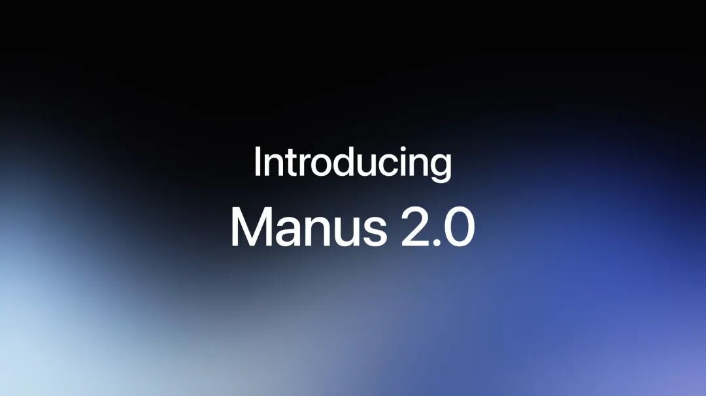

Manus 2.0 已在网页、桌面和移动端上线，同时带来了全新的 Manus Studio 应用。Cue 上线了网页、桌面和安卓端，iOS 版还在等待审核，**目前凭邀请码注册，注册成功赠送一个月 Plus 套餐**。

官方表示，这次更新**面向海外市场**，目前正在组建团队开发面向国内的产品。

（收录说明：原文 01 至 04 节介绍 Manus 2.0 本体的专业工具、远程操控、游戏开发与视频编辑，不属于 Cue，未收。）

05

配备专属邮箱与电话

做你的生活私人助理

Manus 全新独立应用 Cue，是一款为**个人智能体（Personal Agent）** 打造的应用，面向个人的工作和生活。

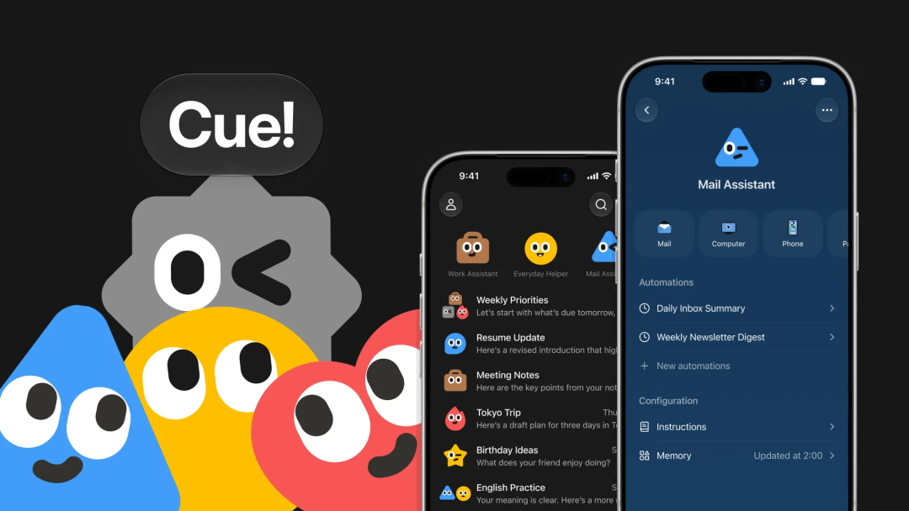

每个 Agent 都有自己的名字、头像和专属邮箱，还可以按需配置电话、电脑和钱包。

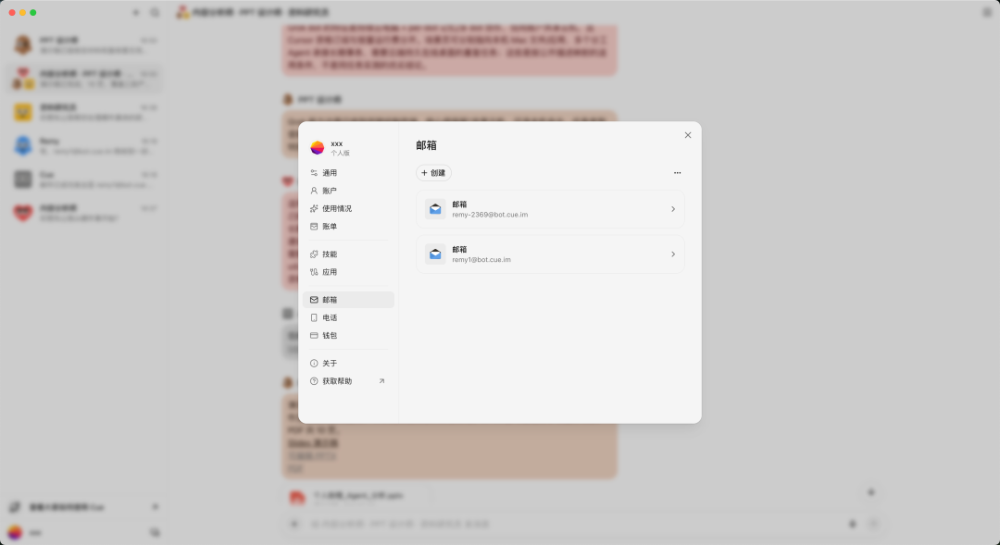

邮箱用来收发邮件，电话能拨打、接听和转接，通话后留下摘要。**钱包目前支持 Link，可以在设定的预算和权限内购物和付款**。

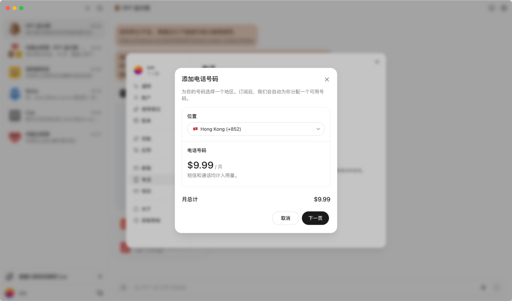

在餐厅扫一下二维码，Agent 就能根据你的饮食偏好**自主完成点餐、排队取号，甚至直接替你打电话预约**，把智能体的执行能力从数字世界进一步延伸到真实的消费场景。

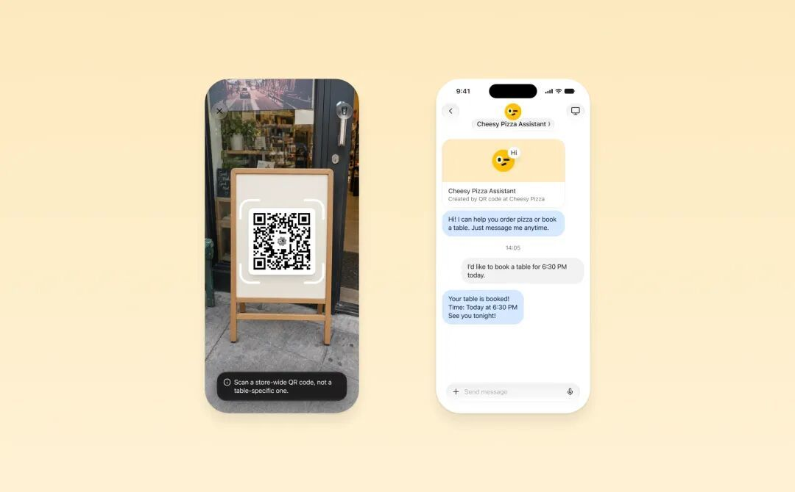

Agent 还有一台属于自己的云电脑，**24 小时全天运行**。

[动图：Agent 的云电脑](https://x0.ifengimg.com/res/2026/916227EEA73D4C78A96980F2A2B2B2F0A845C676_size8531_w1079_h607.gif)（收录说明：原图为 8 MB 的动图，超过大小上限，未下载，改为链接。）

我让 Cue 发了一封邮件。扫码授权之后，它在自己的云电脑里继续操作，**最后确实发送成功了，只不过这个过程用了差不多十分钟**。

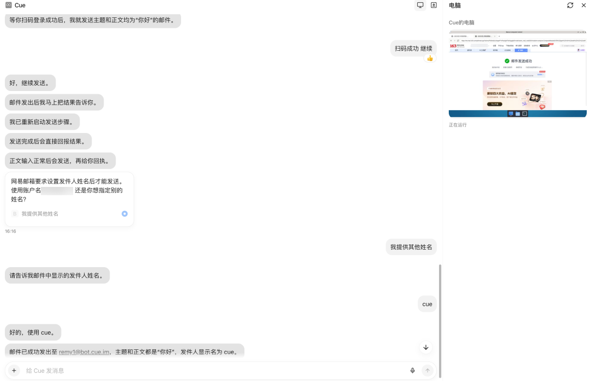

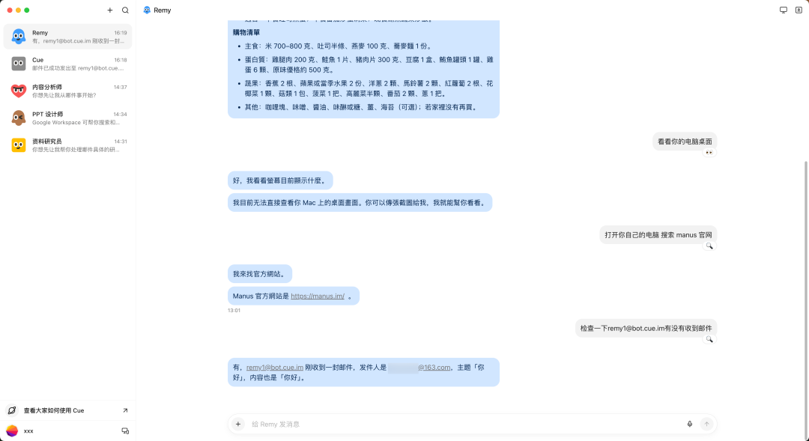

在国外爆火的同类产品 Meta Muse，最常见的使用场景也是整理邮箱、自动回复，相当于拥有了一个全天候的私人智能体助理。

06

多个 Agent 组队

拉群分工协作

Cue 还可以把多个 Agent 拉进同一个群聊，**设定共同目标，由它们分工、交接**。

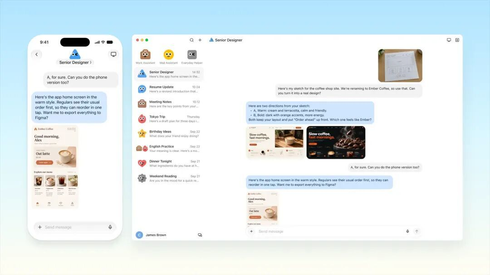

我创建了研究员、分析师和 PPT 设计师三个 Agent，让它们合作做一份“个人智能体行业分析”调研 PPT，**研究员找资料和来源，分析师比较功能、场景与适用人群，PPT 设计师负责组织页面、呈现结论**。

[动图：三个 Agent 合作做调研 PPT](https://x0.ifengimg.com/res/2026/74AD48656684AF40397D0047A413F427D36615A3_size4112_w1079_h607.gif)（收录说明：原图为 4 MB 的动图，超过大小上限，未下载，改为链接。）

看着三个 Agent 在群里讨论沟通，有一种自己当老板的感觉。

[动图：三个 Agent 在群里讨论](https://x0.ifengimg.com/res/2026/E3FA8C2BFB1E12A077221DA329BAD1898C0E0953_size8388_w1079_h607.gif)（收录说明：原图为 8 MB 的动图，超过大小上限，未下载，改为链接。）

最后生成的 PPT 是极简风格，每页都有出处，**不过有些文字叠在了一起，最终依然得人工逐页排版调整**。

虽然最后的结果还不如直接在 Manus Studio 里直接生成演示文稿，**但这个群聊形式已经证明了多智能体分工协作的潜力**。

07

从通用智能体到个人智能体

Manus 重新出发

作为通用智能体赛道的重要开创者之一，Manus 过去大半年经历了一场戏剧性的波折。去年底，**Meta 计划以约 20 亿美元收购 Manus**，随后相关部门要求交易各方撤回收购。今年创始团队联手腾讯、红杉中国、真格等原始股东以原价购回股权，直到 9 月初完成数据隔离与运营拆分，**Manus 正式宣布重获独立**。

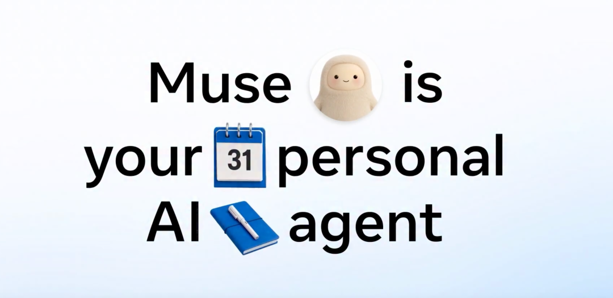

**独立后刚刚一周**，曾经的“老东家”Meta 推出个人智能体 Meta Muse，**上线一周直接登上美国 iPhone 免费应用榜榜首**。

Meta Muse 和 Cue 两款产品走的是同一个方向。都给 Agent 配了专属的云端环境，长期留在用户身边，替用户处理日常事务。

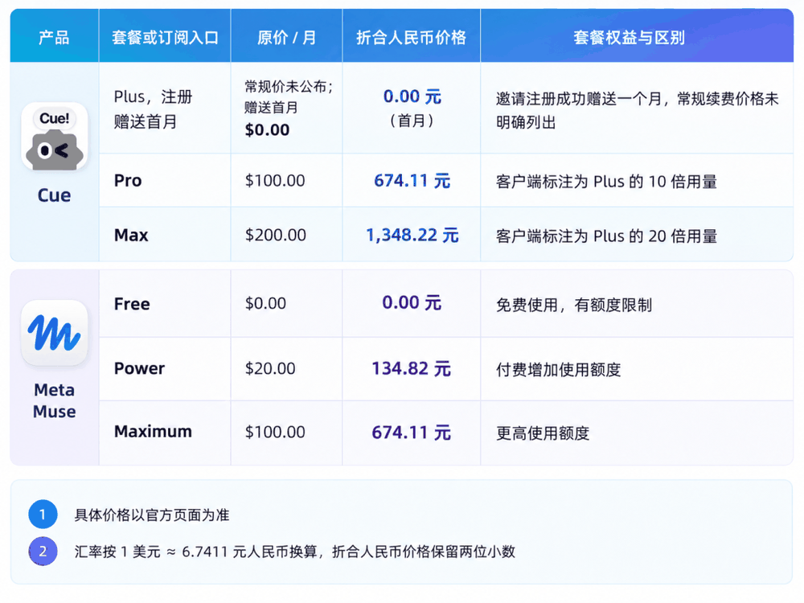

当然价格也是门槛，**Cue 的 Plus 套餐价格还没公布**，Pro 和 Max 分别是每月 100 美元和 200 美元，专属号码价格另算。Meta Muse 支持免费使用，同时拥有更高额度的每月 20 美元和 100 美元的付费订阅。

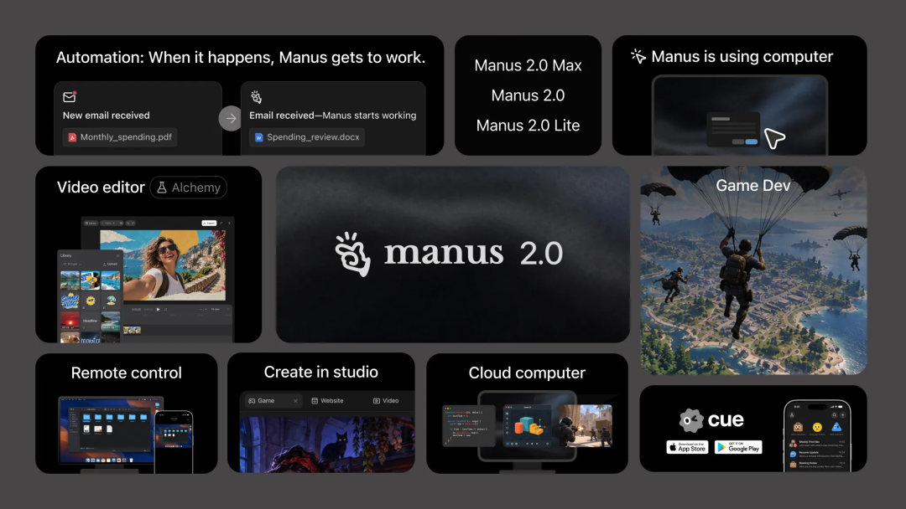

一年前，通用 Agent 让很多人看到，AI 可以自己打开浏览器、拆解任务、交出一份完整的文件。一年后，AI 有了自己的邮箱地址、电话号码和一台永远在线的电脑。

通用智能体证明了 **AI 能帮你把活干完**，个人智能体要证明的是，**AI 值得被长期托付**。

那封十分钟才发出去的邮件，算是在个人智能体时代打的第一声招呼。
