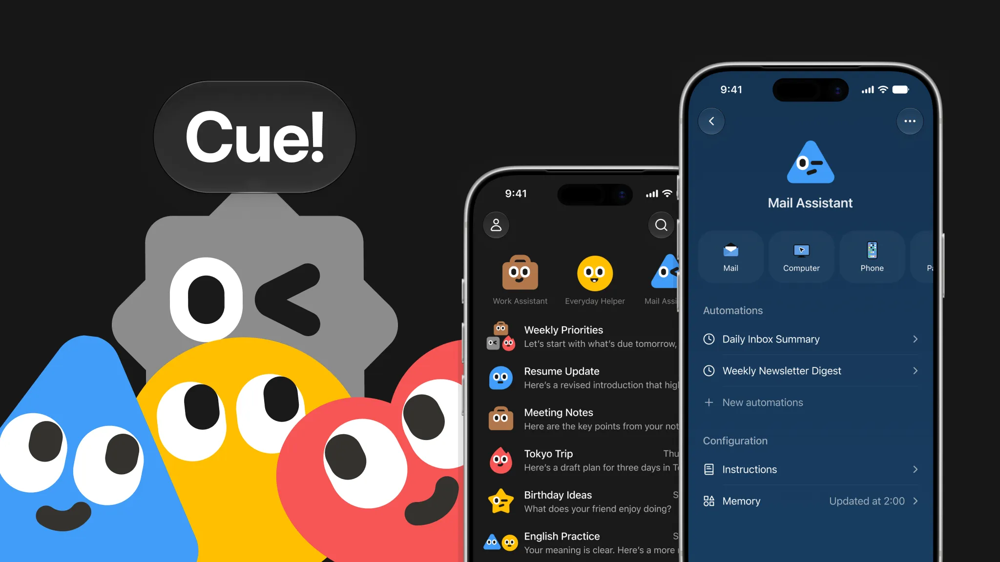



**收录说明**：Cue 随 Manus 2.0 一同发布，没有单独的发布文。这篇发布文的大部分篇幅写 Manus 本身，只收与 Cue 有关的部分：开头两段、第 3 节「Cue: A new app from Manus」，以及文末 Availability 中讲 Cue 的两段。未收第 1 节（Cascade、Cloud Computer、Automations）、第 2 节（Manus Studio、Video Editor、Alchemy mode、Game Dev、Remote Control 与 Computer Use）和「Build with Manus, build with us」。正文取自页面内嵌的 Markdown 原文，静态 HTML 里没有 Availability 一段。原文存于本目录的 original.md，网站上不显示，已翻译。

**内容摘要**：Cue 是 Manus 新出的独立应用，用来管理用户的个人智能体，有手机版和桌面版，与 Manus 用同一套基础设施。每个智能体都有自己的邮箱、电话号码、钱包和电脑，能发消息，能在用户设定的预算内付款，能在自己的机器上把任务做完，还能替用户接电话，之后在 Cue 里留下摘要。几个智能体可以进同一个群聊，为同一个目标分工接力；用户定方向，最后由用户拍板。在餐厅扫二维码，智能体可以代为点餐或排队取号。Cue 有网页、桌面和移动版，iOS 版等 App Store 审核。目前是抢先体验，凭邀请码免费使用，名额有限的公共邀请码是 MEETCUE，获得资格的用户还会拿到可以转赠的邀请码。

**保留理由**：这是 Cue 的官方发布文字，确定了发布日期、产品定位（每个智能体有独立身份和资源）和开放方式，是之后所有报道的出处。

---

今天，我们很高兴推出 Manus 2.0。

[视频](https://d1oupeiobkpcny.cloudfront.net/assets/dashboard/materials/2026/09/28/9e16cfc6dbd4e33982113ccbb237cbdc67e723f6df1378a05701a95cf65ec5dc.mp4)

Manus 2.0 不是一次版本更新。它是一套新的架构、新的产品和新的能力，围绕一个根本问题构建：下一代 Manus 应该是什么样子？

## 3. Cue：Manus 推出的新应用

[Cue](https://cue.im/) 是一款新的独立应用，用来管理你的个人智能体（personal agents），可在手机和桌面上使用，构建在与 Manus 相同的基础设施之上。给它一个提示，它就开始工作。

**每个智能体都有自己的身份**

在 Cue 中，每个智能体都有自己的电子邮件、电话号码、钱包和电脑，因此它可以发送消息、在你设定的预算内付款，并在自己的机器上把一项任务做完。它还可以替你接听电话，并在 Cue 里给你留下一份摘要。

**组建团队**

把几个智能体放进一个群聊，让它们围绕共同目标协作，它们会彼此交接工作：一个为你在纽约的发布活动调研场地，另一个整理出候选清单，第三个起草演示文稿。你定方向，并做最终决定。

**日常服务，由智能体代劳**

Cue 也能与你身边的服务打交道。在餐厅里，扫描二维码，你的智能体就能替你点餐，或帮你排队占位。

**可用性**

Cue 已在[网页](https://cue.im/)、[桌面](https://cue.im/)和[移动端](https://cue-app.go.link/aLWQa)提供，iOS 版将在 App Store 审核通过后很快推出。

Cue 处于抢先体验阶段，凭邀请码可免费使用。你可以从 MEETCUE 开始，该邀请码面向有限数量的早期用户，先到先得。所有获得使用资格的人还会收到额外的邀请码，可以分享给他人。
