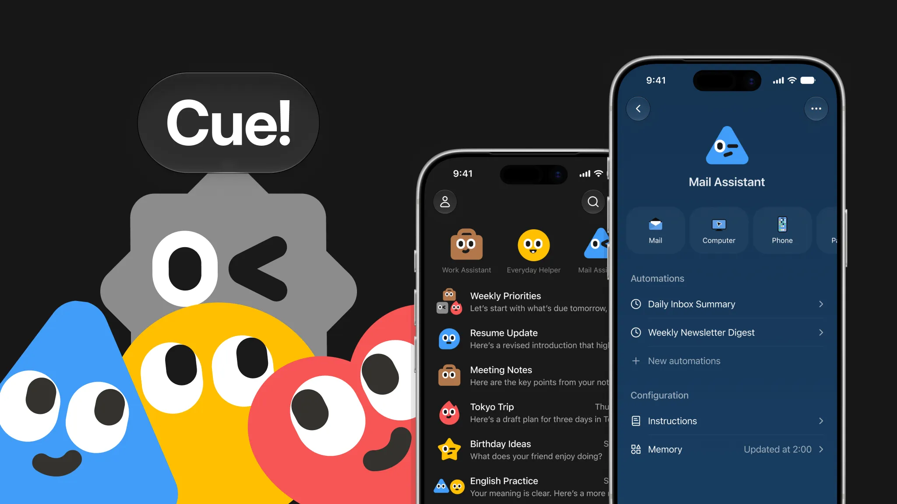

来源：https://manus.im/blog/introducing-manus-2-0
取文：2026-11-05，直接下载，取页面内嵌的 Markdown 原文；节选开头两段、第 3 节「Cue: A new app from Manus」和文末 Availability 中关于 Cue 的段落

Today, we are thrilled to introduce Manus 2.0.

[视频](https://d1oupeiobkpcny.cloudfront.net/assets/dashboard/materials/2026/09/28/9e16cfc6dbd4e33982113ccbb237cbdc67e723f6df1378a05701a95cf65ec5dc.mp4)

Manus 2.0 is not a version update. It's a new architecture, new products, and new capabilities built around a fundamental question: what should the next generation of Manus look like?

## 3. Cue: A new app from Manus

[Cue](https://cue.im/) is a new standalone app for your personal agents, on your phone and desktop, built on the same infrastructure as Manus. Give it a cue, and it gets to work.

**Every agent gets its own identity**

In Cue, each agent has its own email, phone number, wallet, and computer, so it can send messages, pay within the budget you set, and see a task through on its own machine. It can also take your calls and leave you a summary in Cue.

**Build a team**

Put several agents in a group chat with a shared goal, and they hand work to each other: one researches venues for your New York launch, another makes a shortlist, a third drafts the deck. You set the direction and make the final call.

**Everyday services, handled by agents**

Cue also works with the services around you. At a restaurant, scan the QR code and your agent can order for you or hold your place in line.

**Availability**

Cue is available on the [web](https://cue.im/), [desktop](https://cue.im/), and [mobile](https://cue-app.go.link/aLWQa), with iOS coming soon after App Store review.

Cue is in early access and free to use with an invite code. You can start with MEETCUE, available to a limited number of early users on a first-come, first-served basis. Everyone who gets access also receives extra invite codes to share.

