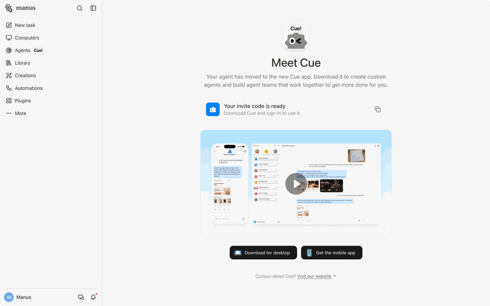



**收录说明**：Manus 帮助中心「Manus 2.0」分类下的总览文章，每个新功能各占一节。这里只收开头的总览列表和「What is Cue?」一节；未收 Cascade、Manus Studio、Video Editor、Game Dev、Cloud Computer、Remote Control、Computer Use、Automations 各节，也未收文末的相关问题列表。截图收入 images/。帮助中心专讲 Cue 的另有多消息平台连接一篇，会员定价、Skills、账号删除等通用文章中也各有 Cue 小节（不在分类列表里，按旧笔记 learning-ai-agent 的引用找到）。原文存于本目录的 original.md，网站上不显示，已翻译。

**内容摘要**：帮助中心把 Cue 定义为「供一支个人智能体团队使用的独立应用」，可以在手机和桌面上用。Cue 目前需要邀请码：在 Manus 侧边栏点击「Agents (Cue!)」标签，扫二维码下载应用，登录时输入邀请码，邀请码也可能通过邮件发来。每个智能体各有邮箱、电话号码、钱包和电脑。文中的团队示例是一个 Marketing 频道里有三个智能体，分别负责调研场地、整理候选清单、起草附推荐意见的演示稿，工作进行中会彼此交接；用户也可以只留一个个人助理，帮忙跑腿、提醒和调研。用户还可以在 Cue 里描述要做的事和时间，建立定时自动化（Scheduled Automation）。

**保留理由**：补充了发布文里没有的两点：现有 Manus 用户从侧边栏的「Agents (Cue!)」标签进入 Cue，以及 Cue 里可以建定时自动化。这是帮助中心对 Cue 的总体介绍。

---

Manus 2.0 是 Manus 的当前版本。它包含重建的内部系统、可直接处理你电脑上已有文件的桌面工作区，以及在你不在工位时让工作继续推进的新方式。

Manus 2.0 包括：

- **Cascade：** 重建的引擎，让你的整个项目保持连贯
- **Manus Studio：** 一个工作区，Manus 可在其中使用你电脑上已有的文件和工具
- **Video Editor：** 从简要需求到可继续剪辑的成片
- **Game Dev：** 从一个想法到一款你的朋友可以玩的游戏
- **Cloud Computer：** 为需要专用环境的项目提供的专属环境
- **Remote Control：** 用手机上的语音指令控制你的电脑
- **Automations：** 在信号发生时启动的工作
- **Cue：** 一支个人智能体团队，每个智能体都有自己的身份。

## Cue 是什么？

**Cue** 是一款供个人智能体团队使用的独立应用。你可以在手机和桌面上使用它。

Cue 目前需要邀请码。在 Manus 侧边栏点击 **Agents (Cue!)** 标签，然后扫描二维码下载应用。登录时输入邀请码。你也可能通过电子邮件收到一份邀请码。

每个智能体都有自己的身份：

- 自己的电子邮件
- 自己的电话号码
- 自己的钱包
- 自己的电脑

你可以组建团队。***例如，*** 一个 Marketing 频道可以有三个智能体：

- 一个负责调研场地
- 另一个把调研结果整理成候选清单
- 第三个起草一份附有推荐意见的演示文稿

随着工作推进，它们会彼此交接。你定方向，用手机查看进展，并做最终决定。你也可以只保留一个个人助理，负责跑腿、提醒和调研。

你还可以在 Cue 中描述你想完成什么、何时完成，从而创建一个定时自动化（Scheduled Automation）。
