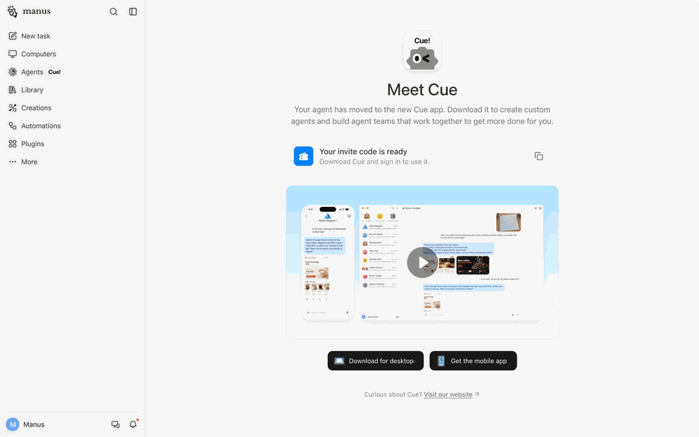

来源：https://help.manus.im/en/articles/17190150-what-is-new-in-manus-2-0
取文：2026-11-05，直接下载；节选开头的总览和「What is Cue?」一节

Manus 2.0 is the current version of Manus. It includes a rebuilt internal system, a desktop workspace that can work with files already on your computer, and new ways to keep work moving when you are not at your desk.

Manus 2.0 includes:

- **Cascade:** a rebuilt engine that keeps your whole project connected
- **Manus Studio:** a workspace where Manus works with the files and tools already on your computer
- **Video Editor:** from a brief to a cut you can keep editing
- **Game Dev:** from an idea to a game your friends can play
- **Cloud Computer:** a dedicated environment for projects that need one
- **Remote Control:** control your computer with a voice command from your phone
- **Automations:** work that starts when a signal happens
- **Cue:** a personal team of agents, each with an identity of its own.

## What is Cue?

**Cue** is a standalone app for a personal team of agents. You can use it on mobile and on desktop.

Cue currently requires an invitation code. Click the **Agents (Cue!)** tab in the Manus sidebar, then scan the QR code to download the app. Enter it when you sign in. You may also receive a copy of the code by email.

Each agent has its own identity:

- Its own email
- Its own phone number
- Its own wallet
- Its own computer

You can build a team. ***For example,*** a Marketing channel can have three agents:

- One researches venues
- Another turns the research into a shortlist
- A third drafts a deck with a recommendation

They pass work to each other as it develops. You set the direction, check in from your phone, and make the final call. You can also keep a single personal assistant for errands, reminders, and research.

You can also create a Scheduled Automation through Cue by describing what you want done and when.

