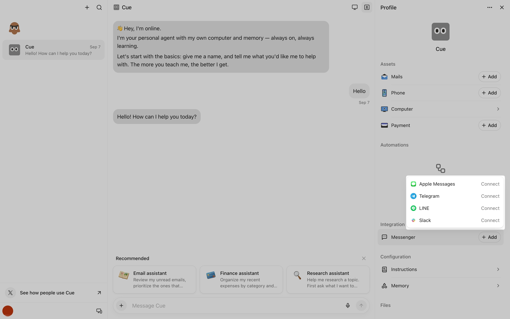



**收录说明**：直接下载，文末的相关问题列表与相关文章未收，截图收入 images/。这篇不在帮助中心的分类列表里，由旧笔记 learning-ai-agent 的 Cue 资料索引引用，2026-11-05 复核后收入。原文存于本目录的 original.md，网站上不显示，已翻译。

**内容摘要**：Cue 的同一个智能体可以连接多个消息平台，可以在平台之间切换，也可以同时启用几个平台。目前支持四种 Messenger 集成：iMessage、Telegram、LINE 和 Slack。连接的路径是在 Cue 中打开智能体，进入 Agent Info，在 Integration 下选 Messenger，点 Connect 按授权步骤完成。每个已连接的平台各有一个开关。登录失败多半与应用内浏览器有关，在受限的公司网络中可能需要改用移动数据完成首次 OAuth 登录。

**保留理由**：官方说明了 Cue 的智能体除了在应用里对话，还能通过 iMessage、Telegram、LINE、Slack 联系，并给出按智能体配置渠道的方式；发布文和其他帮助页都没有写。

---

可以。在 Cue 中，你可以把多个消息平台连接到同一个智能体。你可以在已连接的平台之间切换，也可以同时启用多个平台。

目前，Cue 支持四种 Messenger 集成：iMessage、Telegram、LINE 和 Slack。

## 如何连接多个消息平台

1. 在 Cue 中打开你的智能体，点击 **Agent Info**。
2. 在 **Integration** 下，点击 **Messenger**。

   
3. 点击 **Connect**，按授权步骤操作。
4. 对你想要连接的每个额外消息平台重复这些步骤。

## 如何在消息平台之间切换

前往 **Agent Info > Integration > Messenger**，使用每个已连接消息平台对应的开关将其打开或关闭。

要切换平台，关闭一个连接，再打开你偏好的连接。要同时使用多个平台，保持相关开关处于开启状态。

## 故障排查

如果你在登录过程中遇到问题，可能是应用内浏览器的限制所致。请确保网络连接稳定。如果页面无法加载，尝试关闭应用内浏览器，然后再次点击登录链接。

如果你处于受限的公司网络中，可能需要切换到移动数据，才能成功完成首次 OAuth 登录流程。
