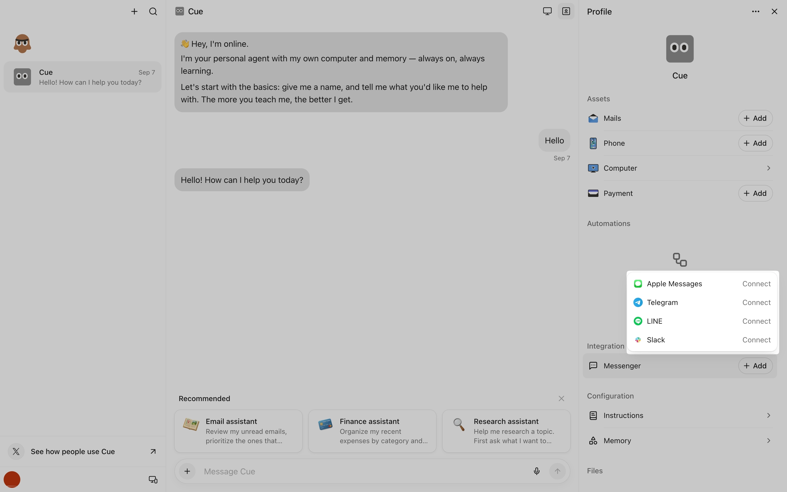

来源：https://help.manus.im/en/articles/14178640-can-i-connect-multiple-messaging-agents-at-once-in-cue
取文：2026-11-05，直接下载；文末相关问题列表与相关文章未取

Yes. In Cue, you can connect multiple messaging platforms to the same agent. You can switch between connected platforms or keep multiple platforms enabled at the same time.

Currently, Cue supports four Messenger integrations: iMessage, Telegram, LINE, and Slack.

## How to connect multiple messaging platforms

1. Open your agent in Cue and click **Agent Info**.
2. Under **Integration**, click **Messenger**.

   
3. Click **Connect** and follow the authorization steps.
4. Repeat these steps for each additional messaging platform you want to connect.

## How to switch between messaging platforms

Go to **Agent Info > Integration > Messenger** and use the toggle for each connected messaging platform to turn it on or off.

To switch platforms, turn off one connection and turn on your preferred connection. To use multiple platforms at the same time, leave the relevant toggles on.

## Troubleshooting

If you encounter issues during the login process, it may be due to the limitations of the in-app browser. Ensure that you have a stable internet connection. If the page fails to load, try closing the in-app browser and tapping the login link again.

If you are on a restricted corporate network, you may need to switch to mobile data to complete the initial OAuth login process successfully.

