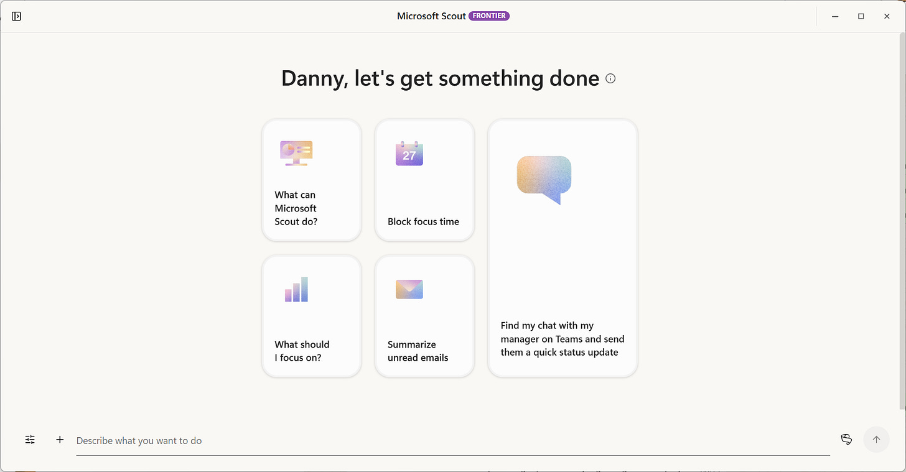
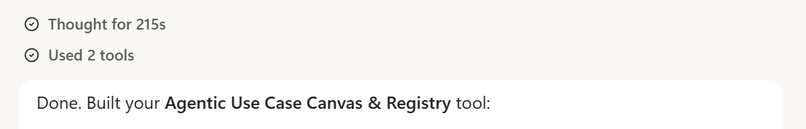
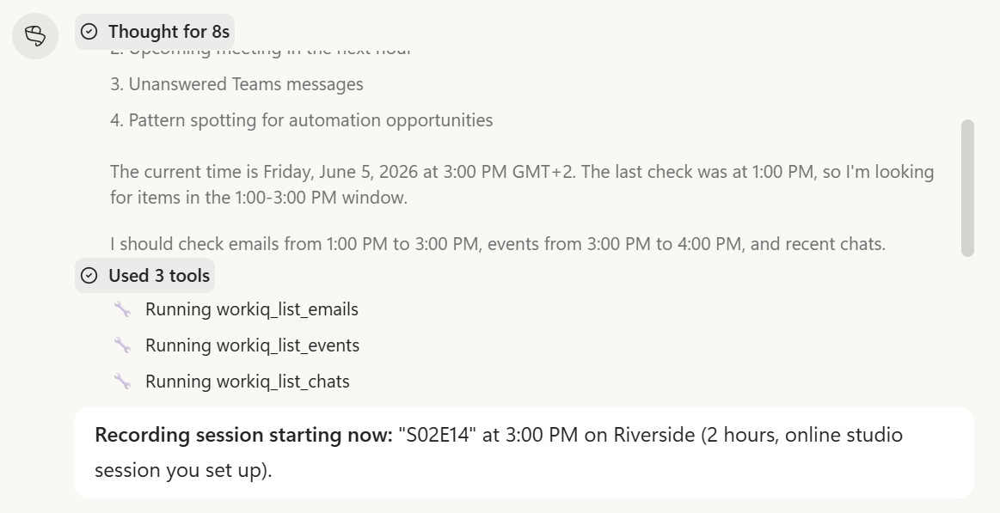
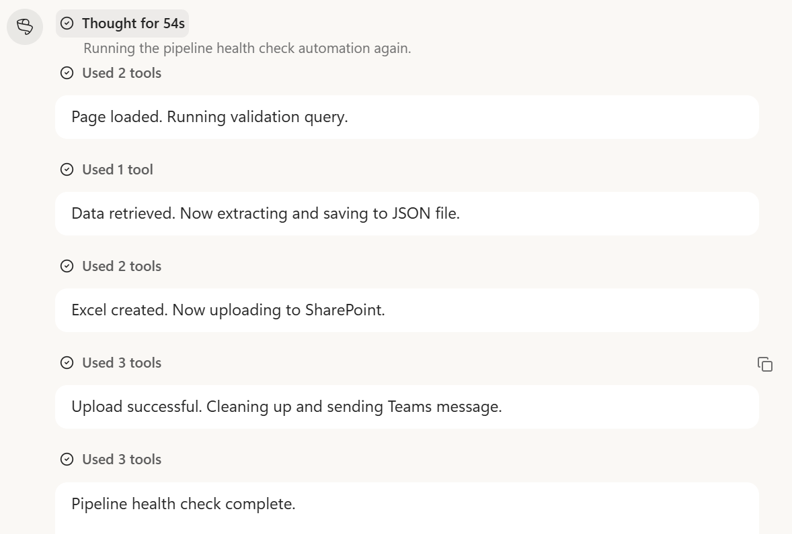
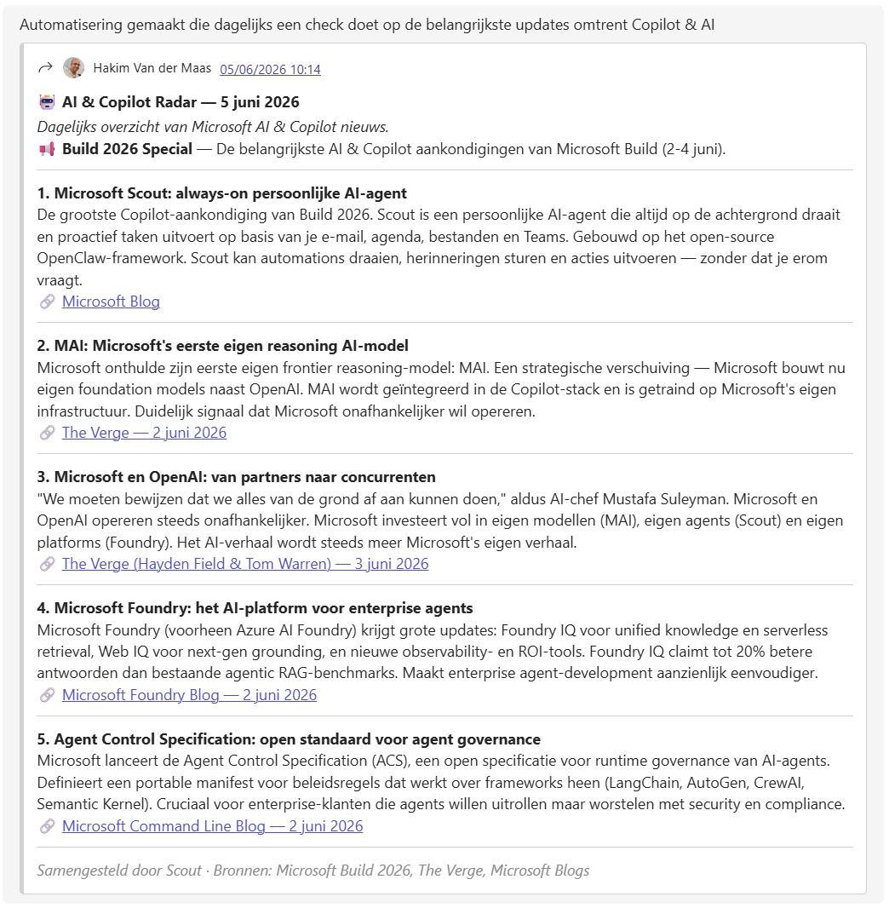
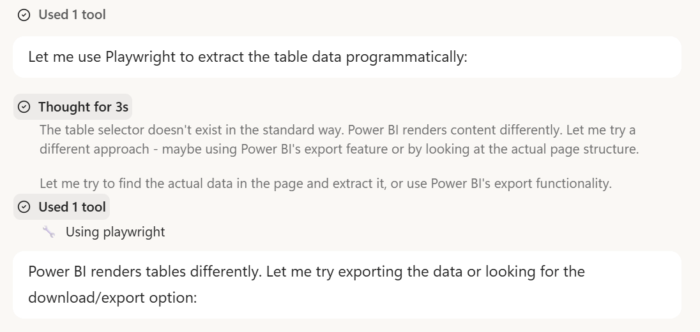



**收录说明**：个人 Newsletter，作者团队有 Frontier 访问权限，文中有上手使用的记录。直接下载；删去了作者头像与文末订阅提示，图片收入 images/。已翻译。

**内容摘要**：文章称 Scout 桌面应用为 0.22 版，用 57 天构建，已能读取 Teams 消息、打开浏览器、运行 Python 脚本、安排会议并把导出文件存入 SharePoint。它有三种交互模式：Chat、可定时执行的 Automations，以及集成 GitHub Copilot 的 Co-Create 工作区；作者团队的试用包括跨租户总结 Teams 对话并安排会议、自动完成 CRM 管道检查并导出到 SharePoint，以及在十分钟内生成每周 AI 新闻摘要，期间它自动发现并接入了某站点的 MCP 服务器。权限上默认每个重要操作前都要确认，可按类别设置长期授权，删除始终需要明确批准；支持 Claude Opus 和 Sonnet、最高到 5.4 的 GPT 变体与 Gemini 3.1 Pro，并有自动路由模式。文中也指出桌面版要求设备保持运行，云端版仍为有限访问，Copilot Chat 的记忆和自动化在重装后不保留，公开定价尚未公布。

**保留理由**：这是发布后数日内的实际使用报告，包含多租户、CRM、新闻摘要三个具体用例，以及版本号、权限模型、支持的模型和当时的缺口，实测细节比官方材料多。

---

Microsoft Scout 不只是另一个 AI 助手

### 它用 57 天在开源基础上构建，悄然重新定义了工作中的个人智能体能实际做到什么。

本周，有些东西发生了变化。不是 AI 工具通常那种渐进式的改进，而是那种让你真的很难再专注于其他事情的变化。[Microsoft Scout](https://www.microsoft.com/en-us/microsoft-365/blog/2026/06/02/introducing-microsoft-scout-your-always-on-personal-agent/?msockid=2496e605a9a4636d3a78f15aa83062b7) 在 Microsoft Build 上发布，并且已向 frontier 客户提供。它能读取你的 Teams 消息、打开你的浏览器、运行 Python 脚本、安排会议，并把导出文件存入 SharePoint，而这一切都无需你交代两次。听起来像产品路线图幻灯片。但事实并非如此。它是 0.22 版，用 57 天构建，而且已经能工作。这种组合比听起来更难被轻视。

[更喜欢用荷兰语阅读本文？](https://copilotatwork.substack.com/p/microsoft-scout-is-niet-zomaar-een)

## 从自动化承诺到真正的自动化

要理解 Scout 为何给人不同的感受，不妨了解它的来历。底层技术是 OpenClaw，一个由 Peter Steinberger 创建的开源计算机使用框架。2025 年 11 月，[OpenClaw](https://en.wikipedia.org/wiki/OpenClaw) 作为基于 AI 的虚拟助手获得广泛认可，成为跨受支持服务执行自主工作流的智能体接口。对许多观察者来说，那是 AI 不再只是文档摘要器、而开始成为能在世界上行动的事物的时刻。

Microsoft 并不只是采纳了这个概念。Scout 团队向 OpenClaw 仓库回馈了加固和修复，这是一种深思熟虑的举动，表明对开源生态的长期承诺，而非一次性的索取。在内部，该项目被称为 Project Lobster。最终以 Microsoft Scout 发布的产品，用 Microsoft 自己的描述，是「一个用于工作的新个人智能体，基于 OpenClaw 和 WorkIQ 构建，理解你的工作方式，使用你已经在用的工具，比如 Teams 和 Outlook，并主动处理会议准备、日程安排、冲突和日常任务，而无需询问。」

「无需询问」这句话分量很重。前几代 AI 助手是反应式的；它们在被提示时才回答。Scout 被设计为主动的，这是一种架构上的转变，而不是换了个品牌名称。桌面应用以 0.22 版发布。它值得注意的地方不在于其完整性，而在于那个版本号与它已经交付的体验质量之间的差距。

## 它能做什么，以及如何做到

Scout 提供三种不同的交互模式。Chat 的运作方式就像一个具备完整 Microsoft 365 上下文的强大 AI 助手。Automations 允许将重复性任务定义一次并按计划执行。Co-Create 是一个用于构建和迭代产物的协作空间，从演示文稿到代码，并原生集成 GitHub Copilot。这种集成不是表面功夫：当 Scout 缺少完成某项任务的能力时，它可以编写自己所需的工具。这就是 OpenClaw 原则在企业环境中的应用。

例如用 Python 或 HTML 构建工具。完全不是问题。

访问开放最初几天出现的用例很有启发性。Robbert 让 Scout 跨多个租户总结 Teams 对话，找出待办事项，并处理线程中埋藏的一个会议请求。Scout 读取了相关消息，检查了双方的日历空闲时间，安排了预约，并发送了 Teams 确认。初始指令之后无需任何手动步骤。

我们的一个自动化：每天四次，Scout 检查是否还有需要关注的事情。

在第二个案例中，CRM 管道卫生（pipeline hygiene）此前需要 Danny 先手动导出，再在另一个工具中分析，现在变成了完全自动化的工作流。Scout 打开浏览器，导航到相应的 CRM 视图，使用 JavaScript 检查商机记录，将摘要文件导出到 SharePoint 存档，并发送一条结构化的 Teams 消息，指出哪些条目不符合规范。此前需要在中间进行若干手动步骤的工作，现在可以无中断地端到端运行。

第三个例子同样说明问题。Hakim 需要一份来自 Microsoft 官方来源、技术出版物和 LinkedIn 的 Copilot 与 AI 新闻每周摘要。Scout 在十分钟内组装了第一期。当它遇到一个无法直接抓取的网站时，它发现该网站暴露了一个 MCP 服务器端点，自主连接上去，并将其注册为定期来源。一项在待办列表中搁置了数周的任务，在半小时内得到解决。

权限模型值得关注。默认情况下，Scout 在每次重要操作前都会请求确认。用户可以按类别授予长期权限：文件读写可以预先批准，而删除始终需要明确批准。在实践中，信任逐步建立，高风险操作始终受到限制。Scout 还支持多种 AI 模型，包括 Claude Opus 和 Sonnet、最高到 5.4 版的 GPT 变体以及 Gemini 3.1 Pro，并提供自动路由模式，为每次查询选择最合适的模型。整个过程中都遵守 Microsoft Purview 敏感度标签，因此标记为机密的文件在工作流的每一步都会得到相应处理。

## 当助手开始行动时，会发生什么变化

最直接的影响是，熟练知识工作的实际样貌被重新定义。此前需要手动协调、切换工具和定期人工判断的任务，现在可以通过指令执行。这并不会消除对专业能力的需求；而是将其转移。价值从执行转向问题界定、验证，以及决定一开始要委托什么。

Scout 会自己想办法达到期望的结果

第二个影响是关于信任校准。当浏览器打开、光标自主地在屏幕上移动的那一刻，人们对工具的感受就变了。它以文本回答永远无法做到的方式变得可触可感。这种转变需要有意识的治理：清晰的权限边界、关于 Scout 被授权代表用户做什么的组织政策，以及对后果重大的操作保留某种形式的审计轨迹。那些把这当作未来问题的组织，其实已经落后了。

第三，当前桌面版与即将推出的云端版之间的区别，对企业规划很重要。桌面应用要求机器保持运行；设备休眠时自动化会暂停。云端版在撰写时仍处于有限访问阶段，它完全自主运行，不依赖设备。对于考虑大规模部署的团队，这一差异会影响架构、许可策略以及可委托范围的现实边界。

开发时间线本身也传递出更广泛的信号。从概念到稳定可用的产品只用了 57 天，这代表构建周期的压缩，很难与传统软件交付时间线相协调。这表明 AI 辅助开发已经在加速 AI 工具的生产，这种递归动态具有复合效应，从业者应将其纳入规划视野。

## 接下来值得关注什么

Microsoft Scout 桌面应用是 0.22 版。能力是真实的，缺口也是真实的。来自 Copilot Chat 的记忆和自动化在重装后尚不能保留。个性设置允许 Scout 以从专业到「勉强愿意帮忙」的语气回应，但尚不能同步到持久配置文件。这些都是可解决的问题，而迄今为止的开发速度表明它们会很快得到处理。

值得关注的决策：撰写时尚未公布公开定价；Scout 作为 autopilot 模式集成到更广泛的 Copilot 界面已确认，但尚未广泛提供；云端版仍处于有限访问。对于开始评估采用的组织，治理问题是现在应优先考虑的问题。能力已经领先于大多数内部政策。界定 Scout 被允许做什么、代表谁做、在什么监督下做，不是未来的问题。它是当前的问题。
