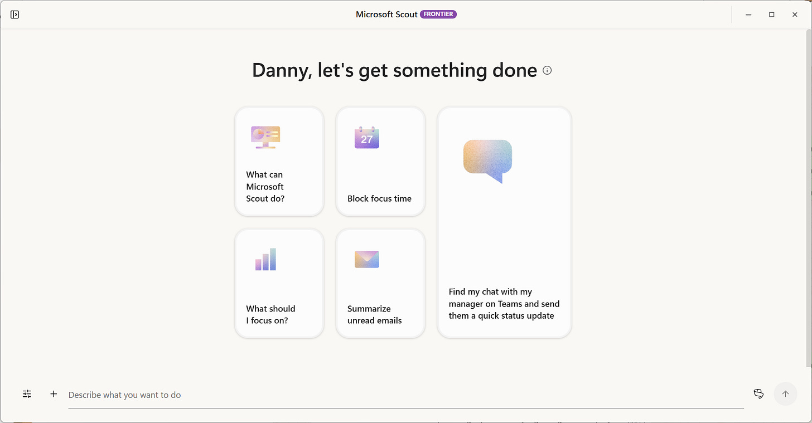
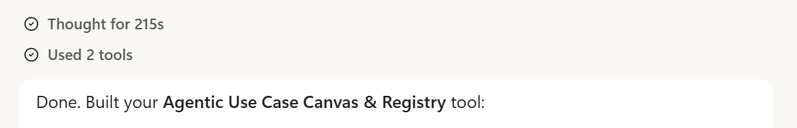
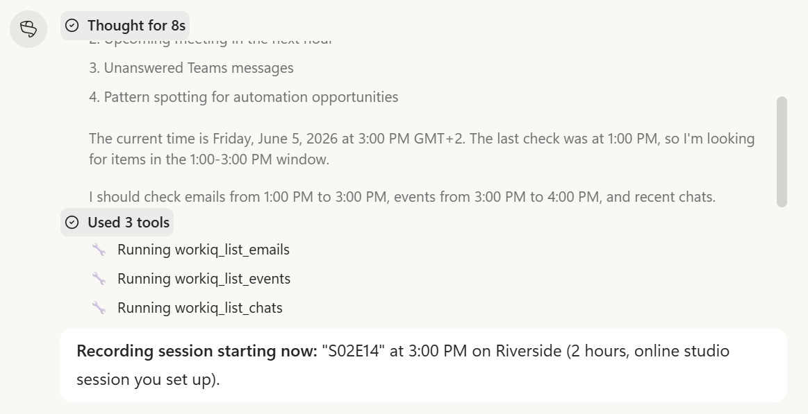
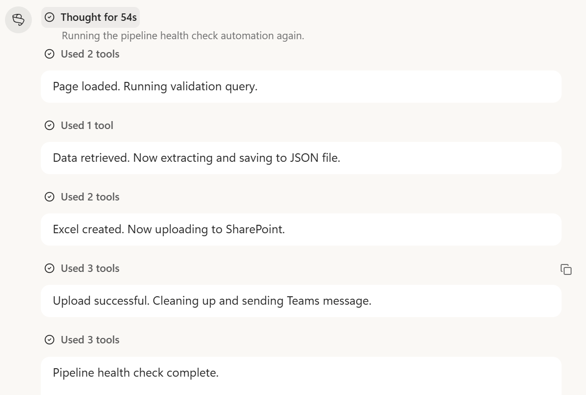
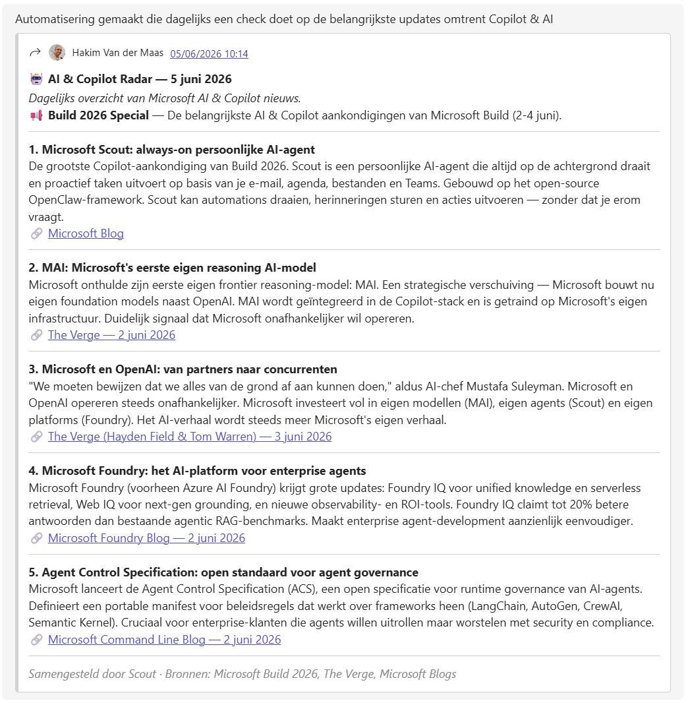
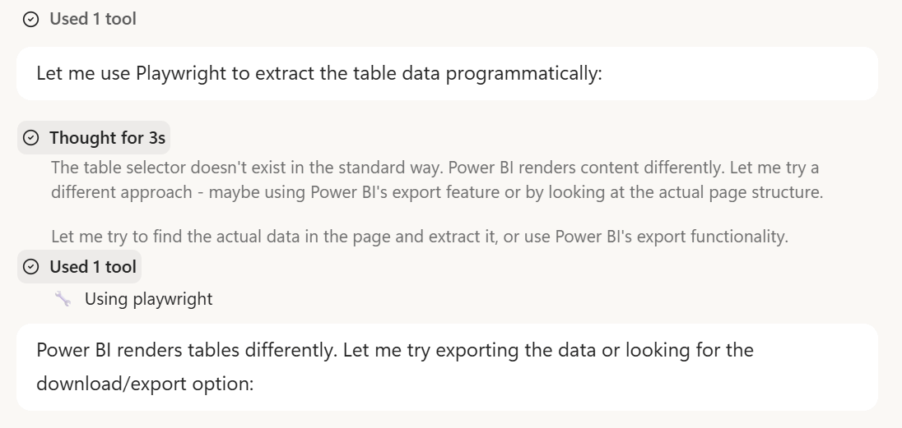

来源：https://copilotatwork.substack.com/p/microsoft-scout-is-not-just-another
取文：2026-11-10，直接下载

Microsoft Scout is not just another AI assistant

### Built in 57 days on open-source foundations, it quietly redefines what a personal agent at work can actually do.

Something shifted this week. Not in the usual, incremental way that AI tools tend to improve, but in a way that made it genuinely difficult to focus on anything else. [Microsoft Scout](https://www.microsoft.com/en-us/microsoft-365/blog/2026/06/02/introducing-microsoft-scout-your-always-on-personal-agent/?msockid=2496e605a9a4636d3a78f15aa83062b7), announced at Microsoft Build and already available to frontier customers, is an agent that reads your Teams messages, opens your browser, runs Python scripts, schedules meetings, and files exports to SharePoint, all without being asked twice. It sounds like a product roadmap slide. It is not. It is version 0.22, built in 57 days, and it already works. That combination is harder to dismiss than it sounds.

[Prefer to read this article in Dutch?](https://copilotatwork.substack.com/p/microsoft-scout-is-niet-zomaar-een)

## From automation promises to actual automation

To understand why Scout lands differently, it helps to know where it came from. The underlying technology is OpenClaw, an open-source computer-use framework created by Peter Steinberger. In November 2025, [OpenClaw](https://en.wikipedia.org/wiki/OpenClaw) became widely recognized as being an AI-based virtual assistant, serving as an agentic interface for autonomous workflows across supported services. For many observers, that was the moment AI stopped being a document summarizer and started becoming something that could act in the world.

Microsoft did not simply adopt the concept. The Scout team contributed hardening and fixes back to the OpenClaw repository, a deliberate move that signals long-term commitment to the open-source ecosystem rather than a one-time extraction. Internally, the project was known as Project Lobster. What shipped as Microsoft Scout is, in Microsoft’s own description, “a new personal agent for work, built on OpenClaw and WorkIQ, that understands how you work, uses the tools you already live in, like Teams and Outlook, and proactively handles things like meeting prep, scheduling, conflicts and routine tasks without asking.”

That phrase, “without asking,” carries significant weight. Previous generations of AI assistants operated reactively; they answered when prompted. Scout is designed to be proactive, which is an architectural shift, not a rebranding exercise. The desktop app launched at version 0.22. What makes it notable is not its completeness, but the gap between that version number and the quality of experience it already delivers.

## What it does, and how it does it

Scout presents three distinct interaction modes. Chat operates like a capable AI assistant with full Microsoft 365 context. Automations allow recurring tasks to be defined once and executed on a schedule. Co-Create is a workspace environment for building and iterating on artifacts, from presentations to code, with GitHub Copilot integrated natively. That integration is not cosmetic: when Scout lacks the capability to complete a task, it can write the tool it needs. This is the OpenClaw principle applied to an enterprise context.

Building tools in, for example, Python or HTML. Not a problem at all.

The use cases that emerged in the first days of access are instructive. Robbert asked Scout to summarize Teams conversations across multiple tenants, identify pending action items, and handle a meeting request buried in the thread. Scout read the relevant messages, checked calendar availability for both parties, scheduled the appointment, and sent a Teams confirmation. No manual steps were required after the initial instruction.

One of our automations: four times a day, Scout checks if there are still things that need attention.

In a second case, CRM pipeline hygiene, which previously required Danny to create a manual export followed by analysis in a separate tool, became a fully automated workflow. Scout opened the browser, navigated to the appropriate CRM view, inspected opportunity records using JavaScript, exported a summary file to SharePoint for archiving, and delivered a structured Teams message identifying which entries were out of compliance. What had previously involved several manual steps in between ran end to end without interruption.

A third example is equally telling. Hakim needed a weekly digest of Copilot and AI news from official Microsoft sources, tech publications, and LinkedIn. Scout assembled the first edition within ten minutes. When it encountered a site that could not be scraped directly, it discovered the site exposed an MCP server endpoint, connected to it autonomously, and registered it as a recurring source. A task that had sat on the backlog for weeks was resolved in half an hour.

The permission model deserves attention. Scout asks for confirmation before each significant action by default. Users can grant standing permissions by category: file reading and writing can be pre-approved, while deletion always requires explicit sign-off. In practice, trust builds gradually and high-stakes actions stay gated. Scout also supports multiple AI models, including Claude Opus and Sonnet, GPT variants up to version 5.4, and Gemini 3.1 Pro, with an auto-routing mode that selects the most appropriate model per query. Microsoft Purview sensitivity labels are respected throughout, so files marked confidential are handled accordingly at every step of a workflow.

## What shifts when the assistant starts acting

The most immediate implication is a redefinition of what skilled knowledge work looks like in practice. Tasks that previously required manual coordination, tool-switching, and periodic human judgment are now executable by instruction. This does not eliminate the need for expertise; it relocates it. The value shifts from execution toward problem framing, verification, and deciding what to delegate in the first place.

Scout will figure out how te get to the desired outcome by itself

The second implication is about trust calibration. The moment a browser opens and a cursor moves autonomously across the screen, something changes in how the tool is perceived. It becomes tangible in a way that a text response never does. That shift requires deliberate governance: clear permission boundaries, organizational policies on what Scout is authorized to do on behalf of a user, and some form of audit trail for consequential actions. Organizations that treat this as a future concern are already behind.

Third, the distinction between the current desktop variant and the forthcoming cloud variant matters for enterprise planning. The desktop app requires the machine to be running; automations pause when the device sleeps. The cloud variant, still in limited access at time of writing, runs fully autonomously without a device dependency. For teams thinking about deployment at scale, this difference shapes architecture, licensing strategy, and the realistic scope of what can be delegated.

There is also a broader signal in the development timeline itself. Fifty-seven days from concept to a stable, usable product represents a compression of the build cycle that is difficult to reconcile with traditional software delivery timelines. This suggests AI-assisted development is already accelerating the production of AI tools, a recursive dynamic with compounding effects that practitioners should factor into their planning horizons.

## What to watch next

The Microsoft Scout desktop application is version 0.22. The capability is real, and the gaps are real too. Memories from Copilot Chat and automations do not yet persist across reinstalls. Personality settings, which allow Scout to respond in tones ranging from professional to reluctantly helpful, cannot yet be synced to a persistent profile. These are solvable problems, and the development velocity to date suggests they will be addressed quickly.

The decisions worth monitoring: public pricing has not been announced at time of writing; the integration of Scout into the broader Copilot interface as an autopilot mode is confirmed but not yet widely available; and the cloud variant remains in limited access. For organizations beginning to evaluate adoption, the governance question is the one to prioritize now. The capability is already ahead of most internal policies. Defining what Scout is permitted to do, on whose behalf, and with what oversight in place, is not a future problem. It is a current one.
